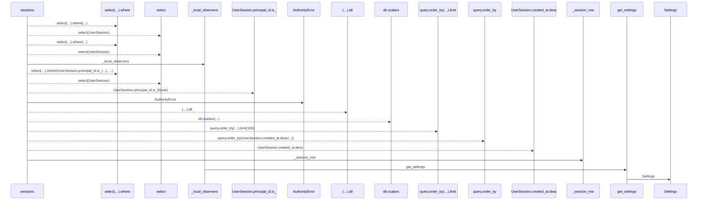
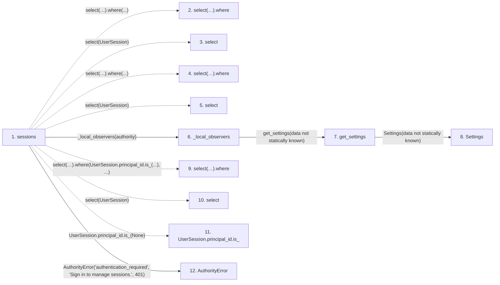

# sessions

**Entry point:** `sessions` (`http`)
**Source:** [routers_identity](../modules/routers_identity.md)
**Modules touched:** [authority](../modules/authority.md), [config](../modules/config.md), [routers_identity](../modules/routers_identity.md)

## Call sequence

> Static overview in presentation order, not runtime execution order. Arrows retain captured callers; representative internal continuations and boundary examples precede repeated helper detail.

<!-- Auto-generated from static call edges. Dashed arrows are external or unresolved calls. Reviewed runtime conditions and side effects belong in Behavior. -->

> Call sequence diagram shows 17 of 17 interactions; 0 omitted to keep the visualization within the 30-interaction and generated-diagram limits, with uncertain identities omitted rather than inferred.

> Captured boundary calls: external 3 of 3 (0 omitted); unresolved 9 of 9 (0 omitted). These counts cover the captured static trace.
> Detailed flow queries retain their own coverage and limits; omitted paths may execute at runtime.

## Data flow

<!-- Auto-generated static analysis. Treat values and boundaries as best-effort hints, not runtime proof. -->

### Analysis coverage

**Effect analysis partially available.** Flow assembly and source effect analysis are separate; empty observations do not prove an empty handler body.

Source steps: 6; effect analysis evaluated: 4, partial: 0, unavailable: 2. Counts include steps omitted from the displayed trace.

Collector observations for 4 source steps with known totals: observed: 11, emitted: 11, omitted: 0. Unavailable totals are excluded.

- Callable record unavailable for one or more source steps; those steps have no represented callable body.
- Effect collector totals unavailable; observed counts cover captured records only.

| Step | Callable record | Effect analysis | Collector totals | Observed | Emitted | Omitted |
|---|---|---|---|---:|---:|---:|
| `sessions` | `available` | `evaluated` | `available` | `5` | `5` | `0` |
| `select(…).where` | `not_applicable` | `not_applicable` | `not_applicable` | — | — | — |
| `select` | `not_applicable` | `not_applicable` | `not_applicable` | — | — | — |
| `select(…).where` | `not_applicable` | `not_applicable` | `not_applicable` | — | — | — |
| `select` | `not_applicable` | `not_applicable` | `not_applicable` | — | — | — |
| `_local_observers` | `available` | `evaluated` | `available` | `2` | `2` | `0` |
| `get_settings` | `available` | `evaluated` | `available` | `1` | `1` | `0` |
| `Settings` | `unavailable` | `unavailable` | `unavailable` | — | — | — |
| `select(…).where` | `not_applicable` | `not_applicable` | `not_applicable` | — | — | — |
| `select` | `not_applicable` | `not_applicable` | `not_applicable` | — | — | — |
| `UserSession.principal_id.is_` | `not_applicable` | `not_applicable` | `not_applicable` | — | — | — |
| `AuthorityError` | `unavailable` | `unavailable` | `unavailable` | — | — | — |

### Step data

| Step | Inputs | Reads | Writes | Returns |
|---|---|---|---|---|
| `sessions` | `db: Database` | `UserSession`, `UserSession`, `UserSession` | - | `...` |
| `select(…).where` | - | - | - | - |
| `select` | - | - | - | - |
| `select(…).where` | - | - | - | - |
| `select` | - | - | - | - |
| `_local_observers` | `authority` | - | - | `...` |
| `get_settings` | - | - | - | `Settings(...)` |
| `Settings` | - | - | - | - |
| `select(…).where` | - | - | - | - |
| `select` | - | - | - | - |
| `UserSession.principal_id.is_` | - | - | - | - |
| `AuthorityError` | - | - | - | - |

### Call data

| From | To | Line | Call |
|---|---|---:|---|
| sessions | select(…).where | 396 | `select(UserSession).where(...)` |
| sessions | select | 396 | `select(UserSession)` |
| sessions | select(…).where | 398 | `select(UserSession).where(...)` |
| sessions | select | 398 | `select(UserSession)` |
| sessions | _local_observers | 399 | `_local_observers(authority)` |
| _local_observers | get_settings | 388 | `get_settings(data not statically known)` |
| get_settings | Settings | 524 | `Settings(data not statically known)` |
| sessions | select(…).where | 400 | `select(UserSession).where(UserSession.principal_id.is_(...), ...)` |
| sessions | select | 400 | `select(UserSession)` |
| sessions | UserSession.principal_id.is_ | 400 | `UserSession.principal_id.is_(None)` |
| sessions | AuthorityError | 402 | `AuthorityError('authentication_required', 'Sign in to manage sessions.', 401)` |

### Boundary effects

*No boundary-effect observations were captured in this static trace.*

### Static analysis gaps

| Kind | Step | Target | Line |
|---|---|---|---:|
| unresolved_call | `sessions` | `select(UserSession).where` | 396 |
| external_call | `sessions` | `select` | 396 |
| unresolved_call | `sessions` | `select(UserSession).where` | 398 |
| external_call | `sessions` | `select` | 398 |
| unresolved_call | `sessions` | `select(UserSession).where` | 400 |
| external_call | `sessions` | `select` | 400 |
| unresolved_call | `sessions` | `UserSession.principal_id.is_` | 400 |
| step_limit | `sessions` | `first 12 steps` | 0 |

## Behavior

Lists sessions with their access level and client label. A signed-in account sees its own sessions, an observer sees only itself, and a trusted-local browser without a person sees the observers paired without a person. Anyone else must sign in.
