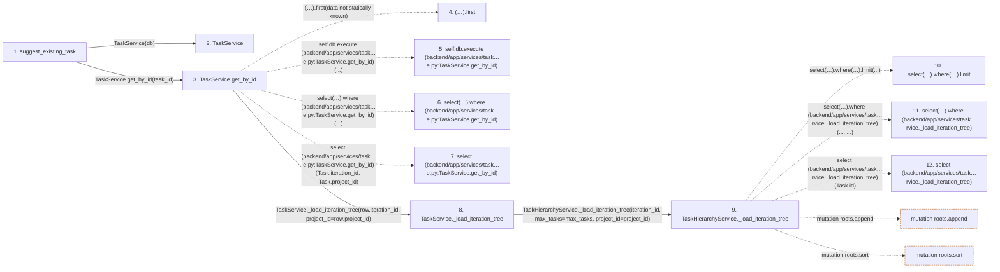

# suggest_existing_task

**Entry point:** `suggest_existing_task` (`http`)
**Source:** [routers_llm](../modules/routers_llm.md)
**Modules touched:** [query_limits](../modules/query_limits.md), [routers_llm](../modules/routers_llm.md), [task_hierarchy_service](../modules/task_hierarchy_service.md), [task_service](../modules/task_service.md)

## Call sequence

> Static overview in presentation order, not runtime execution order. Arrows retain captured callers; representative internal continuations and boundary examples precede repeated helper detail.

```mermaid
sequenceDiagram
    participant p0 as suggest_existing_task
    participant p1 as TaskService.get_by_id
    participant p2 as TaskService
    participant p3 as _task_ai_context_pack
    participant p4 as TaskService._load_iteration_tree
    participant p5 as TaskHierarchyService._load_iteration_tree
    participant p6 as TaskHierarchyService
    participant p7 as CollectionLimitExceededError
    participant p8 as TaskHierarchyService._task_graph_query
    participant p9 as HTTPException
    participant p10 as db.rollback
    participant p11 as llm_service.suggest_task
    participant p12 as (…).first
    participant p13 as data.model_dump
    participant p14 as self.db.execute (backend/app/services/task…e.py:TaskService.get_by_id)
    participant p15 as context.update
    participant p16 as select(…).where (backend/app/services/task…e.py:TaskService.get_by_id)
    participant p17 as db.get
    participant p18 as select (backend/app/services/task…e.py:TaskService.get_by_id)
    participant p19 as tasks_by_id.get
    participant p20 as db.execute
    participant p21 as select(…).where (backend/app/routers/llm.py:_task_ai_context_pack)
    participant p22 as select (backend/app/routers/llm.py:_task_ai_context_pack)
    participant p23 as Task.id.in_
    participant p24 as result.scalars().all (backend/app/routers/llm.py:_task_ai_context_pack)
    participant p25 as result.scalars (backend/app/routers/llm.py:_task_ai_context_pack)
    participant p26 as select(…).where(…).limit
    participant p27 as select(…).where (backend/app/services/task…rvice._load_iteration_tree)
    participant p28 as select (backend/app/services/task…rvice._load_iteration_tree)
    p0->>p1: TaskService.get_by_id
    p0->>p2: TaskService
    p0->>p3: _task_ai_context_pack
    p1->>p4: TaskService._load_iteration_tree
    p4->>p5: TaskHierarchyService._load_iteration_tree
    p4->>p6: TaskHierarchyService
    p5->>p7: CollectionLimitExceededError
    p5->>p8: TaskHierarchyService._task_graph_query
    p0-->>p9: HTTPException(status_code=status.HTTP_404_NOT_FOUND, detail=...)
    p0-->>p10: db.rollback
    p0-->>p11: llm_service.suggest_task(context_pack)
    p1-->>p12: (…).first
    p3-->>p13: data.model_dump
    p1-->>p14: self.db.execute (backend/app/services/task…e.py:TaskService.get_by_id)(...)
    p3-->>p15: context.update({...})
    p1-->>p16: select(…).where (backend/app/services/task…e.py:TaskService.get_by_id)(...)
    p3-->>p17: db.get(Project, project_id)
    p1-->>p18: select (backend/app/services/task…e.py:TaskService.get_by_id)(Task.iteration_id, Task.project_id)
    p3-->>p17: db.get(ProjectMilestone, milestone_id)
    p3-->>p17: db.get(WorkTemplate, data.template_id)
    p1-->>p19: tasks_by_id.get(task_id)
    p3-->>p20: db.execute(...)
    p3-->>p21: select(…).where (backend/app/routers/llm.py:_task_ai_context_pack)(Task.id.in_(...))
    p3-->>p22: select (backend/app/routers/llm.py:_task_ai_context_pack)(Task)
    p3-->>p23: Task.id.in_(dependency_ids)
    p3-->>p24: result.scalars().all (backend/app/routers/llm.py:_task_ai_context_pack)
    p3-->>p25: result.scalars (backend/app/routers/llm.py:_task_ai_context_pack)
    p5-->>p26: select(…).where(…).limit(...)
    p5-->>p27: select(…).where (backend/app/services/task…rvice._load_iteration_tree)(..., ...)
    p5-->>p28: select (backend/app/services/task…rvice._load_iteration_tree)(Task.id)
```

<!-- Auto-generated from static call edges. Dashed arrows are external or unresolved calls. Reviewed runtime conditions and side effects belong in Behavior. -->

> Call sequence diagram shows 30 of 73 interactions; 43 omitted to keep the visualization within the 30-interaction and generated-diagram limits, with uncertain identities omitted rather than inferred.

> Captured boundary calls: external 4 of 22 (18 omitted); unresolved 18 of 42 (24 omitted). These counts cover the captured static trace.

Omitted captured detail, grouped by actual caller occurrence and target module:

| Caller | Parent step | Target module | Kind | Omitted interactions |
| --- | --- | --- | --- | --- |
| `backend/app/services/task_hierarchy_service.py:TaskHierarchyService._load_iteration_tree` | 9 | - | external | 10 |
| `backend/app/services/task_hierarchy_service.py:TaskHierarchyService._load_iteration_tree` | 9 | - | unresolved | 18 |
| `backend/app/services/task_hierarchy_service.py:TaskHierarchyService._task_graph_query` | 19 | - | unresolved | 6 |
| `backend/app/services/task_hierarchy_service.py:TaskHierarchyService._task_graph_query` | 19 | - | external | 8 |
| `backend/app/services/task_hierarchy_service.py:TaskHierarchyService._load_iteration_tree` | 9 | [backend/app/query_limits.py](../modules/query_limits.md) | internal | 1 |
> Detailed flow queries retain their own coverage and limits; omitted paths may execute at runtime.

## Data flow

<!-- Auto-generated static analysis. Treat values and boundaries as best-effort hints, not runtime proof. -->

### Analysis coverage

**Effect analysis partially available.** Flow assembly and source effect analysis are separate; empty observations do not prove an empty handler body.

Source steps: 10; effect analysis evaluated: 6, partial: 0, unavailable: 4. Counts include steps omitted from the displayed trace.

Collector observations for 6 source steps with known totals: observed: 36, emitted: 36, omitted: 0. Unavailable totals are excluded.

- Callable record unavailable for one or more source steps; those steps have no represented callable body.
- Effect collector totals unavailable; observed counts cover captured records only.

| Step | Callable record | Effect analysis | Collector totals | Observed | Emitted | Omitted |
|---|---|---|---|---:|---:|---:|
| `suggest_existing_task` | `available` | `evaluated` | `available` | `6` | `6` | `0` |
| `TaskService` | `unavailable` | `unavailable` | `unavailable` | — | — | — |
| `TaskService.get_by_id` | `available` | `evaluated` | `available` | `3` | `3` | `0` |
| `(…).first` | `not_applicable` | `not_applicable` | `not_applicable` | — | — | — |
| `self.db.execute (backend/app/services/task…e.py:TaskService.get_by_id)` | `not_applicable` | `not_applicable` | `not_applicable` | — | — | — |
| `select(…).where (backend/app/services/task…e.py:TaskService.get_by_id)` | `not_applicable` | `not_applicable` | `not_applicable` | — | — | — |
| `select (backend/app/services/task…e.py:TaskService.get_by_id)` | `not_applicable` | `not_applicable` | `not_applicable` | — | — | — |
| `TaskService._load_iteration_tree` | `available` | `evaluated` | `available` | `4` | `4` | `0` |
| `TaskHierarchyService._load_iteration_tree` | `available` | `evaluated` | `available` | `7` | `7` | `0` |
| `select(…).where(…).limit` | `not_applicable` | `not_applicable` | `not_applicable` | — | — | — |
| `select(…).where (backend/app/services/task…rvice._load_iteration_tree)` | `not_applicable` | `not_applicable` | `not_applicable` | — | — | — |
| `select (backend/app/services/task…rvice._load_iteration_tree)` | `not_applicable` | `not_applicable` | `not_applicable` | — | — | — |

### Step data

| Step | Inputs | Reads | Writes | Returns |
|---|---|---|---|---|
| `suggest_existing_task` | `task_id: int`, `data: TaskAISuggestRequest`, `db: Annotated[AsyncSession, Depends(get_db, scope='function')]`, `llm_service: Annotated[LLMService, Depends(get_llm_service)]` | `status` | - | `...` |
| `TaskService` | - | - | - | - |
| `TaskService.get_by_id` | `task_id: int` | - | - | `None`, `tasks_by_id.get(...)` |
| `(…).first` | - | - | - | - |
| `self.db.execute (backend/app/services/task…e.py:TaskService.get_by_id)` | - | - | - | - |
| `select(…).where (backend/app/services/task…e.py:TaskService.get_by_id)` | - | - | - | - |
| `select (backend/app/services/task…e.py:TaskService.get_by_id)` | - | - | - | - |
| `TaskService._load_iteration_tree` | `iteration_id: int`, `max_tasks: int`, `project_id: int \| None` | - | - | `...` |
| `TaskHierarchyService._load_iteration_tree` | `iteration_id: int`, `max_tasks: int`, `project_id: int \| None` | `TaskDependency` | - | `(...)` |
| `select(…).where(…).limit` | - | - | - | - |
| `select(…).where (backend/app/services/task…rvice._load_iteration_tree)` | - | - | - | - |
| `select (backend/app/services/task…rvice._load_iteration_tree)` | - | - | - | - |

### Call data

| From | To | Line | Call |
|---|---|---:|---|
| suggest_existing_task | TaskService | 230 | `TaskService(db)` |
| suggest_existing_task | TaskService.get_by_id | 231 | `task_service.get_by_id(task_id)` |
| TaskService.get_by_id | (…).first | 556 | `(await self.db.execute(select(Task.iteration_id, Task.project_id).where(Task.id == task_id))).first(data not statically known)` |
| TaskService.get_by_id | self.db.execute (backend/app/services/task…e.py:TaskService.get_by_id) | 556 | `self.db.execute(...)` |
| TaskService.get_by_id | select(…).where (backend/app/services/task…e.py:TaskService.get_by_id) | 556 | `select(Task.iteration_id, Task.project_id).where(...)` |
| TaskService.get_by_id | select (backend/app/services/task…e.py:TaskService.get_by_id) | 556 | `select(Task.iteration_id, Task.project_id)` |
| TaskService.get_by_id | TaskService._load_iteration_tree | 559 | `self._load_iteration_tree(row.iteration_id, project_id=row.project_id)` |
| TaskService._load_iteration_tree | TaskHierarchyService._load_iteration_tree | 547 | `TaskHierarchyService(self.db, self.load_owner_names)._load_iteration_tree(iteration_id, max_tasks=max_tasks, project_id=project_id)` |
| TaskHierarchyService._load_iteration_tree | select(…).where(…).limit | 46 | `select(Task.id).where(Task.iteration_id == iteration_id, *([Task.project_id == project_id] if iteration_id is None else [])).limit(...)` |
| TaskHierarchyService._load_iteration_tree | select(…).where (backend/app/services/task…rvice._load_iteration_tree) | 46 | `select(Task.id).where(..., ...)` |
| TaskHierarchyService._load_iteration_tree | select (backend/app/services/task…rvice._load_iteration_tree) | 46 | `select(Task.id)` |

### Boundary effects

| Kind | Target | Step | Line |
|---|---|---|---:|
| mutation | `roots.append` | `TaskHierarchyService._load_iteration_tree` | 109 |
| mutation | `roots.sort` | `TaskHierarchyService._load_iteration_tree` | 122 |

### Static analysis gaps

| Kind | Step | Target | Line |
|---|---|---|---:|
| unresolved_call | `TaskService.get_by_id` | `(await self.db.execute(select(Task.iteration_id, Task.project_id).where(Task.id == task_id))).first` | 556 |
| unresolved_call | `TaskService.get_by_id` | `self.db.execute` | 556 |
| unresolved_call | `TaskService.get_by_id` | `select(Task.iteration_id, Task.project_id).where` | 556 |
| external_call | `TaskService.get_by_id` | `select` | 556 |
| unresolved_call | `TaskHierarchyService._load_iteration_tree` | `select(Task.id).where(Task.iteration_id == iteration_id, *([Task.project_id == project_id] if iteration_id is None else [])).limit` | 46 |
| unresolved_call | `TaskHierarchyService._load_iteration_tree` | `select(Task.id).where` | 46 |
| external_call | `TaskHierarchyService._load_iteration_tree` | `select` | 46 |
| step_limit | `suggest_existing_task` | `first 12 steps` | 0 |

## Behavior

This flow starts at `suggest_existing_task` and is classified as `http`. The generated call and data-flow sections are bounded static projections; runtime conditions and side effects require source-level confirmation.
