# task_actions

**Entry point:** `task_actions` (`http`)
**Source:** [routers_task_domain](../modules/routers_task_domain.md)
**Modules touched:** [agent_planning_service](../modules/agent_planning_service.md), [agent_routing_policy](../modules/agent_routing_policy.md), [agent_routing_rollout](../modules/agent_routing_rollout.md), and 26 more

**Complete modules touched:**

- [agent_planning_service](../modules/agent_planning_service.md)
- [agent_routing_policy](../modules/agent_routing_policy.md)
- [agent_routing_rollout](../modules/agent_routing_rollout.md)
- [agent_routing_service](../modules/agent_routing_service.md)
- [agent_service](../modules/agent_service.md)
- [agent_team_setup_service](../modules/agent_team_setup_service.md)
- [agent_work_service](../modules/agent_work_service.md)
- [authority](../modules/authority.md)
- [autonomy_canonical](../modules/autonomy_canonical.md)
- [commands](../modules/commands.md)
- [config](../modules/config.md)
- [delivery_dependency_service](../modules/delivery_dependency_service.md)
- [execution_planning_window](../modules/execution_planning_window.md)
- [execution_reconciliation](../modules/execution_reconciliation.md)
- [github_links](../modules/github_links.md)
- [github_reconciliation_service](../modules/github_reconciliation_service.md)
- [planning_window_reconciliation](../modules/planning_window_reconciliation.md)
- [retained_planning_output](../modules/retained_planning_output.md)
- [review_provenance](../modules/review_provenance.md)
- [routers_task_domain](../modules/routers_task_domain.md)
- [schemas_task_domain](../modules/schemas_task_domain.md)
- [services_work_metrics](../modules/services_work_metrics.md)
- [snapshot_service](../modules/snapshot_service.md)
- [task_brief_service](../modules/task_brief_service.md)
- [task_domain_service](../modules/task_domain_service.md)
- [task_postponement_service](../modules/task_postponement_service.md)
- [task_replacement_service](../modules/task_replacement_service.md)
- [task_service](../modules/task_service.md)
- [time](../modules/time.md)

## Call sequence

> Static overview in presentation order, not runtime execution order. Arrows retain captured callers; representative internal continuations and boundary examples precede repeated helper detail.

```mermaid
sequenceDiagram
    participant p0 as task_actions
    participant p1 as TaskDomainService.allowed_actions
    participant p2 as domain_result
    participant p3 as TaskDomainService
    participant p4 as TaskDomainService._policy_task
    participant p5 as DeliveryDependencyService.ready
    participant p6 as action_projection
    participant p7 as replaced_by
    participant p8 as TaskBriefService.require_review
    participant p9 as postponement_actions
    participant p10 as AgentWorkService._start_blockers
    participant p11 as window_authority_matches
    participant p12 as DeliveryDependencyService.projection
    participant p13 as require_acceptable
    participant p14 as different_publisher_required
    participant p15 as recovery_attestation_hint
    participant p16 as AgentWorkService._resolve_rollout
    participant p17 as AgentWorkService._shadow_handoff
    participant p18 as AgentWorkService._selection_pending
    participant p19 as AgentWorkService._is_model_aware_assignment
    participant p20 as AgentWorkService._validate_assignment_actor
    participant p21 as sha256_hex
    participant p22 as AgentWorkService._working_today
    participant p23 as DeliveryDependencyService.holds
    participant p24 as assignment_matches
    participant p25 as AgentWorkService._supervised_recovery
    participant p26 as AgentTeamSetupService.routing_readiness
    participant p27 as supervised_rework_evidence
    participant p28 as evaluate_actor_authorization
    participant p29 as HTTPException
    participant p30 as exc.detail
    p0->>p1: TaskDomainService.allowed_actions
    p0->>p2: domain_result
    p0->>p3: TaskDomainService
    p1->>p4: TaskDomainService._policy_task
    p1->>p5: DeliveryDependencyService.ready
    p1->>p6: action_projection
    p1->>p7: replaced_by
    p1->>p8: TaskBriefService.require_review
    p1->>p9: postponement_actions
    p1->>p10: AgentWorkService._start_blockers
    p10->>p11: window_authority_matches
    p5->>p12: DeliveryDependencyService.projection
    p8->>p13: require_acceptable
    p8->>p14: different_publisher_required
    p10->>p15: recovery_attestation_hint
    p10->>p16: AgentWorkService._resolve_rollout
    p10->>p17: AgentWorkService._shadow_handoff
    p10->>p18: AgentWorkService._selection_pending
    p10->>p19: AgentWorkService._is_model_aware_assignment
    p10->>p20: AgentWorkService._validate_assignment_actor
    p8->>p21: sha256_hex
    p10->>p22: AgentWorkService._working_today
    p10->>p23: DeliveryDependencyService.holds
    p11->>p24: assignment_matches
    p17->>p25: AgentWorkService._supervised_recovery
    p16->>p26: AgentTeamSetupService.routing_readiness
    p17->>p27: supervised_rework_evidence
    p20->>p28: evaluate_actor_authorization
    p2-->>p29: HTTPException(409, detail=exc.detail(...))
    p2-->>p30: exc.detail
```

<!-- Auto-generated from static call edges. Dashed arrows are external or unresolved calls. Reviewed runtime conditions and side effects belong in Behavior. -->

> Call sequence diagram shows 30 of 1079 interactions; 1049 omitted to keep the visualization within the 30-interaction and generated-diagram limits, with uncertain identities omitted rather than inferred.

> Captured boundary calls: external 1 of 280 (279 omitted); unresolved 1 of 576 (575 omitted). These counts cover the captured static trace.

Omitted captured detail, grouped by actual caller occurrence and target module:

| Caller | Parent step | Target module | Kind | Omitted interactions |
| --- | --- | --- | --- | --- |
| `backend/app/routers/task_domain.py:domain_result` | 2 | - | external | 5 |
| `backend/app/services/task_domain_service.py:TaskDomainService._policy_task` | 11 | - | unresolved | 1 |
| `backend/app/services/task_domain_service.py:TaskDomainService._policy_task` | 11 | [backend/app/commands.py](../modules/commands.md) | internal | 1 |
| `backend/app/services/task_domain_service.py:TaskDomainService.allowed_actions` | 10 | - | external | 17 |
| `backend/app/services/task_domain_service.py:TaskDomainService.allowed_actions` | 10 | [backend/app/services/task_domain_service.py](../modules/task_domain_service.md) | internal | 1 |
| `backend/app/services/task_domain_service.py:TaskDomainService.ownership` | 15 | - | unresolved | 11 |
| `backend/app/services/task_domain_service.py:TaskDomainService.ownership` | 15 | - | external | 4 |
| `backend/app/services/task_domain_service.py:TaskDomainService.allowed_actions` | 10 | - | unresolved | 26 |
> Omission summary shows 8 of 206 groups; 198 further groups are not expanded here. Counts above include all omitted interactions.
> Detailed flow queries retain their own coverage and limits; omitted paths may execute at runtime.

> Trace truncated at the depth limit; deeper calls are omitted.

## Data flow

<!-- Auto-generated static analysis. Treat values and boundaries as best-effort hints, not runtime proof. -->

### Analysis coverage

**Effect analysis partially available.** Flow assembly and source effect analysis are separate; empty observations do not prove an empty handler body.

Source steps: 224; effect analysis evaluated: 168, partial: 11, unavailable: 45. Counts include steps omitted from the displayed trace.

Collector observations for 179 source steps with known totals: observed: 1129, emitted: 1046, omitted: 83. Unavailable totals are excluded.

- Callable record unavailable for one or more source steps; those steps have no represented callable body.
- Effect collector omitted observations before flow assembly; displayed effects are partial.
- Effect collector totals unavailable; observed counts cover captured records only.

| Step | Callable record | Effect analysis | Collector totals | Observed | Emitted | Omitted |
|---|---|---|---|---:|---:|---:|
| `task_actions` | `available` | `evaluated` | `available` | `3` | `3` | `0` |
| `domain_result` | `available` | `evaluated` | `available` | `3` | `3` | `0` |
| `HTTPException` | `not_applicable` | `not_applicable` | `not_applicable` | — | — | — |
| `exc.detail` | `not_applicable` | `not_applicable` | `not_applicable` | — | — | — |
| `HTTPException` | `not_applicable` | `not_applicable` | `not_applicable` | — | — | — |
| `str (backend/app/routers/task_domain.py:domain_result)` | `not_applicable` | `not_applicable` | `not_applicable` | — | — | — |
| `HTTPException` | `not_applicable` | `not_applicable` | `not_applicable` | — | — | — |
| `str (backend/app/routers/task_domain.py:domain_result)` | `not_applicable` | `not_applicable` | `not_applicable` | — | — | — |
| `HTTPException` | `not_applicable` | `not_applicable` | `not_applicable` | — | — | — |
| `TaskDomainService.allowed_actions` | `available` | `partial` | `available` | `19` | `17` | `2` |
| `TaskDomainService._policy_task` | `available` | `evaluated` | `available` | `2` | `2` | `0` |
| `self.tasks.get_by_id (backend/app/services/task…omainService._policy_task)` | `not_applicable` | `not_applicable` | `not_applicable` | — | — | — |

```mermaid
flowchart LR
    s1["1. task_actions"]
    s2["2. domain_result"]
    s3["3. HTTPException"]
    s4["4. exc.detail"]
    s5["5. HTTPException"]
    s6["6. str (backend/app/routers/task_domain.py:domain_result)"]
    s7["7. HTTPException"]
    s8["8. str (backend/app/routers/task_domain.py:domain_result)"]
    s9["9. HTTPException"]
    s10["10. TaskDomainService.allowed_actions"]
    s11["11. TaskDomainService._policy_task"]
    s12["12. self.tasks.get_by_id (backend/app/services/task…omainService._policy_task)"]
    s1 -->|"domain_result(...)"| s2
    s2 -. "HTTPException(409, detail=exc.detail(...))" .-> s3
    s2 -. "exc.detail(data not statically known)" .-> s4
    s2 -. "HTTPException(404, detail=str(...))" .-> s5
    s2 -. "str (backend/app/routers/task_domain.py:domain_result)(exc)" .-> s6
    s2 -. "HTTPException(422, detail=[...])" .-> s7
    s2 -. "str (backend/app/routers/task_domain.py:domain_result)(exc)" .-> s8
    s2 -. "HTTPException(404, detail='Task not found or inaccessible')" .-> s9
    s1 -->|"TaskDomainService.allowed_actions(task_id)"| s10
    s10 -->|"TaskDomainService._policy_task(task_id)"| s11
    s11 -. "self.tasks.get_by_id (backend/app/services/task…omainService._policy_task)(task_id)" .-> s12
    b0["mutation actions.append"]
    s10 -. "mutation actions.append" .-> b0
    b1["mutation progress_blockers.append"]
    s10 -. "mutation progress_blockers.append" .-> b1
    b2["mutation progress_blockers.append"]
    s10 -. "mutation progress_blockers.append" .-> b2
    b3["mutation progress_blockers.append"]
    s10 -. "mutation progress_blockers.append" .-> b3
    b4["mutation actions.append"]
    s10 -. "mutation actions.append" .-> b4
    b5["mutation actions.extend"]
    s10 -. "mutation actions.extend" .-> b5
    b6["mutation start_codes.append"]
    s10 -. "mutation start_codes.append" .-> b6
    b7["mutation start_codes.append"]
    s10 -. "mutation start_codes.append" .-> b7
    click s1 "../modules/routers_task_domain.md"
    click s2 "../modules/routers_task_domain.md"
    click s10 "../modules/task_domain_service.md"
    click s11 "../modules/task_domain_service.md"
    classDef boundary stroke:#b45309,stroke-dasharray: 4 2
    class b0 boundary
    class b1 boundary
    class b2 boundary
    class b3 boundary
    class b4 boundary
    class b5 boundary
    class b6 boundary
    class b7 boundary
```

### Step data

| Step | Inputs | Reads | Writes | Returns |
|---|---|---|---|---|
| `task_actions` | `task_id: int`, `db: DB` | - | - | `...` |
| `domain_result` | `awaitable` | `TaskVersionConflictError` | - | `result` |
| `HTTPException` | - | - | - | - |
| `exc.detail` | - | - | - | - |
| `HTTPException` | - | - | - | - |
| `str (backend/app/routers/task_domain.py:domain_result)` | - | - | - | - |
| `HTTPException` | - | - | - | - |
| `str (backend/app/routers/task_domain.py:domain_result)` | - | - | - | - |
| `HTTPException` | - | - | - | - |
| `TaskDomainService.allowed_actions` | `task_id` | `self.db`, `AuthorityError`, `AuthorityError` | `reopen[...]`, `accept_action[...]`, `availability[...]`, `availability[...]` | `TaskActionsResponse(...)` |
| `TaskDomainService._policy_task` | `task_id` | - | - | `...` |
| `self.tasks.get_by_id (backend/app/services/task…omainService._policy_task)` | - | - | - | - |

### Call data

| From | To | Line | Call |
|---|---|---:|---|
| task_actions | domain_result | 238 | `domain_result(...)` |
| domain_result | HTTPException | 53 | `HTTPException(409, detail=exc.detail(...))` |
| domain_result | exc.detail | 53 | `exc.detail(data not statically known)` |
| domain_result | HTTPException | 55 | `HTTPException(404, detail=str(...))` |
| domain_result | str (backend/app/routers/task_domain.py:domain_result) | 55 | `str(exc)` |
| domain_result | HTTPException | 57 | `HTTPException(422, detail=[...])` |
| domain_result | str (backend/app/routers/task_domain.py:domain_result) | 57 | `str(exc)` |
| domain_result | HTTPException | 59 | `HTTPException(404, detail='Task not found or inaccessible')` |
| task_actions | TaskDomainService.allowed_actions | 238 | `TaskDomainService(db).allowed_actions(task_id)` |
| TaskDomainService.allowed_actions | TaskDomainService._policy_task | 232 | `self._policy_task(task_id)` |
| TaskDomainService._policy_task | self.tasks.get_by_id (backend/app/services/task…omainService._policy_task) | 227 | `self.tasks.get_by_id(task_id)` |

### Boundary effects

| Kind | Target | Step | Line |
|---|---|---|---:|
| mutation | `actions.append` | `TaskDomainService.allowed_actions` | 264 |
| mutation | `progress_blockers.append` | `TaskDomainService.allowed_actions` | 267 |
| mutation | `progress_blockers.append` | `TaskDomainService.allowed_actions` | 269 |
| mutation | `progress_blockers.append` | `TaskDomainService.allowed_actions` | 271 |
| mutation | `actions.append` | `TaskDomainService.allowed_actions` | 272 |
| mutation | `actions.extend` | `TaskDomainService.allowed_actions` | 276 |
| mutation | `start_codes.append` | `TaskDomainService.allowed_actions` | 284 |
| mutation | `start_codes.append` | `TaskDomainService.allowed_actions` | 286 |

### Static analysis gaps

| Kind | Step | Target | Line |
|---|---|---|---:|
| external_call | `domain_result` | `HTTPException` | 53 |
| unresolved_call | `domain_result` | `exc.detail` | 53 |
| external_call | `domain_result` | `HTTPException` | 55 |
| external_call | `domain_result` | `HTTPException` | 57 |
| external_call | `domain_result` | `HTTPException` | 59 |
| unresolved_call | `TaskDomainService._policy_task` | `self.tasks.get_by_id` | 227 |
| step_limit | `task_actions` | `first 12 steps` | 0 |
| truncated_flow | `task_actions` | `depth limit` | 0 |

## Behavior

This flow starts at `task_actions` and is classified as `http`. The generated call and data-flow sections are bounded static projections; runtime conditions and side effects require source-level confirmation.
