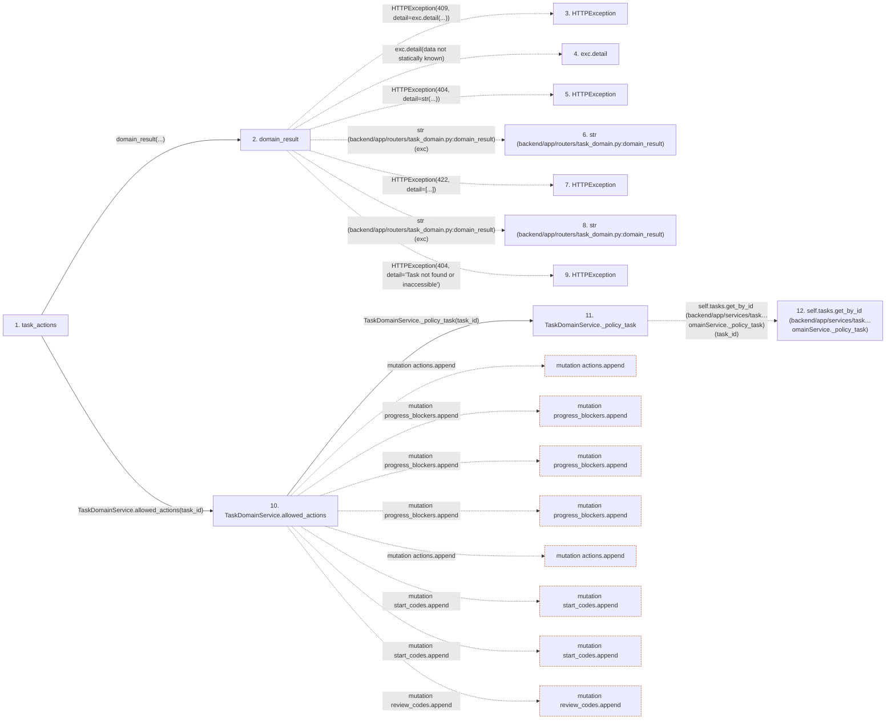

# task_actions

**Entry point:** `task_actions` (`http`)
**Source:** [routers_task_domain](../modules/routers_task_domain.md)
**Modules touched:** [agent_routing_policy](../modules/agent_routing_policy.md), [agent_routing_rollout](../modules/agent_routing_rollout.md), [agent_service](../modules/agent_service.md), and 14 more

**Complete modules touched:**

- [agent_routing_policy](../modules/agent_routing_policy.md)
- [agent_routing_rollout](../modules/agent_routing_rollout.md)
- [agent_service](../modules/agent_service.md)
- [agent_team_setup_service](../modules/agent_team_setup_service.md)
- [agent_work_service](../modules/agent_work_service.md)
- [authority](../modules/authority.md)
- [autonomy_canonical](../modules/autonomy_canonical.md)
- [commands](../modules/commands.md)
- [config](../modules/config.md)
- [delivery_dependency_service](../modules/delivery_dependency_service.md)
- [routers_task_domain](../modules/routers_task_domain.md)
- [schemas_task_domain](../modules/schemas_task_domain.md)
- [services_work_metrics](../modules/services_work_metrics.md)
- [task_brief_service](../modules/task_brief_service.md)
- [task_domain_service](../modules/task_domain_service.md)
- [task_service](../modules/task_service.md)
- [time](../modules/time.md)

## Call sequence

> Static overview in presentation order, not runtime execution order. Arrows retain captured callers; representative internal continuations and boundary examples precede repeated helper detail.

```mermaid
sequenceDiagram
    participant p0 as task_actions
    participant p1 as TaskDomainService.allowed_actions
    participant p2 as domain_result
    participant p3 as TaskDomainService
    participant p4 as TaskDomainService._policy_task
    participant p5 as DeliveryDependencyService.ready
    participant p6 as action_projection
    participant p7 as TaskBriefService.require_review
    participant p8 as AgentWorkService._start_blockers
    participant p9 as AgentWorkService._selection_pending
    participant p10 as DeliveryDependencyService.projection
    participant p11 as AgentWorkService._resolve_rollout
    participant p12 as AgentWorkService._is_model_aware_assignment
    participant p13 as AgentWorkService._validate_assignment_actor
    participant p14 as sha256_hex
    participant p15 as working_today
    participant p16 as AgentTeamSetupService.routing_readiness
    participant p17 as AgentWorkService._routing_snapshot
    participant p18 as evaluate_actor_authorization
    participant p19 as canonical_json_bytes
    participant p20 as require_project
    participant p21 as DeliveryDependencyService._accepted
    participant p22 as AgentTeamSetupService.membership_boundary
    participant p23 as get_settings
    participant p24 as AgentRoutingTopologyReadiness.unavailable
    participant p25 as _json_value
    participant p26 as AgentRoutingTopologyReadiness.ready
    participant p27 as AgentRoutingTopologyReadiness.not_ready
    participant p28 as TaskDomainService.ownership
    participant p29 as HTTPException
    participant p30 as exc.detail
    p0->>p1: TaskDomainService.allowed_actions
    p0->>p2: domain_result
    p0->>p3: TaskDomainService
    p1->>p4: TaskDomainService._policy_task
    p1->>p5: DeliveryDependencyService.ready
    p1->>p6: action_projection
    p1->>p7: TaskBriefService.require_review
    p1->>p8: AgentWorkService._start_blockers
    p8->>p9: AgentWorkService._selection_pending
    p5->>p10: DeliveryDependencyService.projection
    p8->>p11: AgentWorkService._resolve_rollout
    p8->>p12: AgentWorkService._is_model_aware_assignment
    p8->>p13: AgentWorkService._validate_assignment_actor
    p7->>p14: sha256_hex
    p8->>p15: working_today
    p11->>p16: AgentTeamSetupService.routing_readiness
    p9->>p17: AgentWorkService._routing_snapshot
    p13->>p18: evaluate_actor_authorization
    p14->>p19: canonical_json_bytes
    p10->>p20: require_project
    p10->>p21: DeliveryDependencyService._accepted
    p16->>p22: AgentTeamSetupService.membership_boundary
    p20->>p23: get_settings
    p16->>p24: AgentRoutingTopologyReadiness.unavailable
    p19->>p25: _json_value
    p16->>p26: AgentRoutingTopologyReadiness.ready
    p16->>p27: AgentRoutingTopologyReadiness.not_ready
    p1->>p28: TaskDomainService.ownership
    p2-->>p29: HTTPException(409, detail=exc.detail(...))
    p2-->>p30: exc.detail
```

<!-- Auto-generated from static call edges. Dashed arrows are external or unresolved calls. Reviewed runtime conditions and side effects belong in Behavior. -->

> Call sequence diagram shows 30 of 355 interactions; 325 omitted to keep the visualization within the 30-interaction and generated-diagram limits, with uncertain identities omitted rather than inferred.

> Captured boundary calls: external 1 of 85 (84 omitted); unresolved 1 of 188 (187 omitted). These counts cover the captured static trace.

Omitted captured detail, grouped by actual caller occurrence and target module:

| Caller | Parent step | Target module | Kind | Omitted interactions |
| --- | --- | --- | --- | --- |
| `backend/app/routers/task_domain.py:domain_result` | 2 | - | external | 5 |
| `backend/app/services/task_domain_service.py:TaskDomainService._policy_task` | 11 | - | unresolved | 1 |
| `backend/app/services/task_domain_service.py:TaskDomainService._policy_task` | 11 | [backend/app/commands.py](../modules/commands.md) | internal | 1 |
| `backend/app/services/task_domain_service.py:TaskDomainService.allowed_actions` | 10 | - | external | 16 |
| `backend/app/services/task_domain_service.py:TaskDomainService.ownership` | 15 | - | unresolved | 11 |
| `backend/app/services/task_domain_service.py:TaskDomainService.ownership` | 15 | - | external | 4 |
| `backend/app/services/task_domain_service.py:TaskDomainService.allowed_actions` | 10 | - | unresolved | 24 |
| `backend/app/services/delivery_dependency_service.py:DeliveryDependencyService.ready` | 43 | - | external | 1 |
> Omission summary shows 8 of 77 groups; 69 further groups are not expanded here. Counts above include all omitted interactions.
> Detailed flow queries retain their own coverage and limits; omitted paths may execute at runtime.

> Trace truncated at the depth limit; deeper calls are omitted.

## Data flow

<!-- Auto-generated static analysis. Treat values and boundaries as best-effort hints, not runtime proof. -->

### Analysis coverage

**Effect analysis partially available.** Flow assembly and source effect analysis are separate; empty observations do not prove an empty handler body.

Source steps: 83; effect analysis evaluated: 54, partial: 4, unavailable: 25. Counts include steps omitted from the displayed trace.

Collector observations for 58 source steps with known totals: observed: 382, emitted: 343, omitted: 39. Unavailable totals are excluded.

- Callable record unavailable for one or more source steps; those steps have no represented callable body.
- Effect collector omitted observations before flow assembly; displayed effects are partial.
- Effect collector totals unavailable; observed counts cover captured records only.

| Step | Callable record | Effect analysis | Collector totals | Observed | Emitted | Omitted |
|---|---|---|---|---:|---:|---:|
| `task_actions` | `available` | `evaluated` | `available` | `3` | `3` | `0` |
| `domain_result` | `available` | `evaluated` | `available` | `3` | `3` | `0` |
| `HTTPException` | `not_applicable` | `not_applicable` | `not_applicable` | — | — | — |
| `exc.detail` | `not_applicable` | `not_applicable` | `not_applicable` | — | — | — |
| `HTTPException` | `not_applicable` | `not_applicable` | `not_applicable` | — | — | — |
| `str (backend/app/routers/task_domain.py:domain_result)` | `not_applicable` | `not_applicable` | `not_applicable` | — | — | — |
| `HTTPException` | `not_applicable` | `not_applicable` | `not_applicable` | — | — | — |
| `str (backend/app/routers/task_domain.py:domain_result)` | `not_applicable` | `not_applicable` | `not_applicable` | — | — | — |
| `HTTPException` | `not_applicable` | `not_applicable` | `not_applicable` | — | — | — |
| `TaskDomainService.allowed_actions` | `available` | `partial` | `available` | `16` | `15` | `1` |
| `TaskDomainService._policy_task` | `available` | `evaluated` | `available` | `2` | `2` | `0` |
| `self.tasks.get_by_id (backend/app/services/task…omainService._policy_task)` | `not_applicable` | `not_applicable` | `not_applicable` | — | — | — |

### Step data

| Step | Inputs | Reads | Writes | Returns |
|---|---|---|---|---|
| `task_actions` | `task_id: int`, `db: DB` | - | - | `...` |
| `domain_result` | `awaitable` | `TaskVersionConflictError` | - | `result` |
| `HTTPException` | - | - | - | - |
| `exc.detail` | - | - | - | - |
| `HTTPException` | - | - | - | - |
| `str (backend/app/routers/task_domain.py:domain_result)` | - | - | - | - |
| `HTTPException` | - | - | - | - |
| `str (backend/app/routers/task_domain.py:domain_result)` | - | - | - | - |
| `HTTPException` | - | - | - | - |
| `TaskDomainService.allowed_actions` | `task_id` | `AuthorityError`, `AuthorityError` | `accept_action[...]`, `availability[...]`, `availability[...]` | `TaskActionsResponse(...)` |
| `TaskDomainService._policy_task` | `task_id` | - | - | `...` |
| `self.tasks.get_by_id (backend/app/services/task…omainService._policy_task)` | - | - | - | - |

### Call data

| From | To | Line | Call |
|---|---|---:|---|
| task_actions | domain_result | 213 | `domain_result(...)` |
| domain_result | HTTPException | 51 | `HTTPException(409, detail=exc.detail(...))` |
| domain_result | exc.detail | 51 | `exc.detail(data not statically known)` |
| domain_result | HTTPException | 53 | `HTTPException(404, detail=str(...))` |
| domain_result | str (backend/app/routers/task_domain.py:domain_result) | 53 | `str(exc)` |
| domain_result | HTTPException | 55 | `HTTPException(422, detail=[...])` |
| domain_result | str (backend/app/routers/task_domain.py:domain_result) | 55 | `str(exc)` |
| domain_result | HTTPException | 57 | `HTTPException(404, detail='Task not found or inaccessible')` |
| task_actions | TaskDomainService.allowed_actions | 213 | `TaskDomainService(db).allowed_actions(task_id)` |
| TaskDomainService.allowed_actions | TaskDomainService._policy_task | 183 | `self._policy_task(task_id)` |
| TaskDomainService._policy_task | self.tasks.get_by_id (backend/app/services/task…omainService._policy_task) | 178 | `self.tasks.get_by_id(task_id)` |

### Boundary effects

| Kind | Target | Step | Line |
|---|---|---|---:|
| mutation | `actions.append` | `TaskDomainService.allowed_actions` | 207 |
| mutation | `progress_blockers.append` | `TaskDomainService.allowed_actions` | 210 |
| mutation | `progress_blockers.append` | `TaskDomainService.allowed_actions` | 212 |
| mutation | `progress_blockers.append` | `TaskDomainService.allowed_actions` | 214 |
| mutation | `actions.append` | `TaskDomainService.allowed_actions` | 215 |
| mutation | `start_codes.append` | `TaskDomainService.allowed_actions` | 223 |
| mutation | `start_codes.append` | `TaskDomainService.allowed_actions` | 225 |
| mutation | `review_codes.append` | `TaskDomainService.allowed_actions` | 234 |

### Static analysis gaps

| Kind | Step | Target | Line |
|---|---|---|---:|
| external_call | `domain_result` | `HTTPException` | 51 |
| unresolved_call | `domain_result` | `exc.detail` | 51 |
| external_call | `domain_result` | `HTTPException` | 53 |
| external_call | `domain_result` | `HTTPException` | 55 |
| external_call | `domain_result` | `HTTPException` | 57 |
| unresolved_call | `TaskDomainService._policy_task` | `self.tasks.get_by_id` | 178 |
| step_limit | `task_actions` | `first 12 steps` | 0 |
| truncated_flow | `task_actions` | `depth limit` | 0 |

## Behavior

This flow starts at `task_actions` and is classified as `http`. The generated call and data-flow sections are bounded static projections; runtime conditions and side effects require source-level confirmation.
