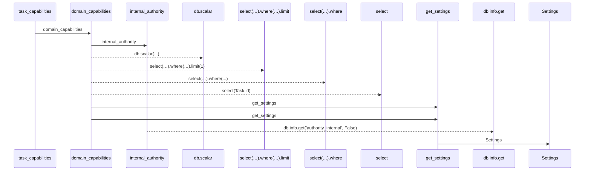
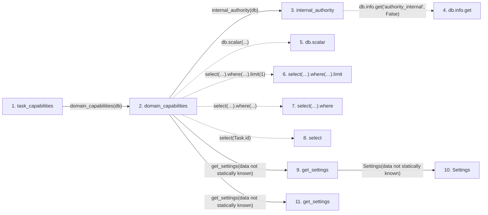

# task_capabilities

**Entry point:** `task_capabilities` (`http`)
**Source:** [routers_task_domain](../modules/routers_task_domain.md)
**Modules touched:** [authority](../modules/authority.md), [config](../modules/config.md), [routers_task_domain](../modules/routers_task_domain.md), [task_domain_service](../modules/task_domain_service.md)

## Call sequence

> Static overview in presentation order, not runtime execution order. Arrows retain captured callers; representative internal continuations and boundary examples precede repeated helper detail.

<!-- Auto-generated from static call edges. Dashed arrows are external or unresolved calls. Reviewed runtime conditions and side effects belong in Behavior. -->

> Call sequence diagram shows 10 of 10 interactions; 0 omitted to keep the visualization within the 30-interaction and generated-diagram limits, with uncertain identities omitted rather than inferred.

> Captured boundary calls: external 1 of 1 (0 omitted); unresolved 4 of 4 (0 omitted). These counts cover the captured static trace.
> Detailed flow queries retain their own coverage and limits; omitted paths may execute at runtime.

## Data flow

<!-- Auto-generated static analysis. Treat values and boundaries as best-effort hints, not runtime proof. -->

### Analysis coverage

**Effect analysis partially available.** Flow assembly and source effect analysis are separate; empty observations do not prove an empty handler body.

Source steps: 6; effect analysis evaluated: 5, partial: 0, unavailable: 1. Counts include steps omitted from the displayed trace.

Collector observations for 5 source steps with known totals: observed: 10, emitted: 10, omitted: 0. Unavailable totals are excluded.

- Callable record unavailable for one or more source steps; those steps have no represented callable body.
- Effect collector totals unavailable; observed counts cover captured records only.

| Step | Callable record | Effect analysis | Collector totals | Observed | Emitted | Omitted |
|---|---|---|---|---:|---:|---:|
| `task_capabilities` | `available` | `evaluated` | `available` | `2` | `2` | `0` |
| `domain_capabilities` | `available` | `evaluated` | `available` | `3` | `3` | `0` |
| `internal_authority` | `available` | `evaluated` | `available` | `3` | `3` | `0` |
| `db.info.get` | `not_applicable` | `not_applicable` | `not_applicable` | — | — | — |
| `db.scalar` | `not_applicable` | `not_applicable` | `not_applicable` | — | — | — |
| `select(…).where(…).limit` | `not_applicable` | `not_applicable` | `not_applicable` | — | — | — |
| `select(…).where` | `not_applicable` | `not_applicable` | `not_applicable` | — | — | — |
| `select` | `not_applicable` | `not_applicable` | `not_applicable` | — | — | — |
| `get_settings` | `available` | `evaluated` | `available` | `1` | `1` | `0` |
| `Settings` | `unavailable` | `unavailable` | `unavailable` | — | — | — |
| `get_settings` | `available` | `evaluated` | `available` | `1` | `1` | `0` |

### Step data

| Step | Inputs | Reads | Writes | Returns |
|---|---|---|---|---|
| `task_capabilities` | `db: DB` | - | - | `...` |
| `domain_capabilities` | `db` | - | - | `{...}`, `{...}` |
| `internal_authority` | `db` | - | `db.info[...]`, `db.info[...]` | - |
| `db.info.get` | - | - | - | - |
| `db.scalar` | - | - | - | - |
| `select(…).where(…).limit` | - | - | - | - |
| `select(…).where` | - | - | - | - |
| `select` | - | - | - | - |
| `get_settings` | - | - | - | `Settings(...)` |
| `Settings` | - | - | - | - |
| `get_settings` | - | - | - | `Settings(...)` |

### Call data

| From | To | Line | Call |
|---|---|---:|---|
| task_capabilities | domain_capabilities | 127 | `domain_capabilities(db)` |
| domain_capabilities | internal_authority | 56 | `internal_authority(db)` |
| internal_authority | db.info.get | 87 | `db.info.get('authority_internal', False)` |
| domain_capabilities | db.scalar | 57 | `db.scalar(...)` |
| domain_capabilities | select(…).where(…).limit | 57 | `select(Task.id).where(Task.domain_backfill_version < 1).limit(1)` |
| domain_capabilities | select(…).where | 57 | `select(Task.id).where(...)` |
| domain_capabilities | select | 57 | `select(Task.id)` |
| domain_capabilities | get_settings | 61 | `get_settings(data not statically known)` |
| get_settings | Settings | 481 | `Settings(data not statically known)` |
| domain_capabilities | get_settings | 62 | `get_settings(data not statically known)` |

### Boundary effects

*No boundary-effect observations were captured in this static trace.*

### Static analysis gaps

| Kind | Step | Target | Line |
|---|---|---|---:|
| unresolved_call | `internal_authority` | `db.info.get` | 87 |
| unresolved_call | `domain_capabilities` | `db.scalar` | 57 |
| unresolved_call | `domain_capabilities` | `select(Task.id).where(Task.domain_backfill_version < 1).limit` | 57 |
| unresolved_call | `domain_capabilities` | `select(Task.id).where` | 57 |
| external_call | `domain_capabilities` | `select` | 57 |

## Behavior

This flow starts at `task_capabilities` and is classified as `http`. The generated call and data-flow sections are bounded static projections; runtime conditions and side effects require source-level confirmation.
