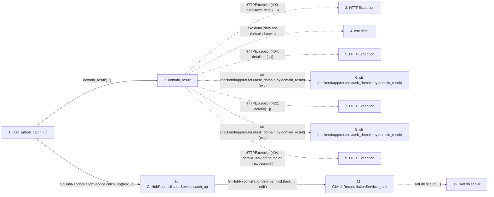

# task_github_catch_up

**Entry point:** `task_github_catch_up` (`http`)
**Source:** [routers_task_domain](../modules/routers_task_domain.md)
**Modules touched:** [authority](../modules/authority.md), [config](../modules/config.md), [github_links](../modules/github_links.md), [github_reconciliation_service](../modules/github_reconciliation_service.md), and 5 more

**Complete modules touched:**

- [authority](../modules/authority.md)
- [config](../modules/config.md)
- [github_links](../modules/github_links.md)
- [github_reconciliation_service](../modules/github_reconciliation_service.md)
- [github_status_service](../modules/github_status_service.md)
- [routers_task_domain](../modules/routers_task_domain.md)
- [system_settings_service](../modules/system_settings_service.md)
- [task_replacement_service](../modules/task_replacement_service.md)
- [url_policy](../modules/url_policy.md)

## Call sequence

> Static overview in presentation order, not runtime execution order. Arrows retain captured callers; representative internal continuations and boundary examples precede repeated helper detail.

```mermaid
sequenceDiagram
    participant p0 as task_github_catch_up
    participant p1 as GitHubReconciliationService.catch_up
    participant p2 as domain_result
    participant p3 as GitHubReconciliationService
    participant p4 as GitHubReconciliationService._task
    participant p5 as GitHubStatusService.from_runtime
    participant p6 as GitHubReconciliationService.view
    participant p7 as RuntimeSettingsService.get_github_settings
    participant p8 as require_project
    participant p9 as relation_for
    participant p10 as GitHubReconciliationService._pull
    participant p11 as RuntimeSettingsService.resolve
    participant p12 as replaced_by
    participant p13 as get_settings
    participant p14 as replacing
    participant p15 as GitHubReconciliationService._submissions
    participant p16 as RuntimeSettingsService._definition
    participant p17 as _sha
    participant p18 as RuntimeSettingsService._decrypt_secret
    participant p19 as _pull_key
    participant p20 as RuntimeSettingsService._coerce
    participant p21 as GitHubReconciliationService._pull_links
    participant p22 as RuntimeSettingsService
    participant p23 as GitHubStatusService
    participant p24 as pull_state
    participant p25 as AuthorityError
    participant p26 as GitHubReconciliationService._next
    participant p27 as parse_github_time
    participant p28 as Settings
    participant p29 as HTTPException
    participant p30 as exc.detail
    p0->>p1: GitHubReconciliationService.catch_up
    p0->>p2: domain_result
    p0->>p3: GitHubReconciliationService
    p1->>p4: GitHubReconciliationService._task
    p1->>p5: GitHubStatusService.from_runtime
    p1->>p6: GitHubReconciliationService.view
    p5->>p7: RuntimeSettingsService.get_github_settings
    p4->>p8: require_project
    p6->>p9: relation_for
    p6->>p10: GitHubReconciliationService._pull
    p7->>p11: RuntimeSettingsService.resolve
    p9->>p12: replaced_by
    p8->>p13: get_settings
    p9->>p14: replacing
    p10->>p15: GitHubReconciliationService._submissions
    p11->>p16: RuntimeSettingsService._definition
    p15->>p17: _sha
    p11->>p18: RuntimeSettingsService._decrypt_secret
    p15->>p19: _pull_key
    p11->>p20: RuntimeSettingsService._coerce
    p1->>p21: GitHubReconciliationService._pull_links
    p5->>p22: RuntimeSettingsService
    p5->>p23: GitHubStatusService
    p10->>p24: pull_state
    p8->>p25: AuthorityError
    p10->>p26: GitHubReconciliationService._next
    p10->>p27: parse_github_time
    p13->>p28: Settings
    p2-->>p29: HTTPException(409, detail=exc.detail(...))
    p2-->>p30: exc.detail
```

<!-- Auto-generated from static call edges. Dashed arrows are external or unresolved calls. Reviewed runtime conditions and side effects belong in Behavior. -->

> Call sequence diagram shows 30 of 164 interactions; 134 omitted to keep the visualization within the 30-interaction and generated-diagram limits, with uncertain identities omitted rather than inferred.

> Captured boundary calls: external 1 of 30 (29 omitted); unresolved 1 of 70 (69 omitted). These counts cover the captured static trace.

Omitted captured detail, grouped by actual caller occurrence and target module:

| Caller | Parent step | Target module | Kind | Omitted interactions |
| --- | --- | --- | --- | --- |
| `backend/app/routers/task_domain.py:domain_result` | 2 | - | external | 5 |
| `backend/app/services/github_reconciliation_service.py:GitHubReconciliationService._task` | 11 | - | unresolved | 2 |
| `backend/app/services/github_reconciliation_service.py:GitHubReconciliationService._task` | 11 | - | external | 2 |
| `backend/app/authority.py:require_project` | 16 | - | unresolved | 2 |
| `backend/app/authority.py:require_project` | 16 | [backend/app/authority.py](../modules/authority.md) | internal | 1 |
| `backend/app/services/github_reconciliation_service.py:GitHubReconciliationService._pull_links` | 23 | - | unresolved | 6 |
| `backend/app/services/github_reconciliation_service.py:GitHubReconciliationService._pull_links` | 23 | - | external | 1 |
| `backend/app/services/system_settings_service.py:RuntimeSettingsService._definition` | 34 | - | unresolved | 1 |
> Omission summary shows 8 of 44 groups; 36 further groups are not expanded here. Counts above include all omitted interactions.
> Detailed flow queries retain their own coverage and limits; omitted paths may execute at runtime.

> Trace truncated at the depth limit; deeper calls are omitted.

## Data flow

<!-- Auto-generated static analysis. Treat values and boundaries as best-effort hints, not runtime proof. -->

### Analysis coverage

**Effect analysis partially available.** Flow assembly and source effect analysis are separate; empty observations do not prove an empty handler body.

Source steps: 65; effect analysis evaluated: 42, partial: 1, unavailable: 22. Counts include steps omitted from the displayed trace.

Collector observations for 43 source steps with known totals: observed: 212, emitted: 207, omitted: 5. Unavailable totals are excluded.

- Callable record unavailable for one or more source steps; those steps have no represented callable body.
- Effect collector omitted observations before flow assembly; displayed effects are partial.
- Effect collector totals unavailable; observed counts cover captured records only.

| Step | Callable record | Effect analysis | Collector totals | Observed | Emitted | Omitted |
|---|---|---|---|---:|---:|---:|
| `task_github_catch_up` | `available` | `evaluated` | `available` | `3` | `3` | `0` |
| `domain_result` | `available` | `evaluated` | `available` | `3` | `3` | `0` |
| `HTTPException` | `not_applicable` | `not_applicable` | `not_applicable` | — | — | — |
| `exc.detail` | `not_applicable` | `not_applicable` | `not_applicable` | — | — | — |
| `HTTPException` | `not_applicable` | `not_applicable` | `not_applicable` | — | — | — |
| `str (backend/app/routers/task_domain.py:domain_result)` | `not_applicable` | `not_applicable` | `not_applicable` | — | — | — |
| `HTTPException` | `not_applicable` | `not_applicable` | `not_applicable` | — | — | — |
| `str (backend/app/routers/task_domain.py:domain_result)` | `not_applicable` | `not_applicable` | `not_applicable` | — | — | — |
| `HTTPException` | `not_applicable` | `not_applicable` | `not_applicable` | — | — | — |
| `GitHubReconciliationService.catch_up` | `available` | `evaluated` | `available` | `4` | `4` | `0` |
| `GitHubReconciliationService._task` | `available` | `evaluated` | `available` | `5` | `5` | `0` |
| `self.db.scalar` | `not_applicable` | `not_applicable` | `not_applicable` | — | — | — |

### Step data

| Step | Inputs | Reads | Writes | Returns |
|---|---|---|---|---|
| `task_github_catch_up` | `task_id: int`, `db: DB` | - | - | `...` |
| `domain_result` | `awaitable` | `TaskVersionConflictError` | - | `result` |
| `HTTPException` | - | - | - | - |
| `exc.detail` | - | - | - | - |
| `HTTPException` | - | - | - | - |
| `str (backend/app/routers/task_domain.py:domain_result)` | - | - | - | - |
| `HTTPException` | - | - | - | - |
| `str (backend/app/routers/task_domain.py:domain_result)` | - | - | - | - |
| `HTTPException` | - | - | - | - |
| `GitHubReconciliationService.catch_up` | `task_id: int` | `MAX_CATCH_UP_LINKS`, `self.db` | - | `...` |
| `GitHubReconciliationService._task` | `task_id: int`, `action: str` | `Task`, `self.db` | - | `task` |
| `self.db.scalar` | - | - | - | - |

### Call data

| From | To | Line | Call |
|---|---|---:|---|
| task_github_catch_up | domain_result | 346 | `domain_result(...)` |
| domain_result | HTTPException | 53 | `HTTPException(409, detail=exc.detail(...))` |
| domain_result | exc.detail | 53 | `exc.detail(data not statically known)` |
| domain_result | HTTPException | 55 | `HTTPException(404, detail=str(...))` |
| domain_result | str (backend/app/routers/task_domain.py:domain_result) | 55 | `str(exc)` |
| domain_result | HTTPException | 57 | `HTTPException(422, detail=[...])` |
| domain_result | str (backend/app/routers/task_domain.py:domain_result) | 57 | `str(exc)` |
| domain_result | HTTPException | 59 | `HTTPException(404, detail='Task not found or inaccessible')` |
| task_github_catch_up | GitHubReconciliationService.catch_up | 346 | `GitHubReconciliationService(db).catch_up(task_id)` |
| GitHubReconciliationService.catch_up | GitHubReconciliationService._task | 93 | `self._task(task_id, 'edit')` |
| GitHubReconciliationService._task | self.db.scalar | 79 | `self.db.scalar(...)` |

### Boundary effects

*No boundary-effect observations were captured in this static trace.*

### Static analysis gaps

| Kind | Step | Target | Line |
|---|---|---|---:|
| external_call | `domain_result` | `HTTPException` | 53 |
| unresolved_call | `domain_result` | `exc.detail` | 53 |
| external_call | `domain_result` | `HTTPException` | 55 |
| external_call | `domain_result` | `HTTPException` | 57 |
| external_call | `domain_result` | `HTTPException` | 59 |
| unresolved_call | `GitHubReconciliationService._task` | `self.db.scalar` | 79 |
| step_limit | `task_github_catch_up` | `first 12 steps` | 0 |
| truncated_flow | `task_github_catch_up` | `depth limit` | 0 |

## Behavior

Requires edit permission on the task. It refreshes the task's own GitHub pull request links, up to a fixed bound, from GitHub for events a deployment never received, then returns the same reconciliation view. It reads only this task's links and accepts nothing.
