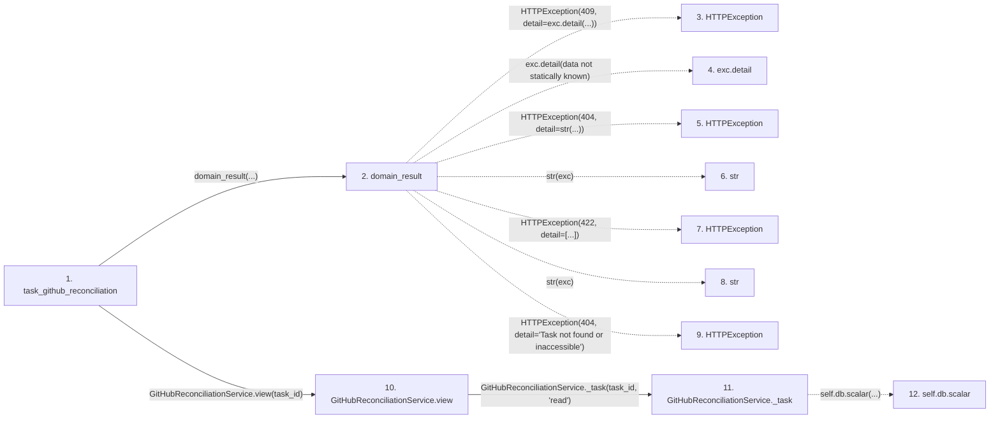

# task_github_reconciliation

**Entry point:** `task_github_reconciliation` (`http`)
**Source:** [routers_task_domain](../modules/routers_task_domain.md)
**Modules touched:** [authority](../modules/authority.md), [config](../modules/config.md), [github_links](../modules/github_links.md), [github_reconciliation_service](../modules/github_reconciliation_service.md), and 3 more

**Complete modules touched:**

- [authority](../modules/authority.md)
- [config](../modules/config.md)
- [github_links](../modules/github_links.md)
- [github_reconciliation_service](../modules/github_reconciliation_service.md)
- [github_status_service](../modules/github_status_service.md)
- [routers_task_domain](../modules/routers_task_domain.md)
- [task_replacement_service](../modules/task_replacement_service.md)

## Call sequence

> Static overview in presentation order, not runtime execution order. Arrows retain captured callers; representative internal continuations and boundary examples precede repeated helper detail.

```mermaid
sequenceDiagram
    participant p0 as task_github_reconciliation
    participant p1 as GitHubReconciliationService.view
    participant p2 as domain_result
    participant p3 as GitHubReconciliationService
    participant p4 as GitHubReconciliationService._task
    participant p5 as relation_for
    participant p6 as GitHubReconciliationService._pull
    participant p7 as replaced_by
    participant p8 as replacing
    participant p9 as GitHubReconciliationService._submissions
    participant p10 as require_project
    participant p11 as get_settings
    participant p12 as _sha
    participant p13 as _pull_key
    participant p14 as parse_github_url
    participant p15 as GitHubReconciliationService._pull_links
    participant p16 as pull_state
    participant p17 as GitHubReconciliationService._next
    participant p18 as parse_github_time
    participant p19 as internal_authority
    participant p20 as AuthorityError
    participant p21 as Settings
    participant p22 as GitHubLinkError
    participant p23 as _commit
    participant p24 as ParsedGitHubLink
    participant p25 as HTTPException
    participant p26 as exc.detail
    participant p27 as (…).all (backend/app/services/gith…econciliationService.view)
    participant p28 as self.db.scalars (backend/app/services/gith…econciliationService.view)
    participant p29 as str
    p0->>p1: GitHubReconciliationService.view
    p0->>p2: domain_result
    p0->>p3: GitHubReconciliationService
    p1->>p4: GitHubReconciliationService._task
    p1->>p5: relation_for
    p1->>p6: GitHubReconciliationService._pull
    p5->>p7: replaced_by
    p5->>p8: replacing
    p6->>p9: GitHubReconciliationService._submissions
    p4->>p10: require_project
    p10->>p11: get_settings
    p9->>p12: _sha
    p9->>p13: _pull_key
    p12->>p14: parse_github_url
    p1->>p15: GitHubReconciliationService._pull_links
    p6->>p16: pull_state
    p6->>p17: GitHubReconciliationService._next
    p6->>p18: parse_github_time
    p7->>p19: internal_authority
    p10->>p20: AuthorityError
    p11->>p21: Settings
    p14->>p22: GitHubLinkError
    p14->>p23: _commit
    p14->>p24: ParsedGitHubLink
    p2-->>p25: HTTPException(409, detail=exc.detail(...))
    p2-->>p26: exc.detail
    p1-->>p27: (…).all (backend/app/services/gith…econciliationService.view)
    p2-->>p25: HTTPException(404, detail=str(...))
    p1-->>p28: self.db.scalars (backend/app/services/gith…econciliationService.view)(...)
    p2-->>p29: str(exc)
```

<!-- Auto-generated from static call edges. Dashed arrows are external or unresolved calls. Reviewed runtime conditions and side effects belong in Behavior. -->

> Call sequence diagram shows 30 of 133 interactions; 103 omitted to keep the visualization within the 30-interaction and generated-diagram limits, with uncertain identities omitted rather than inferred.

> Captured boundary calls: external 3 of 26 (23 omitted); unresolved 3 of 70 (67 omitted). These counts cover the captured static trace.

Omitted captured detail, grouped by actual caller occurrence and target module:

| Caller | Parent step | Target module | Kind | Omitted interactions |
| --- | --- | --- | --- | --- |
| `backend/app/routers/task_domain.py:domain_result` | 2 | - | external | 3 |
| `backend/app/services/github_reconciliation_service.py:GitHubReconciliationService._task` | 11 | - | unresolved | 2 |
| `backend/app/services/github_reconciliation_service.py:GitHubReconciliationService._task` | 11 | - | external | 2 |
| `backend/app/authority.py:require_project` | 16 | - | unresolved | 2 |
| `backend/app/authority.py:require_project` | 16 | [backend/app/authority.py](../modules/authority.md) | internal | 1 |
| `backend/app/services/github_reconciliation_service.py:GitHubReconciliationService.view` | 10 | - | unresolved | 9 |
| `backend/app/services/github_reconciliation_service.py:GitHubReconciliationService.view` | 10 | - | external | 3 |
| `backend/app/services/github_reconciliation_service.py:GitHubReconciliationService._pull_links` | 35 | - | unresolved | 6 |
> Omission summary shows 8 of 30 groups; 22 further groups are not expanded here. Counts above include all omitted interactions.
> Detailed flow queries retain their own coverage and limits; omitted paths may execute at runtime.

> Trace truncated at the depth limit; deeper calls are omitted.

## Data flow

<!-- Auto-generated static analysis. Treat values and boundaries as best-effort hints, not runtime proof. -->

### Analysis coverage

**Effect analysis partially available.** Flow assembly and source effect analysis are separate; empty observations do not prove an empty handler body.

Source steps: 38; effect analysis evaluated: 25, partial: 1, unavailable: 12. Counts include steps omitted from the displayed trace.

Collector observations for 26 source steps with known totals: observed: 148, emitted: 143, omitted: 5. Unavailable totals are excluded.

- Callable record unavailable for one or more source steps; those steps have no represented callable body.
- Effect collector omitted observations before flow assembly; displayed effects are partial.
- Effect collector totals unavailable; observed counts cover captured records only.

| Step | Callable record | Effect analysis | Collector totals | Observed | Emitted | Omitted |
|---|---|---|---|---:|---:|---:|
| `task_github_reconciliation` | `available` | `evaluated` | `available` | `3` | `3` | `0` |
| `domain_result` | `available` | `evaluated` | `available` | `3` | `3` | `0` |
| `HTTPException` | `not_applicable` | `not_applicable` | `not_applicable` | — | — | — |
| `exc.detail` | `not_applicable` | `not_applicable` | `not_applicable` | — | — | — |
| `HTTPException` | `not_applicable` | `not_applicable` | `not_applicable` | — | — | — |
| `str` | `not_applicable` | `not_applicable` | `not_applicable` | — | — | — |
| `HTTPException` | `not_applicable` | `not_applicable` | `not_applicable` | — | — | — |
| `str` | `not_applicable` | `not_applicable` | `not_applicable` | — | — | — |
| `HTTPException` | `not_applicable` | `not_applicable` | `not_applicable` | — | — | — |
| `GitHubReconciliationService.view` | `available` | `evaluated` | `available` | `4` | `4` | `0` |
| `GitHubReconciliationService._task` | `available` | `evaluated` | `available` | `5` | `5` | `0` |
| `self.db.scalar` | `not_applicable` | `not_applicable` | `not_applicable` | — | — | — |

### Step data

| Step | Inputs | Reads | Writes | Returns |
|---|---|---|---|---|
| `task_github_reconciliation` | `task_id: int`, `db: DB` | - | - | `...` |
| `domain_result` | `awaitable` | `TaskVersionConflictError` | - | `result` |
| `HTTPException` | - | - | - | - |
| `exc.detail` | - | - | - | - |
| `HTTPException` | - | - | - | - |
| `str` | - | - | - | - |
| `HTTPException` | - | - | - | - |
| `str` | - | - | - | - |
| `HTTPException` | - | - | - | - |
| `GitHubReconciliationService.view` | `task_id: int` | `self.db`, `Task` | - | `{...}` |
| `GitHubReconciliationService._task` | `task_id: int`, `action: str` | `Task`, `self.db` | - | `task` |
| `self.db.scalar` | - | - | - | - |

### Call data

| From | To | Line | Call |
|---|---|---:|---|
| task_github_reconciliation | domain_result | 361 | `domain_result(...)` |
| domain_result | HTTPException | 56 | `HTTPException(409, detail=exc.detail(...))` |
| domain_result | exc.detail | 56 | `exc.detail(data not statically known)` |
| domain_result | HTTPException | 58 | `HTTPException(404, detail=str(...))` |
| domain_result | str | 58 | `str(exc)` |
| domain_result | HTTPException | 60 | `HTTPException(422, detail=[...])` |
| domain_result | str | 60 | `str(exc)` |
| domain_result | HTTPException | 62 | `HTTPException(404, detail='Task not found or inaccessible')` |
| task_github_reconciliation | GitHubReconciliationService.view | 361 | `GitHubReconciliationService(db).view(task_id)` |
| GitHubReconciliationService.view | GitHubReconciliationService._task | 104 | `self._task(task_id, 'read')` |
| GitHubReconciliationService._task | self.db.scalar | 79 | `self.db.scalar(...)` |

### Boundary effects

*No boundary-effect observations were captured in this static trace.*

### Static analysis gaps

| Kind | Step | Target | Line |
|---|---|---|---:|
| external_call | `domain_result` | `HTTPException` | 56 |
| unresolved_call | `domain_result` | `exc.detail` | 56 |
| external_call | `domain_result` | `HTTPException` | 58 |
| external_call | `domain_result` | `HTTPException` | 60 |
| external_call | `domain_result` | `HTTPException` | 62 |
| unresolved_call | `GitHubReconciliationService._task` | `self.db.scalar` | 79 |
| step_limit | `task_github_reconciliation` | `first 12 steps` | 0 |
| truncated_flow | `task_github_reconciliation` | `depth limit` | 0 |

## Behavior

Compares, for each pull request linked to the task, the commit each run submitted with the observed head, checks, merge or unmerged closure and review state, and names who acts next. A replaced original or a replacement shows its relation and successor pull requests. Observing a merge never accepts or closes a task: acceptance stays with the independent reviewer's verdict.
