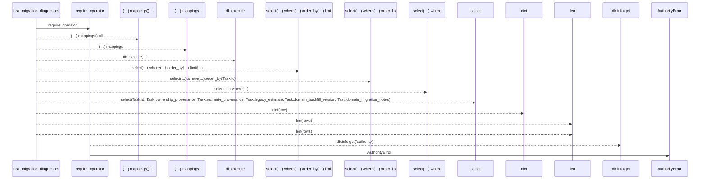
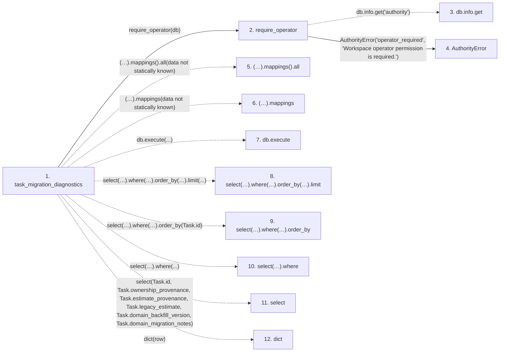

# task_migration_diagnostics

**Entry point:** `task_migration_diagnostics` (`http`)
**Source:** [routers_task_domain](../modules/routers_task_domain.md)
**Modules touched:** [authority](../modules/authority.md), [routers_task_domain](../modules/routers_task_domain.md)

## Call sequence

> Static overview in presentation order, not runtime execution order. Arrows retain captured callers; representative internal continuations and boundary examples precede repeated helper detail.

<!-- Auto-generated from static call edges. Dashed arrows are external or unresolved calls. Reviewed runtime conditions and side effects belong in Behavior. -->

> Call sequence diagram shows 13 of 13 interactions; 0 omitted to keep the visualization within the 30-interaction and generated-diagram limits, with uncertain identities omitted rather than inferred.

> Captured boundary calls: external 4 of 4 (0 omitted); unresolved 7 of 7 (0 omitted). These counts cover the captured static trace.
> Detailed flow queries retain their own coverage and limits; omitted paths may execute at runtime.

## Data flow

<!-- Auto-generated static analysis. Treat values and boundaries as best-effort hints, not runtime proof. -->

### Analysis coverage

**Effect analysis partially available.** Flow assembly and source effect analysis are separate; empty observations do not prove an empty handler body.

Source steps: 3; effect analysis evaluated: 2, partial: 0, unavailable: 1. Counts include steps omitted from the displayed trace.

Collector observations for 2 source steps with known totals: observed: 5, emitted: 5, omitted: 0. Unavailable totals are excluded.

- Callable record unavailable for one or more source steps; those steps have no represented callable body.
- Effect collector totals unavailable; observed counts cover captured records only.

| Step | Callable record | Effect analysis | Collector totals | Observed | Emitted | Omitted |
|---|---|---|---|---:|---:|---:|
| `task_migration_diagnostics` | `available` | `evaluated` | `available` | `4` | `4` | `0` |
| `require_operator` | `available` | `evaluated` | `available` | `1` | `1` | `0` |
| `db.info.get` | `not_applicable` | `not_applicable` | `not_applicable` | — | — | — |
| `AuthorityError` | `unavailable` | `unavailable` | `unavailable` | — | — | — |
| `(…).mappings().all` | `not_applicable` | `not_applicable` | `not_applicable` | — | — | — |
| `(…).mappings` | `not_applicable` | `not_applicable` | `not_applicable` | — | — | — |
| `db.execute` | `not_applicable` | `not_applicable` | `not_applicable` | — | — | — |
| `select(…).where(…).order_by(…).limit` | `not_applicable` | `not_applicable` | `not_applicable` | — | — | — |
| `select(…).where(…).order_by` | `not_applicable` | `not_applicable` | `not_applicable` | — | — | — |
| `select(…).where` | `not_applicable` | `not_applicable` | `not_applicable` | — | — | — |
| `select` | `not_applicable` | `not_applicable` | `not_applicable` | — | — | — |
| `dict` | `not_applicable` | `not_applicable` | `not_applicable` | — | — | — |

### Step data

| Step | Inputs | Reads | Writes | Returns |
|---|---|---|---|---|
| `task_migration_diagnostics` | `db: DB`, `after_id: int`, `limit: int` | - | - | `{...}` |
| `require_operator` | `db` | - | - | - |
| `db.info.get` | - | - | - | - |
| `AuthorityError` | - | - | - | - |
| `(…).mappings().all` | - | - | - | - |
| `(…).mappings` | - | - | - | - |
| `db.execute` | - | - | - | - |
| `select(…).where(…).order_by(…).limit` | - | - | - | - |
| `select(…).where(…).order_by` | - | - | - | - |
| `select(…).where` | - | - | - | - |
| `select` | - | - | - | - |
| `dict` | - | - | - | - |

### Call data

| From | To | Line | Call |
|---|---|---:|---|
| task_migration_diagnostics | require_operator | 129 | `require_operator(db)` |
| require_operator | db.info.get | 79 | `db.info.get('authority')` |
| require_operator | AuthorityError | 81 | `AuthorityError('operator_required', 'Workspace operator permission is required.')` |
| task_migration_diagnostics | (…).mappings().all | 130 | `(await db.execute(select(Task.id, Task.ownership_provenance, Task.estimate_provenance, Task.legacy_estimate, Task.domain_backfill_version, Task.domain_migration_notes).where(Task.id > after_id).order_by(Task.id).limit(limit + 1))).mappings().all(data not statically known)` |
| task_migration_diagnostics | (…).mappings | 130 | `(await db.execute(select(Task.id, Task.ownership_provenance, Task.estimate_provenance, Task.legacy_estimate, Task.domain_backfill_version, Task.domain_migration_notes).where(Task.id > after_id).order_by(Task.id).limit(limit + 1))).mappings(data not statically known)` |
| task_migration_diagnostics | db.execute | 130 | `db.execute(...)` |
| task_migration_diagnostics | select(…).where(…).order_by(…).limit | 130 | `select(Task.id, Task.ownership_provenance, Task.estimate_provenance, Task.legacy_estimate, Task.domain_backfill_version, Task.domain_migration_notes).where(Task.id > after_id).order_by(Task.id).limit(...)` |
| task_migration_diagnostics | select(…).where(…).order_by | 130 | `select(Task.id, Task.ownership_provenance, Task.estimate_provenance, Task.legacy_estimate, Task.domain_backfill_version, Task.domain_migration_notes).where(Task.id > after_id).order_by(Task.id)` |
| task_migration_diagnostics | select(…).where | 130 | `select(Task.id, Task.ownership_provenance, Task.estimate_provenance, Task.legacy_estimate, Task.domain_backfill_version, Task.domain_migration_notes).where(...)` |
| task_migration_diagnostics | select | 130 | `select(Task.id, Task.ownership_provenance, Task.estimate_provenance, Task.legacy_estimate, Task.domain_backfill_version, Task.domain_migration_notes)` |
| task_migration_diagnostics | dict | 132 | `dict(row)` |

### Boundary effects

*No boundary-effect observations were captured in this static trace.*

### Static analysis gaps

| Kind | Step | Target | Line |
|---|---|---|---:|
| unresolved_call | `require_operator` | `db.info.get` | 79 |
| unresolved_call | `task_migration_diagnostics` | `(await db.execute(select(Task.id, Task.ownership_provenance, Task.estimate_provenance, Task.legacy_estimate, Task.domain_backfill_version, Task.domain_migration_notes).where(Task.id > after_id).order_by(Task.id).limit(limit + 1))).mappings().all` | 130 |
| unresolved_call | `task_migration_diagnostics` | `(await db.execute(select(Task.id, Task.ownership_provenance, Task.estimate_provenance, Task.legacy_estimate, Task.domain_backfill_version, Task.domain_migration_notes).where(Task.id > after_id).order_by(Task.id).limit(limit + 1))).mappings` | 130 |
| unresolved_call | `task_migration_diagnostics` | `db.execute` | 130 |
| unresolved_call | `task_migration_diagnostics` | `select(Task.id, Task.ownership_provenance, Task.estimate_provenance, Task.legacy_estimate, Task.domain_backfill_version, Task.domain_migration_notes).where(Task.id > after_id).order_by(Task.id).limit` | 130 |
| unresolved_call | `task_migration_diagnostics` | `select(Task.id, Task.ownership_provenance, Task.estimate_provenance, Task.legacy_estimate, Task.domain_backfill_version, Task.domain_migration_notes).where(Task.id > after_id).order_by` | 130 |
| unresolved_call | `task_migration_diagnostics` | `select(Task.id, Task.ownership_provenance, Task.estimate_provenance, Task.legacy_estimate, Task.domain_backfill_version, Task.domain_migration_notes).where` | 130 |
| external_call | `task_migration_diagnostics` | `select` | 130 |
| step_limit | `task_migration_diagnostics` | `first 12 steps` | 0 |

## Behavior

This flow starts at `task_migration_diagnostics` and is classified as `http`. The generated call and data-flow sections are bounded static projections; runtime conditions and side effects require source-level confirmation.
