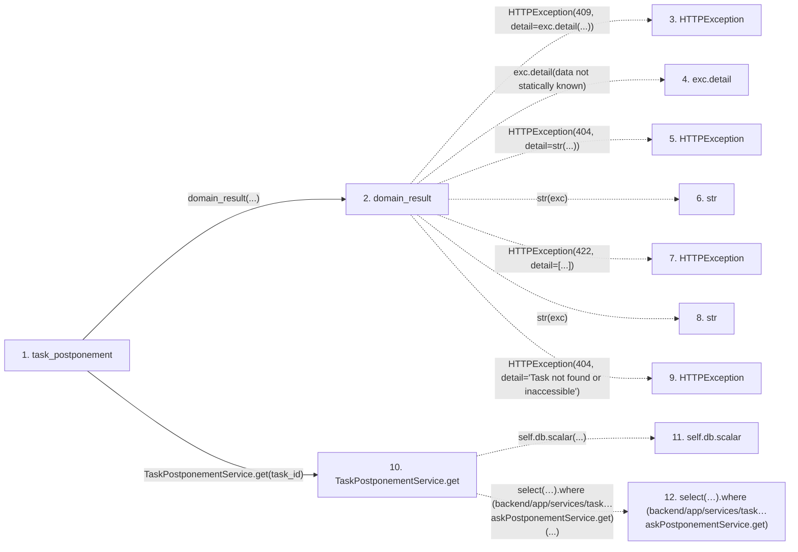

# task_postponement

**Entry point:** `task_postponement` (`http`)
**Source:** [routers_task_domain](../modules/routers_task_domain.md)
**Modules touched:** [authority](../modules/authority.md), [config](../modules/config.md), [routers_task_domain](../modules/routers_task_domain.md), [task_postponement_service](../modules/task_postponement_service.md)

## Call sequence

> Static overview in presentation order, not runtime execution order. Arrows retain captured callers; representative internal continuations and boundary examples precede repeated helper detail.

```mermaid
sequenceDiagram
    participant p0 as task_postponement
    participant p1 as TaskPostponementService.get
    participant p2 as domain_result
    participant p3 as TaskPostponementService
    participant p4 as require_project
    participant p5 as latest_postponement
    participant p6 as TaskPostponementService.projection
    participant p7 as get_settings
    participant p8 as postponement_record
    participant p9 as open_postponement
    participant p10 as AuthorityError
    participant p11 as Settings
    participant p12 as _requirement_response
    participant p13 as HTTPException
    participant p14 as self.db.scalar
    participant p15 as exc.detail
    participant p16 as select(…).where (backend/app/services/task…askPostponementService.get)
    participant p17 as select (backend/app/services/task…askPostponementService.get)
    participant p18 as str
    participant p19 as LookupError
    participant p20 as db.info.get
    participant p21 as tasks.get_by_id
    participant p22 as db.scalar (backend/app/services/task…ice.py:latest_postponement)
    participant p23 as tasks.task_to_response
    participant p24 as select(…).where(…).order_by(…).limit
    p0->>p1: TaskPostponementService.get
    p0->>p2: domain_result
    p0->>p3: TaskPostponementService
    p1->>p4: require_project
    p1->>p5: latest_postponement
    p1->>p6: TaskPostponementService.projection
    p4->>p7: get_settings
    p6->>p8: postponement_record
    p5->>p9: open_postponement
    p4->>p10: AuthorityError
    p7->>p11: Settings
    p8->>p12: _requirement_response
    p2-->>p13: HTTPException(409, detail=exc.detail(...))
    p1-->>p14: self.db.scalar(...)
    p2-->>p15: exc.detail
    p1-->>p16: select(…).where (backend/app/services/task…askPostponementService.get)(...)
    p2-->>p13: HTTPException(404, detail=str(...))
    p1-->>p17: select (backend/app/services/task…askPostponementService.get)(Task)
    p2-->>p18: str(exc)
    p1-->>p19: LookupError('Task not found or inaccessible')
    p2-->>p13: HTTPException(422, detail=[...])
    p2-->>p18: str(exc)
    p2-->>p13: HTTPException(404, detail='Task not found or inaccessible')
    p1-->>p19: LookupError('This task has never been postponed')
    p4-->>p20: db.info.get('authority')
    p6-->>p21: tasks.get_by_id(task_id)
    p5-->>p22: db.scalar (backend/app/services/task…ice.py:latest_postponement)(...)
    p6-->>p23: tasks.task_to_response(task)
    p5-->>p24: select(…).where(…).order_by(…).limit(1)
    p6-->>p23: tasks.task_to_response(task)
```

<!-- Auto-generated from static call edges. Dashed arrows are external or unresolved calls. Reviewed runtime conditions and side effects belong in Behavior. -->

> Call sequence diagram shows 30 of 50 interactions; 20 omitted to keep the visualization within the 30-interaction and generated-diagram limits, with uncertain identities omitted rather than inferred.

> Captured boundary calls: external 9 of 13 (4 omitted); unresolved 9 of 24 (15 omitted). These counts cover the captured static trace.

Omitted captured detail, grouped by actual caller occurrence and target module:

| Caller | Parent step | Target module | Kind | Omitted interactions |
| --- | --- | --- | --- | --- |
| `backend/app/authority.py:require_project` | 15 | - | unresolved | 1 |
| `backend/app/authority.py:require_project` | 15 | [backend/app/authority.py](../modules/authority.md) | internal | 1 |
| `backend/app/services/task_postponement_service.py:open_postponement` | 23 | - | unresolved | 4 |
| `backend/app/services/task_postponement_service.py:open_postponement` | 23 | - | external | 1 |
| `backend/app/services/task_postponement_service.py:latest_postponement` | 22 | - | unresolved | 4 |
| `backend/app/services/task_postponement_service.py:latest_postponement` | 22 | - | external | 1 |
| `backend/app/services/task_postponement_service.py:postponement_record` | 41 | - | unresolved | 6 |
| `backend/app/services/task_postponement_service.py:postponement_record` | 41 | - | external | 2 |
> Detailed flow queries retain their own coverage and limits; omitted paths may execute at runtime.

## Data flow

<!-- Auto-generated static analysis. Treat values and boundaries as best-effort hints, not runtime proof. -->

### Analysis coverage

**Effect analysis partially available.** Flow assembly and source effect analysis are separate; empty observations do not prove an empty handler body.

Source steps: 14; effect analysis evaluated: 10, partial: 0, unavailable: 4. Counts include steps omitted from the displayed trace.

Collector observations for 10 source steps with known totals: observed: 35, emitted: 35, omitted: 0. Unavailable totals are excluded.

- Callable record unavailable for one or more source steps; those steps have no represented callable body.
- Effect collector totals unavailable; observed counts cover captured records only.

| Step | Callable record | Effect analysis | Collector totals | Observed | Emitted | Omitted |
|---|---|---|---|---:|---:|---:|
| `task_postponement` | `available` | `evaluated` | `available` | `3` | `3` | `0` |
| `domain_result` | `available` | `evaluated` | `available` | `3` | `3` | `0` |
| `HTTPException` | `not_applicable` | `not_applicable` | `not_applicable` | — | — | — |
| `exc.detail` | `not_applicable` | `not_applicable` | `not_applicable` | — | — | — |
| `HTTPException` | `not_applicable` | `not_applicable` | `not_applicable` | — | — | — |
| `str` | `not_applicable` | `not_applicable` | `not_applicable` | — | — | — |
| `HTTPException` | `not_applicable` | `not_applicable` | `not_applicable` | — | — | — |
| `str` | `not_applicable` | `not_applicable` | `not_applicable` | — | — | — |
| `HTTPException` | `not_applicable` | `not_applicable` | `not_applicable` | — | — | — |
| `TaskPostponementService.get` | `available` | `evaluated` | `available` | `5` | `5` | `0` |
| `self.db.scalar` | `not_applicable` | `not_applicable` | `not_applicable` | — | — | — |
| `select(…).where (backend/app/services/task…askPostponementService.get)` | `not_applicable` | `not_applicable` | `not_applicable` | — | — | — |

### Step data

| Step | Inputs | Reads | Writes | Returns |
|---|---|---|---|---|
| `task_postponement` | `task_id: int`, `db: DB` | - | - | `...` |
| `domain_result` | `awaitable` | `TaskVersionConflictError` | - | `result` |
| `HTTPException` | - | - | - | - |
| `exc.detail` | - | - | - | - |
| `HTTPException` | - | - | - | - |
| `str` | - | - | - | - |
| `HTTPException` | - | - | - | - |
| `str` | - | - | - | - |
| `HTTPException` | - | - | - | - |
| `TaskPostponementService.get` | `task_id` | `Task`, `self.db`, `self.db` | - | `...` |
| `self.db.scalar` | - | - | - | - |
| `select(…).where (backend/app/services/task…askPostponementService.get)` | - | - | - | - |

### Call data

| From | To | Line | Call |
|---|---|---:|---|
| task_postponement | domain_result | 415 | `domain_result(...)` |
| domain_result | HTTPException | 56 | `HTTPException(409, detail=exc.detail(...))` |
| domain_result | exc.detail | 56 | `exc.detail(data not statically known)` |
| domain_result | HTTPException | 58 | `HTTPException(404, detail=str(...))` |
| domain_result | str | 58 | `str(exc)` |
| domain_result | HTTPException | 60 | `HTTPException(422, detail=[...])` |
| domain_result | str | 60 | `str(exc)` |
| domain_result | HTTPException | 62 | `HTTPException(404, detail='Task not found or inaccessible')` |
| task_postponement | TaskPostponementService.get | 415 | `TaskPostponementService(db).get(task_id)` |
| TaskPostponementService.get | self.db.scalar | 182 | `self.db.scalar(...)` |
| TaskPostponementService.get | select(…).where (backend/app/services/task…askPostponementService.get) | 182 | `select(Task).where(...)` |

### Boundary effects

*No boundary-effect observations were captured in this static trace.*

### Static analysis gaps

| Kind | Step | Target | Line |
|---|---|---|---:|
| external_call | `domain_result` | `HTTPException` | 56 |
| unresolved_call | `domain_result` | `exc.detail` | 56 |
| external_call | `domain_result` | `HTTPException` | 58 |
| external_call | `domain_result` | `HTTPException` | 60 |
| external_call | `domain_result` | `HTTPException` | 62 |
| unresolved_call | `TaskPostponementService.get` | `self.db.scalar` | 182 |
| unresolved_call | `TaskPostponementService.get` | `select(Task).where` | 182 |
| step_limit | `task_postponement` | `first 12 steps` | 0 |

## Behavior

This flow starts at `task_postponement` and is classified as `http`. The generated call and data-flow sections are bounded static projections; runtime conditions and side effects require source-level confirmation.
