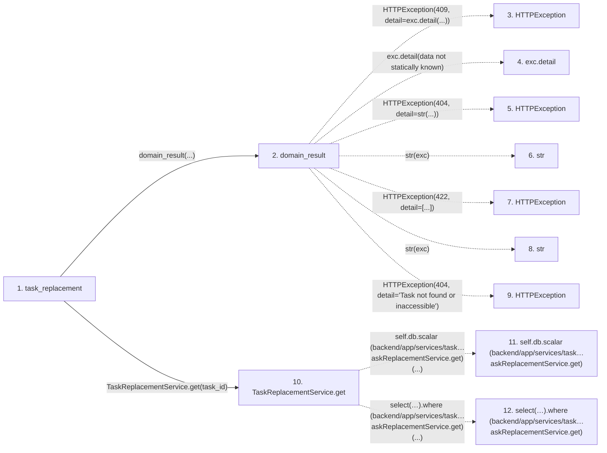

# task_replacement

**Entry point:** `task_replacement` (`http`)
**Source:** [routers_task_domain](../modules/routers_task_domain.md)
**Modules touched:** [authority](../modules/authority.md), [config](../modules/config.md), [manual_provenance_service](../modules/manual_provenance_service.md), [query_limits](../modules/query_limits.md), and 3 more

**Complete modules touched:**

- [authority](../modules/authority.md)
- [config](../modules/config.md)
- [manual_provenance_service](../modules/manual_provenance_service.md)
- [query_limits](../modules/query_limits.md)
- [review_provenance](../modules/review_provenance.md)
- [routers_task_domain](../modules/routers_task_domain.md)
- [task_replacement_service](../modules/task_replacement_service.md)

## Call sequence

> Static overview in presentation order, not runtime execution order. Arrows retain captured callers; representative internal continuations and boundary examples precede repeated helper detail.

```mermaid
sequenceDiagram
    participant p0 as task_replacement
    participant p1 as TaskReplacementService.get
    participant p2 as domain_result
    participant p3 as TaskReplacementService
    participant p4 as require_project
    participant p5 as relation_for
    participant p6 as TaskReplacementService.projection
    participant p7 as replaced_by
    participant p8 as get_settings
    participant p9 as replacing
    participant p10 as attempt_history
    participant p11 as _contributor
    participant p12 as review_history
    participant p13 as _assignments
    participant p14 as _attempt_history
    participant p15 as carried_contributors
    participant p16 as internal_authority
    participant p17 as AuthorityError
    participant p18 as Settings
    participant p19 as attributed
    participant p20 as CollectionLimitExceededError
    participant p21 as _carried_bound_row
    participant p22 as _run_history
    participant p23 as _recorded_contributions
    participant p24 as digest
    participant p25 as _submission_candidate
    participant p26 as submitted_candidate
    participant p27 as ReviewHistory
    participant p28 as _add_recorded
    participant p29 as HTTPException
    participant p30 as self.db.scalar (backend/app/services/task…askReplacementService.get)
    p0->>p1: TaskReplacementService.get
    p0->>p2: domain_result
    p0->>p3: TaskReplacementService
    p1->>p4: require_project
    p1->>p5: relation_for
    p1->>p6: TaskReplacementService.projection
    p5->>p7: replaced_by
    p4->>p8: get_settings
    p5->>p9: replacing
    p6->>p10: attempt_history
    p6->>p11: _contributor
    p10->>p12: review_history
    p10->>p13: _assignments
    p12->>p14: _attempt_history
    p12->>p15: carried_contributors
    p6->>p16: internal_authority
    p4->>p17: AuthorityError
    p8->>p18: Settings
    p11->>p19: attributed
    p13->>p20: CollectionLimitExceededError
    p15->>p21: _carried_bound_row
    p14->>p22: _run_history
    p14->>p23: _recorded_contributions
    p14->>p24: digest
    p14->>p25: _submission_candidate
    p14->>p26: submitted_candidate
    p14->>p27: ReviewHistory
    p14->>p28: _add_recorded
    p2-->>p29: HTTPException(409, detail=exc.detail(...))
    p1-->>p30: self.db.scalar (backend/app/services/task…askReplacementService.get)(...)
```

<!-- Auto-generated from static call edges. Dashed arrows are external or unresolved calls. Reviewed runtime conditions and side effects belong in Behavior. -->

> Call sequence diagram shows 30 of 123 interactions; 93 omitted to keep the visualization within the 30-interaction and generated-diagram limits, with uncertain identities omitted rather than inferred.

> Captured boundary calls: external 1 of 31 (30 omitted); unresolved 1 of 46 (45 omitted). These counts cover the captured static trace.

Omitted captured detail, grouped by actual caller occurrence and target module:

| Caller | Parent step | Target module | Kind | Omitted interactions |
| --- | --- | --- | --- | --- |
| `backend/app/routers/task_domain.py:domain_result` | 2 | - | unresolved | 1 |
| `backend/app/routers/task_domain.py:domain_result` | 2 | - | external | 5 |
| `backend/app/services/task_replacement_service.py:TaskReplacementService.get` | 10 | - | unresolved | 1 |
| `backend/app/services/task_replacement_service.py:TaskReplacementService.get` | 10 | - | external | 3 |
| `backend/app/authority.py:require_project` | 15 | - | unresolved | 2 |
| `backend/app/authority.py:require_project` | 15 | [backend/app/authority.py](../modules/authority.md) | internal | 1 |
| `backend/app/services/task_replacement_service.py:replaced_by` | 23 | [backend/app/authority.py](../modules/authority.md) | internal | 1 |
| `backend/app/authority.py:internal_authority` | 24 | - | unresolved | 1 |
> Omission summary shows 8 of 33 groups; 25 further groups are not expanded here. Counts above include all omitted interactions.
> Detailed flow queries retain their own coverage and limits; omitted paths may execute at runtime.

> Trace truncated at the depth limit; deeper calls are omitted.

## Data flow

<!-- Auto-generated static analysis. Treat values and boundaries as best-effort hints, not runtime proof. -->

### Analysis coverage

**Effect analysis partially available.** Flow assembly and source effect analysis are separate; empty observations do not prove an empty handler body.

Source steps: 47; effect analysis evaluated: 37, partial: 3, unavailable: 7. Counts include steps omitted from the displayed trace.

Collector observations for 40 source steps with known totals: observed: 236, emitted: 229, omitted: 7. Unavailable totals are excluded.

- Callable record unavailable for one or more source steps; those steps have no represented callable body.
- Effect collector omitted observations before flow assembly; displayed effects are partial.
- Effect collector totals unavailable; observed counts cover captured records only.

| Step | Callable record | Effect analysis | Collector totals | Observed | Emitted | Omitted |
|---|---|---|---|---:|---:|---:|
| `task_replacement` | `available` | `evaluated` | `available` | `3` | `3` | `0` |
| `domain_result` | `available` | `evaluated` | `available` | `3` | `3` | `0` |
| `HTTPException` | `not_applicable` | `not_applicable` | `not_applicable` | — | — | — |
| `exc.detail` | `not_applicable` | `not_applicable` | `not_applicable` | — | — | — |
| `HTTPException` | `not_applicable` | `not_applicable` | `not_applicable` | — | — | — |
| `str` | `not_applicable` | `not_applicable` | `not_applicable` | — | — | — |
| `HTTPException` | `not_applicable` | `not_applicable` | `not_applicable` | — | — | — |
| `str` | `not_applicable` | `not_applicable` | `not_applicable` | — | — | — |
| `HTTPException` | `not_applicable` | `not_applicable` | `not_applicable` | — | — | — |
| `TaskReplacementService.get` | `available` | `evaluated` | `available` | `5` | `5` | `0` |
| `self.db.scalar (backend/app/services/task…askReplacementService.get)` | `not_applicable` | `not_applicable` | `not_applicable` | — | — | — |
| `select(…).where (backend/app/services/task…askReplacementService.get)` | `not_applicable` | `not_applicable` | `not_applicable` | — | — | — |

### Step data

| Step | Inputs | Reads | Writes | Returns |
|---|---|---|---|---|
| `task_replacement` | `task_id: int`, `db: DB` | - | - | `...` |
| `domain_result` | `awaitable` | `TaskVersionConflictError` | - | `result` |
| `HTTPException` | - | - | - | - |
| `exc.detail` | - | - | - | - |
| `HTTPException` | - | - | - | - |
| `str` | - | - | - | - |
| `HTTPException` | - | - | - | - |
| `str` | - | - | - | - |
| `HTTPException` | - | - | - | - |
| `TaskReplacementService.get` | `task_id` | `Task`, `self.db`, `self.db` | - | `...` |
| `self.db.scalar (backend/app/services/task…askReplacementService.get)` | - | - | - | - |
| `select(…).where (backend/app/services/task…askReplacementService.get)` | - | - | - | - |

### Call data

| From | To | Line | Call |
|---|---|---:|---|
| task_replacement | domain_result | 335 | `domain_result(...)` |
| domain_result | HTTPException | 55 | `HTTPException(409, detail=exc.detail(...))` |
| domain_result | exc.detail | 55 | `exc.detail(data not statically known)` |
| domain_result | HTTPException | 57 | `HTTPException(404, detail=str(...))` |
| domain_result | str | 57 | `str(exc)` |
| domain_result | HTTPException | 59 | `HTTPException(422, detail=[...])` |
| domain_result | str | 59 | `str(exc)` |
| domain_result | HTTPException | 61 | `HTTPException(404, detail='Task not found or inaccessible')` |
| task_replacement | TaskReplacementService.get | 335 | `TaskReplacementService(db).get(task_id)` |
| TaskReplacementService.get | self.db.scalar (backend/app/services/task…askReplacementService.get) | 184 | `self.db.scalar(...)` |
| TaskReplacementService.get | select(…).where (backend/app/services/task…askReplacementService.get) | 184 | `select(Task).where(...)` |

### Boundary effects

*No boundary-effect observations were captured in this static trace.*

### Static analysis gaps

| Kind | Step | Target | Line |
|---|---|---|---:|
| external_call | `domain_result` | `HTTPException` | 55 |
| unresolved_call | `domain_result` | `exc.detail` | 55 |
| external_call | `domain_result` | `HTTPException` | 57 |
| external_call | `domain_result` | `HTTPException` | 59 |
| external_call | `domain_result` | `HTTPException` | 61 |
| unresolved_call | `TaskReplacementService.get` | `self.db.scalar` | 184 |
| unresolved_call | `TaskReplacementService.get` | `select(Task).where` | 184 |
| step_limit | `task_replacement` | `first 12 steps` | 0 |
| truncated_flow | `task_replacement` | `depth limit` | 0 |

## Behavior

Reads the replacement disposition of a task: its role as original or replacement, who decided and why, the carried runs, the moved dependents and releases, and the attempt history with its server-held attribution. It changes nothing.
