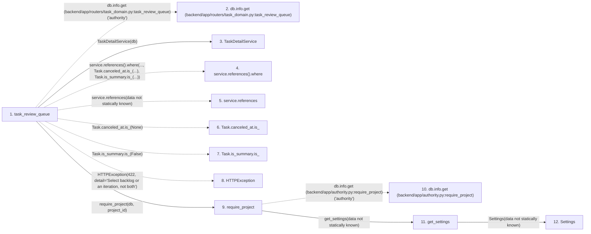

# task_review_queue

**Entry point:** `task_review_queue` (`http`)
**Source:** [routers_task_domain](../modules/routers_task_domain.md)
**Modules touched:** [authority](../modules/authority.md), [config](../modules/config.md), [routers_task_domain](../modules/routers_task_domain.md), [task_detail](../modules/task_detail.md), and 1 more

**Complete modules touched:**

- [authority](../modules/authority.md)
- [config](../modules/config.md)
- [routers_task_domain](../modules/routers_task_domain.md)
- [task_detail](../modules/task_detail.md)
- [task_detail_service](../modules/task_detail_service.md)

## Call sequence

> Static overview in presentation order, not runtime execution order. Arrows retain captured callers; representative internal continuations and boundary examples precede repeated helper detail.

```mermaid
sequenceDiagram
    participant p0 as task_review_queue
    participant p1 as require_project
    participant p2 as TaskDetailService.page
    participant p3 as TaskDetailService
    participant p4 as get_settings
    participant p5 as AuthorityError
    participant p6 as TaskReferencePage
    participant p7 as Settings
    participant p8 as HTTPException
    participant p9 as db.info.get (backend/app/routers/task_domain.py:task_review_queue)
    participant p10 as service.references().where
    participant p11 as service.references
    participant p12 as Task.canceled_at.is_
    participant p13 as Task.is_summary.is_
    participant p14 as query.where (backend/app/routers/task_domain.py:task_review_queue)
    participant p15 as Task.iteration_id.is_
    participant p16 as Task.project_id.in_
    participant p17 as authority.allows (backend/app/routers/task_domain.py:task_review_queue)
    participant p18 as or_
    participant p19 as Task.executed_by_principal_id.is_
    participant p20 as select(…).where(…).exists
    participant p21 as select(…).where
    participant p22 as select
    participant p23 as db.info.get (backend/app/authority.py:require_project)
    participant p24 as ValueError
    participant p25 as (…).all
    p0->>p1: require_project
    p0->>p2: TaskDetailService.page
    p0->>p3: TaskDetailService
    p1->>p4: get_settings
    p1->>p5: AuthorityError
    p2->>p6: TaskReferencePage
    p4->>p7: Settings
    p0-->>p8: HTTPException(422, detail='Select backlog or an iteration, not both')
    p0-->>p9: db.info.get (backend/app/routers/task_domain.py:task_review_queue)('authority')
    p0-->>p10: service.references().where(..., Task.canceled_at.is_(...), Task.is_summary.is_(...))
    p0-->>p11: service.references
    p0-->>p12: Task.canceled_at.is_(None)
    p0-->>p13: Task.is_summary.is_(False)
    p0-->>p14: query.where (backend/app/routers/task_domain.py:task_review_queue)(...)
    p0-->>p14: query.where (backend/app/routers/task_domain.py:task_review_queue)(...)
    p0-->>p14: query.where (backend/app/routers/task_domain.py:task_review_queue)(Task.iteration_id.is_(...))
    p0-->>p15: Task.iteration_id.is_(None)
    p0-->>p14: query.where (backend/app/routers/task_domain.py:task_review_queue)(Task.project_id.in_(...))
    p0-->>p16: Task.project_id.in_(...)
    p0-->>p17: authority.allows (backend/app/routers/task_domain.py:task_review_queue)(project_id, 'review')
    p0-->>p14: query.where (backend/app/routers/task_domain.py:task_review_queue)(or_(...))
    p0-->>p18: or_(Task.executed_by_principal_id.is_(...), ...)
    p0-->>p19: Task.executed_by_principal_id.is_(None)
    p0-->>p20: select(…).where(…).exists
    p0-->>p21: select(…).where(..., ..., ...)
    p0-->>p22: select(TaskProgressRecord.id)
    p0-->>p14: query.where (backend/app/routers/task_domain.py:task_review_queue)(...)
    p1-->>p23: db.info.get (backend/app/authority.py:require_project)('authority')
    p2-->>p24: ValueError('Use a limit from 1 to 100 and a nonnegative cursor')
    p2-->>p25: (…).all
```

<!-- Auto-generated from static call edges. Dashed arrows are external or unresolved calls. Reviewed runtime conditions and side effects belong in Behavior. -->

> Call sequence diagram shows 30 of 38 interactions; 8 omitted to keep the visualization within the 30-interaction and generated-diagram limits, with uncertain identities omitted rather than inferred.

> Captured boundary calls: external 4 of 5 (1 omitted); unresolved 19 of 25 (6 omitted). These counts cover the captured static trace.

Omitted captured detail, grouped by actual caller occurrence and target module:

| Caller | Parent step | Target module | Kind | Omitted interactions |
| --- | --- | --- | --- | --- |
| `backend/app/authority.py:require_project` | 9 | - | unresolved | 1 |
| `backend/app/authority.py:require_project` | 9 | [backend/app/authority.py](../modules/authority.md) | internal | 1 |
| `backend/app/services/task_detail_service.py:TaskDetailService.page` | 30 | - | unresolved | 5 |
| `backend/app/services/task_detail_service.py:TaskDetailService.page` | 30 | - | external | 1 |
> Detailed flow queries retain their own coverage and limits; omitted paths may execute at runtime.

## Data flow

<!-- Auto-generated static analysis. Treat values and boundaries as best-effort hints, not runtime proof. -->

### Analysis coverage

**Effect analysis partially available.** Flow assembly and source effect analysis are separate; empty observations do not prove an empty handler body.

Source steps: 9; effect analysis evaluated: 4, partial: 0, unavailable: 5. Counts include steps omitted from the displayed trace.

Collector observations for 4 source steps with known totals: observed: 20, emitted: 20, omitted: 0. Unavailable totals are excluded.

- Callable record unavailable for one or more source steps; those steps have no represented callable body.
- Effect collector totals unavailable; observed counts cover captured records only.

| Step | Callable record | Effect analysis | Collector totals | Observed | Emitted | Omitted |
|---|---|---|---|---:|---:|---:|
| `task_review_queue` | `available` | `evaluated` | `available` | `11` | `11` | `0` |
| `db.info.get (backend/app/routers/task_domain.py:task_review_queue)` | `not_applicable` | `not_applicable` | `not_applicable` | — | — | — |
| `TaskDetailService` | `unavailable` | `unavailable` | `unavailable` | — | — | — |
| `service.references().where` | `not_applicable` | `not_applicable` | `not_applicable` | — | — | — |
| `service.references` | `not_applicable` | `not_applicable` | `not_applicable` | — | — | — |
| `Task.canceled_at.is_` | `not_applicable` | `not_applicable` | `not_applicable` | — | — | — |
| `Task.is_summary.is_` | `not_applicable` | `not_applicable` | `not_applicable` | — | — | — |
| `HTTPException` | `not_applicable` | `not_applicable` | `not_applicable` | — | — | — |
| `require_project` | `available` | `evaluated` | `available` | `4` | `4` | `0` |
| `db.info.get (backend/app/authority.py:require_project)` | `not_applicable` | `not_applicable` | `not_applicable` | — | — | — |
| `get_settings` | `available` | `evaluated` | `available` | `1` | `1` | `0` |
| `Settings` | `unavailable` | `unavailable` | `unavailable` | — | — | — |

### Step data

| Step | Inputs | Reads | Writes | Returns |
|---|---|---|---|---|
| `task_review_queue` | `db: DB`, `limit: int`, `after_id: int`, `project_id: int \| None`, `iteration_id: int \| None`, `backlog_only: bool` | `Task`, `Task`, `Task`, `Task` | - | `...` |
| `db.info.get (backend/app/routers/task_domain.py:task_review_queue)` | - | - | - | - |
| `TaskDetailService` | - | - | - | - |
| `service.references().where` | - | - | - | - |
| `service.references` | - | - | - | - |
| `Task.canceled_at.is_` | - | - | - | - |
| `Task.is_summary.is_` | - | - | - | - |
| `HTTPException` | - | - | - | - |
| `require_project` | `db`, `project_id`, `action` | - | - | `none` |
| `db.info.get (backend/app/authority.py:require_project)` | - | - | - | - |
| `get_settings` | - | - | - | `Settings(...)` |
| `Settings` | - | - | - | - |

### Call data

| From | To | Line | Call |
|---|---|---:|---|
| task_review_queue | db.info.get (backend/app/routers/task_domain.py:task_review_queue) | 140 | `db.info.get('authority')` |
| task_review_queue | TaskDetailService | 141 | `TaskDetailService(db)` |
| task_review_queue | service.references().where | 142 | `service.references().where(..., Task.canceled_at.is_(...), Task.is_summary.is_(...))` |
| task_review_queue | service.references | 142 | `service.references(data not statically known)` |
| task_review_queue | Task.canceled_at.is_ | 142 | `Task.canceled_at.is_(None)` |
| task_review_queue | Task.is_summary.is_ | 142 | `Task.is_summary.is_(False)` |
| task_review_queue | HTTPException | 144 | `HTTPException(422, detail='Select backlog or an iteration, not both')` |
| task_review_queue | require_project | 147 | `require_project(db, project_id)` |
| require_project | db.info.get (backend/app/authority.py:require_project) | 69 | `db.info.get('authority')` |
| require_project | get_settings | 71 | `get_settings(data not statically known)` |
| get_settings | Settings | 481 | `Settings(data not statically known)` |

### Boundary effects

*No boundary-effect observations were captured in this static trace.*

### Static analysis gaps

| Kind | Step | Target | Line |
|---|---|---|---:|
| unresolved_call | `task_review_queue` | `db.info.get` | 140 |
| unresolved_call | `task_review_queue` | `service.references().where` | 142 |
| unresolved_call | `task_review_queue` | `service.references` | 142 |
| unresolved_call | `task_review_queue` | `Task.canceled_at.is_` | 142 |
| unresolved_call | `task_review_queue` | `Task.is_summary.is_` | 142 |
| external_call | `task_review_queue` | `HTTPException` | 144 |
| unresolved_call | `require_project` | `db.info.get` | 69 |
| step_limit | `task_review_queue` | `first 12 steps` | 0 |

## Behavior

Returns a bounded independent-review queue under current project review permissions. Scope filters apply before pagination. The executing principal and current progress author are excluded; an unlinked human profile does not substitute for a missing principal or review permission.
