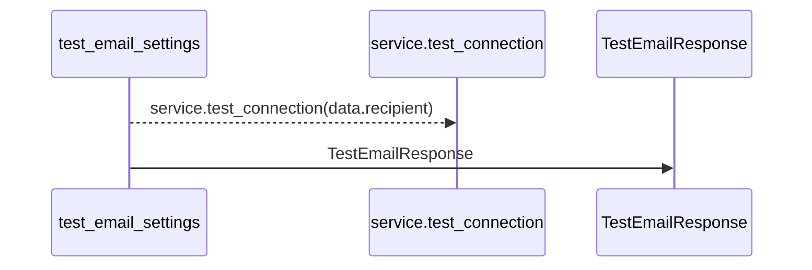
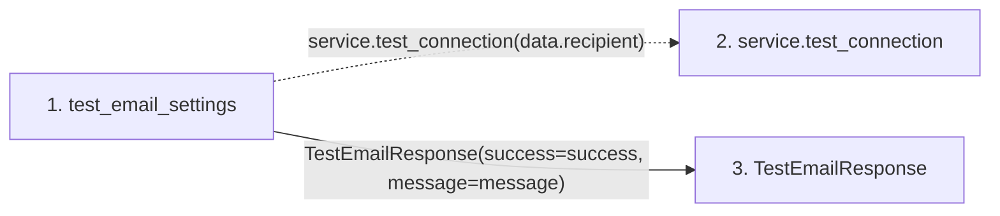

# test_email_settings

**Entry point:** `test_email_settings` (`http`)
**Source:** [routers_email_settings](../modules/routers_email_settings.md)
**Modules touched:** [routers_email_settings](../modules/routers_email_settings.md), [schemas_email_settings](../modules/schemas_email_settings.md)

## Call sequence

> Static overview in presentation order, not runtime execution order. Arrows retain captured callers; representative internal continuations and boundary examples precede repeated helper detail.

<!-- Auto-generated from static call edges. Dashed arrows are external or unresolved calls. Reviewed runtime conditions and side effects belong in Behavior. -->

> Call sequence diagram shows 2 of 2 interactions; 0 omitted to keep the visualization within the 30-interaction and generated-diagram limits, with uncertain identities omitted rather than inferred.

> Captured boundary calls: external 0 of 0 (0 omitted); unresolved 1 of 1 (0 omitted). These counts cover the captured static trace.
> Detailed flow queries retain their own coverage and limits; omitted paths may execute at runtime.

## Data flow

<!-- Auto-generated static analysis. Treat values and boundaries as best-effort hints, not runtime proof. -->

### Analysis coverage

**Effect analysis partially available.** Flow assembly and source effect analysis are separate; empty observations do not prove an empty handler body.

Source steps: 2; effect analysis evaluated: 1, partial: 0, unavailable: 1. Counts include steps omitted from the displayed trace.

Collector observations for 1 source steps with known totals: observed: 3, emitted: 3, omitted: 0. Unavailable totals are excluded.

- Callable record unavailable for one or more source steps; those steps have no represented callable body.
- Effect collector totals unavailable; observed counts cover captured records only.

| Step | Callable record | Effect analysis | Collector totals | Observed | Emitted | Omitted |
|---|---|---|---|---:|---:|---:|
| `test_email_settings` | `available` | `evaluated` | `available` | `3` | `3` | `0` |
| `service.test_connection` | `not_applicable` | `not_applicable` | `not_applicable` | — | — | — |
| `TestEmailResponse` | `unavailable` | `unavailable` | `unavailable` | — | — | — |

### Step data

| Step | Inputs | Reads | Writes | Returns |
|---|---|---|---|---|
| `test_email_settings` | `data: TestEmailRequest`, `service: Annotated[EmailSettingsService, Depends(get_settings_service)]` | - | - | `TestEmailResponse(...)` |
| `service.test_connection` | - | - | - | - |
| `TestEmailResponse` | - | - | - | - |

### Call data

| From | To | Line | Call |
|---|---|---:|---|
| test_email_settings | service.test_connection | 100 | `service.test_connection(data.recipient)` |
| test_email_settings | TestEmailResponse | 102 | `TestEmailResponse(success=success, message=message)` |

### Boundary effects

*No boundary-effect observations were captured in this static trace.*

### Static analysis gaps

| Kind | Step | Target | Line |
|---|---|---|---:|
| unresolved_call | `test_email_settings` | `service.test_connection` | 100 |

## Behavior

This flow starts at `test_email_settings` and is classified as `http`. The generated call and data-flow sections are bounded static projections; runtime conditions and side effects require source-level confirmation.
