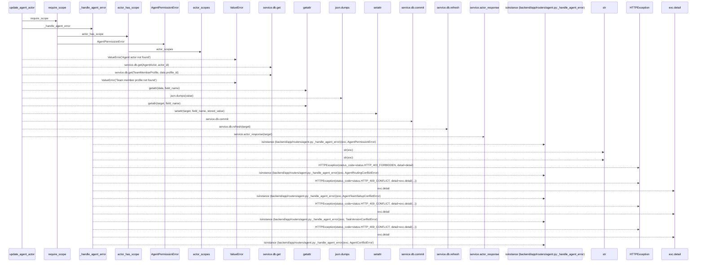
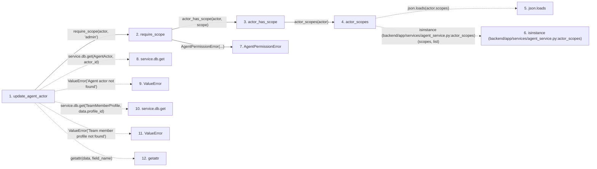

# update_agent_actor

**Entry point:** `update_agent_actor` (`http`)
**Source:** [routers_agent](../modules/routers_agent.md)
**Modules touched:** [agent_service](../modules/agent_service.md), [routers_agent](../modules/routers_agent.md)

## Call sequence

> Static overview in presentation order, not runtime execution order. Arrows retain captured callers; representative internal continuations and boundary examples precede repeated helper detail.

<!-- Auto-generated from static call edges. Dashed arrows are external or unresolved calls. Reviewed runtime conditions and side effects belong in Behavior. -->

> Call sequence diagram shows 30 of 43 interactions; 13 omitted to keep the visualization within the 30-interaction and generated-diagram limits, with uncertain identities omitted rather than inferred.

> Captured boundary calls: external 17 of 30 (13 omitted); unresolved 8 of 8 (0 omitted). These counts cover the captured static trace.

Omitted captured detail, grouped by actual caller occurrence and target module:

| Caller | Parent step | Target module | Kind | Omitted interactions |
| --- | --- | --- | --- | --- |
| `backend/app/services/agent_service.py:actor_scopes` | 4 | - | external | 2 |
| `backend/app/routers/agent.py:_handle_agent_error` | 19 | - | external | 11 |
> Detailed flow queries retain their own coverage and limits; omitted paths may execute at runtime.

## Data flow

<!-- Auto-generated static analysis. Treat values and boundaries as best-effort hints, not runtime proof. -->

### Analysis coverage

**Effect analysis partially available.** Flow assembly and source effect analysis are separate; empty observations do not prove an empty handler body.

Source steps: 6; effect analysis evaluated: 4, partial: 1, unavailable: 1. Counts include steps omitted from the displayed trace.

Collector observations for 5 source steps with known totals: observed: 31, emitted: 27, omitted: 4. Unavailable totals are excluded.

- Callable record unavailable for one or more source steps; those steps have no represented callable body.
- Effect collector omitted observations before flow assembly; displayed effects are partial.
- Effect collector totals unavailable; observed counts cover captured records only.

| Step | Callable record | Effect analysis | Collector totals | Observed | Emitted | Omitted |
|---|---|---|---|---:|---:|---:|
| `update_agent_actor` | `available` | `evaluated` | `available` | `9` | `9` | `0` |
| `require_scope` | `available` | `evaluated` | `available` | `2` | `2` | `0` |
| `actor_has_scope` | `available` | `evaluated` | `available` | `3` | `3` | `0` |
| `actor_scopes` | `available` | `evaluated` | `available` | `3` | `3` | `0` |
| `json.loads` | `not_applicable` | `not_applicable` | `not_applicable` | — | — | — |
| `isinstance (backend/app/services/agent_service.py:actor_scopes)` | `not_applicable` | `not_applicable` | `not_applicable` | — | — | — |
| `AgentPermissionError` | `unavailable` | `unavailable` | `unavailable` | — | — | — |
| `service.db.get` | `not_applicable` | `not_applicable` | `not_applicable` | — | — | — |
| `ValueError` | `not_applicable` | `not_applicable` | `not_applicable` | — | — | — |
| `service.db.get` | `not_applicable` | `not_applicable` | `not_applicable` | — | — | — |
| `ValueError` | `not_applicable` | `not_applicable` | `not_applicable` | — | — | — |
| `getattr` | `not_applicable` | `not_applicable` | `not_applicable` | — | — | — |

### Step data

| Step | Inputs | Reads | Writes | Returns |
|---|---|---|---|---|
| `update_agent_actor` | `actor_id: int`, `data: AgentActorUpdate`, `actor: Annotated[AgentActor, Depends(get_agent_admin_actor)]`, `service: Annotated[AgentWorkService, Depends(get_agent_work_service)]` | `AgentActor`, `TeamMemberProfile` | `target.lifecycle_state`, `target.queue_revision` | `service.actor_response(...)` |
| `require_scope` | `actor: AgentActor`, `scope: str` | - | - | - |
| `actor_has_scope` | `actor: AgentActor`, `scope: str` | - | - | `...` |
| `actor_scopes` | `actor: AgentActor` | `json` | - | `...` |
| `json.loads` | - | - | - | - |
| `isinstance (backend/app/services/agent_service.py:actor_scopes)` | - | - | - | - |
| `AgentPermissionError` | - | - | - | - |
| `service.db.get` | - | - | - | - |
| `ValueError` | - | - | - | - |
| `service.db.get` | - | - | - | - |
| `ValueError` | - | - | - | - |
| `getattr` | - | - | - | - |

### Call data

| From | To | Line | Call |
|---|---|---:|---|
| update_agent_actor | require_scope | 642 | `require_scope(actor, 'admin')` |
| require_scope | actor_has_scope | 100 | `actor_has_scope(actor, scope)` |
| actor_has_scope | actor_scopes | 94 | `actor_scopes(actor)` |
| actor_scopes | json.loads | 86 | `json.loads(actor.scopes)` |
| actor_scopes | isinstance (backend/app/services/agent_service.py:actor_scopes) | 89 | `isinstance(scopes, list)` |
| require_scope | AgentPermissionError | 101 | `AgentPermissionError(...)` |
| update_agent_actor | service.db.get | 643 | `service.db.get(AgentActor, actor_id)` |
| update_agent_actor | ValueError | 645 | `ValueError('Agent actor not found')` |
| update_agent_actor | service.db.get | 647 | `service.db.get(TeamMemberProfile, data.profile_id)` |
| update_agent_actor | ValueError | 649 | `ValueError('Team member profile not found')` |
| update_agent_actor | getattr | 661 | `getattr(data, field_name)` |

### Boundary effects

*No boundary-effect observations were captured in this static trace.*

### Static analysis gaps

| Kind | Step | Target | Line |
|---|---|---|---:|
| external_call | `actor_scopes` | `json.loads` | 86 |
| external_call | `actor_scopes` | `isinstance` | 89 |
| unresolved_call | `update_agent_actor` | `service.db.get` | 643 |
| external_call | `update_agent_actor` | `ValueError` | 645 |
| unresolved_call | `update_agent_actor` | `service.db.get` | 647 |
| external_call | `update_agent_actor` | `ValueError` | 649 |
| external_call | `update_agent_actor` | `getattr` | 661 |
| step_limit | `update_agent_actor` | `first 12 steps` | 0 |

## Behavior

This flow starts at `update_agent_actor` and is classified as `http`. The generated call and data-flow sections are bounded static projections; runtime conditions and side effects require source-level confirmation.
