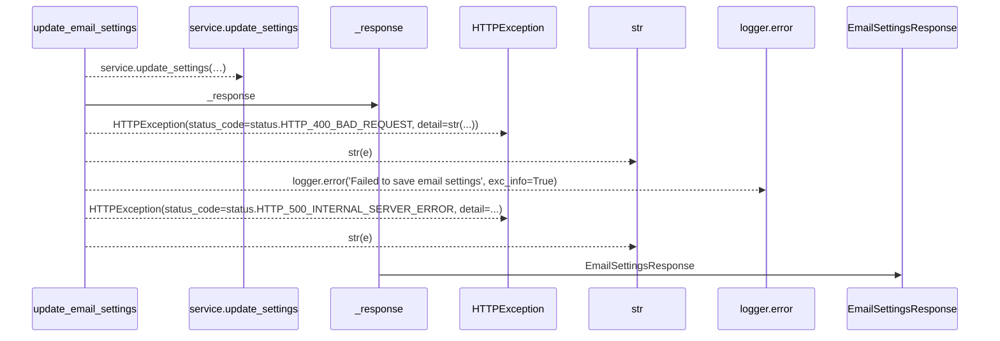
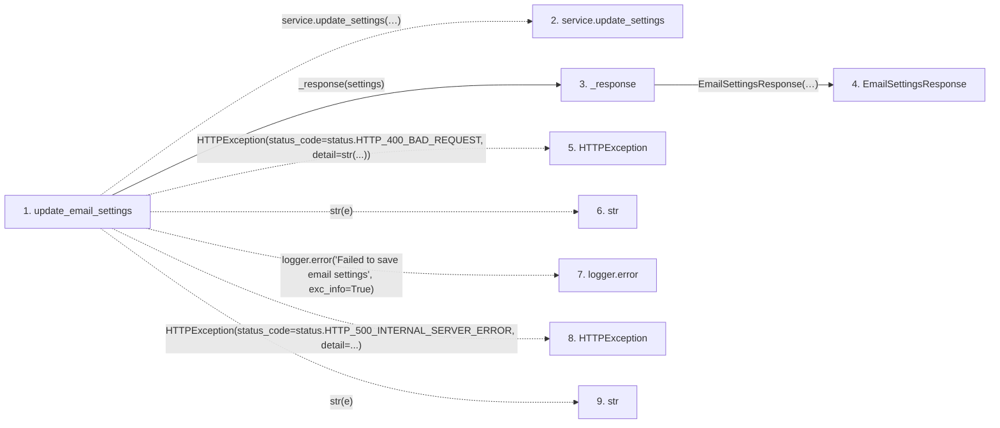

# update_email_settings

**Entry point:** `update_email_settings` (`http`)
**Source:** [routers_email_settings](../modules/routers_email_settings.md)
**Modules touched:** [routers_email_settings](../modules/routers_email_settings.md), [schemas_email_settings](../modules/schemas_email_settings.md)

## Call sequence

> Static overview in presentation order, not runtime execution order. Arrows retain captured callers; representative internal continuations and boundary examples precede repeated helper detail.

<!-- Auto-generated from static call edges. Dashed arrows are external or unresolved calls. Reviewed runtime conditions and side effects belong in Behavior. -->

> Call sequence diagram shows 8 of 8 interactions; 0 omitted to keep the visualization within the 30-interaction and generated-diagram limits, with uncertain identities omitted rather than inferred.

> Captured boundary calls: external 4 of 4 (0 omitted); unresolved 2 of 2 (0 omitted). These counts cover the captured static trace.
> Detailed flow queries retain their own coverage and limits; omitted paths may execute at runtime.

## Data flow

<!-- Auto-generated static analysis. Treat values and boundaries as best-effort hints, not runtime proof. -->

### Analysis coverage

**Effect analysis partially available.** Flow assembly and source effect analysis are separate; empty observations do not prove an empty handler body.

Source steps: 3; effect analysis evaluated: 2, partial: 0, unavailable: 1. Counts include steps omitted from the displayed trace.

Collector observations for 2 source steps with known totals: observed: 7, emitted: 7, omitted: 0. Unavailable totals are excluded.

- Callable record unavailable for one or more source steps; those steps have no represented callable body.
- Effect collector totals unavailable; observed counts cover captured records only.

| Step | Callable record | Effect analysis | Collector totals | Observed | Emitted | Omitted |
|---|---|---|---|---:|---:|---:|
| `update_email_settings` | `available` | `evaluated` | `available` | `5` | `5` | `0` |
| `service.update_settings` | `not_applicable` | `not_applicable` | `not_applicable` | — | — | — |
| `_response` | `available` | `evaluated` | `available` | `2` | `2` | `0` |
| `EmailSettingsResponse` | `unavailable` | `unavailable` | `unavailable` | — | — | — |
| `HTTPException` | `not_applicable` | `not_applicable` | `not_applicable` | — | — | — |
| `str` | `not_applicable` | `not_applicable` | `not_applicable` | — | — | — |
| `logger.error` | `not_applicable` | `not_applicable` | `not_applicable` | — | — | — |
| `HTTPException` | `not_applicable` | `not_applicable` | `not_applicable` | — | — | — |
| `str` | `not_applicable` | `not_applicable` | `not_applicable` | — | — | — |

### Step data

| Step | Inputs | Reads | Writes | Returns |
|---|---|---|---|---|
| `update_email_settings` | `data: EmailSettingsUpdate`, `service: Annotated[EmailSettingsService, Depends(get_settings_service)]` | `status`, `status` | - | `_response(...)` |
| `service.update_settings` | - | - | - | - |
| `_response` | `settings` | - | - | `EmailSettingsResponse(...)` |
| `EmailSettingsResponse` | - | - | - | - |
| `HTTPException` | - | - | - | - |
| `str` | - | - | - | - |
| `logger.error` | - | - | - | - |
| `HTTPException` | - | - | - | - |
| `str` | - | - | - | - |

### Call data

| From | To | Line | Call |
|---|---|---:|---|
| update_email_settings | service.update_settings | 67 | `service.update_settings(enabled=data.enabled, smtp_host=data.smtp_host, smtp_port=data.smtp_port, smtp_user=data.smtp_user, smtp_password=data.smtp_password, smtp_from_email=data.smtp_from_email, smtp_use_tls=data.smtp_use_tls, clear_smtp_password=data.clear_smtp_password)` |
| update_email_settings | _response | 78 | `_response(settings)` |
| _response | EmailSettingsResponse | 24 | `EmailSettingsResponse(enabled=settings.enabled, smtp_host=settings.smtp_host, smtp_port=settings.smtp_port, smtp_user=settings.smtp_user, smtp_from_email=settings.smtp_from_email, smtp_use_tls=settings.smtp_use_tls, has_password=settings.has_password, field_sources=settings.field_sources)` |
| update_email_settings | HTTPException | 80 | `HTTPException(status_code=status.HTTP_400_BAD_REQUEST, detail=str(...))` |
| update_email_settings | str | 82 | `str(e)` |
| update_email_settings | logger.error | 87 | `logger.error('Failed to save email settings', exc_info=True)` |
| update_email_settings | HTTPException | 88 | `HTTPException(status_code=status.HTTP_500_INTERNAL_SERVER_ERROR, detail=...)` |
| update_email_settings | str | 90 | `str(e)` |

### Boundary effects

*No boundary-effect observations were captured in this static trace.*

### Static analysis gaps

| Kind | Step | Target | Line |
|---|---|---|---:|
| unresolved_call | `update_email_settings` | `service.update_settings` | 67 |
| external_call | `update_email_settings` | `HTTPException` | 80 |
| unresolved_call | `update_email_settings` | `logger.error` | 87 |
| external_call | `update_email_settings` | `HTTPException` | 88 |

## Behavior

This flow starts at `update_email_settings` and is classified as `http`. The generated call and data-flow sections are bounded static projections; runtime conditions and side effects require source-level confirmation.
