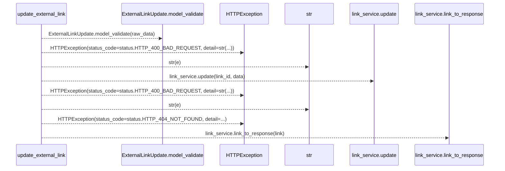
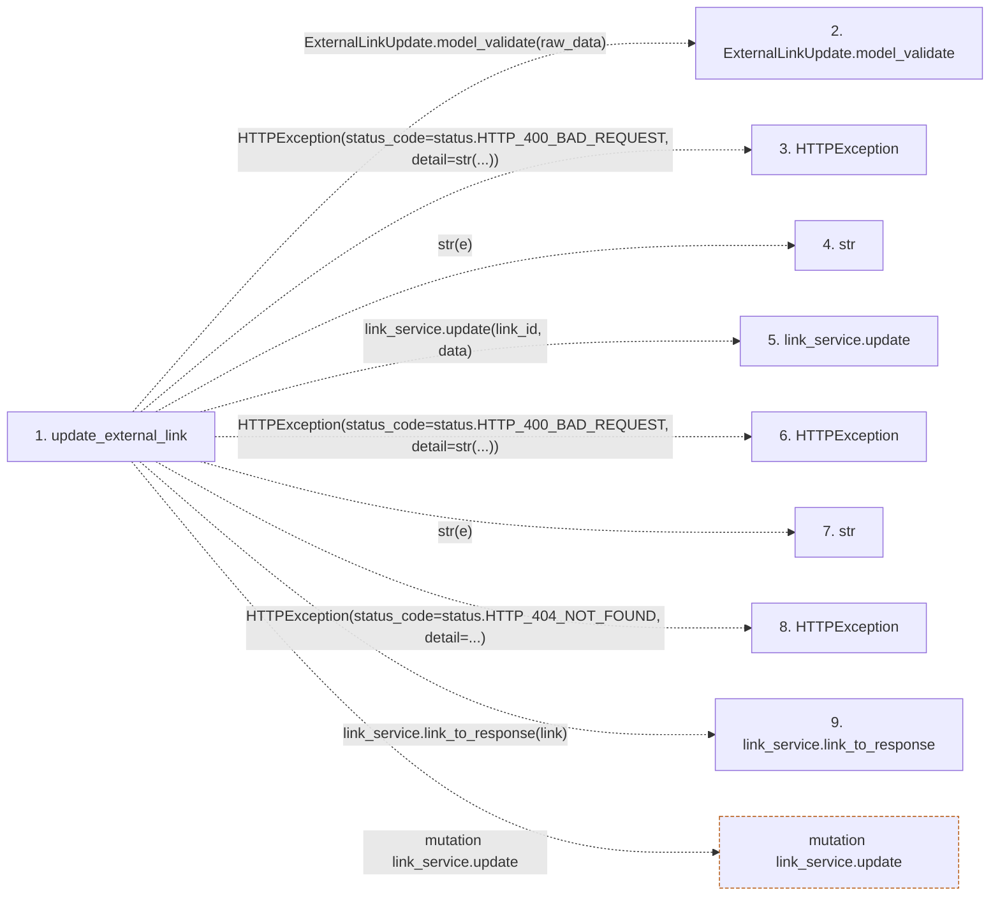

# update_external_link

**Entry point:** `update_external_link` (`http`)
**Source:** [tasks](../modules/tasks.md)
**Modules touched:** [tasks](../modules/tasks.md)

## Call sequence

> Static overview in presentation order, not runtime execution order. Arrows retain captured callers; representative internal continuations and boundary examples precede repeated helper detail.

<!-- Auto-generated from static call edges. Dashed arrows are external or unresolved calls. Reviewed runtime conditions and side effects belong in Behavior. -->

> Call sequence diagram shows 8 of 8 interactions; 0 omitted to keep the visualization within the 30-interaction and generated-diagram limits, with uncertain identities omitted rather than inferred.

> Captured boundary calls: external 5 of 5 (0 omitted); unresolved 3 of 3 (0 omitted). These counts cover the captured static trace.
> Detailed flow queries retain their own coverage and limits; omitted paths may execute at runtime.

## Data flow

<!-- Auto-generated static analysis. Treat values and boundaries as best-effort hints, not runtime proof. -->

### Analysis coverage

**Effect analysis evaluated.** Flow assembly and source effect analysis are separate; empty observations do not prove an empty handler body.

Source steps: 1; effect analysis evaluated: 1, partial: 0, unavailable: 0. Counts include steps omitted from the displayed trace.

Collector observations for 1 source steps with known totals: observed: 10, emitted: 10, omitted: 0. Unavailable totals are excluded.

### Step data

| Step | Inputs | Reads | Writes | Returns |
|---|---|---|---|---|
| `update_external_link` | `link_id: int`, `raw_data: Annotated[dict, Body(...)]`, `link_service: Annotated[ExternalLinkService, Depends(get_external_link_service)]` | `ValidationError`, `status`, `ExternalLinkValidationError`, `status`, `status` | - | `link_service.link_to_response(...)` |
| `ExternalLinkUpdate.model_validate` | - | - | - | - |
| `HTTPException` | - | - | - | - |
| `str` | - | - | - | - |
| `link_service.update` | - | - | - | - |
| `HTTPException` | - | - | - | - |
| `str` | - | - | - | - |
| `HTTPException` | - | - | - | - |
| `link_service.link_to_response` | - | - | - | - |

### Call data

| From | To | Line | Call |
|---|---|---:|---|
| update_external_link | ExternalLinkUpdate.model_validate | 529 | `ExternalLinkUpdate.model_validate(raw_data)` |
| update_external_link | HTTPException | 531 | `HTTPException(status_code=status.HTTP_400_BAD_REQUEST, detail=str(...))` |
| update_external_link | str | 533 | `str(e)` |
| update_external_link | link_service.update | 537 | `link_service.update(link_id, data)` |
| update_external_link | HTTPException | 539 | `HTTPException(status_code=status.HTTP_400_BAD_REQUEST, detail=str(...))` |
| update_external_link | str | 539 | `str(e)` |
| update_external_link | HTTPException | 541 | `HTTPException(status_code=status.HTTP_404_NOT_FOUND, detail=...)` |
| update_external_link | link_service.link_to_response | 545 | `link_service.link_to_response(link)` |

### Boundary effects

| Kind | Target | Step | Line |
|---|---|---|---:|
| mutation | `link_service.update` | `update_external_link` | 537 |

### Static analysis gaps

| Kind | Step | Target | Line |
|---|---|---|---:|
| unresolved_call | `update_external_link` | `ExternalLinkUpdate.model_validate` | 529 |
| external_call | `update_external_link` | `HTTPException` | 531 |
| external_call | `update_external_link` | `HTTPException` | 539 |
| external_call | `update_external_link` | `HTTPException` | 541 |
| unresolved_call | `update_external_link` | `link_service.link_to_response` | 545 |

## Behavior

Applies a partial update after checking the resulting provider and URL pair, so a loopback URL cannot remain on, or move to, a provider other than `agdash`. Validation errors return 400; a missing link returns 404.
