# update_project

**Entry point:** `update_project` (`http`)
**Source:** [projects](../modules/projects.md)
**Modules touched:** [config](../modules/config.md), [language_service](../modules/language_service.md), [projects](../modules/projects.md), [system_settings_service](../modules/system_settings_service.md), and 1 more

**Complete modules touched:**

- [config](../modules/config.md)
- [language_service](../modules/language_service.md)
- [projects](../modules/projects.md)
- [system_settings_service](../modules/system_settings_service.md)
- [url_policy](../modules/url_policy.md)

## Call sequence

> Static overview in presentation order, not runtime execution order. Arrows retain captured callers; representative internal continuations and boundary examples precede repeated helper detail.

```mermaid
sequenceDiagram
    participant p0 as update_project
    participant p1 as _localized_detail
    participant p2 as _not_found_detail
    participant p3 as resolve_runtime_ui_language
    participant p4 as backend_error_message
    participant p5 as RuntimeSettingsService.get_app_settings
    participant p6 as entity_not_found_message
    participant p7 as get_settings
    participant p8 as scoped_entity_not_found_message
    participant p9 as entity_deleted_message
    participant p10 as RuntimeSettingsService.resolve
    participant p11 as localized
    participant p12 as RuntimeSettingsService._definition
    participant p13 as RuntimeSettingsService._decrypt_secret
    participant p14 as RuntimeSettingsService._coerce
    participant p15 as normalize_language
    participant p16 as RuntimeSettingsService
    participant p17 as Settings
    participant p18 as RuntimeSettingsService._row
    participant p19 as RuntimeSettingsService._env_value
    participant p20 as RuntimeSettingsError
    participant p21 as RuntimeSettingsService._fernet
    participant p22 as RuntimeSettingsEncryptionError
    participant p23 as normalize_provider_api_url
    participant p24 as HTTPException
    participant p25 as service.update
    participant p26 as str (backend/app/routers/projects.py:update_project)
    participant p27 as message.lower
    participant p28 as re.fullmatch
    participant p29 as match.groups
    p0->>p1: _localized_detail
    p0->>p2: _not_found_detail
    p1->>p3: resolve_runtime_ui_language
    p1->>p4: backend_error_message
    p3->>p5: RuntimeSettingsService.get_app_settings
    p4->>p6: entity_not_found_message
    p3->>p7: get_settings
    p4->>p8: scoped_entity_not_found_message
    p4->>p9: entity_deleted_message
    p5->>p10: RuntimeSettingsService.resolve
    p6->>p11: localized
    p10->>p12: RuntimeSettingsService._definition
    p10->>p13: RuntimeSettingsService._decrypt_secret
    p10->>p14: RuntimeSettingsService._coerce
    p3->>p15: normalize_language
    p3->>p16: RuntimeSettingsService
    p7->>p17: Settings
    p10->>p18: RuntimeSettingsService._row
    p10->>p19: RuntimeSettingsService._env_value
    p12->>p20: RuntimeSettingsError
    p13->>p21: RuntimeSettingsService._fernet
    p13->>p22: RuntimeSettingsEncryptionError
    p14->>p23: normalize_provider_api_url
    p0-->>p24: HTTPException(status_code=status.HTTP_400_BAD_REQUEST, detail=...)
    p0-->>p25: service.update(project_id, data)
    p0-->>p26: str (backend/app/routers/projects.py:update_project)(e)
    p0-->>p24: HTTPException(status_code=status.HTTP_404_NOT_FOUND, detail=...)
    p4-->>p27: message.lower
    p4-->>p28: re.fullmatch('(.+) with id ([^ ]+) not found', message)
    p4-->>p29: match.groups
```

<!-- Auto-generated from static call edges. Dashed arrows are external or unresolved calls. Reviewed runtime conditions and side effects belong in Behavior. -->

> Call sequence diagram shows 30 of 165 interactions; 135 omitted to keep the visualization within the 30-interaction and generated-diagram limits, with uncertain identities omitted rather than inferred.

> Captured boundary calls: external 4 of 47 (43 omitted); unresolved 3 of 70 (67 omitted). These counts cover the captured static trace.

Omitted captured detail, grouped by actual caller occurrence and target module:

| Caller | Parent step | Target module | Kind | Omitted interactions |
| --- | --- | --- | --- | --- |
| `backend/app/services/language_service.py:normalize_language` | 6 | - | unresolved | 2 |
| `backend/app/services/language_service.py:normalize_language` | 6 | - | external | 1 |
| `backend/app/services/system_settings_service.py:RuntimeSettingsService._definition` | 12 | - | unresolved | 1 |
| `backend/app/services/system_settings_service.py:RuntimeSettingsService._row` | 15 | - | unresolved | 3 |
| `backend/app/services/system_settings_service.py:RuntimeSettingsService._row` | 15 | - | external | 1 |
| `backend/app/services/system_settings_service.py:RuntimeSettingsService._decrypt_secret` | 20 | - | unresolved | 3 |
| `backend/app/services/system_settings_service.py:RuntimeSettingsService._coerce` | 26 | - | external | 8 |
| `backend/app/services/system_settings_service.py:RuntimeSettingsService._coerce` | 26 | [backend/app/services/system_settings_service.py](../modules/system_settings_service.md) | internal | 14 |
> Omission summary shows 8 of 27 groups; 19 further groups are not expanded here. Counts above include all omitted interactions.
> Detailed flow queries retain their own coverage and limits; omitted paths may execute at runtime.

> Trace truncated at the depth limit; deeper calls are omitted.

## Data flow

<!-- Auto-generated static analysis. Treat values and boundaries as best-effort hints, not runtime proof. -->

### Analysis coverage

**Effect analysis partially available.** Flow assembly and source effect analysis are separate; empty observations do not prove an empty handler body.

Source steps: 49; effect analysis evaluated: 30, partial: 1, unavailable: 18. Counts include steps omitted from the displayed trace.

Collector observations for 31 source steps with known totals: observed: 161, emitted: 135, omitted: 26. Unavailable totals are excluded.

- Callable record unavailable for one or more source steps; those steps have no represented callable body.
- Effect collector omitted observations before flow assembly; displayed effects are partial.
- Effect collector totals unavailable; observed counts cover captured records only.

| Step | Callable record | Effect analysis | Collector totals | Observed | Emitted | Omitted |
|---|---|---|---|---:|---:|---:|
| `update_project` | `available` | `evaluated` | `available` | `7` | `7` | `0` |
| `service.update` | `not_applicable` | `not_applicable` | `not_applicable` | — | — | — |
| `HTTPException` | `not_applicable` | `not_applicable` | `not_applicable` | — | — | — |
| `_localized_detail` | `available` | `evaluated` | `available` | `3` | `3` | `0` |
| `resolve_runtime_ui_language` | `available` | `evaluated` | `available` | `5` | `5` | `0` |
| `normalize_language` | `available` | `evaluated` | `available` | `4` | `4` | `0` |
| `str(…).strip().lower` | `not_applicable` | `not_applicable` | `not_applicable` | — | — | — |
| `str(…).strip (backend/app/services/lang…ice.py:normalize_language)` | `not_applicable` | `not_applicable` | `not_applicable` | — | — | — |
| `str (backend/app/services/lang…ice.py:normalize_language)` | `not_applicable` | `not_applicable` | `not_applicable` | — | — | — |
| `RuntimeSettingsService.get_app_settings` | `available` | `evaluated` | `available` | `1` | `1` | `0` |
| `RuntimeSettingsService.resolve` | `available` | `evaluated` | `available` | `4` | `4` | `0` |
| `RuntimeSettingsService._definition` | `available` | `evaluated` | `available` | `2` | `2` | `0` |

```mermaid
flowchart LR
    s1["1. update_project"]
    s2["2. service.update"]
    s3["3. HTTPException"]
    s4["4. _localized_detail"]
    s5["5. resolve_runtime_ui_language"]
    s6["6. normalize_language"]
    s7["7. str(…).strip().lower"]
    s8["8. str(…).strip (backend/app/services/lang…ice.py:normalize_language)"]
    s9["9. str (backend/app/services/lang…ice.py:normalize_language)"]
    s10["10. RuntimeSettingsService.get_app_settings"]
    s11["11. RuntimeSettingsService.resolve"]
    s12["12. RuntimeSettingsService._definition"]
    s1 -. "service.update(project_id, data)" .-> s2
    s1 -. "HTTPException(status_code=status.HTTP_400_BAD_REQUEST, detail=...)" .-> s3
    s1 -->|"_localized_detail(service, str(...))"| s4
    s4 -->|"resolve_runtime_ui_language(service.db)"| s5
    s5 -->|"normalize_language(default)"| s6
    s6 -. "str(…).strip().lower(data not statically known)" .-> s7
    s6 -. "str(…).strip (backend/app/services/lang…ice.py:normalize_language)(data not statically known)" .-> s8
    s6 -. "str (backend/app/services/lang…ice.py:normalize_language)(...)" .-> s9
    s5 -->|"RuntimeSettingsService.get_app_settings(data not statically known)"| s10
    s10 -->|"RuntimeSettingsService.resolve('app.ui_language')"| s11
    s11 -->|"RuntimeSettingsService._definition(key)"| s12
    b0["mutation service.update"]
    s1 -. "mutation service.update" .-> b0
    click s1 "../modules/projects.md"
    click s4 "../modules/projects.md"
    click s5 "../modules/language_service.md"
    click s6 "../modules/language_service.md"
    click s10 "../modules/system_settings_service.md"
    click s11 "../modules/system_settings_service.md"
    click s12 "../modules/system_settings_service.md"
    classDef boundary stroke:#b45309,stroke-dasharray: 4 2
    class b0 boundary
```

### Step data

| Step | Inputs | Reads | Writes | Returns |
|---|---|---|---|---|
| `update_project` | `project_id: int`, `data: ProjectUpdate`, `service: Annotated[ProjectService, Depends(get_project_service)]` | `status`, `status` | - | `project` |
| `service.update` | - | - | - | - |
| `HTTPException` | - | - | - | - |
| `_localized_detail` | `service: Any`, `message: str` | - | - | `backend_error_message(...)` |
| `resolve_runtime_ui_language` | `db: Any`, `default: LanguageCode \| None` | - | - | `normalize_language(...)`, `normalize_language(...)`, `fallback` |
| `normalize_language` | `value: Any`, `default: LanguageCode` | - | - | `normalized`, `default` |
| `str(…).strip().lower` | - | - | - | - |
| `str(…).strip (backend/app/services/lang…ice.py:normalize_language)` | - | - | - | - |
| `str (backend/app/services/lang…ice.py:normalize_language)` | - | - | - | - |
| `RuntimeSettingsService.get_app_settings` | - | - | - | `SimpleNamespace(...)` |
| `RuntimeSettingsService.resolve` | `key: str` | - | - | `(...)`, `(...)`, `(...)` |
| `RuntimeSettingsService._definition` | `key: str` | - | - | `definition` |

### Call data

| From | To | Line | Call |
|---|---|---:|---|
| update_project | service.update | 249 | `service.update(project_id, data)` |
| update_project | HTTPException | 251 | `HTTPException(status_code=status.HTTP_400_BAD_REQUEST, detail=...)` |
| update_project | _localized_detail | 253 | `_localized_detail(service, str(...))` |
| _localized_detail | resolve_runtime_ui_language | 68 | `resolve_runtime_ui_language(service.db)` |
| resolve_runtime_ui_language | normalize_language | 406 | `normalize_language(default)` |
| normalize_language | str(…).strip().lower | 35 | `str(value or '').strip().lower(data not statically known)` |
| normalize_language | str(…).strip (backend/app/services/lang…ice.py:normalize_language) | 35 | `str(value or '').strip(data not statically known)` |
| normalize_language | str (backend/app/services/lang…ice.py:normalize_language) | 35 | `str(...)` |
| resolve_runtime_ui_language | RuntimeSettingsService.get_app_settings | 411 | `RuntimeSettingsService(db).get_app_settings(data not statically known)` |
| RuntimeSettingsService.get_app_settings | RuntimeSettingsService.resolve | 337 | `self.resolve('app.ui_language')` |
| RuntimeSettingsService.resolve | RuntimeSettingsService._definition | 284 | `self._definition(key)` |

### Boundary effects

| Kind | Target | Step | Line |
|---|---|---|---:|
| mutation | `service.update` | `update_project` | 249 |

### Static analysis gaps

| Kind | Step | Target | Line |
|---|---|---|---:|
| external_call | `update_project` | `HTTPException` | 251 |
| unresolved_call | `normalize_language` | `str(value or '').strip().lower` | 35 |
| unresolved_call | `normalize_language` | `str(value or '').strip` | 35 |
| step_limit | `update_project` | `first 12 steps` | 0 |
| truncated_flow | `update_project` | `depth limit` | 0 |

## Behavior

This flow starts at `update_project` and is classified as `http`. The generated call and data-flow sections are bounded static projections; runtime conditions and side effects require source-level confirmation.
