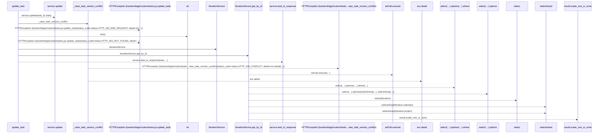
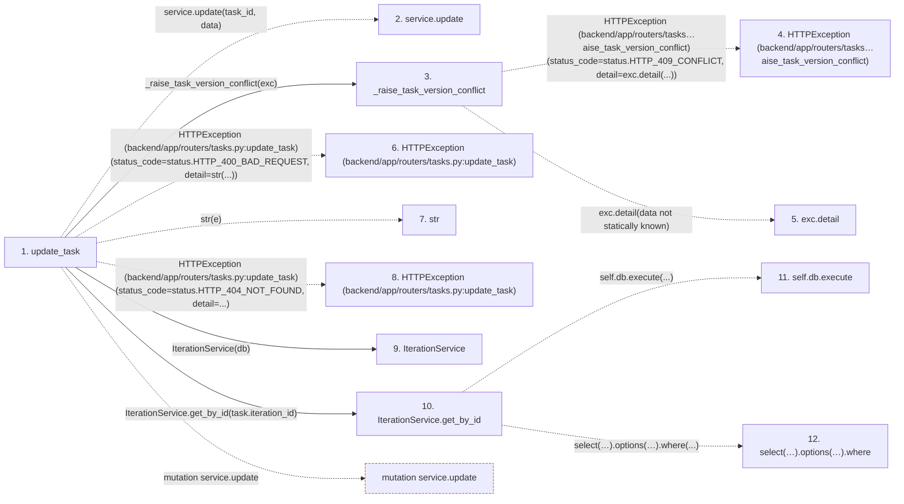

# update_task

**Entry point:** `update_task` (`http`)
**Source:** [tasks](../modules/tasks.md)
**Modules touched:** [iteration_service](../modules/iteration_service.md), [tasks](../modules/tasks.md)

## Call sequence

> Static overview in presentation order, not runtime execution order. Arrows retain captured callers; representative internal continuations and boundary examples precede repeated helper detail.

<!-- Auto-generated from static call edges. Dashed arrows are external or unresolved calls. Reviewed runtime conditions and side effects belong in Behavior. -->

> Call sequence diagram shows 17 of 17 interactions; 0 omitted to keep the visualization within the 30-interaction and generated-diagram limits, with uncertain identities omitted rather than inferred.

> Captured boundary calls: external 7 of 7 (0 omitted); unresolved 7 of 7 (0 omitted). These counts cover the captured static trace.
> Detailed flow queries retain their own coverage and limits; omitted paths may execute at runtime.

## Data flow

<!-- Auto-generated static analysis. Treat values and boundaries as best-effort hints, not runtime proof. -->

### Analysis coverage

**Effect analysis partially available.** Flow assembly and source effect analysis are separate; empty observations do not prove an empty handler body.

Source steps: 4; effect analysis evaluated: 3, partial: 0, unavailable: 1. Counts include steps omitted from the displayed trace.

Collector observations for 3 source steps with known totals: observed: 14, emitted: 14, omitted: 0. Unavailable totals are excluded.

- Callable record unavailable for one or more source steps; those steps have no represented callable body.
- Effect collector totals unavailable; observed counts cover captured records only.

| Step | Callable record | Effect analysis | Collector totals | Observed | Emitted | Omitted |
|---|---|---|---|---:|---:|---:|
| `update_task` | `available` | `evaluated` | `available` | `9` | `9` | `0` |
| `service.update` | `not_applicable` | `not_applicable` | `not_applicable` | — | — | — |
| `_raise_task_version_conflict` | `available` | `evaluated` | `available` | `2` | `2` | `0` |
| `HTTPException (backend/app/routers/tasks…aise_task_version_conflict)` | `not_applicable` | `not_applicable` | `not_applicable` | — | — | — |
| `exc.detail` | `not_applicable` | `not_applicable` | `not_applicable` | — | — | — |
| `HTTPException (backend/app/routers/tasks.py:update_task)` | `not_applicable` | `not_applicable` | `not_applicable` | — | — | — |
| `str` | `not_applicable` | `not_applicable` | `not_applicable` | — | — | — |
| `HTTPException (backend/app/routers/tasks.py:update_task)` | `not_applicable` | `not_applicable` | `not_applicable` | — | — | — |
| `IterationService` | `unavailable` | `unavailable` | `unavailable` | — | — | — |
| `IterationService.get_by_id` | `available` | `evaluated` | `available` | `3` | `3` | `0` |
| `self.db.execute` | `not_applicable` | `not_applicable` | `not_applicable` | — | — | — |
| `select(…).options(…).where` | `not_applicable` | `not_applicable` | `not_applicable` | — | — | — |

### Step data

| Step | Inputs | Reads | Writes | Returns |
|---|---|---|---|---|
| `update_task` | `task_id: int`, `data: TaskUpdate`, `service: Annotated[TaskService, Depends(get_task_service)]`, `db: Annotated[AsyncSession, Depends(get_db, scope='function')]` | `TaskVersionConflictError`, `status`, `status` | - | `service.task_to_response(...)` |
| `service.update` | - | - | - | - |
| `_raise_task_version_conflict` | `exc: TaskVersionConflictError` | `status` | - | - |
| `HTTPException (backend/app/routers/tasks…aise_task_version_conflict)` | - | - | - | - |
| `exc.detail` | - | - | - | - |
| `HTTPException (backend/app/routers/tasks.py:update_task)` | - | - | - | - |
| `str` | - | - | - | - |
| `HTTPException (backend/app/routers/tasks.py:update_task)` | - | - | - | - |
| `IterationService` | - | - | - | - |
| `IterationService.get_by_id` | `iteration_id: int` | `Iteration` | - | `result.scalar_one_or_none(...)` |
| `self.db.execute` | - | - | - | - |
| `select(…).options(…).where` | - | - | - | - |

### Call data

| From | To | Line | Call |
|---|---|---:|---|
| update_task | service.update | 334 | `service.update(task_id, data)` |
| update_task | _raise_task_version_conflict | 336 | `_raise_task_version_conflict(exc)` |
| _raise_task_version_conflict | HTTPException (backend/app/routers/tasks…aise_task_version_conflict) | 59 | `HTTPException(status_code=status.HTTP_409_CONFLICT, detail=exc.detail(...))` |
| _raise_task_version_conflict | exc.detail | 61 | `exc.detail(data not statically known)` |
| update_task | HTTPException (backend/app/routers/tasks.py:update_task) | 338 | `HTTPException(status_code=status.HTTP_400_BAD_REQUEST, detail=str(...))` |
| update_task | str | 340 | `str(e)` |
| update_task | HTTPException (backend/app/routers/tasks.py:update_task) | 343 | `HTTPException(status_code=status.HTTP_404_NOT_FOUND, detail=...)` |
| update_task | IterationService | 348 | `IterationService(db)` |
| update_task | IterationService.get_by_id | 349 | `iteration_service.get_by_id(task.iteration_id)` |
| IterationService.get_by_id | self.db.execute | 323 | `self.db.execute(...)` |
| IterationService.get_by_id | select(…).options(…).where | 324 | `select(Iteration).options(selectinload(Iteration.calendar), selectinload(Iteration.project)).where(...)` |

### Boundary effects

| Kind | Target | Step | Line |
|---|---|---|---:|
| mutation | `service.update` | `update_task` | 334 |

### Static analysis gaps

| Kind | Step | Target | Line |
|---|---|---|---:|
| external_call | `_raise_task_version_conflict` | `HTTPException` | 59 |
| unresolved_call | `_raise_task_version_conflict` | `exc.detail` | 61 |
| external_call | `update_task` | `HTTPException` | 338 |
| external_call | `update_task` | `HTTPException` | 343 |
| unresolved_call | `IterationService.get_by_id` | `self.db.execute` | 323 |
| unresolved_call | `IterationService.get_by_id` | `select(Iteration).options(selectinload(Iteration.calendar), selectinload(Iteration.project)).where` | 324 |
| step_limit | `update_task` | `first 12 steps` | 0 |

## Behavior

This flow starts at `update_task` and is classified as `http`. The generated call and data-flow sections are bounded static projections; runtime conditions and side effects require source-level confirmation.

Backlog project changes require edit permission in both scopes. Project locks are acquired in ascending ID order and the task scope is rechecked before writing. The complete subtree must have no incoming or outgoing dependency across its boundary. Both backlogs receive transactional recovery points, descendants reserve one version per command, and rejected moves roll everything back. Actual dependency changes invalidate current progress and acceptance through general updates and individual add/remove commands. Immutable evidence history remains available, a command reserves one task version, and no-op dependency requests retain their current version. Locked graph relationships are loaded explicitly before applying a dependency update.
