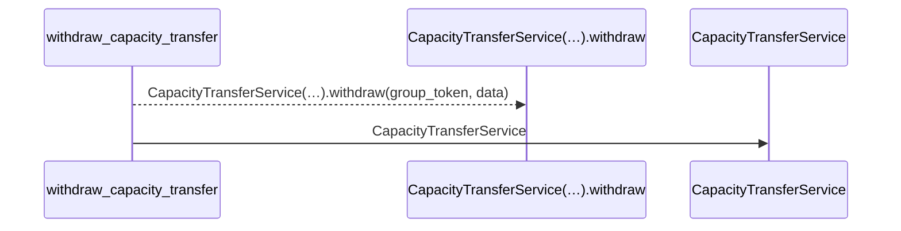
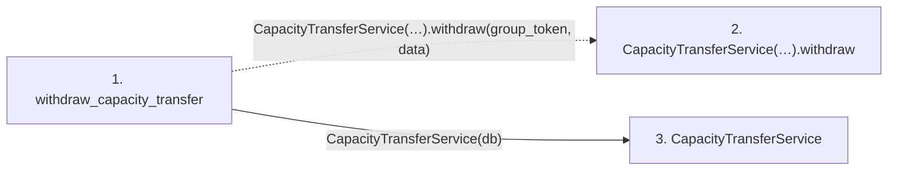

# withdraw_capacity_transfer

**Entry point:** `withdraw_capacity_transfer` (`http`)
**Source:** [routers_team](../modules/routers_team.md)
**Modules touched:** [capacity_transfers](../modules/capacity_transfers.md), [routers_team](../modules/routers_team.md)

## Call sequence

> Static overview in presentation order, not runtime execution order. Arrows retain captured callers; representative internal continuations and boundary examples precede repeated helper detail.

<!-- Auto-generated from static call edges. Dashed arrows are external or unresolved calls. Reviewed runtime conditions and side effects belong in Behavior. -->

> Call sequence diagram shows 2 of 2 interactions; 0 omitted to keep the visualization within the 30-interaction and generated-diagram limits, with uncertain identities omitted rather than inferred.

> Captured boundary calls: external 0 of 0 (0 omitted); unresolved 1 of 1 (0 omitted). These counts cover the captured static trace.
> Detailed flow queries retain their own coverage and limits; omitted paths may execute at runtime.

## Data flow

<!-- Auto-generated static analysis. Treat values and boundaries as best-effort hints, not runtime proof. -->

### Analysis coverage

**Effect analysis partially available.** Flow assembly and source effect analysis are separate; empty observations do not prove an empty handler body.

Source steps: 2; effect analysis evaluated: 1, partial: 0, unavailable: 1. Counts include steps omitted from the displayed trace.

Collector observations for 1 source steps with known totals: observed: 4, emitted: 4, omitted: 0. Unavailable totals are excluded.

- Callable record unavailable for one or more source steps; those steps have no represented callable body.
- Effect collector totals unavailable; observed counts cover captured records only.

| Step | Callable record | Effect analysis | Collector totals | Observed | Emitted | Omitted |
|---|---|---|---|---:|---:|---:|
| `withdraw_capacity_transfer` | `available` | `evaluated` | `available` | `4` | `4` | `0` |
| `CapacityTransferService(…).withdraw` | `not_applicable` | `not_applicable` | `not_applicable` | — | — | — |
| `CapacityTransferService` | `unavailable` | `unavailable` | `unavailable` | — | — | — |

### Step data

| Step | Inputs | Reads | Writes | Returns |
|---|---|---|---|---|
| `withdraw_capacity_transfer` | `group_token: Annotated[str, Path(max_length=36)]`, `data: CapacityTransferWithdrawal`, `db: Annotated[AsyncSession, Depends(get_db, scope='function')]` | - | - | `...` |
| `CapacityTransferService(…).withdraw` | - | - | - | - |
| `CapacityTransferService` | - | - | - | - |

### Call data

| From | To | Line | Call |
|---|---|---:|---|
| withdraw_capacity_transfer | CapacityTransferService(…).withdraw | 367 | `CapacityTransferService(db).withdraw(group_token, data)` |
| withdraw_capacity_transfer | CapacityTransferService | 367 | `CapacityTransferService(db)` |

### Boundary effects

*No boundary-effect observations were captured in this static trace.*

### Static analysis gaps

| Kind | Step | Target | Line |
|---|---|---|---:|
| unresolved_call | `withdraw_capacity_transfer` | `CapacityTransferService(db).withdraw` | 367 |

## Behavior

A temporary capacity transfer lends part of the availability of one or more source rows to a target row of the same person for a dated range. It is recorded as dated adjustments sharing one group token, so each source counts its own percentage minus the lent percentage and the target adds the lent total on those dates only; the prior shares return after the end date without a scheduled job and the rows' own percentages are never edited. Preview rolls everything back. Apply and withdraw are one shared planning input command over every row they change, so both sides change together or not at all, and an intervening change to an affected iteration is a revision conflict. No task, assignment or run changes, and a source reduction or target restoration on dates where that row's issued work is scheduled is refused.
