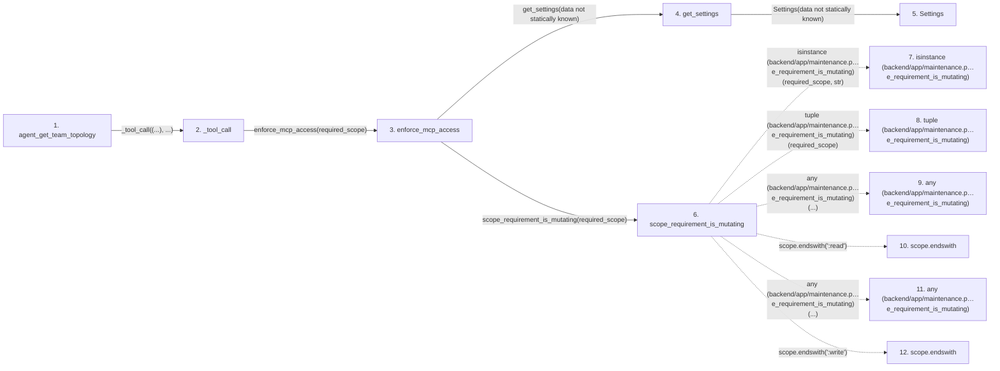

# agent_get_team_topology

**Entry point:** `agent_get_team_topology` (`mcp`)
**Source:** [mcp_server](../modules/mcp_server.md)
**Modules touched:** [agent_service](../modules/agent_service.md), [agent_team_setup](../modules/agent_team_setup.md), [agent_team_setup_service](../modules/agent_team_setup_service.md), [authority](../modules/authority.md), and 14 more

**Complete modules touched:**

- [agent_service](../modules/agent_service.md)
- [agent_team_setup](../modules/agent_team_setup.md)
- [agent_team_setup_service](../modules/agent_team_setup_service.md)
- [authority](../modules/authority.md)
- [autonomy_canonical](../modules/autonomy_canonical.md)
- [commands](../modules/commands.md)
- [config](../modules/config.md)
- [delivery_dependency_service](../modules/delivery_dependency_service.md)
- [discussion_service](../modules/discussion_service.md)
- [identity_service](../modules/identity_service.md)
- [maintenance](../modules/maintenance.md)
- [mcp_agent_tools](../modules/mcp_agent_tools.md)
- [mcp_server](../modules/mcp_server.md)
- [models_identity](../modules/models_identity.md)
- [models_outbound_webhook](../modules/models_outbound_webhook.md)
- [task_brief_service](../modules/task_brief_service.md)
- [task_service](../modules/task_service.md)
- [time](../modules/time.md)

## Call sequence

> Static overview in presentation order, not runtime execution order. Arrows retain captured callers; representative internal continuations and boundary examples precede repeated helper detail.

```mermaid
sequenceDiagram
    participant p0 as agent_get_team_topology
    participant p1 as _tool_call
    participant p2 as get_agent_team_topology
    participant p3 as enforce_mcp_access
    participant p4 as AgentTeamSetupService.topology
    participant p5 as _agent_context
    participant p6 as get_settings
    participant p7 as AgentTeamSetupService._select_status_topology
    participant p8 as command_transaction
    participant p9 as _authenticate_agent_key
    participant p10 as _require_scope_requirement
    participant p11 as IdentityService.actor_context
    participant p12 as AgentTeamSetupService._status_for_topology
    participant p13 as require_scope
    participant p14 as AgentService.authenticate
    participant p15 as require_identity_writes
    participant p16 as DeliveryDependencyService.reconcile
    participant p17 as DiscussionService.enqueue
    participant p18 as _member_contract_outdated
    participant p19 as AgentTeamSetupService._handoff
    participant p20 as _canonical_json
    participant p21 as actor_has_scope
    participant p22 as ensure_agent_team_secret_free
    participant p23 as commit_or_flush
    participant p24 as DeliveryDependencyService.validate_cycles
    participant p25 as DiscussionService.recipient_authorized
    participant p26 as TaskService.reserve_task_version
    participant p27 as clear_execution_evidence
    participant p28 as AgentTeamSetupService
    participant p29 as ToolError
    participant p30 as func
    p0->>p1: _tool_call
    p0->>p2: get_agent_team_topology
    p1->>p3: enforce_mcp_access
    p2->>p4: AgentTeamSetupService.topology
    p1->>p5: _agent_context
    p3->>p6: get_settings
    p4->>p7: AgentTeamSetupService._select_status_topology
    p5->>p8: command_transaction
    p5->>p9: _authenticate_agent_key
    p5->>p10: _require_scope_requirement
    p5->>p11: IdentityService.actor_context
    p4->>p12: AgentTeamSetupService._status_for_topology
    p10->>p13: require_scope
    p9->>p14: AgentService.authenticate
    p11->>p15: require_identity_writes
    p8->>p16: DeliveryDependencyService.reconcile
    p8->>p17: DiscussionService.enqueue
    p12->>p18: _member_contract_outdated
    p12->>p19: AgentTeamSetupService._handoff
    p12->>p20: _canonical_json
    p13->>p21: actor_has_scope
    p20->>p22: ensure_agent_team_secret_free
    p14->>p23: commit_or_flush
    p16->>p24: DeliveryDependencyService.validate_cycles
    p17->>p25: DiscussionService.recipient_authorized
    p16->>p26: TaskService.reserve_task_version
    p16->>p27: clear_execution_evidence
    p2->>p28: AgentTeamSetupService
    p1-->>p29: ToolError(_structured_tool_error(...))
    p1-->>p30: func(db, actor)
```

<!-- Auto-generated from static call edges. Dashed arrows are external or unresolved calls. Reviewed runtime conditions and side effects belong in Behavior. -->

> Call sequence diagram shows 30 of 444 interactions; 414 omitted to keep the visualization within the 30-interaction and generated-diagram limits, with uncertain identities omitted rather than inferred.

> Captured boundary calls: external 1 of 127 (126 omitted); unresolved 1 of 198 (197 omitted). These counts cover the captured static trace.

Omitted captured detail, grouped by actual caller occurrence and target module:

| Caller | Parent step | Target module | Kind | Omitted interactions |
| --- | --- | --- | --- | --- |
| `backend/app/config.py:get_settings` | 4 | [backend/app/config.py](../modules/config.md) | internal | 1 |
| `backend/app/maintenance.py:enforce_mcp_access` | 3 | [backend/app/maintenance.py](../modules/maintenance.md) | internal | 2 |
| `backend/app/maintenance.py:scope_requirement_is_mutating` | 6 | - | external | 4 |
| `backend/app/maintenance.py:scope_requirement_is_mutating` | 6 | - | unresolved | 3 |
| `backend/app/mcp_server.py:_agent_context` | 15 | [backend/app/mcp_server.py](../modules/mcp_server.md) | internal | 3 |
| `backend/app/mcp_server.py:_current_agent_key` | 16 | - | unresolved | 1 |
| `backend/app/mcp_server.py:_current_agent_key` | 16 | - | external | 1 |
| `backend/app/mcp_server.py:_open_db_session` | 20 | - | unresolved | 1 |
> Omission summary shows 8 of 103 groups; 95 further groups are not expanded here. Counts above include all omitted interactions.
> Detailed flow queries retain their own coverage and limits; omitted paths may execute at runtime.

> Trace truncated at the depth limit; deeper calls are omitted.

## Data flow

<!-- Auto-generated static analysis. Treat values and boundaries as best-effort hints, not runtime proof. -->

### Analysis coverage

**Effect analysis partially available.** Flow assembly and source effect analysis are separate; empty observations do not prove an empty handler body.

Source steps: 120; effect analysis evaluated: 75, partial: 3, unavailable: 42. Counts include steps omitted from the displayed trace.

Collector observations for 78 source steps with known totals: observed: 367, emitted: 344, omitted: 23. Unavailable totals are excluded.

- Callable record unavailable for one or more source steps; those steps have no represented callable body.
- Effect collector omitted observations before flow assembly; displayed effects are partial.
- Effect collector totals unavailable; observed counts cover captured records only.

| Step | Callable record | Effect analysis | Collector totals | Observed | Emitted | Omitted |
|---|---|---|---|---:|---:|---:|
| `agent_get_team_topology` | `available` | `evaluated` | `available` | `1` | `1` | `0` |
| `_tool_call` | `available` | `partial` | `available` | `18` | `12` | `6` |
| `enforce_mcp_access` | `available` | `evaluated` | `available` | `2` | `2` | `0` |
| `get_settings` | `available` | `evaluated` | `available` | `1` | `1` | `0` |
| `Settings` | `unavailable` | `unavailable` | `unavailable` | — | — | — |
| `scope_requirement_is_mutating` | `available` | `evaluated` | `available` | `3` | `3` | `0` |
| `isinstance (backend/app/maintenance.p…e_requirement_is_mutating)` | `not_applicable` | `not_applicable` | `not_applicable` | — | — | — |
| `tuple (backend/app/maintenance.p…e_requirement_is_mutating)` | `not_applicable` | `not_applicable` | `not_applicable` | — | — | — |
| `any (backend/app/maintenance.p…e_requirement_is_mutating)` | `not_applicable` | `not_applicable` | `not_applicable` | — | — | — |
| `scope.endswith` | `not_applicable` | `not_applicable` | `not_applicable` | — | — | — |
| `any (backend/app/maintenance.p…e_requirement_is_mutating)` | `not_applicable` | `not_applicable` | `not_applicable` | — | — | — |
| `scope.endswith` | `not_applicable` | `not_applicable` | `not_applicable` | — | — | — |

### Step data

| Step | Inputs | Reads | Writes | Returns |
|---|---|---|---|---|
| `agent_get_team_topology` | - | - | - | `...` |
| `_tool_call` | `required_scope: ScopeRequirement`, `func: Callable[[Any, AgentActor], Any]`, `preview` | `ToolError`, `MissingMutationRevision`, `AggregateVersionConflict`, `HierarchyScopeError`, `AuthorityError`, `MCPAuthError`, `MaintenanceModeError`, `AgentRoutingConflictError` | - | `...` |
| `enforce_mcp_access` | `required_scope: Any` | - | - | `none` |
| `get_settings` | - | - | - | `Settings(...)` |
| `Settings` | - | - | - | - |
| `scope_requirement_is_mutating` | `required_scope: Any` | - | - | `False`, `...` |
| `isinstance (backend/app/maintenance.p…e_requirement_is_mutating)` | - | - | - | - |
| `tuple (backend/app/maintenance.p…e_requirement_is_mutating)` | - | - | - | - |
| `any (backend/app/maintenance.p…e_requirement_is_mutating)` | - | - | - | - |
| `scope.endswith` | - | - | - | - |
| `any (backend/app/maintenance.p…e_requirement_is_mutating)` | - | - | - | - |
| `scope.endswith` | - | - | - | - |

### Call data

| From | To | Line | Call |
|---|---|---:|---|
| agent_get_team_topology | _tool_call | 403 | `_tool_call((...), ...)` |
| _tool_call | enforce_mcp_access | 334 | `enforce_mcp_access(required_scope)` |
| enforce_mcp_access | get_settings | 112 | `get_settings(data not statically known)` |
| get_settings | Settings | 506 | `Settings(data not statically known)` |
| enforce_mcp_access | scope_requirement_is_mutating | 113 | `scope_requirement_is_mutating(required_scope)` |
| scope_requirement_is_mutating | isinstance (backend/app/maintenance.p…e_requirement_is_mutating) | 100 | `isinstance(required_scope, str)` |
| scope_requirement_is_mutating | tuple (backend/app/maintenance.p…e_requirement_is_mutating) | 100 | `tuple(required_scope)` |
| scope_requirement_is_mutating | any (backend/app/maintenance.p…e_requirement_is_mutating) | 101 | `any(...)` |
| scope_requirement_is_mutating | scope.endswith | 101 | `scope.endswith(':read')` |
| scope_requirement_is_mutating | any (backend/app/maintenance.p…e_requirement_is_mutating) | 102 | `any(...)` |
| scope_requirement_is_mutating | scope.endswith | 103 | `scope.endswith(':write')` |

### Boundary effects

*No boundary-effect observations were captured in this static trace.*

### Static analysis gaps

| Kind | Step | Target | Line |
|---|---|---|---:|
| external_call | `scope_requirement_is_mutating` | `isinstance` | 100 |
| external_call | `scope_requirement_is_mutating` | `any` | 101 |
| unresolved_call | `scope_requirement_is_mutating` | `scope.endswith` | 101 |
| external_call | `scope_requirement_is_mutating` | `any` | 102 |
| unresolved_call | `scope_requirement_is_mutating` | `scope.endswith` | 103 |
| step_limit | `agent_get_team_topology` | `first 12 steps` | 0 |
| truncated_flow | `agent_get_team_topology` | `depth limit` | 0 |

## Behavior

Read-only MCP projection of the team topology for an agent with `planning:read` or `admin`, on the same status rule as REST: an operator reads the first topology, a PM its bound one. Credential references are never included.
