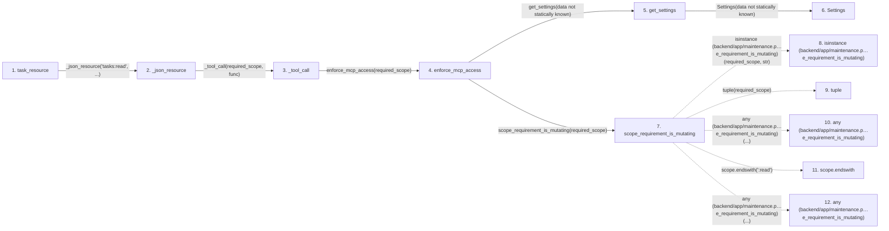

# task_resource

**Entry point:** `task_resource` (`mcp`)
**Source:** [mcp_server](../modules/mcp_server.md)
**Modules touched:** [agent_service](../modules/agent_service.md), [authority](../modules/authority.md), [commands](../modules/commands.md), [config](../modules/config.md), and 11 more

**Complete modules touched:**

- [agent_service](../modules/agent_service.md)
- [authority](../modules/authority.md)
- [commands](../modules/commands.md)
- [config](../modules/config.md)
- [delivery_dependency_service](../modules/delivery_dependency_service.md)
- [discussion_service](../modules/discussion_service.md)
- [identity_service](../modules/identity_service.md)
- [maintenance](../modules/maintenance.md)
- [mcp_agent_tools](../modules/mcp_agent_tools.md)
- [mcp_server](../modules/mcp_server.md)
- [models_identity](../modules/models_identity.md)
- [models_outbound_webhook](../modules/models_outbound_webhook.md)
- [task_brief_service](../modules/task_brief_service.md)
- [task_service](../modules/task_service.md)
- [time](../modules/time.md)

## Call sequence

> Static overview in presentation order, not runtime execution order. Arrows retain captured callers; representative internal continuations and boundary examples precede repeated helper detail.

```mermaid
sequenceDiagram
    participant p0 as task_resource
    participant p1 as _json_resource
    participant p2 as get_task
    participant p3 as _tool_call
    participant p4 as enforce_mcp_access
    participant p5 as _agent_context
    participant p6 as get_settings
    participant p7 as command_transaction
    participant p8 as _authenticate_agent_key
    participant p9 as _require_scope_requirement
    participant p10 as IdentityService.actor_context
    participant p11 as require_scope
    participant p12 as AgentService.authenticate
    participant p13 as require_identity_writes
    participant p14 as DeliveryDependencyService.reconcile
    participant p15 as IdentityService.context
    participant p16 as DiscussionService.enqueue
    participant p17 as AgentService
    participant p18 as _structured_tool_error
    participant p19 as _current_agent_key
    participant p20 as scope_requirement_is_mutating
    participant p21 as MCPAuthError
    participant p22 as MaintenanceModeError
    participant p23 as _open_db_session
    participant p24 as IdentityService
    participant p25 as Settings
    participant p26 as current_command
    participant p27 as internal_authority
    participant p28 as CommandState
    participant p29 as int
    participant p30 as service.task_service.get_by_id
    p0->>p1: _json_resource
    p0->>p2: get_task
    p1->>p3: _tool_call
    p3->>p4: enforce_mcp_access
    p3->>p5: _agent_context
    p4->>p6: get_settings
    p5->>p7: command_transaction
    p5->>p8: _authenticate_agent_key
    p5->>p9: _require_scope_requirement
    p5->>p10: IdentityService.actor_context
    p9->>p11: require_scope
    p8->>p12: AgentService.authenticate
    p10->>p13: require_identity_writes
    p7->>p14: DeliveryDependencyService.reconcile
    p10->>p15: IdentityService.context
    p7->>p16: DiscussionService.enqueue
    p2->>p17: AgentService
    p3->>p18: _structured_tool_error
    p5->>p19: _current_agent_key
    p4->>p20: scope_requirement_is_mutating
    p5->>p21: MCPAuthError
    p4->>p22: MaintenanceModeError
    p5->>p23: _open_db_session
    p5->>p24: IdentityService
    p6->>p25: Settings
    p7->>p26: current_command
    p10->>p27: internal_authority
    p7->>p28: CommandState
    p0-->>p29: int(task_id)
    p2-->>p30: service.task_service.get_by_id(task_id)
```

<!-- Auto-generated from static call edges. Dashed arrows are external or unresolved calls. Reviewed runtime conditions and side effects belong in Behavior. -->

> Call sequence diagram shows 30 of 210 interactions; 180 omitted to keep the visualization within the 30-interaction and generated-diagram limits, with uncertain identities omitted rather than inferred.

> Captured boundary calls: external 1 of 64 (63 omitted); unresolved 1 of 82 (81 omitted). These counts cover the captured static trace.

Omitted captured detail, grouped by actual caller occurrence and target module:

| Caller | Parent step | Target module | Kind | Omitted interactions |
| --- | --- | --- | --- | --- |
| `backend/app/maintenance.py:scope_requirement_is_mutating` | 7 | - | external | 4 |
| `backend/app/maintenance.py:scope_requirement_is_mutating` | 7 | - | unresolved | 3 |
| `backend/app/mcp_server.py:_current_agent_key` | 17 | - | unresolved | 1 |
| `backend/app/mcp_server.py:_current_agent_key` | 17 | - | external | 1 |
| `backend/app/mcp_server.py:_open_db_session` | 21 | - | unresolved | 1 |
| `backend/app/mcp_server.py:_open_db_session` | 21 | - | external | 1 |
| `backend/app/commands.py:current_command` | 25 | - | external | 2 |
| `backend/app/commands.py:current_command` | 25 | - | unresolved | 1 |
> Omission summary shows 8 of 53 groups; 45 further groups are not expanded here. Counts above include all omitted interactions.
> Detailed flow queries retain their own coverage and limits; omitted paths may execute at runtime.

> Trace truncated at the depth limit; deeper calls are omitted.

## Data flow

<!-- Auto-generated static analysis. Treat values and boundaries as best-effort hints, not runtime proof. -->

### Analysis coverage

**Effect analysis partially available.** Flow assembly and source effect analysis are separate; empty observations do not prove an empty handler body.

Source steps: 65; effect analysis evaluated: 41, partial: 2, unavailable: 22. Counts include steps omitted from the displayed trace.

Collector observations for 43 source steps with known totals: observed: 179, emitted: 169, omitted: 10. Unavailable totals are excluded.

- Callable record unavailable for one or more source steps; those steps have no represented callable body.
- Effect collector omitted observations before flow assembly; displayed effects are partial.
- Effect collector totals unavailable; observed counts cover captured records only.

| Step | Callable record | Effect analysis | Collector totals | Observed | Emitted | Omitted |
|---|---|---|---|---:|---:|---:|
| `task_resource` | `available` | `evaluated` | `available` | `2` | `2` | `0` |
| `_json_resource` | `available` | `evaluated` | `available` | `3` | `3` | `0` |
| `_tool_call` | `available` | `partial` | `available` | `18` | `12` | `6` |
| `enforce_mcp_access` | `available` | `evaluated` | `available` | `2` | `2` | `0` |
| `get_settings` | `available` | `evaluated` | `available` | `1` | `1` | `0` |
| `Settings` | `unavailable` | `unavailable` | `unavailable` | — | — | — |
| `scope_requirement_is_mutating` | `available` | `evaluated` | `available` | `3` | `3` | `0` |
| `isinstance (backend/app/maintenance.p…e_requirement_is_mutating)` | `not_applicable` | `not_applicable` | `not_applicable` | — | — | — |
| `tuple` | `not_applicable` | `not_applicable` | `not_applicable` | — | — | — |
| `any (backend/app/maintenance.p…e_requirement_is_mutating)` | `not_applicable` | `not_applicable` | `not_applicable` | — | — | — |
| `scope.endswith` | `not_applicable` | `not_applicable` | `not_applicable` | — | — | — |
| `any (backend/app/maintenance.p…e_requirement_is_mutating)` | `not_applicable` | `not_applicable` | `not_applicable` | — | — | — |

### Step data

| Step | Inputs | Reads | Writes | Returns |
|---|---|---|---|---|
| `task_resource` | `task_id: str` | - | - | `...` |
| `_json_resource` | `required_scope: ScopeRequirement`, `func: Callable[[Any, AgentActor], Any]` | - | - | `json.dumps(...)` |
| `_tool_call` | `required_scope: ScopeRequirement`, `func: Callable[[Any, AgentActor], Any]`, `preview` | `ToolError`, `MissingMutationRevision`, `AggregateVersionConflict`, `HierarchyScopeError`, `AuthorityError`, `MCPAuthError`, `MaintenanceModeError`, `AgentRoutingConflictError` | - | `...` |
| `enforce_mcp_access` | `required_scope: Any` | - | - | `none` |
| `get_settings` | - | - | - | `Settings(...)` |
| `Settings` | - | - | - | - |
| `scope_requirement_is_mutating` | `required_scope: Any` | - | - | `False`, `...` |
| `isinstance (backend/app/maintenance.p…e_requirement_is_mutating)` | - | - | - | - |
| `tuple` | - | - | - | - |
| `any (backend/app/maintenance.p…e_requirement_is_mutating)` | - | - | - | - |
| `scope.endswith` | - | - | - | - |
| `any (backend/app/maintenance.p…e_requirement_is_mutating)` | - | - | - | - |

### Call data

| From | To | Line | Call |
|---|---|---:|---|
| task_resource | _json_resource | 2141 | `_json_resource('tasks:read', ...)` |
| _json_resource | _tool_call | 343 | `_tool_call(required_scope, func)` |
| _tool_call | enforce_mcp_access | 314 | `enforce_mcp_access(required_scope)` |
| enforce_mcp_access | get_settings | 112 | `get_settings(data not statically known)` |
| get_settings | Settings | 481 | `Settings(data not statically known)` |
| enforce_mcp_access | scope_requirement_is_mutating | 113 | `scope_requirement_is_mutating(required_scope)` |
| scope_requirement_is_mutating | isinstance (backend/app/maintenance.p…e_requirement_is_mutating) | 100 | `isinstance(required_scope, str)` |
| scope_requirement_is_mutating | tuple | 100 | `tuple(required_scope)` |
| scope_requirement_is_mutating | any (backend/app/maintenance.p…e_requirement_is_mutating) | 101 | `any(...)` |
| scope_requirement_is_mutating | scope.endswith | 101 | `scope.endswith(':read')` |
| scope_requirement_is_mutating | any (backend/app/maintenance.p…e_requirement_is_mutating) | 102 | `any(...)` |

### Boundary effects

*No boundary-effect observations were captured in this static trace.*

### Static analysis gaps

| Kind | Step | Target | Line |
|---|---|---|---:|
| external_call | `scope_requirement_is_mutating` | `isinstance` | 100 |
| external_call | `scope_requirement_is_mutating` | `any` | 101 |
| unresolved_call | `scope_requirement_is_mutating` | `scope.endswith` | 101 |
| external_call | `scope_requirement_is_mutating` | `any` | 102 |
| step_limit | `task_resource` | `first 12 steps` | 0 |
| truncated_flow | `task_resource` | `depth limit` | 0 |

## Behavior

This flow starts at `task_resource` and is classified as `mcp`. The generated call and data-flow sections are bounded static projections; runtime conditions and side effects require source-level confirmation.
