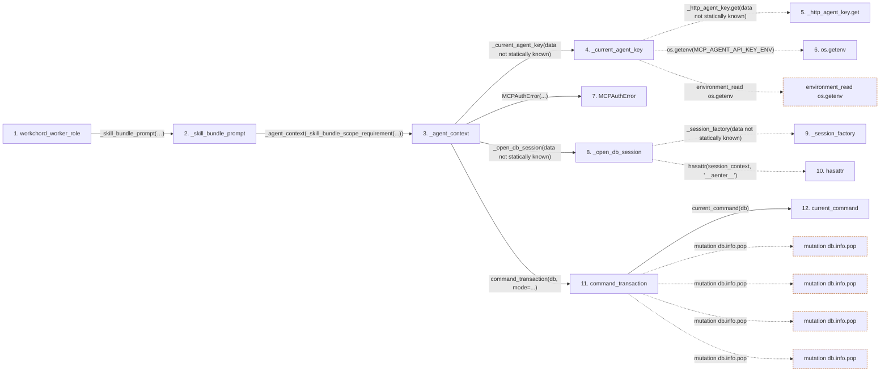

# workchord_worker_role

**Entry point:** `workchord_worker_role` (`mcp`)
**Source:** [mcp_server](../modules/mcp_server.md)
**Modules touched:** [agent_service](../modules/agent_service.md), [authority](../modules/authority.md), [commands](../modules/commands.md), [config](../modules/config.md), and 10 more

**Complete modules touched:**

- [agent_service](../modules/agent_service.md)
- [authority](../modules/authority.md)
- [commands](../modules/commands.md)
- [config](../modules/config.md)
- [delivery_dependency_service](../modules/delivery_dependency_service.md)
- [discussion_service](../modules/discussion_service.md)
- [identity_service](../modules/identity_service.md)
- [maintenance](../modules/maintenance.md)
- [mcp_server](../modules/mcp_server.md)
- [models_identity](../modules/models_identity.md)
- [models_outbound_webhook](../modules/models_outbound_webhook.md)
- [task_brief_service](../modules/task_brief_service.md)
- [task_service](../modules/task_service.md)
- [time](../modules/time.md)

## Call sequence

> Static overview in presentation order, not runtime execution order. Arrows retain captured callers; representative internal continuations and boundary examples precede repeated helper detail.

```mermaid
sequenceDiagram
    participant p0 as workchord_worker_role
    participant p1 as _skill_bundle_prompt
    participant p2 as _agent_context
    participant p3 as _skill_bundle_scope_requirement
    participant p4 as command_transaction
    participant p5 as _authenticate_agent_key
    participant p6 as _require_scope_requirement
    participant p7 as IdentityService.actor_context
    participant p8 as get_settings
    participant p9 as require_scope
    participant p10 as AgentService.authenticate
    participant p11 as require_identity_writes
    participant p12 as DeliveryDependencyService.reconcile
    participant p13 as DiscussionService.enqueue
    participant p14 as actor_has_scope
    participant p15 as commit_or_flush
    participant p16 as DeliveryDependencyService.validate_cycles
    participant p17 as DiscussionService.recipient_authorized
    participant p18 as TaskService.reserve_task_version
    participant p19 as clear_execution_evidence
    participant p20 as _current_agent_key
    participant p21 as MCPAuthError
    participant p22 as _open_db_session
    participant p23 as IdentityService
    participant p24 as current_command
    participant p25 as internal_authority
    participant p26 as CommandState
    participant p27 as AgentService
    participant p28 as AgentPermissionError
    participant p29 as isinstance (backend/app/mcp_server.py…require_scope_requirement)
    participant p30 as _http_agent_key.get
    p0->>p1: _skill_bundle_prompt
    p1->>p2: _agent_context
    p1->>p3: _skill_bundle_scope_requirement
    p2->>p4: command_transaction
    p2->>p5: _authenticate_agent_key
    p2->>p6: _require_scope_requirement
    p2->>p7: IdentityService.actor_context
    p5->>p8: get_settings
    p6->>p9: require_scope
    p5->>p10: AgentService.authenticate
    p7->>p11: require_identity_writes
    p4->>p12: DeliveryDependencyService.reconcile
    p4->>p13: DiscussionService.enqueue
    p9->>p14: actor_has_scope
    p10->>p15: commit_or_flush
    p12->>p16: DeliveryDependencyService.validate_cycles
    p13->>p17: DiscussionService.recipient_authorized
    p12->>p18: TaskService.reserve_task_version
    p12->>p19: clear_execution_evidence
    p2->>p20: _current_agent_key
    p2->>p21: MCPAuthError
    p2->>p22: _open_db_session
    p2->>p23: IdentityService
    p4->>p24: current_command
    p7->>p25: internal_authority
    p4->>p26: CommandState
    p5->>p27: AgentService
    p6->>p28: AgentPermissionError
    p6-->>p29: isinstance (backend/app/mcp_server.py…require_scope_requirement)(required, str)
    p20-->>p30: _http_agent_key.get
```

<!-- Auto-generated from static call edges. Dashed arrows are external or unresolved calls. Reviewed runtime conditions and side effects belong in Behavior. -->

> Call sequence diagram shows 30 of 200 interactions; 170 omitted to keep the visualization within the 30-interaction and generated-diagram limits, with uncertain identities omitted rather than inferred.

> Captured boundary calls: external 1 of 40 (39 omitted); unresolved 1 of 90 (89 omitted). These counts cover the captured static trace.

Omitted captured detail, grouped by actual caller occurrence and target module:

| Caller | Parent step | Target module | Kind | Omitted interactions |
| --- | --- | --- | --- | --- |
| `backend/app/mcp_server.py:_current_agent_key` | 4 | - | external | 1 |
| `backend/app/mcp_server.py:_open_db_session` | 8 | - | unresolved | 1 |
| `backend/app/mcp_server.py:_open_db_session` | 8 | - | external | 1 |
| `backend/app/commands.py:current_command` | 12 | - | external | 2 |
| `backend/app/commands.py:current_command` | 12 | - | unresolved | 1 |
| `backend/app/commands.py:command_transaction` | 11 | - | external | 4 |
| `backend/app/commands.py:command_transaction` | 11 | - | unresolved | 12 |
| `backend/app/services/delivery_dependency_service.py:DeliveryDependencyService.reconcile` | 23 | - | unresolved | 23 |
> Omission summary shows 8 of 59 groups; 51 further groups are not expanded here. Counts above include all omitted interactions.
> Detailed flow queries retain their own coverage and limits; omitted paths may execute at runtime.

> Trace truncated at the depth limit; deeper calls are omitted.

## Data flow

<!-- Auto-generated static analysis. Treat values and boundaries as best-effort hints, not runtime proof. -->

### Analysis coverage

**Effect analysis partially available.** Flow assembly and source effect analysis are separate; empty observations do not prove an empty handler body.

Source steps: 71; effect analysis evaluated: 48, partial: 0, unavailable: 23. Counts include steps omitted from the displayed trace.

Collector observations for 48 source steps with known totals: observed: 173, emitted: 173, omitted: 0. Unavailable totals are excluded.

- Callable record unavailable for one or more source steps; those steps have no represented callable body.
- Effect collector totals unavailable; observed counts cover captured records only.

| Step | Callable record | Effect analysis | Collector totals | Observed | Emitted | Omitted |
|---|---|---|---|---:|---:|---:|
| `workchord_worker_role` | `available` | `evaluated` | `available` | `1` | `1` | `0` |
| `_skill_bundle_prompt` | `available` | `evaluated` | `available` | `2` | `2` | `0` |
| `_agent_context` | `available` | `evaluated` | `available` | `4` | `4` | `0` |
| `_current_agent_key` | `available` | `evaluated` | `available` | `3` | `3` | `0` |
| `_http_agent_key.get` | `not_applicable` | `not_applicable` | `not_applicable` | — | — | — |
| `os.getenv` | `not_applicable` | `not_applicable` | `not_applicable` | — | — | — |
| `MCPAuthError` | `unavailable` | `unavailable` | `unavailable` | — | — | — |
| `_open_db_session` | `available` | `evaluated` | `available` | `1` | `1` | `0` |
| `_session_factory` | `not_applicable` | `not_applicable` | `not_applicable` | — | — | — |
| `hasattr` | `not_applicable` | `not_applicable` | `not_applicable` | — | — | — |
| `command_transaction` | `available` | `evaluated` | `available` | `10` | `10` | `0` |
| `current_command` | `available` | `evaluated` | `available` | `2` | `2` | `0` |

### Step data

| Step | Inputs | Reads | Writes | Returns |
|---|---|---|---|---|
| `workchord_worker_role` | - | - | - | `...` |
| `_skill_bundle_prompt` | `value: str` | - | - | `value` |
| `_agent_context` | `required_scope: ScopeRequirement`, `preview` | `MCP_AGENT_API_KEY_ENV` | `db.info[...]` | - |
| `_current_agent_key` | - | `MCP_AGENT_API_KEY_ENV` | - | `...` |
| `_http_agent_key.get` | - | - | - | - |
| `os.getenv` | - | - | - | - |
| `MCPAuthError` | - | - | - | - |
| `_open_db_session` | - | - | - | `none` |
| `_session_factory` | - | - | - | - |
| `hasattr` | - | - | - | - |
| `command_transaction` | `db: AsyncSession`, `mode`, `commit` | - | `previous.failed`, `db.info[...]` | `none` |
| `current_command` | `db` | - | - | `...` |

### Call data

| From | To | Line | Call |
|---|---|---:|---|
| workchord_worker_role | _skill_bundle_prompt | 2356 | `_skill_bundle_prompt('Read workchord://agent/capabilities, resolve its recommended worker skill version, then read workchord://skill-bundles/workchord-worker/{version}/SKILL.md. Follow that skill, call workchord://agent/me/work, and execute only the exact server-selected assignment.')` |
| _skill_bundle_prompt | _agent_context | 349 | `_agent_context(_skill_bundle_scope_requirement(...))` |
| _agent_context | _current_agent_key | 258 | `_current_agent_key(data not statically known)` |
| _current_agent_key | _http_agent_key.get | 201 | `_http_agent_key.get(data not statically known)` |
| _current_agent_key | os.getenv | 201 | `os.getenv(MCP_AGENT_API_KEY_ENV)` |
| _agent_context | MCPAuthError | 260 | `MCPAuthError(...)` |
| _agent_context | _open_db_session | 261 | `_open_db_session(data not statically known)` |
| _open_db_session | _session_factory | 182 | `_session_factory(data not statically known)` |
| _open_db_session | hasattr | 183 | `hasattr(session_context, '__aenter__')` |
| _agent_context | command_transaction | 262 | `command_transaction(db, mode=...)` |
| command_transaction | current_command | 87 | `current_command(db)` |

### Boundary effects

| Kind | Target | Step | Line |
|---|---|---|---:|
| environment_read | `os.getenv` | `_current_agent_key` | 201 |
| mutation | `db.info.pop` | `command_transaction` | 107 |
| mutation | `db.info.pop` | `command_transaction` | 120 |
| mutation | `db.info.pop` | `command_transaction` | 121 |
| mutation | `db.info.pop` | `command_transaction` | 123 |

### Static analysis gaps

| Kind | Step | Target | Line |
|---|---|---|---:|
| unresolved_call | `_open_db_session` | `_session_factory` | 182 |
| external_call | `_open_db_session` | `hasattr` | 183 |
| step_limit | `workchord_worker_role` | `first 12 steps` | 0 |
| truncated_flow | `workchord_worker_role` | `depth limit` | 0 |

## Behavior

This flow starts at `workchord_worker_role` and is classified as `mcp`. The generated call and data-flow sections are bounded static projections; runtime conditions and side effects require source-level confirmation.
