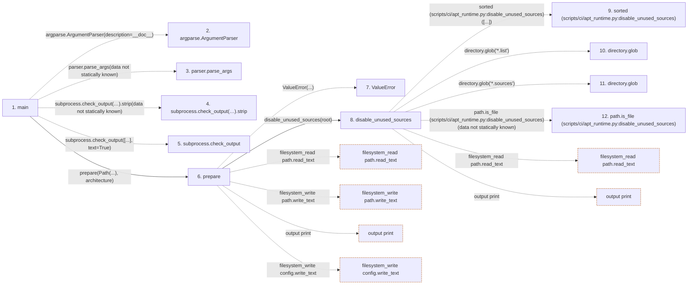

# apt_runtime

**Entry point:** `main` (`process`)
**Source:** [apt_runtime](../modules/apt_runtime.md)
**Modules touched:** [apt_runtime](../modules/apt_runtime.md)

## Call sequence

> Static overview in presentation order, not runtime execution order. Arrows retain captured callers; representative internal continuations and boundary examples precede repeated helper detail.

```mermaid
sequenceDiagram
    participant p0 as main
    participant p1 as prepare
    participant p2 as disable_unused_sources
    participant p3 as _repository_hosts
    participant p4 as argparse.ArgumentParser
    participant p5 as parser.parse_args
    participant p6 as subprocess.check_output(…).strip
    participant p7 as subprocess.check_output
    participant p8 as Path
    participant p9 as ValueError
    participant p10 as sorted (scripts/ci/apt_runtime.py:prepare)
    participant p11 as (…).glob
    participant p12 as path.is_file (scripts/ci/apt_runtime.py:prepare)
    participant p13 as path.read_text (scripts/ci/apt_runtime.py:prepare)
    participant p14 as re.sub
    participant p15 as path.write_text
    participant p16 as print (scripts/ci/apt_runtime.py:prepare)
    participant p17 as config.parent.mkdir
    participant p18 as config.write_text
    participant p19 as sorted (scripts/ci/apt_runtime.py:disable_unused_sources)
    participant p20 as directory.glob
    participant p21 as path.is_file (scripts/ci/apt_runtime.py:disable_unused_sources)
    participant p22 as path.read_text (scripts/ci/apt_runtime.py:disable_unused_sources)
    participant p23 as path.rename
    participant p24 as path.with_name
    participant p25 as print (scripts/ci/apt_runtime.py:disable_unused_sources)
    participant p26 as set
    p0->>p1: prepare
    p1->>p2: disable_unused_sources
    p2->>p3: _repository_hosts
    p0-->>p4: argparse.ArgumentParser(description=__doc__)
    p0-->>p5: parser.parse_args
    p0-->>p6: subprocess.check_output(…).strip
    p0-->>p7: subprocess.check_output([...], text=True)
    p0-->>p8: Path('/etc/apt')
    p1-->>p9: ValueError(...)
    p1-->>p10: sorted (scripts/ci/apt_runtime.py:prepare)(...)
    p1-->>p11: (…).glob('*.list')
    p1-->>p10: sorted (scripts/ci/apt_runtime.py:prepare)(...)
    p1-->>p11: (…).glob('*.sources')
    p1-->>p12: path.is_file (scripts/ci/apt_runtime.py:prepare)
    p1-->>p13: path.read_text (scripts/ci/apt_runtime.py:prepare)
    p1-->>p14: re.sub('https?://azure\\.archive\\.ubuntu\\.com/ubuntu(?=/|\\s|$)', archive, original)
    p1-->>p14: re.sub('mirror\\+file:/etc/apt/apt-mirrors\\.txt(?=\\s|$)', archive, updated)
    p1-->>p15: path.write_text(updated)
    p1-->>p16: print (scripts/ci/apt_runtime.py:prepare)(...)
    p1-->>p17: config.parent.mkdir(parents=True, exist_ok=True)
    p1-->>p18: config.write_text(APT_CONFIG)
    p2-->>p19: sorted (scripts/ci/apt_runtime.py:disable_unused_sources)([...])
    p2-->>p20: directory.glob('*.list')
    p2-->>p20: directory.glob('*.sources')
    p2-->>p21: path.is_file (scripts/ci/apt_runtime.py:disable_unused_sources)
    p2-->>p22: path.read_text (scripts/ci/apt_runtime.py:disable_unused_sources)
    p2-->>p23: path.rename(path.with_name(...))
    p2-->>p24: path.with_name(...)
    p2-->>p25: print (scripts/ci/apt_runtime.py:disable_unused_sources)(...)
    p3-->>p26: set
```

<!-- Auto-generated from static call edges. Dashed arrows are external or unresolved calls. Reviewed runtime conditions and side effects belong in Behavior. -->

> Call sequence diagram shows 30 of 37 interactions; 7 omitted to keep the visualization within the 30-interaction and generated-diagram limits, with uncertain identities omitted rather than inferred.

> Captured boundary calls: external 12 of 13 (1 omitted); unresolved 15 of 21 (6 omitted). These counts cover the captured static trace.

Omitted captured detail, grouped by actual caller occurrence and target module:

| Caller | Parent step | Target module | Kind | Omitted interactions |
| --- | --- | --- | --- | --- |
| `scripts/ci/apt_runtime.py:_repository_hosts` | 13 | - | unresolved | 6 |
| `scripts/ci/apt_runtime.py:_repository_hosts` | 13 | - | external | 1 |
> Detailed flow queries retain their own coverage and limits; omitted paths may execute at runtime.

## Data flow

<!-- Auto-generated static analysis. Treat values and boundaries as best-effort hints, not runtime proof. -->

### Analysis coverage

**Effect analysis evaluated.** Flow assembly and source effect analysis are separate; empty observations do not prove an empty handler body.

Source steps: 4; effect analysis evaluated: 4, partial: 0, unavailable: 0. Counts include steps omitted from the displayed trace.

Collector observations for 4 source steps with known totals: observed: 14, emitted: 14, omitted: 0. Unavailable totals are excluded.

### Step data

| Step | Inputs | Reads | Writes | Returns |
|---|---|---|---|---|
| `main` | - | - | - | - |
| `argparse.ArgumentParser` | - | - | - | - |
| `parser.parse_args` | - | - | - | - |
| `subprocess.check_output(…).strip` | - | - | - | - |
| `subprocess.check_output` | - | - | - | - |
| `prepare` | `root: Path`, `architecture: str` | `APT_CONFIG` | - | - |
| `ValueError` | - | - | - | - |
| `disable_unused_sources` | `root: Path` | `UNUSED_RUNNER_HOSTS` | - | - |
| `sorted (scripts/ci/apt_runtime.py:disable_unused_sources)` | - | - | - | - |
| `directory.glob` | - | - | - | - |
| `directory.glob` | - | - | - | - |
| `path.is_file (scripts/ci/apt_runtime.py:disable_unused_sources)` | - | - | - | - |

### Call data

| From | To | Line | Call |
|---|---|---:|---|
| main | argparse.ArgumentParser | 67 | `argparse.ArgumentParser(description=__doc__)` |
| main | parser.parse_args | 68 | `parser.parse_args(data not statically known)` |
| main | subprocess.check_output(…).strip | 69 | `subprocess.check_output(['dpkg', '--print-architecture'], text=True).strip(data not statically known)` |
| main | subprocess.check_output | 69 | `subprocess.check_output([...], text=True)` |
| main | prepare | 70 | `prepare(Path(...), architecture)` |
| prepare | ValueError | 45 | `ValueError(...)` |
| prepare | disable_unused_sources | 48 | `disable_unused_sources(root)` |
| disable_unused_sources | sorted (scripts/ci/apt_runtime.py:disable_unused_sources) | 33 | `sorted([...])` |
| disable_unused_sources | directory.glob | 33 | `directory.glob('*.list')` |
| disable_unused_sources | directory.glob | 33 | `directory.glob('*.sources')` |
| disable_unused_sources | path.is_file (scripts/ci/apt_runtime.py:disable_unused_sources) | 34 | `path.is_file(data not statically known)` |

### Boundary effects

| Kind | Target | Step | Line |
|---|---|---|---:|
| filesystem_read | `path.read_text` | `prepare` | 55 |
| filesystem_write | `path.write_text` | `prepare` | 59 |
| output | `print` | `prepare` | 60 |
| filesystem_write | `config.write_text` | `prepare` | 63 |
| filesystem_read | `path.read_text` | `disable_unused_sources` | 36 |
| output | `print` | `disable_unused_sources` | 39 |

### Static analysis gaps

| Kind | Step | Target | Line |
|---|---|---|---:|
| external_call | `main` | `argparse.ArgumentParser` | 67 |
| unresolved_call | `main` | `parser.parse_args` | 68 |
| unresolved_call | `main` | `subprocess.check_output(['dpkg', '--print-architecture'], text=True).strip` | 69 |
| external_call | `main` | `subprocess.check_output` | 69 |
| external_call | `prepare` | `ValueError` | 45 |
| external_call | `disable_unused_sources` | `sorted` | 33 |
| unresolved_call | `disable_unused_sources` | `directory.glob` | 33 |
| unresolved_call | `disable_unused_sources` | `path.is_file` | 34 |
| step_limit | `main` | `first 12 steps` | 0 |

## Behavior

This flow starts at `main` and is classified as `process`. The generated call and data-flow sections are bounded static projections; runtime conditions and side effects require source-level confirmation.
