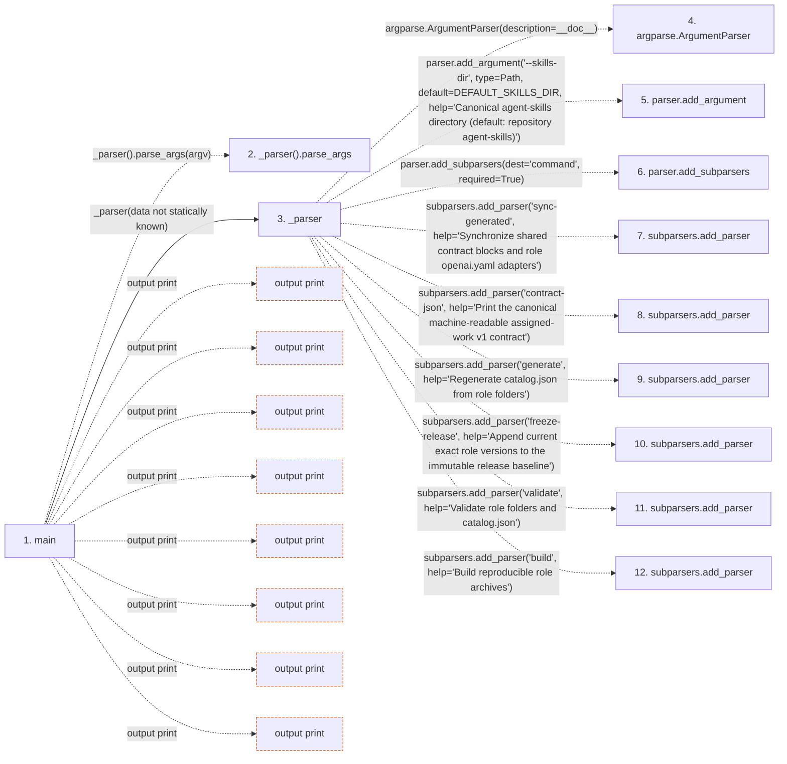

# build_agent_skills

**Entry point:** `main` (`process`)
**Source:** [build_agent_skills](../modules/build_agent_skills.md)
**Modules touched:** [build_agent_skills](../modules/build_agent_skills.md)

## Call sequence

> Static overview in presentation order, not runtime execution order. Arrows retain captured callers; representative internal continuations and boundary examples precede repeated helper detail.

```mermaid
sequenceDiagram
    participant p0 as main
    participant p1 as sync_generated_skill_sources
    participant p2 as write_catalog
    participant p3 as freeze_release
    participant p4 as build_release
    participant p5 as validate_archive
    participant p6 as build_codex_plugin
    participant p7 as install_skill
    participant p8 as validate_installed_skill
    participant p9 as rollback_skill
    participant p10 as uninstall_skill
    participant p11 as _parser
    participant p12 as SkillPackError
    participant p13 as _canonical_json
    participant p14 as validate_catalog
    participant p15 as generate_catalog
    participant p16 as _load_release
    participant p17 as _release_skill
    participant p18 as _replace_generated_contract_block
    participant p19 as _validated_archive_members
    participant p20 as render_workflow_vocabulary_markdown
    participant p21 as _destination_mutation_lock
    participant p22 as load_workflow_vocabulary
    participant p23 as _recover_interrupted_transaction
    participant p24 as _replace_built_tree
    participant p25 as _workflow_vocabulary_block
    participant p26 as _role_features_block
    participant p27 as render_openai_adapter
    participant p28 as _extract_validated_archive
    participant p29 as print
    participant p30 as _parser().parse_args
    p0->>p1: sync_generated_skill_sources
    p0->>p2: write_catalog
    p0->>p3: freeze_release
    p0->>p4: build_release
    p0->>p5: validate_archive
    p0->>p6: build_codex_plugin
    p0->>p7: install_skill
    p0->>p8: validate_installed_skill
    p0->>p9: rollback_skill
    p0->>p10: uninstall_skill
    p0->>p11: _parser
    p0->>p12: SkillPackError
    p0->>p13: _canonical_json
    p0->>p14: validate_catalog
    p2->>p15: generate_catalog
    p7->>p16: _load_release
    p7->>p17: _release_skill
    p1->>p18: _replace_generated_contract_block
    p5->>p19: _validated_archive_members
    p1->>p20: render_workflow_vocabulary_markdown
    p7->>p21: _destination_mutation_lock
    p1->>p22: load_workflow_vocabulary
    p7->>p23: _recover_interrupted_transaction
    p4->>p24: _replace_built_tree
    p1->>p25: _workflow_vocabulary_block
    p1->>p26: _role_features_block
    p1->>p27: render_openai_adapter
    p7->>p28: _extract_validated_archive
    p0-->>p29: print(...)
    p0-->>p30: _parser().parse_args(argv)
```

<!-- Auto-generated from static call edges. Dashed arrows are external or unresolved calls. Reviewed runtime conditions and side effects belong in Behavior. -->

> Call sequence diagram shows 30 of 1267 interactions; 1237 omitted to keep the visualization within the 30-interaction and generated-diagram limits, with uncertain identities omitted rather than inferred.

> Captured boundary calls: external 1 of 310 (309 omitted); unresolved 1 of 424 (423 omitted). These counts cover the captured static trace.

Omitted captured detail, grouped by actual caller occurrence and target module:

| Caller | Parent step | Target module | Kind | Omitted interactions |
| --- | --- | --- | --- | --- |
| `scripts/build_agent_skills.py:_parser` | 3 | - | external | 6 |
| `scripts/build_agent_skills.py:_parser` | 3 | - | unresolved | 30 |
| `scripts/build_agent_skills.py:main` | 1 | - | unresolved | 13 |
| `scripts/build_agent_skills.py:sync_generated_skill_sources` | 43 | - | unresolved | 14 |
| `scripts/build_agent_skills.py:sync_generated_skill_sources` | 43 | [scripts/build_agent_skills.py](../modules/build_agent_skills.md) | internal | 5 |
| `scripts/build_agent_skills.py:_replace_generated_contract_block` | 46 | [scripts/build_agent_skills.py](../modules/build_agent_skills.md) | internal | 2 |
| `scripts/build_agent_skills.py:_generated_contract_block` | 47 | [scripts/build_agent_skills.py](../modules/build_agent_skills.md) | internal | 1 |
| `scripts/build_agent_skills.py:_generated_block` | 48 | - | unresolved | 4 |
> Omission summary shows 8 of 203 groups; 195 further groups are not expanded here. Counts above include all omitted interactions.
> Detailed flow queries retain their own coverage and limits; omitted paths may execute at runtime.

> Trace truncated at the depth limit; deeper calls are omitted.

## Data flow

<!-- Auto-generated static analysis. Treat values and boundaries as best-effort hints, not runtime proof. -->

### Analysis coverage

**Effect analysis partially available.** Flow assembly and source effect analysis are separate; empty observations do not prove an empty handler body.

Source steps: 534; effect analysis evaluated: 302, partial: 11, unavailable: 221. Counts include steps omitted from the displayed trace.

Collector observations for 313 source steps with known totals: observed: 1414, emitted: 1387, omitted: 27. Unavailable totals are excluded.

- Callable record unavailable for one or more source steps; those steps have no represented callable body.
- Effect collector omitted observations before flow assembly; displayed effects are partial.
- Effect collector totals unavailable; observed counts cover captured records only.

| Step | Callable record | Effect analysis | Collector totals | Observed | Emitted | Omitted |
|---|---|---|---|---:|---:|---:|
| `main` | `available` | `partial` | `available` | `19` | `15` | `4` |
| `_parser().parse_args` | `not_applicable` | `not_applicable` | `not_applicable` | — | — | — |
| `_parser` | `available` | `partial` | `available` | `17` | `9` | `8` |
| `argparse.ArgumentParser` | `not_applicable` | `not_applicable` | `not_applicable` | — | — | — |
| `parser.add_argument` | `not_applicable` | `not_applicable` | `not_applicable` | — | — | — |
| `parser.add_subparsers` | `not_applicable` | `not_applicable` | `not_applicable` | — | — | — |
| `subparsers.add_parser` | `not_applicable` | `not_applicable` | `not_applicable` | — | — | — |
| `subparsers.add_parser` | `not_applicable` | `not_applicable` | `not_applicable` | — | — | — |
| `subparsers.add_parser` | `not_applicable` | `not_applicable` | `not_applicable` | — | — | — |
| `subparsers.add_parser` | `not_applicable` | `not_applicable` | `not_applicable` | — | — | — |
| `subparsers.add_parser` | `not_applicable` | `not_applicable` | `not_applicable` | — | — | — |
| `subparsers.add_parser` | `not_applicable` | `not_applicable` | `not_applicable` | — | — | — |

### Step data

| Step | Inputs | Reads | Writes | Returns |
|---|---|---|---|---|
| `main` | `argv: list[str] \| None` | `REPOSITORY_ROOT`, `ASSIGNED_WORK_V1_CONTRACT`, `SkillPackError`, `sys` | - | `2`, `0` |
| `_parser().parse_args` | - | - | - | - |
| `_parser` | - | `Path`, `DEFAULT_SKILLS_DIR`, `Path`, `Path`, `ROLE_METADATA`, `Path`, `Path`, `Path` | - | `parser` |
| `argparse.ArgumentParser` | - | - | - | - |
| `parser.add_argument` | - | - | - | - |
| `parser.add_subparsers` | - | - | - | - |
| `subparsers.add_parser` | - | - | - | - |
| `subparsers.add_parser` | - | - | - | - |
| `subparsers.add_parser` | - | - | - | - |
| `subparsers.add_parser` | - | - | - | - |
| `subparsers.add_parser` | - | - | - | - |
| `subparsers.add_parser` | - | - | - | - |

### Call data

| From | To | Line | Call |
|---|---|---:|---|
| main | _parser().parse_args | 3404 | `_parser().parse_args(argv)` |
| main | _parser | 3404 | `_parser(data not statically known)` |
| _parser | argparse.ArgumentParser | 3345 | `argparse.ArgumentParser(description=__doc__)` |
| _parser | parser.add_argument | 3346 | `parser.add_argument('--skills-dir', type=Path, default=DEFAULT_SKILLS_DIR, help='Canonical agent-skills directory (default: repository agent-skills)')` |
| _parser | parser.add_subparsers | 3352 | `parser.add_subparsers(dest='command', required=True)` |
| _parser | subparsers.add_parser | 3353 | `subparsers.add_parser('sync-generated', help='Synchronize shared contract blocks and role openai.yaml adapters')` |
| _parser | subparsers.add_parser | 3357 | `subparsers.add_parser('contract-json', help='Print the canonical machine-readable assigned-work v1 contract')` |
| _parser | subparsers.add_parser | 3361 | `subparsers.add_parser('generate', help='Regenerate catalog.json from role folders')` |
| _parser | subparsers.add_parser | 3362 | `subparsers.add_parser('freeze-release', help='Append current exact role versions to the immutable release baseline')` |
| _parser | subparsers.add_parser | 3366 | `subparsers.add_parser('validate', help='Validate role folders and catalog.json')` |
| _parser | subparsers.add_parser | 3367 | `subparsers.add_parser('build', help='Build reproducible role archives')` |

### Boundary effects

| Kind | Target | Step | Line |
|---|---|---|---:|
| output | `print` | `main` | 3413 |
| output | `print` | `main` | 3418 |
| output | `print` | `main` | 3421 |
| output | `print` | `main` | 3424 |
| output | `print` | `main` | 3427 |
| output | `print` | `main` | 3433 |
| output | `print` | `main` | 3436 |
| output | `print` | `main` | 3445 |

### Static analysis gaps

| Kind | Step | Target | Line |
|---|---|---|---:|
| unresolved_call | `main` | `_parser().parse_args` | 3404 |
| external_call | `_parser` | `argparse.ArgumentParser` | 3345 |
| unresolved_call | `_parser` | `parser.add_argument` | 3346 |
| unresolved_call | `_parser` | `parser.add_subparsers` | 3352 |
| unresolved_call | `_parser` | `subparsers.add_parser` | 3353 |
| unresolved_call | `_parser` | `subparsers.add_parser` | 3357 |
| unresolved_call | `_parser` | `subparsers.add_parser` | 3361 |
| unresolved_call | `_parser` | `subparsers.add_parser` | 3362 |
| unresolved_call | `_parser` | `subparsers.add_parser` | 3366 |
| unresolved_call | `_parser` | `subparsers.add_parser` | 3367 |
| step_limit | `main` | `first 12 steps` | 0 |
| truncated_flow | `main` | `depth limit` | 0 |

## Behavior

This flow starts at `main` and is classified as `process`. The generated call and data-flow sections are bounded static projections; runtime conditions and side effects require source-level confirmation.
