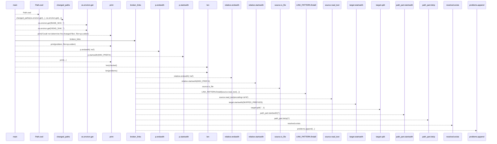
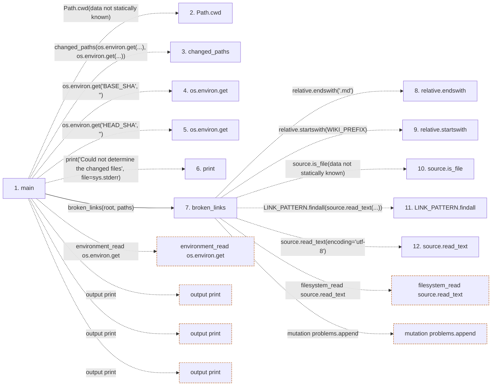

# check_markdown_links

**Entry point:** `main` (`process`)
**Source:** [check_markdown_links](../modules/check_markdown_links.md)
**Modules touched:** [check_markdown_links](../modules/check_markdown_links.md)

## Call sequence

> Static overview in presentation order, not runtime execution order. Arrows retain captured callers; representative internal continuations and boundary examples precede repeated helper detail.

<!-- Auto-generated from static call edges. Dashed arrows are external or unresolved calls. Reviewed runtime conditions and side effects belong in Behavior. -->

> Call sequence diagram shows 23 of 23 interactions; 0 omitted to keep the visualization within the 30-interaction and generated-diagram limits, with uncertain identities omitted rather than inferred.

> Captured boundary calls: external 9 of 9 (0 omitted); unresolved 13 of 13 (0 omitted). These counts cover the captured static trace.
> Detailed flow queries retain their own coverage and limits; omitted paths may execute at runtime.

## Data flow

<!-- Auto-generated static analysis. Treat values and boundaries as best-effort hints, not runtime proof. -->

### Analysis coverage

**Effect analysis evaluated.** Flow assembly and source effect analysis are separate; empty observations do not prove an empty handler body.

Source steps: 2; effect analysis evaluated: 2, partial: 0, unavailable: 0. Counts include steps omitted from the displayed trace.

Collector observations for 2 source steps with known totals: observed: 17, emitted: 17, omitted: 0. Unavailable totals are excluded.

### Step data

| Step | Inputs | Reads | Writes | Returns |
|---|---|---|---|---|
| `main` | `argv: list[str]` | `sys`, `sys`, `WIKI_PREFIX` | - | `1`, `...` |
| `Path.cwd` | - | - | - | - |
| `changed_paths` | - | - | - | - |
| `os.environ.get` | - | - | - | - |
| `os.environ.get` | - | - | - | - |
| `print` | - | - | - | - |
| `broken_links` | `root: Path`, `relative_paths: list[str]` | `WIKI_PREFIX`, `SKIPPED_PREFIXES` | - | `problems` |
| `relative.endswith` | - | - | - | - |
| `relative.startswith` | - | - | - | - |
| `source.is_file` | - | - | - | - |
| `LINK_PATTERN.findall` | - | - | - | - |
| `source.read_text` | - | - | - | - |

### Call data

| From | To | Line | Call |
|---|---|---:|---|
| main | Path.cwd | 45 | `Path.cwd(data not statically known)` |
| main | changed_paths | 49 | `changed_paths(os.environ.get(...), os.environ.get(...))` |
| main | os.environ.get | 49 | `os.environ.get('BASE_SHA', '')` |
| main | os.environ.get | 49 | `os.environ.get('HEAD_SHA', '')` |
| main | print | 51 | `print('Could not determine the changed files', file=sys.stderr)` |
| main | broken_links | 53 | `broken_links(root, paths)` |
| broken_links | relative.endswith | 27 | `relative.endswith('.md')` |
| broken_links | relative.startswith | 27 | `relative.startswith(WIKI_PREFIX)` |
| broken_links | source.is_file | 30 | `source.is_file(data not statically known)` |
| broken_links | LINK_PATTERN.findall | 32 | `LINK_PATTERN.findall(source.read_text(...))` |
| broken_links | source.read_text | 32 | `source.read_text(encoding='utf-8')` |

### Boundary effects

| Kind | Target | Step | Line |
|---|---|---|---:|
| environment_read | `os.environ.get` | `main` | 49 |
| output | `print` | `main` | 51 |
| output | `print` | `main` | 55 |
| output | `print` | `main` | 57 |
| filesystem_read | `source.read_text` | `broken_links` | 32 |
| mutation | `problems.append` | `broken_links` | 40 |

### Static analysis gaps

| Kind | Step | Target | Line |
|---|---|---|---:|
| external_call | `main` | `Path.cwd` | 45 |
| unresolved_call | `broken_links` | `relative.endswith` | 27 |
| unresolved_call | `broken_links` | `relative.startswith` | 27 |
| unresolved_call | `broken_links` | `source.is_file` | 30 |
| step_limit | `main` | `first 12 steps` | 0 |

## Behavior

This flow starts at `main` and is classified as `process`. The generated call and data-flow sections are bounded static projections; runtime conditions and side effects require source-level confirmation.
