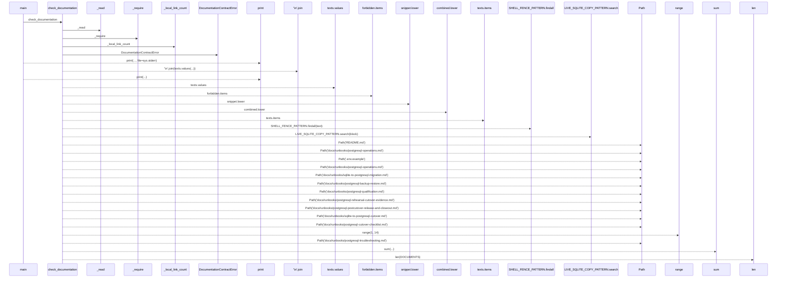
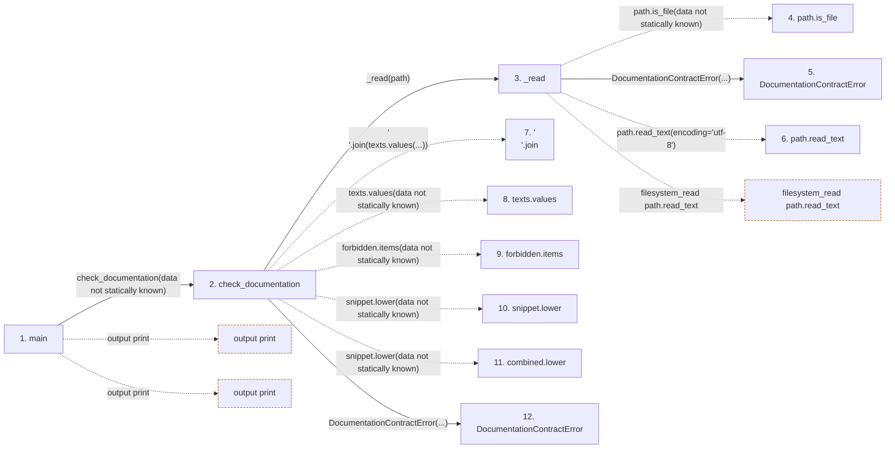

# check_postgresql_documentation

**Entry point:** `main` (`process`)
**Source:** [check_postgresql_documentation](../modules/check_postgresql_documentation.md)
**Modules touched:** [check_postgresql_documentation](../modules/check_postgresql_documentation.md)

## Call sequence

> Static overview in presentation order, not runtime execution order. Arrows retain captured callers; representative internal continuations and boundary examples precede repeated helper detail.

<!-- Auto-generated from static call edges. Dashed arrows are external or unresolved calls. Reviewed runtime conditions and side effects belong in Behavior. -->

> Call sequence diagram shows 30 of 60 interactions; 30 omitted to keep the visualization within the 30-interaction and generated-diagram limits, with uncertain identities omitted rather than inferred.

> Captured boundary calls: external 17 of 17 (0 omitted); unresolved 8 of 21 (13 omitted). These counts cover the captured static trace.

Omitted captured detail, grouped by actual caller occurrence and target module:

| Caller | Parent step | Target module | Kind | Omitted interactions |
| --- | --- | --- | --- | --- |
| `scripts/ci/check_postgresql_documentation.py:_read` | 3 | - | unresolved | 2 |
| `scripts/ci/check_postgresql_documentation.py:_read` | 3 | [scripts/ci/check_postgresql_documentation.py](../modules/check_postgresql_documentation.md) | internal | 1 |
| `scripts/ci/check_postgresql_documentation.py:check_documentation` | 2 | [scripts/ci/check_postgresql_documentation.py](../modules/check_postgresql_documentation.md) | internal | 12 |
| `scripts/ci/check_postgresql_documentation.py:_require` | 17 | [scripts/ci/check_postgresql_documentation.py](../modules/check_postgresql_documentation.md) | internal | 2 |
| `scripts/ci/check_postgresql_documentation.py:_require` | 17 | - | unresolved | 4 |
| `scripts/ci/check_postgresql_documentation.py:_local_link_count` | 49 | [scripts/ci/check_postgresql_documentation.py](../modules/check_postgresql_documentation.md) | internal | 2 |
| `scripts/ci/check_postgresql_documentation.py:_local_link_count` | 49 | - | unresolved | 7 |
> Detailed flow queries retain their own coverage and limits; omitted paths may execute at runtime.

## Data flow

<!-- Auto-generated static analysis. Treat values and boundaries as best-effort hints, not runtime proof. -->

### Analysis coverage

**Effect analysis partially available.** Flow assembly and source effect analysis are separate; empty observations do not prove an empty handler body.

Source steps: 23; effect analysis evaluated: 17, partial: 0, unavailable: 6. Counts include steps omitted from the displayed trace.

Collector observations for 17 source steps with known totals: observed: 47, emitted: 47, omitted: 0. Unavailable totals are excluded.

- Callable record unavailable for one or more source steps; those steps have no represented callable body.
- Effect collector totals unavailable; observed counts cover captured records only.

| Step | Callable record | Effect analysis | Collector totals | Observed | Emitted | Omitted |
|---|---|---|---|---:|---:|---:|
| `main` | `available` | `evaluated` | `available` | `6` | `6` | `0` |
| `check_documentation` | `available` | `evaluated` | `available` | `4` | `4` | `0` |
| `_read` | `available` | `evaluated` | `available` | `4` | `4` | `0` |
| `path.is_file` | `not_applicable` | `not_applicable` | `not_applicable` | — | — | — |
| `DocumentationContractError` | `unavailable` | `unavailable` | `unavailable` | — | — | — |
| `path.read_text` | `not_applicable` | `not_applicable` | `not_applicable` | — | — | — |
| `'\n'.join` | `not_applicable` | `not_applicable` | `not_applicable` | — | — | — |
| `texts.values` | `not_applicable` | `not_applicable` | `not_applicable` | — | — | — |
| `forbidden.items` | `not_applicable` | `not_applicable` | `not_applicable` | — | — | — |
| `snippet.lower` | `not_applicable` | `not_applicable` | `not_applicable` | — | — | — |
| `combined.lower` | `not_applicable` | `not_applicable` | `not_applicable` | — | — | — |
| `DocumentationContractError` | `unavailable` | `unavailable` | `unavailable` | — | — | — |

### Step data

| Step | Inputs | Reads | Writes | Returns |
|---|---|---|---|---|
| `main` | - | `DocumentationContractError`, `sys` | - | `1`, `0` |
| `check_documentation` | - | `DOCUMENTS`, `DOCUMENTS`, `DOCUMENTS` | - | `(...)` |
| `_read` | `relative_path: Path` | `REPOSITORY_ROOT` | - | `path.read_text(...)` |
| `path.is_file` | - | - | - | - |
| `DocumentationContractError` | - | - | - | - |
| `path.read_text` | - | - | - | - |
| `'\n'.join` | - | - | - | - |
| `texts.values` | - | - | - | - |
| `forbidden.items` | - | - | - | - |
| `snippet.lower` | - | - | - | - |
| `combined.lower` | - | - | - | - |
| `DocumentationContractError` | - | - | - | - |

### Call data

| From | To | Line | Call |
|---|---|---:|---|
| main | check_documentation | 229 | `check_documentation(data not statically known)` |
| check_documentation | _read | 84 | `_read(path)` |
| _read | path.is_file | 45 | `path.is_file(data not statically known)` |
| _read | DocumentationContractError | 46 | `DocumentationContractError(...)` |
| _read | path.read_text | 47 | `path.read_text(encoding='utf-8')` |
| check_documentation | '\n'.join | 85 | `'\n'.join(texts.values(...))` |
| check_documentation | texts.values | 85 | `texts.values(data not statically known)` |
| check_documentation | forbidden.items | 96 | `forbidden.items(data not statically known)` |
| check_documentation | snippet.lower | 97 | `snippet.lower(data not statically known)` |
| check_documentation | combined.lower | 97 | `snippet.lower(data not statically known)` |
| check_documentation | DocumentationContractError | 98 | `DocumentationContractError(...)` |

### Boundary effects

| Kind | Target | Step | Line |
|---|---|---|---:|
| output | `print` | `main` | 231 |
| output | `print` | `main` | 233 |
| filesystem_read | `path.read_text` | `_read` | 47 |

### Static analysis gaps

| Kind | Step | Target | Line |
|---|---|---|---:|
| unresolved_call | `_read` | `path.is_file` | 45 |
| unresolved_call | `check_documentation` | `'\n'.join` | 85 |
| unresolved_call | `check_documentation` | `texts.values` | 85 |
| unresolved_call | `check_documentation` | `forbidden.items` | 96 |
| unresolved_call | `check_documentation` | `snippet.lower` | 97 |
| unresolved_call | `check_documentation` | `combined.lower` | 97 |
| step_limit | `main` | `first 12 steps` | 0 |

## Behavior

This flow starts at `main` and is classified as `process`. The generated call and data-flow sections are bounded static projections; runtime conditions and side effects require source-level confirmation.
