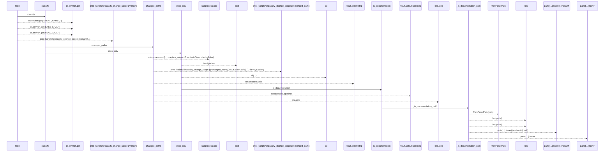
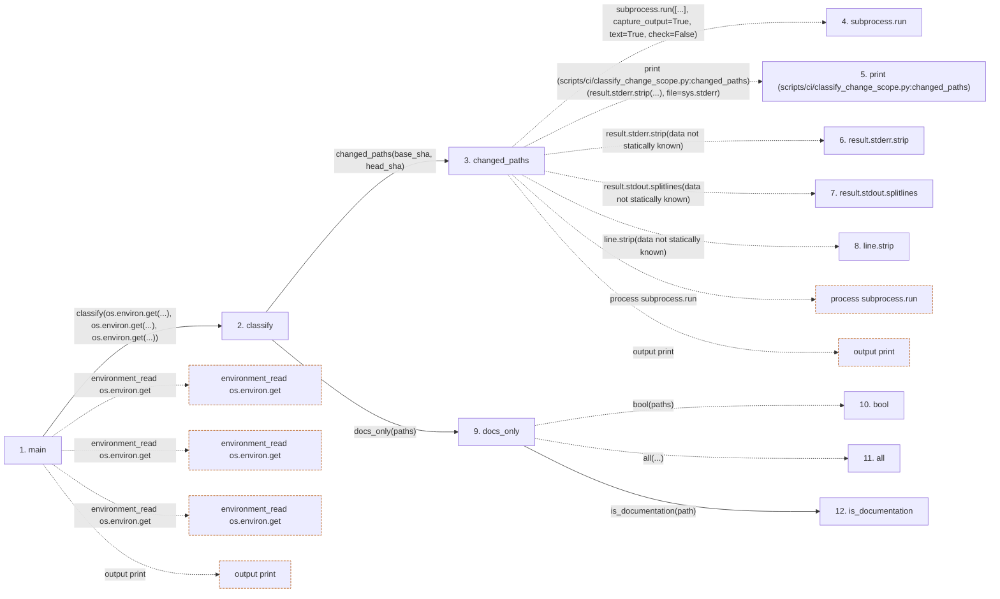

# classify_change_scope

**Entry point:** `main` (`process`)
**Source:** [classify_change_scope](../modules/classify_change_scope.md)
**Modules touched:** [classify_change_scope](../modules/classify_change_scope.md)

## Call sequence

> Static overview in presentation order, not runtime execution order. Arrows retain captured callers; representative internal continuations and boundary examples precede repeated helper detail.

<!-- Auto-generated from static call edges. Dashed arrows are external or unresolved calls. Reviewed runtime conditions and side effects belong in Behavior. -->

> Call sequence diagram shows 21 of 21 interactions; 0 omitted to keep the visualization within the 30-interaction and generated-diagram limits, with uncertain identities omitted rather than inferred.

> Captured boundary calls: external 11 of 11 (0 omitted); unresolved 5 of 5 (0 omitted). These counts cover the captured static trace.
> Detailed flow queries retain their own coverage and limits; omitted paths may execute at runtime.

## Data flow

<!-- Auto-generated static analysis. Treat values and boundaries as best-effort hints, not runtime proof. -->

### Analysis coverage

**Effect analysis evaluated.** Flow assembly and source effect analysis are separate; empty observations do not prove an empty handler body.

Source steps: 6; effect analysis evaluated: 6, partial: 0, unavailable: 0. Counts include steps omitted from the displayed trace.

Collector observations for 6 source steps with known totals: observed: 29, emitted: 29, omitted: 0. Unavailable totals are excluded.

### Step data

| Step | Inputs | Reads | Writes | Returns |
|---|---|---|---|---|
| `main` | - | - | - | `0` |
| `classify` | `event_name: str`, `base_sha: str`, `head_sha: str` | `CLASSIFIED_EVENTS` | - | `False`, `False`, `docs_only(...)` |
| `changed_paths` | `base_sha: str`, `head_sha: str` | `ZERO_SHA`, `sys` | - | `None`, `None`, `...` |
| `subprocess.run` | - | - | - | - |
| `print (scripts/ci/classify_change_scope.py:changed_paths)` | - | - | - | - |
| `result.stderr.strip` | - | - | - | - |
| `result.stdout.splitlines` | - | - | - | - |
| `line.strip` | - | - | - | - |
| `docs_only` | `paths: list[str]` | - | - | `...` |
| `bool` | - | - | - | - |
| `all` | - | - | - | - |
| `is_documentation` | `path: str` | `CHECKED_DOCUMENTS` | - | `...` |

### Call data

| From | To | Line | Call |
|---|---|---:|---|
| main | classify | 97 | `classify(os.environ.get(...), os.environ.get(...), os.environ.get(...))` |
| classify | changed_paths | 90 | `changed_paths(base_sha, head_sha)` |
| changed_paths | subprocess.run | 75 | `subprocess.run([...], capture_output=True, text=True, check=False)` |
| changed_paths | print (scripts/ci/classify_change_scope.py:changed_paths) | 82 | `print(result.stderr.strip(...), file=sys.stderr)` |
| changed_paths | result.stderr.strip | 82 | `result.stderr.strip(data not statically known)` |
| changed_paths | result.stdout.splitlines | 84 | `result.stdout.splitlines(data not statically known)` |
| changed_paths | line.strip | 84 | `line.strip(data not statically known)` |
| classify | docs_only | 93 | `docs_only(paths)` |
| docs_only | bool | 68 | `bool(paths)` |
| docs_only | all | 68 | `all(...)` |
| docs_only | is_documentation | 68 | `is_documentation(path)` |

### Boundary effects

| Kind | Target | Step | Line |
|---|---|---|---:|
| environment_read | `os.environ.get` | `main` | 98 |
| environment_read | `os.environ.get` | `main` | 99 |
| environment_read | `os.environ.get` | `main` | 100 |
| output | `print` | `main` | 102 |
| process | `subprocess.run` | `changed_paths` | 75 |
| output | `print` | `changed_paths` | 82 |

### Static analysis gaps

| Kind | Step | Target | Line |
|---|---|---|---:|
| unresolved_call | `changed_paths` | `result.stdout.splitlines` | 84 |
| unresolved_call | `changed_paths` | `line.strip` | 84 |
| external_call | `docs_only` | `all` | 68 |
| step_limit | `main` | `first 12 steps` | 0 |

## Behavior

This flow starts at `main` and is classified as `process`. The generated call and data-flow sections are bounded static projections; runtime conditions and side effects require source-level confirmation.
