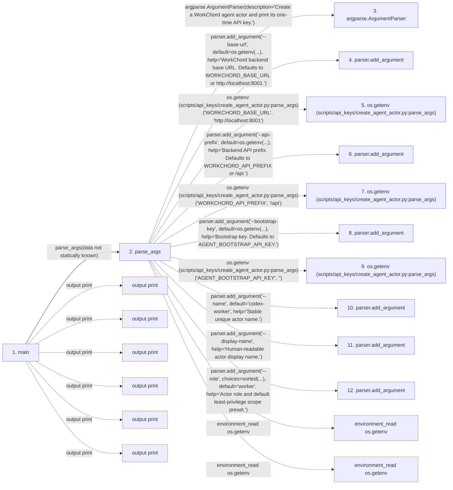

# create_agent_actor

**Entry point:** `main` (`process`)
**Source:** [create_agent_actor](../modules/create_agent_actor.md)
**Modules touched:** [create_agent_actor](../modules/create_agent_actor.md)

## Call sequence

> Static overview in presentation order, not runtime execution order. Arrows retain captured callers; representative internal continuations and boundary examples precede repeated helper detail.

```mermaid
sequenceDiagram
    participant p0 as main
    participant p1 as actor_url
    participant p2 as parse_args
    participant p3 as check_key_file_target
    participant p4 as default_key_file
    participant p5 as normalize_scopes
    participant p6 as create_actor
    participant p7 as title_from_name
    participant p8 as write_key_file
    participant p9 as without_key
    participant p10 as render_shell
    participant p11 as render_env
    participant p12 as normalize_api_prefix
    participant p13 as normalize_base_url
    participant p14 as SystemExit (scripts/api_keys/create_agent_actor.py:main)
    participant p15 as args.name.strip
    participant p16 as Path (scripts/api_keys/create_agent_actor.py:main)
    participant p17 as args.model_catalog_key.strip().lower
    participant p18 as args.model_catalog_key.strip
    participant p19 as print
    participant p20 as json.dumps (scripts/api_keys/create_agent_actor.py:main)
    participant p21 as data.get (scripts/api_keys/create_agent_actor.py:main)
    participant p22 as argparse.ArgumentParser
    participant p23 as path.expanduser().absolute
    p0->>p1: actor_url
    p0->>p2: parse_args
    p0->>p3: check_key_file_target
    p0->>p4: default_key_file
    p0->>p5: normalize_scopes
    p0->>p6: create_actor
    p0->>p7: title_from_name
    p0->>p8: write_key_file
    p0->>p9: without_key
    p0->>p10: render_shell
    p0->>p11: render_env
    p0->>p12: normalize_api_prefix
    p1->>p13: normalize_base_url
    p0-->>p14: SystemExit (scripts/api_keys/create_agent_actor.py:main)('Missing bootstrap key. Set AGENT_BOOTSTRAP_API_KEY or pass --bootstrap-key.')
    p0-->>p15: args.name.strip
    p0-->>p14: SystemExit (scripts/api_keys/create_agent_actor.py:main)('Actor name cannot be blank')
    p0-->>p16: Path (scripts/api_keys/create_agent_actor.py:main)(args.key_file)
    p0-->>p17: args.model_catalog_key.strip().lower
    p0-->>p18: args.model_catalog_key.strip
    p0-->>p14: SystemExit (scripts/api_keys/create_agent_actor.py:main)('Model tags require --model-catalog-key provider credentials must not be supplied.')
    p0-->>p19: print(json.dumps(...))
    p0-->>p20: json.dumps (scripts/api_keys/create_agent_actor.py:main)(data, indent=2, sort_keys=True)
    p0-->>p19: print(render_shell(...))
    p0-->>p19: print(render_env(...))
    p0-->>p19: print(..., file=sys.stderr)
    p0-->>p19: print('The api_key is returned once store it securely before closing this terminal.', file=sys.stderr)
    p0-->>p21: data.get (scripts/api_keys/create_agent_actor.py:main)('model_binding_id')
    p0-->>p19: print(..., file=sys.stderr)
    p2-->>p22: argparse.ArgumentParser(description='Create a WorkChord agent actor and print its one-time API key.')
    p3-->>p23: path.expanduser().absolute
```

<!-- Auto-generated from static call edges. Dashed arrows are external or unresolved calls. Reviewed runtime conditions and side effects belong in Behavior. -->

> Call sequence diagram shows 30 of 133 interactions; 103 omitted to keep the visualization within the 30-interaction and generated-diagram limits, with uncertain identities omitted rather than inferred.

> Captured boundary calls: external 12 of 53 (41 omitted); unresolved 5 of 65 (60 omitted). These counts cover the captured static trace.

Omitted captured detail, grouped by actual caller occurrence and target module:

| Caller | Parent step | Target module | Kind | Omitted interactions |
| --- | --- | --- | --- | --- |
| `scripts/api_keys/create_agent_actor.py:parse_args` | 2 | - | unresolved | 21 |
| `scripts/api_keys/create_agent_actor.py:parse_args` | 2 | - | external | 4 |
| `scripts/api_keys/create_agent_actor.py:check_key_file_target` | 32 | - | unresolved | 4 |
| `scripts/api_keys/create_agent_actor.py:check_key_file_target` | 32 | - | external | 2 |
| `scripts/api_keys/create_agent_actor.py:default_key_file` | 41 | - | external | 4 |
| `scripts/api_keys/create_agent_actor.py:normalize_scopes` | 46 | - | unresolved | 4 |
| `scripts/api_keys/create_agent_actor.py:normalize_scopes` | 46 | - | external | 1 |
| `scripts/api_keys/create_agent_actor.py:create_actor` | 55 | - | unresolved | 5 |
> Omission summary shows 8 of 22 groups; 14 further groups are not expanded here. Counts above include all omitted interactions.
> Detailed flow queries retain their own coverage and limits; omitted paths may execute at runtime.

## Data flow

<!-- Auto-generated static analysis. Treat values and boundaries as best-effort hints, not runtime proof. -->

### Analysis coverage

**Effect analysis partially available.** Flow assembly and source effect analysis are separate; empty observations do not prove an empty handler body.

Source steps: 16; effect analysis evaluated: 15, partial: 1, unavailable: 0. Counts include steps omitted from the displayed trace.

Collector observations for 16 source steps with known totals: observed: 88, emitted: 81, omitted: 7. Unavailable totals are excluded.

- Effect collector omitted observations before flow assembly; displayed effects are partial.

| Step | Callable record | Effect analysis | Collector totals | Observed | Emitted | Omitted |
|---|---|---|---|---:|---:|---:|
| `main` | `available` | `evaluated` | `available` | `10` | `10` | `0` |
| `parse_args` | `available` | `evaluated` | `available` | `5` | `5` | `0` |
| `argparse.ArgumentParser` | `not_applicable` | `not_applicable` | `not_applicable` | — | — | — |
| `parser.add_argument` | `not_applicable` | `not_applicable` | `not_applicable` | — | — | — |
| `os.getenv (scripts/api_keys/create_agent_actor.py:parse_args)` | `not_applicable` | `not_applicable` | `not_applicable` | — | — | — |
| `parser.add_argument` | `not_applicable` | `not_applicable` | `not_applicable` | — | — | — |
| `os.getenv (scripts/api_keys/create_agent_actor.py:parse_args)` | `not_applicable` | `not_applicable` | `not_applicable` | — | — | — |
| `parser.add_argument` | `not_applicable` | `not_applicable` | `not_applicable` | — | — | — |
| `os.getenv (scripts/api_keys/create_agent_actor.py:parse_args)` | `not_applicable` | `not_applicable` | `not_applicable` | — | — | — |
| `parser.add_argument` | `not_applicable` | `not_applicable` | `not_applicable` | — | — | — |
| `parser.add_argument` | `not_applicable` | `not_applicable` | `not_applicable` | — | — | — |
| `parser.add_argument` | `not_applicable` | `not_applicable` | `not_applicable` | — | — | — |

### Step data

| Step | Inputs | Reads | Writes | Returns |
|---|---|---|---|---|
| `main` | - | `ROLE_SCOPES`, `sys`, `sys`, `sys` | - | - |
| `parse_args` | - | `ROLE_SCOPES` | - | `parser.parse_args(...)` |
| `argparse.ArgumentParser` | - | - | - | - |
| `parser.add_argument` | - | - | - | - |
| `os.getenv (scripts/api_keys/create_agent_actor.py:parse_args)` | - | - | - | - |
| `parser.add_argument` | - | - | - | - |
| `os.getenv (scripts/api_keys/create_agent_actor.py:parse_args)` | - | - | - | - |
| `parser.add_argument` | - | - | - | - |
| `os.getenv (scripts/api_keys/create_agent_actor.py:parse_args)` | - | - | - | - |
| `parser.add_argument` | - | - | - | - |
| `parser.add_argument` | - | - | - | - |
| `parser.add_argument` | - | - | - | - |

### Call data

| From | To | Line | Call |
|---|---|---:|---|
| main | parse_args | 381 | `parse_args(data not statically known)` |
| parse_args | argparse.ArgumentParser | 285 | `argparse.ArgumentParser(description='Create a WorkChord agent actor and print its one-time API key.')` |
| parse_args | parser.add_argument | 288 | `parser.add_argument('--base-url', default=os.getenv(...), help='WorkChord backend base URL. Defaults to WORKCHORD_BASE_URL or http://localhost:8001.')` |
| parse_args | os.getenv (scripts/api_keys/create_agent_actor.py:parse_args) | 290 | `os.getenv('WORKCHORD_BASE_URL', 'http://localhost:8001')` |
| parse_args | parser.add_argument | 293 | `parser.add_argument('--api-prefix', default=os.getenv(...), help='Backend API prefix. Defaults to WORKCHORD_API_PREFIX or /api.')` |
| parse_args | os.getenv (scripts/api_keys/create_agent_actor.py:parse_args) | 295 | `os.getenv('WORKCHORD_API_PREFIX', '/api')` |
| parse_args | parser.add_argument | 298 | `parser.add_argument('--bootstrap-key', default=os.getenv(...), help='Bootstrap key. Defaults to AGENT_BOOTSTRAP_API_KEY.')` |
| parse_args | os.getenv (scripts/api_keys/create_agent_actor.py:parse_args) | 300 | `os.getenv('AGENT_BOOTSTRAP_API_KEY', '')` |
| parse_args | parser.add_argument | 303 | `parser.add_argument('--name', default='codex-worker', help='Stable unique actor name.')` |
| parse_args | parser.add_argument | 304 | `parser.add_argument('--display-name', help='Human-readable actor display name.')` |
| parse_args | parser.add_argument | 305 | `parser.add_argument('--role', choices=sorted(...), default='worker', help='Actor role and default least-privilege scope preset.')` |

### Boundary effects

| Kind | Target | Step | Line |
|---|---|---|---:|
| output | `print` | `main` | 433 |
| output | `print` | `main` | 435 |
| output | `print` | `main` | 437 |
| output | `print` | `main` | 440 |
| output | `print` | `main` | 445 |
| output | `print` | `main` | 450 |
| environment_read | `os.getenv` | `parse_args` | 290 |
| environment_read | `os.getenv` | `parse_args` | 295 |

### Static analysis gaps

| Kind | Step | Target | Line |
|---|---|---|---:|
| external_call | `parse_args` | `argparse.ArgumentParser` | 285 |
| unresolved_call | `parse_args` | `parser.add_argument` | 288 |
| unresolved_call | `parse_args` | `parser.add_argument` | 293 |
| unresolved_call | `parse_args` | `parser.add_argument` | 298 |
| external_call | `parse_args` | `os.getenv` | 300 |
| unresolved_call | `parse_args` | `parser.add_argument` | 303 |
| unresolved_call | `parse_args` | `parser.add_argument` | 304 |
| unresolved_call | `parse_args` | `parser.add_argument` | 305 |
| step_limit | `main` | `first 12 steps` | 0 |

## Behavior

This flow starts at `main` and is classified as `process`. The generated call and data-flow sections are bounded static projections; runtime conditions and side effects require source-level confirmation.
