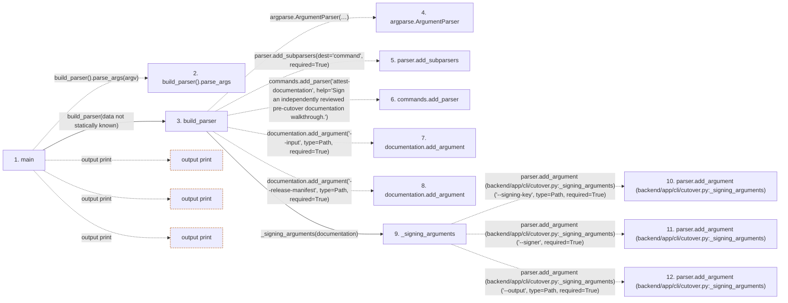

# cutover

**Entry point:** `main` (`process`)
**Source:** [cli_cutover](../modules/cli_cutover.md)
**Modules touched:** [cli_cutover](../modules/cli_cutover.md), [database_migration_cutover](../modules/database_migration_cutover.md), [database_migration_manifest](../modules/database_migration_manifest.md), and 1 more

**Complete modules touched:**

- [cli_cutover](../modules/cli_cutover.md)
- [database_migration_cutover](../modules/database_migration_cutover.md)
- [database_migration_manifest](../modules/database_migration_manifest.md)
- [execution_mode](../modules/execution_mode.md)

**Related modules:** [database_migration_cutover](../modules/database_migration_cutover.md), [database_migration_manifest](../modules/database_migration_manifest.md)

## Call sequence

> Static overview in presentation order, not runtime execution order. Arrows retain captured callers; representative internal continuations and boundary examples precede repeated helper detail.

```mermaid
sequenceDiagram
    participant p0 as main
    participant p1 as build_parser
    participant p2 as attest_documentation
    participant p3 as seal_execution
    participant p4 as finalize_rehearsal
    participant p5 as finalize_rehearsal_series
    participant p6 as authorize_production
    participant p7 as finalize_production
    participant p8 as verify_report
    participant p9 as read_document
    participant p10 as _release_identity
    participant p11 as _read_json_object
    participant p12 as _validate_execution
    participant p13 as _validate_documentation
    participant p14 as _validate_qualification
    participant p15 as _validate_rehearsal_report
    participant p16 as _sign_document
    participant p17 as _validate_production_report
    participant p18 as _validate_rehearsal_series
    participant p19 as _cross_validate_dependencies
    participant p20 as _validate_authorization
    participant p21 as _require_new_output
    participant p22 as _exact_keys
    participant p23 as _private_key
    participant p24 as _text
    participant p25 as verify_document
    participant p26 as _time
    participant p27 as write_document
    participant p28 as _sha256
    participant p29 as print
    participant p30 as build_parser().parse_args
    p0->>p1: build_parser
    p0->>p2: attest_documentation
    p0->>p3: seal_execution
    p0->>p4: finalize_rehearsal
    p0->>p5: finalize_rehearsal_series
    p0->>p6: authorize_production
    p0->>p7: finalize_production
    p0->>p8: verify_report
    p2->>p9: read_document
    p2->>p10: _release_identity
    p2->>p11: _read_json_object
    p3->>p12: _validate_execution
    p2->>p13: _validate_documentation
    p4->>p14: _validate_qualification
    p5->>p15: _validate_rehearsal_report
    p2->>p16: _sign_document
    p8->>p17: _validate_production_report
    p6->>p18: _validate_rehearsal_series
    p4->>p19: _cross_validate_dependencies
    p6->>p20: _validate_authorization
    p16->>p21: _require_new_output
    p13->>p22: _exact_keys
    p16->>p23: _private_key
    p10->>p24: _text
    p9->>p25: verify_document
    p13->>p26: _time
    p16->>p27: write_document
    p10->>p28: _sha256
    p0-->>p29: print(...)
    p0-->>p30: build_parser().parse_args(argv)
```

<!-- Auto-generated from static call edges. Dashed arrows are external or unresolved calls. Reviewed runtime conditions and side effects belong in Behavior. -->

> Call sequence diagram shows 30 of 879 interactions; 849 omitted to keep the visualization within the 30-interaction and generated-diagram limits, with uncertain identities omitted rather than inferred.

> Captured boundary calls: external 1 of 179 (178 omitted); unresolved 1 of 307 (306 omitted). These counts cover the captured static trace.

Omitted captured detail, grouped by actual caller occurrence and target module:

| Caller | Parent step | Target module | Kind | Omitted interactions |
| --- | --- | --- | --- | --- |
| `backend/app/cli/cutover.py:build_parser` | 3 | - | external | 1 |
| `backend/app/cli/cutover.py:build_parser` | 3 | - | unresolved | 26 |
| `backend/app/cli/cutover.py:build_parser` | 3 | [backend/app/cli/cutover.py](../modules/cli_cutover.md) | internal | 8 |
| `backend/app/cli/cutover.py:_signing_arguments` | 9 | - | unresolved | 3 |
| `backend/app/cli/cutover.py:_trusted_dependency_arguments` | 18 | - | unresolved | 5 |
| `backend/app/database_migration/manifest.py:read_document` | 48 | - | external | 2 |
| `backend/app/database_migration/manifest.py:read_document` | 48 | - | unresolved | 1 |
| `backend/app/database_migration/manifest.py:read_document` | 48 | [backend/app/database_migration/manifest.py](../modules/database_migration_manifest.md) | internal | 2 |
> Omission summary shows 8 of 128 groups; 120 further groups are not expanded here. Counts above include all omitted interactions.
> Detailed flow queries retain their own coverage and limits; omitted paths may execute at runtime.

## Data flow

<!-- Auto-generated static analysis. Treat values and boundaries as best-effort hints, not runtime proof. -->

### Analysis coverage

**Effect analysis partially available.** Flow assembly and source effect analysis are separate; empty observations do not prove an empty handler body.

Source steps: 394; effect analysis evaluated: 210, partial: 12, unavailable: 172. Counts include steps omitted from the displayed trace.

Collector observations for 222 source steps with known totals: observed: 1107, emitted: 1035, omitted: 72. Unavailable totals are excluded.

- Callable record unavailable for one or more source steps; those steps have no represented callable body.
- Effect collector omitted observations before flow assembly; displayed effects are partial.
- Effect collector totals unavailable; observed counts cover captured records only.

| Step | Callable record | Effect analysis | Collector totals | Observed | Emitted | Omitted |
|---|---|---|---|---:|---:|---:|
| `main` | `available` | `evaluated` | `available` | `11` | `11` | `0` |
| `build_parser().parse_args` | `not_applicable` | `not_applicable` | `not_applicable` | — | — | — |
| `build_parser` | `available` | `partial` | `available` | `19` | `9` | `10` |
| `argparse.ArgumentParser` | `not_applicable` | `not_applicable` | `not_applicable` | — | — | — |
| `parser.add_subparsers` | `not_applicable` | `not_applicable` | `not_applicable` | — | — | — |
| `commands.add_parser` | `not_applicable` | `not_applicable` | `not_applicable` | — | — | — |
| `documentation.add_argument` | `not_applicable` | `not_applicable` | `not_applicable` | — | — | — |
| `documentation.add_argument` | `not_applicable` | `not_applicable` | `not_applicable` | — | — | — |
| `_signing_arguments` | `available` | `evaluated` | `available` | `3` | `3` | `0` |
| `parser.add_argument (backend/app/cli/cutover.py:_signing_arguments)` | `not_applicable` | `not_applicable` | `not_applicable` | — | — | — |
| `parser.add_argument (backend/app/cli/cutover.py:_signing_arguments)` | `not_applicable` | `not_applicable` | `not_applicable` | — | — | — |
| `parser.add_argument (backend/app/cli/cutover.py:_signing_arguments)` | `not_applicable` | `not_applicable` | `not_applicable` | — | — | — |

### Step data

| Step | Inputs | Reads | Writes | Returns |
|---|---|---|---|---|
| `main` | `argv: list[str] \| None` | `CutoverEvidenceError`, `ManifestError`, `sys` | - | `0`, `2`, `0`, `2` |
| `build_parser().parse_args` | - | - | - | - |
| `build_parser` | - | `Path`, `Path`, `Path`, `Path`, `Path`, `Path`, `Path`, `Path` | - | `parser` |
| `argparse.ArgumentParser` | - | - | - | - |
| `parser.add_subparsers` | - | - | - | - |
| `commands.add_parser` | - | - | - | - |
| `documentation.add_argument` | - | - | - | - |
| `documentation.add_argument` | - | - | - | - |
| `_signing_arguments` | `parser: argparse.ArgumentParser` | `Path`, `Path` | - | - |
| `parser.add_argument (backend/app/cli/cutover.py:_signing_arguments)` | - | - | - | - |
| `parser.add_argument (backend/app/cli/cutover.py:_signing_arguments)` | - | - | - | - |
| `parser.add_argument (backend/app/cli/cutover.py:_signing_arguments)` | - | - | - | - |

### Call data

| From | To | Line | Call |
|---|---|---:|---|
| main | build_parser().parse_args | 109 | `build_parser().parse_args(argv)` |
| main | build_parser | 109 | `build_parser(data not statically known)` |
| build_parser | argparse.ArgumentParser | 37 | `argparse.ArgumentParser(description='Fail-closed PostgreSQL rehearsal and production-cutover evidence. This command records evidence; it never mutates a database or deployment.')` |
| build_parser | parser.add_subparsers | 43 | `parser.add_subparsers(dest='command', required=True)` |
| build_parser | commands.add_parser | 45 | `commands.add_parser('attest-documentation', help='Sign an independently reviewed pre-cutover documentation walkthrough.')` |
| build_parser | documentation.add_argument | 49 | `documentation.add_argument('--input', type=Path, required=True)` |
| build_parser | documentation.add_argument | 50 | `documentation.add_argument('--release-manifest', type=Path, required=True)` |
| build_parser | _signing_arguments | 51 | `_signing_arguments(documentation)` |
| _signing_arguments | parser.add_argument (backend/app/cli/cutover.py:_signing_arguments) | 31 | `parser.add_argument('--signing-key', type=Path, required=True)` |
| _signing_arguments | parser.add_argument (backend/app/cli/cutover.py:_signing_arguments) | 32 | `parser.add_argument('--signer', required=True)` |
| _signing_arguments | parser.add_argument (backend/app/cli/cutover.py:_signing_arguments) | 33 | `parser.add_argument('--output', type=Path, required=True)` |

### Boundary effects

| Kind | Target | Step | Line |
|---|---|---|---:|
| output | `print` | `main` | 177 |
| output | `print` | `main` | 181 |
| output | `print` | `main` | 193 |

### Static analysis gaps

| Kind | Step | Target | Line |
|---|---|---|---:|
| unresolved_call | `main` | `build_parser().parse_args` | 109 |
| external_call | `build_parser` | `argparse.ArgumentParser` | 37 |
| unresolved_call | `build_parser` | `parser.add_subparsers` | 43 |
| unresolved_call | `build_parser` | `commands.add_parser` | 45 |
| unresolved_call | `build_parser` | `documentation.add_argument` | 49 |
| unresolved_call | `build_parser` | `documentation.add_argument` | 50 |
| unresolved_call | `_signing_arguments` | `parser.add_argument` | 31 |
| unresolved_call | `_signing_arguments` | `parser.add_argument` | 32 |
| unresolved_call | `_signing_arguments` | `parser.add_argument` | 33 |
| step_limit | `main` | `first 12 steps` | 0 |

## Behavior

This flow starts at `main` and is classified as `process`. The generated call and data-flow sections are bounded static projections; runtime conditions and side effects require source-level confirmation.
