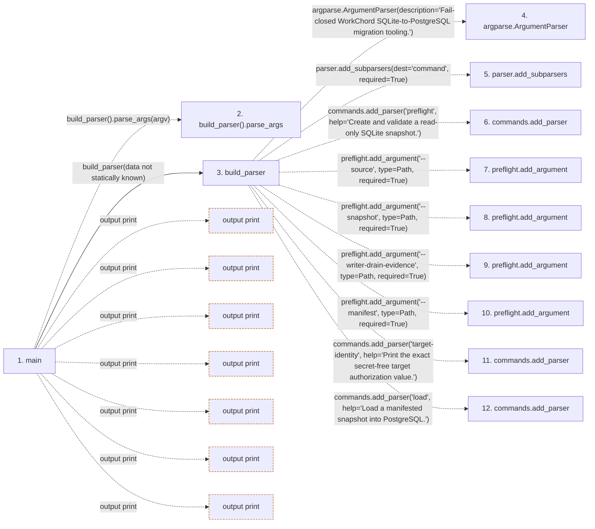

# database_migration

**Entry point:** `main` (`process`)
**Source:** [cli_database_migration](../modules/cli_database_migration.md)
**Modules touched:** [authority](../modules/authority.md), [calendar_service](../modules/calendar_service.md), [catalog](../modules/catalog.md), [cli_database_migration](../modules/cli_database_migration.md), and 24 more

**Complete modules touched:**

- [authority](../modules/authority.md)
- [calendar_service](../modules/calendar_service.md)
- [catalog](../modules/catalog.md)
- [cli_database_migration](../modules/cli_database_migration.md)
- [commands](../modules/commands.md)
- [config](../modules/config.md)
- [database_config](../modules/database_config.md)
- [database_migration_canonical](../modules/database_migration_canonical.md)
- [database_migration_manifest](../modules/database_migration_manifest.md)
- [github_status_automation_service](../modules/github_status_automation_service.md)
- [identity_service](../modules/identity_service.md)
- [label_service](../modules/label_service.md)
- [maintenance](../modules/maintenance.md)
- [models_calendar](../modules/models_calendar.md)
- [models_github](../modules/models_github.md)
- [models_identity](../modules/models_identity.md)
- [models_label](../modules/models_label.md)
- [models_saved_view](../modules/models_saved_view.md)
- [models_system_settings](../modules/models_system_settings.md)
- [models_template](../modules/models_template.md)
- [project_identity](../modules/project_identity.md)
- [saved_view_service](../modules/saved_view_service.md)
- [source](../modules/source.md)
- [system_settings_service](../modules/system_settings_service.md)
- [template_service](../modules/template_service.md)
- [time](../modules/time.md)
- [transfer](../modules/transfer.md)
- [upgrade_service](../modules/upgrade_service.md)

**Related modules:** [database_migration_manifest](../modules/database_migration_manifest.md), [source](../modules/source.md), [transfer](../modules/transfer.md), [upgrade_service](../modules/upgrade_service.md)

## Call sequence

> Static overview in presentation order, not runtime execution order. Arrows retain captured callers; representative internal continuations and boundary examples precede repeated helper detail.

```mermaid
sequenceDiagram
    participant p0 as main
    participant p1 as preflight_source
    participant p2 as load_snapshot
    participant p3 as record_post_copy_repairs
    participant p4 as reconcile_snapshot
    participant p5 as _seal
    participant p6 as build_parser
    participant p7 as database_configuration
    participant p8 as MigrationDataError
    participant p9 as target_identifier
    participant p10 as _load_source_manifest
    participant p11 as _target_engine
    participant p12 as _authorize_target
    participant p13 as _target_identity_sha256
    participant p14 as read_document
    participant p15 as _optional_evidence
    participant p16 as validate_writer_drain_evidence
    participant p17 as get_settings
    participant p18 as _source_file_set
    participant p19 as sqlite_project_allocation_floor
    participant p20 as _exclusive_loader_connection
    participant p21 as _assert_postgresql_contract
    participant p22 as _initialize_gate
    participant p23 as _row_hash_map
    participant p24 as _repair_report
    participant p25 as run_database_repairs
    participant p26 as _snapshot_database
    participant p27 as _raw_table_results
    participant p28 as _final_table_results
    participant p29 as print
    participant p30 as build_parser().parse_args
    p0->>p1: preflight_source
    p0->>p2: load_snapshot
    p0->>p3: record_post_copy_repairs
    p0->>p4: reconcile_snapshot
    p0->>p5: _seal
    p0->>p6: build_parser
    p0->>p7: database_configuration
    p0->>p8: MigrationDataError
    p0->>p9: target_identifier
    p2->>p10: _load_source_manifest
    p2->>p11: _target_engine
    p2->>p12: _authorize_target
    p2->>p13: _target_identity_sha256
    p1->>p14: read_document
    p2->>p15: _optional_evidence
    p1->>p16: validate_writer_drain_evidence
    p2->>p17: get_settings
    p1->>p18: _source_file_set
    p1->>p19: sqlite_project_allocation_floor
    p2->>p20: _exclusive_loader_connection
    p2->>p21: _assert_postgresql_contract
    p2->>p22: _initialize_gate
    p3->>p23: _row_hash_map
    p4->>p24: _repair_report
    p3->>p25: run_database_repairs
    p1->>p26: _snapshot_database
    p4->>p27: _raw_table_results
    p4->>p28: _final_table_results
    p0-->>p29: print(...)
    p0-->>p30: build_parser().parse_args(argv)
```

<!-- Auto-generated from static call edges. Dashed arrows are external or unresolved calls. Reviewed runtime conditions and side effects belong in Behavior. -->

> Call sequence diagram shows 30 of 1437 interactions; 1407 omitted to keep the visualization within the 30-interaction and generated-diagram limits, with uncertain identities omitted rather than inferred.

> Captured boundary calls: external 1 of 433 (432 omitted); unresolved 1 of 533 (532 omitted). These counts cover the captured static trace.

Omitted captured detail, grouped by actual caller occurrence and target module:

| Caller | Parent step | Target module | Kind | Omitted interactions |
| --- | --- | --- | --- | --- |
| `backend/app/cli/database_migration.py:build_parser` | 3 | - | external | 1 |
| `backend/app/cli/database_migration.py:build_parser` | 3 | - | unresolved | 30 |
| `backend/app/database_migration/source.py:preflight_source` | 35 | - | unresolved | 9 |
| `backend/app/database_migration/source.py:preflight_source` | 35 | [backend/app/database_migration/source.py](../modules/source.md) | internal | 16 |
| `backend/app/database_migration/source.py:preflight_source` | 35 | - | external | 15 |
| `backend/app/database_migration/manifest.py:read_document` | 43 | - | external | 2 |
| `backend/app/database_migration/manifest.py:read_document` | 43 | - | unresolved | 1 |
| `backend/app/database_migration/manifest.py:read_document` | 43 | [backend/app/database_migration/manifest.py](../modules/database_migration_manifest.md) | internal | 3 |
> Omission summary shows 8 of 338 groups; 330 further groups are not expanded here. Counts above include all omitted interactions.
> Detailed flow queries retain their own coverage and limits; omitted paths may execute at runtime.

> Trace truncated at the depth limit; deeper calls are omitted.

## Data flow

<!-- Auto-generated static analysis. Treat values and boundaries as best-effort hints, not runtime proof. -->

### Analysis coverage

**Effect analysis partially available.** Flow assembly and source effect analysis are separate; empty observations do not prove an empty handler body.

Source steps: 472; effect analysis evaluated: 295, partial: 9, unavailable: 168. Counts include steps omitted from the displayed trace.

Collector observations for 304 source steps with known totals: observed: 1145, emitted: 1120, omitted: 25. Unavailable totals are excluded.

- Callable record unavailable for one or more source steps; those steps have no represented callable body.
- Effect collector omitted observations before flow assembly; displayed effects are partial.
- Effect collector totals unavailable; observed counts cover captured records only.

| Step | Callable record | Effect analysis | Collector totals | Observed | Emitted | Omitted |
|---|---|---|---|---:|---:|---:|
| `main` | `available` | `evaluated` | `available` | `19` | `19` | `0` |
| `build_parser().parse_args` | `not_applicable` | `not_applicable` | `not_applicable` | — | — | — |
| `build_parser` | `available` | `partial` | `available` | `19` | `9` | `10` |
| `argparse.ArgumentParser` | `not_applicable` | `not_applicable` | `not_applicable` | — | — | — |
| `parser.add_subparsers` | `not_applicable` | `not_applicable` | `not_applicable` | — | — | — |
| `commands.add_parser` | `not_applicable` | `not_applicable` | `not_applicable` | — | — | — |
| `preflight.add_argument` | `not_applicable` | `not_applicable` | `not_applicable` | — | — | — |
| `preflight.add_argument` | `not_applicable` | `not_applicable` | `not_applicable` | — | — | — |
| `preflight.add_argument` | `not_applicable` | `not_applicable` | `not_applicable` | — | — | — |
| `preflight.add_argument` | `not_applicable` | `not_applicable` | `not_applicable` | — | — | — |
| `commands.add_parser` | `not_applicable` | `not_applicable` | `not_applicable` | — | — | — |
| `commands.add_parser` | `not_applicable` | `not_applicable` | `not_applicable` | — | — | — |

### Step data

| Step | Inputs | Reads | Writes | Returns |
|---|---|---|---|---|
| `main` | `argv: list[str] \| None` | `ManifestError`, `MigrationDataError`, `sys` | - | `0`, `0`, `0`, `0`, `0`, `0`, `2`, `2` |
| `build_parser().parse_args` | - | - | - | - |
| `build_parser` | - | `Path`, `Path`, `Path`, `Path`, `Path`, `Path`, `Path`, `Path` | - | `parser` |
| `argparse.ArgumentParser` | - | - | - | - |
| `parser.add_subparsers` | - | - | - | - |
| `commands.add_parser` | - | - | - | - |
| `preflight.add_argument` | - | - | - | - |
| `preflight.add_argument` | - | - | - | - |
| `preflight.add_argument` | - | - | - | - |
| `preflight.add_argument` | - | - | - | - |
| `commands.add_parser` | - | - | - | - |
| `commands.add_parser` | - | - | - | - |

### Call data

| From | To | Line | Call |
|---|---|---:|---|
| main | build_parser().parse_args | 94 | `build_parser().parse_args(argv)` |
| main | build_parser | 94 | `build_parser(data not statically known)` |
| build_parser | argparse.ArgumentParser | 22 | `argparse.ArgumentParser(description='Fail-closed WorkChord SQLite-to-PostgreSQL migration tooling.')` |
| build_parser | parser.add_subparsers | 25 | `parser.add_subparsers(dest='command', required=True)` |
| build_parser | commands.add_parser | 27 | `commands.add_parser('preflight', help='Create and validate a read-only SQLite snapshot.')` |
| build_parser | preflight.add_argument | 30 | `preflight.add_argument('--source', type=Path, required=True)` |
| build_parser | preflight.add_argument | 31 | `preflight.add_argument('--snapshot', type=Path, required=True)` |
| build_parser | preflight.add_argument | 32 | `preflight.add_argument('--writer-drain-evidence', type=Path, required=True)` |
| build_parser | preflight.add_argument | 33 | `preflight.add_argument('--manifest', type=Path, required=True)` |
| build_parser | commands.add_parser | 35 | `commands.add_parser('target-identity', help='Print the exact secret-free target authorization value.')` |
| build_parser | commands.add_parser | 39 | `commands.add_parser('load', help='Load a manifested snapshot into PostgreSQL.')` |

### Boundary effects

| Kind | Target | Step | Line |
|---|---|---|---:|
| output | `print` | `main` | 103 |
| output | `print` | `main` | 114 |
| output | `print` | `main` | 126 |
| output | `print` | `main` | 137 |
| output | `print` | `main` | 152 |
| output | `print` | `main` | 159 |
| output | `print` | `main` | 163 |

### Static analysis gaps

| Kind | Step | Target | Line |
|---|---|---|---:|
| unresolved_call | `main` | `build_parser().parse_args` | 94 |
| external_call | `build_parser` | `argparse.ArgumentParser` | 22 |
| unresolved_call | `build_parser` | `parser.add_subparsers` | 25 |
| unresolved_call | `build_parser` | `commands.add_parser` | 27 |
| unresolved_call | `build_parser` | `preflight.add_argument` | 30 |
| unresolved_call | `build_parser` | `preflight.add_argument` | 31 |
| unresolved_call | `build_parser` | `preflight.add_argument` | 32 |
| unresolved_call | `build_parser` | `preflight.add_argument` | 33 |
| unresolved_call | `build_parser` | `commands.add_parser` | 35 |
| unresolved_call | `build_parser` | `commands.add_parser` | 39 |
| step_limit | `main` | `first 12 steps` | 0 |
| truncated_flow | `main` | `depth limit` | 0 |

## Behavior

This flow starts at `main` and is classified as `process`. The generated call and data-flow sections are bounded static projections; runtime conditions and side effects require source-level confirmation.
