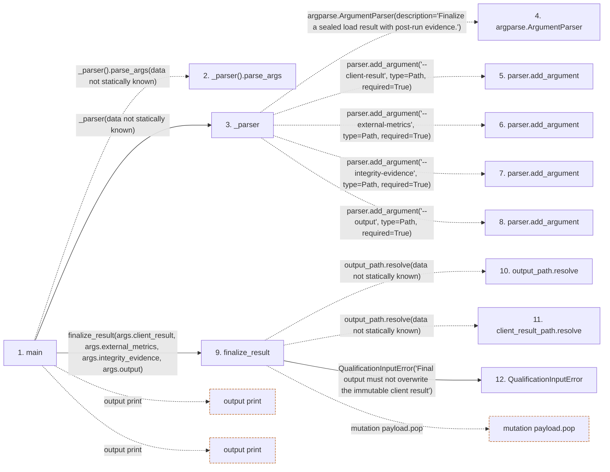

# finalize

**Entry point:** `main` (`process`)
**Source:** [finalize](../modules/finalize.md)
**Modules touched:** [autonomy_canonical](../modules/autonomy_canonical.md), [finalize](../modules/finalize.md), [load_common](../modules/load_common.md), [loader](../modules/loader.md), [result](../modules/result.md)

**Related modules:** [load_common](../modules/load_common.md), [result](../modules/result.md)

## Call sequence

> Static overview in presentation order, not runtime execution order. Arrows retain captured callers; representative internal continuations and boundary examples precede repeated helper detail.

```mermaid
sequenceDiagram
    participant p0 as main
    participant p1 as finalize_result
    participant p2 as _parser
    participant p3 as read_json_object
    participant p4 as validate_result
    participant p5 as _load_reference
    participant p6 as evaluate_client_gates
    participant p7 as evaluate_workload_gates
    participant p8 as evaluate_external_gates
    participant p9 as atomic_write_json
    participant p10 as capacity_contract
    participant p11 as seal_document
    participant p12 as contract_member_json
    participant p13 as traffic_profile
    participant p14 as verify_document
    participant p15 as _maximum_gate
    participant p16 as contract_bundle
    participant p17 as load_postgresql_contract_bundle
    participant p18 as QualificationInputError
    participant p19 as result_status
    participant p20 as _gate
    participant p21 as sha256_bytes
    participant p22 as canonical_json_bytes (scripts/load/common.py)
    participant p23 as ContractBundleError
    participant p24 as canonical_json_bytes (backend/app/autonomy/canonical.py)
    participant p25 as sha256_hex
    participant p26 as _validate_machine_semantics
    participant p27 as PostgreSQLContractBundle
    participant p28 as print
    participant p29 as _parser().parse_args
    p0->>p1: finalize_result
    p0->>p2: _parser
    p1->>p3: read_json_object
    p1->>p4: validate_result
    p1->>p5: _load_reference
    p1->>p6: evaluate_client_gates
    p1->>p7: evaluate_workload_gates
    p1->>p8: evaluate_external_gates
    p1->>p9: atomic_write_json
    p6->>p10: capacity_contract
    p9->>p11: seal_document
    p4->>p12: contract_member_json
    p6->>p13: traffic_profile
    p3->>p14: verify_document
    p6->>p15: _maximum_gate
    p12->>p16: contract_bundle
    p16->>p17: load_postgresql_contract_bundle
    p1->>p18: QualificationInputError
    p1->>p19: result_status
    p6->>p20: _gate
    p11->>p21: sha256_bytes
    p11->>p22: canonical_json_bytes (scripts/load/common.py)
    p17->>p23: ContractBundleError
    p17->>p24: canonical_json_bytes (backend/app/autonomy/canonical.py)
    p17->>p25: sha256_hex
    p17->>p26: _validate_machine_semantics
    p17->>p27: PostgreSQLContractBundle
    p0-->>p28: print(...)
    p0-->>p29: _parser().parse_args
    p0-->>p28: print(..., file=sys.stderr)
```

<!-- Auto-generated from static call edges. Dashed arrows are external or unresolved calls. Reviewed runtime conditions and side effects belong in Behavior. -->

> Call sequence diagram shows 30 of 390 interactions; 360 omitted to keep the visualization within the 30-interaction and generated-diagram limits, with uncertain identities omitted rather than inferred.

> Captured boundary calls: external 2 of 149 (147 omitted); unresolved 1 of 148 (147 omitted). These counts cover the captured static trace.

Omitted captured detail, grouped by actual caller occurrence and target module:

| Caller | Parent step | Target module | Kind | Omitted interactions |
| --- | --- | --- | --- | --- |
| `scripts/load/finalize.py:_parser` | 3 | - | external | 1 |
| `scripts/load/finalize.py:_parser` | 3 | - | unresolved | 4 |
| `scripts/load/finalize.py:finalize_result` | 9 | - | unresolved | 11 |
| `scripts/load/common.py:read_json_object` | 13 | - | external | 2 |
| `scripts/load/common.py:read_json_object` | 13 | - | unresolved | 1 |
| `scripts/load/common.py:read_json_object` | 13 | [scripts/load/common.py](../modules/load_common.md) | internal | 2 |
| `scripts/load/common.py:verify_document` | 19 | - | unresolved | 2 |
| `scripts/load/common.py:verify_document` | 19 | - | external | 3 |
> Omission summary shows 8 of 54 groups; 46 further groups are not expanded here. Counts above include all omitted interactions.
> Detailed flow queries retain their own coverage and limits; omitted paths may execute at runtime.

> Trace truncated at the depth limit; deeper calls are omitted.

## Data flow

<!-- Auto-generated static analysis. Treat values and boundaries as best-effort hints, not runtime proof. -->

### Analysis coverage

**Effect analysis partially available.** Flow assembly and source effect analysis are separate; empty observations do not prove an empty handler body.

Source steps: 94; effect analysis evaluated: 62, partial: 2, unavailable: 30. Counts include steps omitted from the displayed trace.

Collector observations for 64 source steps with known totals: observed: 300, emitted: 289, omitted: 11. Unavailable totals are excluded.

- Callable record unavailable for one or more source steps; those steps have no represented callable body.
- Effect collector omitted observations before flow assembly; displayed effects are partial.
- Effect collector totals unavailable; observed counts cover captured records only.

| Step | Callable record | Effect analysis | Collector totals | Observed | Emitted | Omitted |
|---|---|---|---|---:|---:|---:|
| `main` | `available` | `evaluated` | `available` | `6` | `6` | `0` |
| `_parser().parse_args` | `not_applicable` | `not_applicable` | `not_applicable` | — | — | — |
| `_parser` | `available` | `evaluated` | `available` | `5` | `5` | `0` |
| `argparse.ArgumentParser` | `not_applicable` | `not_applicable` | `not_applicable` | — | — | — |
| `parser.add_argument` | `not_applicable` | `not_applicable` | `not_applicable` | — | — | — |
| `parser.add_argument` | `not_applicable` | `not_applicable` | `not_applicable` | — | — | — |
| `parser.add_argument` | `not_applicable` | `not_applicable` | `not_applicable` | — | — | — |
| `parser.add_argument` | `not_applicable` | `not_applicable` | `not_applicable` | — | — | — |
| `finalize_result` | `available` | `evaluated` | `available` | `10` | `10` | `0` |
| `output_path.resolve` | `not_applicable` | `not_applicable` | `not_applicable` | — | — | — |
| `client_result_path.resolve` | `not_applicable` | `not_applicable` | `not_applicable` | — | — | — |
| `QualificationInputError` | `unavailable` | `unavailable` | `unavailable` | — | — | — |

### Step data

| Step | Inputs | Reads | Writes | Returns |
|---|---|---|---|---|
| `main` | - | `QualificationInputError`, `sys` | - | `...`, `2` |
| `_parser().parse_args` | - | - | - | - |
| `_parser` | - | `Path`, `Path`, `Path`, `Path` | - | `parser` |
| `argparse.ArgumentParser` | - | - | - | - |
| `parser.add_argument` | - | - | - | - |
| `parser.add_argument` | - | - | - | - |
| `parser.add_argument` | - | - | - | - |
| `parser.add_argument` | - | - | - | - |
| `finalize_result` | `client_result_path: Path`, `external_metrics_path: Path`, `integrity_path: Path`, `output_path: Path` | - | `payload[...]`, `payload[...]`, `payload[...]`, `payload[...]` | `finalized` |
| `output_path.resolve` | - | - | - | - |
| `client_result_path.resolve` | - | - | - | - |
| `QualificationInputError` | - | - | - | - |

### Call data

| From | To | Line | Call |
|---|---|---:|---|
| main | _parser().parse_args | 114 | `_parser().parse_args(data not statically known)` |
| main | _parser | 114 | `_parser(data not statically known)` |
| _parser | argparse.ArgumentParser | 103 | `argparse.ArgumentParser(description='Finalize a sealed load result with post-run evidence.')` |
| _parser | parser.add_argument | 106 | `parser.add_argument('--client-result', type=Path, required=True)` |
| _parser | parser.add_argument | 107 | `parser.add_argument('--external-metrics', type=Path, required=True)` |
| _parser | parser.add_argument | 108 | `parser.add_argument('--integrity-evidence', type=Path, required=True)` |
| _parser | parser.add_argument | 109 | `parser.add_argument('--output', type=Path, required=True)` |
| main | finalize_result | 116 | `finalize_result(args.client_result, args.external_metrics, args.integrity_evidence, args.output)` |
| finalize_result | output_path.resolve | 44 | `output_path.resolve(data not statically known)` |
| finalize_result | client_result_path.resolve | 44 | `output_path.resolve(data not statically known)` |
| finalize_result | QualificationInputError | 45 | `QualificationInputError('Final output must not overwrite the immutable client result')` |

### Boundary effects

| Kind | Target | Step | Line |
|---|---|---|---:|
| output | `print` | `main` | 122 |
| output | `print` | `main` | 128 |
| mutation | `payload.pop` | `finalize_result` | 78 |

### Static analysis gaps

| Kind | Step | Target | Line |
|---|---|---|---:|
| unresolved_call | `main` | `_parser().parse_args` | 114 |
| external_call | `_parser` | `argparse.ArgumentParser` | 103 |
| unresolved_call | `_parser` | `parser.add_argument` | 106 |
| unresolved_call | `_parser` | `parser.add_argument` | 107 |
| unresolved_call | `_parser` | `parser.add_argument` | 108 |
| unresolved_call | `_parser` | `parser.add_argument` | 109 |
| unresolved_call | `finalize_result` | `output_path.resolve` | 44 |
| unresolved_call | `finalize_result` | `client_result_path.resolve` | 44 |
| step_limit | `main` | `first 12 steps` | 0 |
| truncated_flow | `main` | `depth limit` | 0 |

## Behavior

This flow starts at `main` and is classified as `process`. The generated call and data-flow sections are bounded static projections; runtime conditions and side effects require source-level confirmation.
