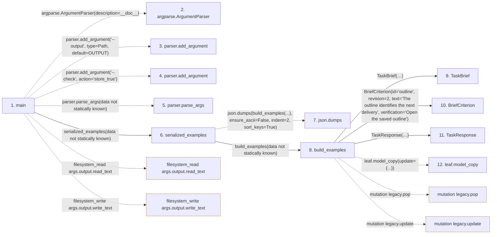

# generate_mobile_contract_fixtures

**Entry point:** `main` (`process`)
**Source:** [generate_mobile_contract_fixtures](../modules/generate_mobile_contract_fixtures.md)
**Modules touched:** [config](../modules/config.md), [generate_mobile_contract_fixtures](../modules/generate_mobile_contract_fixtures.md), [schemas_task](../modules/schemas_task.md), and 5 more

**Complete modules touched:**

- [config](../modules/config.md)
- [generate_mobile_contract_fixtures](../modules/generate_mobile_contract_fixtures.md)
- [schemas_task](../modules/schemas_task.md)
- [schemas_task_brief](../modules/schemas_task_brief.md)
- [schemas_task_domain](../modules/schemas_task_domain.md)
- [session_service](../modules/session_service.md)
- [task_detail](../modules/task_detail.md)
- [task_service](../modules/task_service.md)

**Related modules:** [schemas_task](../modules/schemas_task.md), [schemas_task_brief](../modules/schemas_task_brief.md), [schemas_task_domain](../modules/schemas_task_domain.md), [session_service](../modules/session_service.md), and 2 more

**Complete related modules:**

- [schemas_task](../modules/schemas_task.md)
- [schemas_task_brief](../modules/schemas_task_brief.md)
- [schemas_task_domain](../modules/schemas_task_domain.md)
- [session_service](../modules/session_service.md)
- [task_detail](../modules/task_detail.md)
- [task_service](../modules/task_service.md)

## Call sequence

> Static overview in presentation order, not runtime execution order. Arrows retain captured callers; representative internal continuations and boundary examples precede repeated helper detail.

```mermaid
sequenceDiagram
    participant p0 as main
    participant p1 as serialized_examples
    participant p2 as build_examples
    participant p3 as _cookie_options
    participant p4 as get_settings
    participant p5 as TaskBrief
    participant p6 as BriefCriterion
    participant p7 as TaskResponse
    participant p8 as TaskReference
    participant p9 as TaskReferencePage
    participant p10 as TaskDetailResponse
    participant p11 as TaskActionsResponse
    participant p12 as TaskActionAvailability
    participant p13 as TaskStatusChangeResponse
    participant p14 as CascadeUpdateInfo
    participant p15 as TaskReviewResponse
    participant p16 as TaskVersionConflictError
    participant p17 as Settings
    participant p18 as argparse.ArgumentParser
    participant p19 as parser.add_argument
    participant p20 as parser.parse_args
    participant p21 as args.output.exists
    participant p22 as args.output.read_text
    participant p23 as parser.exit
    participant p24 as args.output.parent.mkdir
    participant p25 as args.output.write_text
    participant p26 as json.dumps
    participant p27 as leaf.model_copy
    participant p28 as reference.model_copy
    p0->>p1: serialized_examples
    p1->>p2: build_examples
    p2->>p3: _cookie_options
    p3->>p4: get_settings
    p2->>p5: TaskBrief
    p2->>p6: BriefCriterion
    p2->>p7: TaskResponse
    p2->>p8: TaskReference
    p2->>p9: TaskReferencePage
    p2->>p10: TaskDetailResponse
    p2->>p11: TaskActionsResponse
    p2->>p12: TaskActionAvailability
    p2->>p13: TaskStatusChangeResponse
    p2->>p14: CascadeUpdateInfo
    p2->>p15: TaskReviewResponse
    p2->>p16: TaskVersionConflictError
    p4->>p17: Settings
    p0-->>p18: argparse.ArgumentParser(description=__doc__)
    p0-->>p19: parser.add_argument('--output', type=Path, default=OUTPUT)
    p0-->>p19: parser.add_argument('--check', action='store_true')
    p0-->>p20: parser.parse_args
    p0-->>p21: args.output.exists
    p0-->>p22: args.output.read_text
    p0-->>p23: parser.exit(1, 'Mobile examples differ regenerate and review consumer compatibility.\n')
    p0-->>p24: args.output.parent.mkdir(parents=True, exist_ok=True)
    p0-->>p25: args.output.write_text(expected)
    p1-->>p26: json.dumps(build_examples(...), ensure_ascii=False, indent=2, sort_keys=True)
    p2-->>p27: leaf.model_copy(update={...})
    p2-->>p28: reference.model_copy(update={...})
    p2-->>p27: leaf.model_copy(update={...})
```

<!-- Auto-generated from static call edges. Dashed arrows are external or unresolved calls. Reviewed runtime conditions and side effects belong in Behavior. -->

> Call sequence diagram shows 30 of 47 interactions; 17 omitted to keep the visualization within the 30-interaction and generated-diagram limits, with uncertain identities omitted rather than inferred.

> Captured boundary calls: external 2 of 5 (3 omitted); unresolved 11 of 23 (12 omitted). These counts cover the captured static trace.

Omitted captured detail, grouped by actual caller occurrence and target module:

| Caller | Parent step | Target module | Kind | Omitted interactions |
| --- | --- | --- | --- | --- |
| `scripts/generate_mobile_contract_fixtures.py:build_examples` | 8 | [backend/app/schemas/task_detail.py](../modules/task_detail.md) | internal | 1 |
| `scripts/generate_mobile_contract_fixtures.py:build_examples` | 8 | [backend/app/schemas/task_domain.py](../modules/schemas_task_domain.md) | internal | 1 |
| `scripts/generate_mobile_contract_fixtures.py:build_examples` | 8 | - | external | 3 |
| `scripts/generate_mobile_contract_fixtures.py:build_examples` | 8 | - | unresolved | 12 |
> Detailed flow queries retain their own coverage and limits; omitted paths may execute at runtime.

## Data flow

<!-- Auto-generated static analysis. Treat values and boundaries as best-effort hints, not runtime proof. -->

### Analysis coverage

**Effect analysis partially available.** Flow assembly and source effect analysis are separate; empty observations do not prove an empty handler body.

Source steps: 20; effect analysis evaluated: 5, partial: 0, unavailable: 15. Counts include steps omitted from the displayed trace.

Collector observations for 5 source steps with known totals: observed: 11, emitted: 11, omitted: 0. Unavailable totals are excluded.

- Callable record unavailable for one or more source steps; those steps have no represented callable body.
- Effect collector totals unavailable; observed counts cover captured records only.

| Step | Callable record | Effect analysis | Collector totals | Observed | Emitted | Omitted |
|---|---|---|---|---:|---:|---:|
| `main` | `available` | `evaluated` | `available` | `4` | `4` | `0` |
| `argparse.ArgumentParser` | `not_applicable` | `not_applicable` | `not_applicable` | — | — | — |
| `parser.add_argument` | `not_applicable` | `not_applicable` | `not_applicable` | — | — | — |
| `parser.add_argument` | `not_applicable` | `not_applicable` | `not_applicable` | — | — | — |
| `parser.parse_args` | `not_applicable` | `not_applicable` | `not_applicable` | — | — | — |
| `serialized_examples` | `available` | `evaluated` | `available` | `1` | `1` | `0` |
| `json.dumps` | `not_applicable` | `not_applicable` | `not_applicable` | — | — | — |
| `build_examples` | `available` | `evaluated` | `available` | `4` | `4` | `0` |
| `TaskBrief` | `unavailable` | `unavailable` | `unavailable` | — | — | — |
| `BriefCriterion` | `unavailable` | `unavailable` | `unavailable` | — | — | — |
| `TaskResponse` | `unavailable` | `unavailable` | `unavailable` | — | — | — |
| `leaf.model_copy` | `not_applicable` | `not_applicable` | `not_applicable` | — | — | — |

### Step data

| Step | Inputs | Reads | Writes | Returns |
|---|---|---|---|---|
| `main` | - | `Path`, `OUTPUT` | - | - |
| `argparse.ArgumentParser` | - | - | - | - |
| `parser.add_argument` | - | - | - | - |
| `parser.add_argument` | - | - | - | - |
| `parser.parse_args` | - | - | - | - |
| `serialized_examples` | - | - | - | `...` |
| `json.dumps` | - | - | - | - |
| `build_examples` | - | `UTC` | - | `{...}` |
| `TaskBrief` | - | - | - | - |
| `BriefCriterion` | - | - | - | - |
| `TaskResponse` | - | - | - | - |
| `leaf.model_copy` | - | - | - | - |

### Call data

| From | To | Line | Call |
|---|---|---:|---|
| main | argparse.ArgumentParser | 72 | `argparse.ArgumentParser(description=__doc__)` |
| main | parser.add_argument | 73 | `parser.add_argument('--output', type=Path, default=OUTPUT)` |
| main | parser.add_argument | 74 | `parser.add_argument('--check', action='store_true')` |
| main | parser.parse_args | 75 | `parser.parse_args(data not statically known)` |
| main | serialized_examples | 76 | `serialized_examples(data not statically known)` |
| serialized_examples | json.dumps | 68 | `json.dumps(build_examples(...), ensure_ascii=False, indent=2, sort_keys=True)` |
| serialized_examples | build_examples | 68 | `build_examples(data not statically known)` |
| build_examples | TaskBrief | 24 | `TaskBrief(goal='Deliver a reviewed outline', context='Coordinate with the team', scope='Write the outline', exclusions='Publishing', verification='Read the saved artifact', artifact_expectations='A versioned outline', acceptance_criteria=[...])` |
| build_examples | BriefCriterion | 26 | `BriefCriterion(id='outline', revision=2, text='The outline identifies the next delivery', verification='Open the saved outline')` |
| build_examples | TaskResponse | 27 | `TaskResponse(id=72, title='Review the outline', iteration_id=None, project_id=9, parent_id=71, description='Legacy text is retained independently', priority=3, effort_days=None, effort_hours=None, start_date=None, end_date=None, status='active', version=7, owner_profile_id=4, blocked_reason='Waiting for feedback', execution_mode='manual', brief=brief, brief_revision=3, artifact_revision=2, progress={...})` |
| build_examples | leaf.model_copy | 33 | `leaf.model_copy(update={...})` |

### Boundary effects

| Kind | Target | Step | Line |
|---|---|---|---:|
| filesystem_read | `args.output.read_text` | `main` | 78 |
| filesystem_write | `args.output.write_text` | `main` | 82 |
| mutation | `legacy.pop` | `build_examples` | 53 |
| mutation | `legacy.update` | `build_examples` | 54 |

### Static analysis gaps

| Kind | Step | Target | Line |
|---|---|---|---:|
| external_call | `main` | `argparse.ArgumentParser` | 72 |
| unresolved_call | `main` | `parser.add_argument` | 73 |
| unresolved_call | `main` | `parser.add_argument` | 74 |
| unresolved_call | `main` | `parser.parse_args` | 75 |
| external_call | `serialized_examples` | `json.dumps` | 68 |
| unresolved_call | `build_examples` | `leaf.model_copy` | 33 |
| step_limit | `main` | `first 12 steps` | 0 |

## Behavior

Builds deterministic sample payloads through the current backend models and includes the selected OpenAPI components. Check mode compares the complete serialized output to the committed mobile resource and fails on drift. Normal mode writes only the requested output. The caller supplies backend imports and controls the execution environment; no provider credential or live account is required.
