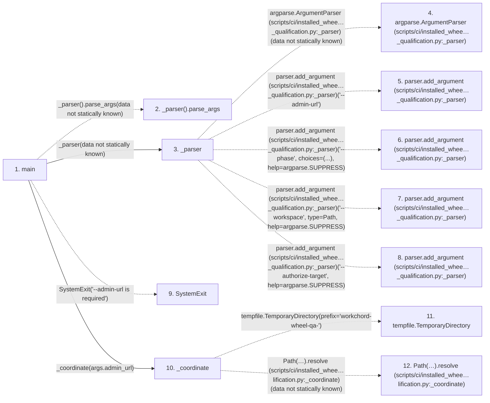

# installed_wheel_postgresql_qualification

**Entry point:** `main` (`process`)
**Source:** [installed_wheel_postgresql_qualification](../modules/installed_wheel_postgresql_qualification.md)
**Modules touched:** [authority](../modules/authority.md), [calendar_service](../modules/calendar_service.md), [catalog](../modules/catalog.md), [cli_closeout](../modules/cli_closeout.md), and 30 more

**Complete modules touched:**

- [authority](../modules/authority.md)
- [calendar_service](../modules/calendar_service.md)
- [catalog](../modules/catalog.md)
- [cli_closeout](../modules/cli_closeout.md)
- [cli_cutover](../modules/cli_cutover.md)
- [commands](../modules/commands.md)
- [config](../modules/config.md)
- [database_config](../modules/database_config.md)
- [database_migration_canonical](../modules/database_migration_canonical.md)
- [database_migration_manifest](../modules/database_migration_manifest.md)
- [github_status_automation_service](../modules/github_status_automation_service.md)
- [identity_service](../modules/identity_service.md)
- [installed_wheel_postgresql_qualification](../modules/installed_wheel_postgresql_qualification.md)
- [label_service](../modules/label_service.md)
- [maintenance](../modules/maintenance.md)
- [models_agent](../modules/models_agent.md)
- [models_calendar](../modules/models_calendar.md)
- [models_github](../modules/models_github.md)
- [models_identity](../modules/models_identity.md)
- [models_iteration](../modules/models_iteration.md)
- [models_label](../modules/models_label.md)
- [models_project](../modules/models_project.md)
- [models_saved_view](../modules/models_saved_view.md)
- [models_task](../modules/models_task.md)
- [models_template](../modules/models_template.md)
- [project_identity](../modules/project_identity.md)
- [saved_view_service](../modules/saved_view_service.md)
- [source](../modules/source.md)
- [system_settings_service](../modules/system_settings_service.md)
- [template_service](../modules/template_service.md)
- [time](../modules/time.md)
- [transfer](../modules/transfer.md)
- [upgrade_service](../modules/upgrade_service.md)
- [user_session](../modules/user_session.md)

**Related modules:** [app_database](../modules/app_database.md), [app_main](../modules/app_main.md), [cli_closeout](../modules/cli_closeout.md), [cli_cutover](../modules/cli_cutover.md), and 15 more

**Complete related modules:**

- [app_database](../modules/app_database.md)
- [app_main](../modules/app_main.md)
- [cli_closeout](../modules/cli_closeout.md)
- [cli_cutover](../modules/cli_cutover.md)
- [config](../modules/config.md)
- [database_config](../modules/database_config.md)
- [database_migration_manifest](../modules/database_migration_manifest.md)
- [models_agent](../modules/models_agent.md)
- [models_calendar](../modules/models_calendar.md)
- [models_identity](../modules/models_identity.md)
- [models_iteration](../modules/models_iteration.md)
- [models_project](../modules/models_project.md)
- [models_task](../modules/models_task.md)
- [models_time_entry](../modules/models_time_entry.md)
- [recovery](../modules/recovery.md)
- [source](../modules/source.md)
- [transfer](../modules/transfer.md)
- [upgrade_service](../modules/upgrade_service.md)
- [user_session](../modules/user_session.md)

## Call sequence

> Static overview in presentation order, not runtime execution order. Arrows retain captured callers; representative internal continuations and boundary examples precede repeated helper detail.

```mermaid
sequenceDiagram
    participant p0 as main
    participant p1 as _coordinate
    participant p2 as _source_phase
    participant p3 as _target_phase
    participant p4 as _maintenance_phase
    participant p5 as _parser
    participant p6 as _assert_installed_package
    participant p7 as bootstrap_database_schema
    participant p8 as load_snapshot
    participant p9 as _probe_maintenance
    participant p10 as reconcile_snapshot
    participant p11 as record_post_copy_repairs
    participant p12 as _create_database
    participant p13 as _run_phase
    participant p14 as _drop_database
    participant p15 as write_document
    participant p16 as preflight_source
    participant p17 as run_alembic_upgrade
    participant p18 as seal_document
    participant p19 as _load_source_manifest
    participant p20 as build_parser (backend/app/cli/cutover.py)
    participant p21 as _target_engine
    participant p22 as _authorize_target
    participant p23 as _target_identity_sha256
    participant p24 as build_parser (backend/app/cli/closeout.py)
    participant p25 as read_document
    participant p26 as _optional_evidence
    participant p27 as validate_writer_drain_evidence
    participant p28 as _source_file_set
    participant p29 as SystemExit
    participant p30 as _parser().parse_args
    p0->>p1: _coordinate
    p0->>p2: _source_phase
    p0->>p3: _target_phase
    p0->>p4: _maintenance_phase
    p0->>p5: _parser
    p2->>p6: _assert_installed_package
    p2->>p7: bootstrap_database_schema
    p3->>p8: load_snapshot
    p4->>p9: _probe_maintenance
    p3->>p10: reconcile_snapshot
    p3->>p11: record_post_copy_repairs
    p1->>p12: _create_database
    p1->>p13: _run_phase
    p1->>p14: _drop_database
    p2->>p15: write_document
    p2->>p16: preflight_source
    p7->>p17: run_alembic_upgrade
    p15->>p18: seal_document
    p8->>p19: _load_source_manifest
    p6->>p20: build_parser (backend/app/cli/cutover.py)
    p8->>p21: _target_engine
    p8->>p22: _authorize_target
    p8->>p23: _target_identity_sha256
    p6->>p24: build_parser (backend/app/cli/closeout.py)
    p16->>p25: read_document
    p8->>p26: _optional_evidence
    p16->>p27: validate_writer_drain_evidence
    p16->>p28: _source_file_set
    p0-->>p29: SystemExit('--admin-url is required')
    p0-->>p30: _parser().parse_args
```

<!-- Auto-generated from static call edges. Dashed arrows are external or unresolved calls. Reviewed runtime conditions and side effects belong in Behavior. -->

> Call sequence diagram shows 30 of 1714 interactions; 1684 omitted to keep the visualization within the 30-interaction and generated-diagram limits, with uncertain identities omitted rather than inferred.

> Captured boundary calls: external 1 of 536 (535 omitted); unresolved 1 of 671 (670 omitted). These counts cover the captured static trace.

Omitted captured detail, grouped by actual caller occurrence and target module:

| Caller | Parent step | Target module | Kind | Omitted interactions |
| --- | --- | --- | --- | --- |
| `scripts/ci/installed_wheel_postgresql_qualification.py:_parser` | 3 | - | external | 1 |
| `scripts/ci/installed_wheel_postgresql_qualification.py:_parser` | 3 | - | unresolved | 4 |
| `scripts/ci/installed_wheel_postgresql_qualification.py:_coordinate` | 10 | - | external | 4 |
| `scripts/ci/installed_wheel_postgresql_qualification.py:_coordinate` | 10 | - | unresolved | 4 |
| `scripts/ci/installed_wheel_postgresql_qualification.py:_coordinate` | 10 | [scripts/ci/installed_wheel_postgresql_qualification.py](../modules/installed_wheel_postgresql_qualification.md) | internal | 4 |
| `scripts/ci/installed_wheel_postgresql_qualification.py:_database_url` | 19 | - | external | 2 |
| `scripts/ci/installed_wheel_postgresql_qualification.py:_target_identifier` | 22 | - | external | 1 |
| `scripts/ci/installed_wheel_postgresql_qualification.py:_create_database` | 24 | - | external | 24 |
> Omission summary shows 8 of 372 groups; 364 further groups are not expanded here. Counts above include all omitted interactions.
> Detailed flow queries retain their own coverage and limits; omitted paths may execute at runtime.

> Trace truncated at the depth limit; deeper calls are omitted.

## Data flow

<!-- Auto-generated static analysis. Treat values and boundaries as best-effort hints, not runtime proof. -->

### Analysis coverage

**Effect analysis partially available.** Flow assembly and source effect analysis are separate; empty observations do not prove an empty handler body.

Source steps: 508; effect analysis evaluated: 332, partial: 9, unavailable: 167. Counts include steps omitted from the displayed trace.

Collector observations for 341 source steps with known totals: observed: 1256, emitted: 1227, omitted: 29. Unavailable totals are excluded.

- Callable record unavailable for one or more source steps; those steps have no represented callable body.
- Effect collector omitted observations before flow assembly; displayed effects are partial.
- Effect collector totals unavailable; observed counts cover captured records only.

| Step | Callable record | Effect analysis | Collector totals | Observed | Emitted | Omitted |
|---|---|---|---|---:|---:|---:|
| `main` | `available` | `evaluated` | `available` | `2` | `2` | `0` |
| `_parser().parse_args` | `not_applicable` | `not_applicable` | `not_applicable` | — | — | — |
| `_parser` | `available` | `evaluated` | `available` | `5` | `5` | `0` |
| `argparse.ArgumentParser (scripts/ci/installed_whee…_qualification.py:_parser)` | `not_applicable` | `not_applicable` | `not_applicable` | — | — | — |
| `parser.add_argument (scripts/ci/installed_whee…_qualification.py:_parser)` | `not_applicable` | `not_applicable` | `not_applicable` | — | — | — |
| `parser.add_argument (scripts/ci/installed_whee…_qualification.py:_parser)` | `not_applicable` | `not_applicable` | `not_applicable` | — | — | — |
| `parser.add_argument (scripts/ci/installed_whee…_qualification.py:_parser)` | `not_applicable` | `not_applicable` | `not_applicable` | — | — | — |
| `parser.add_argument (scripts/ci/installed_whee…_qualification.py:_parser)` | `not_applicable` | `not_applicable` | `not_applicable` | — | — | — |
| `SystemExit` | `not_applicable` | `not_applicable` | `not_applicable` | — | — | — |
| `_coordinate` | `available` | `evaluated` | `available` | `1` | `1` | `0` |
| `tempfile.TemporaryDirectory` | `not_applicable` | `not_applicable` | `not_applicable` | — | — | — |
| `Path(…).resolve (scripts/ci/installed_whee…lification.py:_coordinate)` | `not_applicable` | `not_applicable` | `not_applicable` | — | — | — |

### Step data

| Step | Inputs | Reads | Writes | Returns |
|---|---|---|---|---|
| `main` | - | - | - | `0`, `0` |
| `_parser().parse_args` | - | - | - | - |
| `_parser` | - | `argparse`, `Path`, `argparse`, `argparse` | - | `parser` |
| `argparse.ArgumentParser (scripts/ci/installed_whee…_qualification.py:_parser)` | - | - | - | - |
| `parser.add_argument (scripts/ci/installed_whee…_qualification.py:_parser)` | - | - | - | - |
| `parser.add_argument (scripts/ci/installed_whee…_qualification.py:_parser)` | - | - | - | - |
| `parser.add_argument (scripts/ci/installed_whee…_qualification.py:_parser)` | - | - | - | - |
| `parser.add_argument (scripts/ci/installed_whee…_qualification.py:_parser)` | - | - | - | - |
| `SystemExit` | - | - | - | - |
| `_coordinate` | `admin_url: str` | - | - | - |
| `tempfile.TemporaryDirectory` | - | - | - | - |
| `Path(…).resolve (scripts/ci/installed_whee…lification.py:_coordinate)` | - | - | - | - |

### Call data

| From | To | Line | Call |
|---|---|---:|---|
| main | _parser().parse_args | 695 | `_parser().parse_args(data not statically known)` |
| main | _parser | 695 | `_parser(data not statically known)` |
| _parser | argparse.ArgumentParser (scripts/ci/installed_whee…_qualification.py:_parser) | 682 | `argparse.ArgumentParser(data not statically known)` |
| _parser | parser.add_argument (scripts/ci/installed_whee…_qualification.py:_parser) | 683 | `parser.add_argument('--admin-url')` |
| _parser | parser.add_argument (scripts/ci/installed_whee…_qualification.py:_parser) | 684 | `parser.add_argument('--phase', choices=(...), help=argparse.SUPPRESS)` |
| _parser | parser.add_argument (scripts/ci/installed_whee…_qualification.py:_parser) | 689 | `parser.add_argument('--workspace', type=Path, help=argparse.SUPPRESS)` |
| _parser | parser.add_argument (scripts/ci/installed_whee…_qualification.py:_parser) | 690 | `parser.add_argument('--authorize-target', help=argparse.SUPPRESS)` |
| main | SystemExit | 698 | `SystemExit('--admin-url is required')` |
| main | _coordinate | 699 | `_coordinate(args.admin_url)` |
| _coordinate | tempfile.TemporaryDirectory | 642 | `tempfile.TemporaryDirectory(prefix='workchord-wheel-qa-')` |
| _coordinate | Path(…).resolve (scripts/ci/installed_whee…lification.py:_coordinate) | 643 | `Path(temporary).resolve(data not statically known)` |

### Boundary effects

*No boundary-effect observations were captured in this static trace.*

### Static analysis gaps

| Kind | Step | Target | Line |
|---|---|---|---:|
| unresolved_call | `main` | `_parser().parse_args` | 695 |
| external_call | `_parser` | `argparse.ArgumentParser` | 682 |
| unresolved_call | `_parser` | `parser.add_argument` | 683 |
| unresolved_call | `_parser` | `parser.add_argument` | 684 |
| unresolved_call | `_parser` | `parser.add_argument` | 689 |
| unresolved_call | `_parser` | `parser.add_argument` | 690 |
| external_call | `main` | `SystemExit` | 698 |
| external_call | `_coordinate` | `tempfile.TemporaryDirectory` | 642 |
| unresolved_call | `_coordinate` | `Path(temporary).resolve` | 643 |
| step_limit | `main` | `first 12 steps` | 0 |
| truncated_flow | `main` | `depth limit` | 0 |

## Behavior

The coordinator creates a disposable PostgreSQL destination and starts fresh child interpreters against the installed package from a temporary working directory. Managed authentication is explicit. Source initialization creates the frozen schema, then representative application and authenticated-identity records; transfer and reconciliation remain closed to traffic until their required steps finish.

Maintenance probes use the transferred viewer session for a safe project read. Anonymous access remains denied, writes remain rejected, validation-only mode blocks non-allowlisted reads, and all application rows must remain unchanged. The coordinator drops its owned database and role during cleanup.
