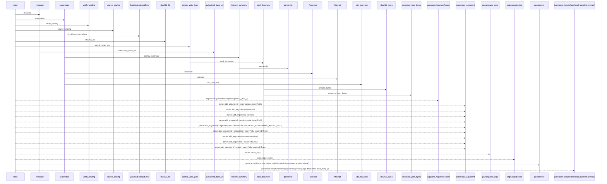
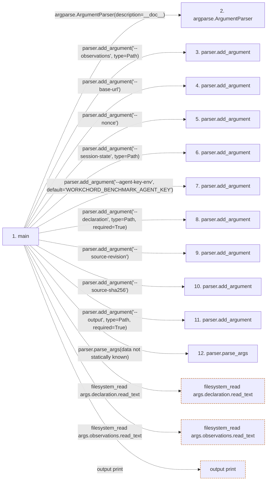

# local_baseline

**Entry point:** `main` (`process`)
**Source:** [local_baseline](../modules/local_baseline.md)
**Modules touched:** [load_common](../modules/load_common.md), [local_baseline](../modules/local_baseline.md), [result](../modules/result.md), [run](../modules/run.md), [source_binding](../modules/source_binding.md)

**Related modules:** [load_common](../modules/load_common.md), [result](../modules/result.md), [run](../modules/run.md), [source_binding](../modules/source_binding.md)

## Call sequence

> Static overview in presentation order, not runtime execution order. Arrows retain captured callers; representative internal continuations and boundary examples precede repeated helper detail.

<!-- Auto-generated from static call edges. Dashed arrows are external or unresolved calls. Reviewed runtime conditions and side effects belong in Behavior. -->

> Call sequence diagram shows 30 of 230 interactions; 200 omitted to keep the visualization within the 30-interaction and generated-diagram limits, with uncertain identities omitted rather than inferred.

> Captured boundary calls: external 2 of 87 (85 omitted); unresolved 12 of 96 (84 omitted). These counts cover the captured static trace.

Omitted captured detail, grouped by actual caller occurrence and target module:

| Caller | Parent step | Target module | Kind | Omitted interactions |
| --- | --- | --- | --- | --- |
| `scripts/load/source_binding.py:source_binding` | 15 | - | unresolved | 9 |
| `scripts/load/source_binding.py:source_binding` | 15 | - | external | 9 |
| `scripts/load/local_baseline.py:main` | 1 | - | unresolved | 6 |
| `scripts/load/local_baseline.py:main` | 1 | - | external | 6 |
| `scripts/load/common.py:authorized_base_url` | 41 | - | external | 3 |
| `scripts/load/common.py:authorized_base_url` | 41 | [scripts/load/common.py](../modules/load_common.md) | internal | 6 |
| `scripts/load/common.py:authorized_base_url` | 41 | - | unresolved | 2 |
| `scripts/load/local_baseline.py:measure` | 40 | - | external | 15 |
> Omission summary shows 8 of 32 groups; 24 further groups are not expanded here. Counts above include all omitted interactions.
> Detailed flow queries retain their own coverage and limits; omitted paths may execute at runtime.

## Data flow

<!-- Auto-generated static analysis. Treat values and boundaries as best-effort hints, not runtime proof. -->

### Analysis coverage

**Effect analysis partially available.** Flow assembly and source effect analysis are separate; empty observations do not prove an empty handler body.

Source steps: 48; effect analysis evaluated: 19, partial: 0, unavailable: 29. Counts include steps omitted from the displayed trace.

Collector observations for 19 source steps with known totals: observed: 87, emitted: 87, omitted: 0. Unavailable totals are excluded.

- Callable record unavailable for one or more source steps; those steps have no represented callable body.
- Effect collector totals unavailable; observed counts cover captured records only.

| Step | Callable record | Effect analysis | Collector totals | Observed | Emitted | Omitted |
|---|---|---|---|---:|---:|---:|
| `main` | `available` | `evaluated` | `available` | `17` | `17` | `0` |
| `argparse.ArgumentParser` | `not_applicable` | `not_applicable` | `not_applicable` | — | — | — |
| `parser.add_argument` | `not_applicable` | `not_applicable` | `not_applicable` | — | — | — |
| `parser.add_argument` | `not_applicable` | `not_applicable` | `not_applicable` | — | — | — |
| `parser.add_argument` | `not_applicable` | `not_applicable` | `not_applicable` | — | — | — |
| `parser.add_argument` | `not_applicable` | `not_applicable` | `not_applicable` | — | — | — |
| `parser.add_argument` | `not_applicable` | `not_applicable` | `not_applicable` | — | — | — |
| `parser.add_argument` | `not_applicable` | `not_applicable` | `not_applicable` | — | — | — |
| `parser.add_argument` | `not_applicable` | `not_applicable` | `not_applicable` | — | — | — |
| `parser.add_argument` | `not_applicable` | `not_applicable` | `not_applicable` | — | — | — |
| `parser.add_argument` | `not_applicable` | `not_applicable` | `not_applicable` | — | — | — |
| `parser.parse_args` | `not_applicable` | `not_applicable` | `not_applicable` | — | — | — |

### Step data

| Step | Inputs | Reads | Writes | Returns |
|---|---|---|---|---|
| `main` | - | `Path`, `Path`, `Path`, `Path`, `QualificationInputError` | `result[...]`, `result[...]`, `result[...]`, `result[...]`, `result[...]`, `result[...]`, `result[...]`, `result[...]` | `...` |
| `argparse.ArgumentParser` | - | - | - | - |
| `parser.add_argument` | - | - | - | - |
| `parser.add_argument` | - | - | - | - |
| `parser.add_argument` | - | - | - | - |
| `parser.add_argument` | - | - | - | - |
| `parser.add_argument` | - | - | - | - |
| `parser.add_argument` | - | - | - | - |
| `parser.add_argument` | - | - | - | - |
| `parser.add_argument` | - | - | - | - |
| `parser.add_argument` | - | - | - | - |
| `parser.parse_args` | - | - | - | - |

### Call data

| From | To | Line | Call |
|---|---|---:|---|
| main | argparse.ArgumentParser | 172 | `argparse.ArgumentParser(description=__doc__)` |
| main | parser.add_argument | 173 | `parser.add_argument('--observations', type=Path)` |
| main | parser.add_argument | 174 | `parser.add_argument('--base-url')` |
| main | parser.add_argument | 175 | `parser.add_argument('--nonce')` |
| main | parser.add_argument | 176 | `parser.add_argument('--session-state', type=Path)` |
| main | parser.add_argument | 177 | `parser.add_argument('--agent-key-env', default='WORKCHORD_BENCHMARK_AGENT_KEY')` |
| main | parser.add_argument | 178 | `parser.add_argument('--declaration', type=Path, required=True)` |
| main | parser.add_argument | 179 | `parser.add_argument('--source-revision')` |
| main | parser.add_argument | 180 | `parser.add_argument('--source-sha256')` |
| main | parser.add_argument | 181 | `parser.add_argument('--output', type=Path, required=True)` |
| main | parser.parse_args | 182 | `parser.parse_args(data not statically known)` |

### Boundary effects

| Kind | Target | Step | Line |
|---|---|---|---:|
| filesystem_read | `args.declaration.read_text` | `main` | 186 |
| filesystem_read | `args.observations.read_text` | `main` | 188 |
| output | `print` | `main` | 206 |

### Static analysis gaps

| Kind | Step | Target | Line |
|---|---|---|---:|
| external_call | `main` | `argparse.ArgumentParser` | 172 |
| unresolved_call | `main` | `parser.add_argument` | 173 |
| unresolved_call | `main` | `parser.add_argument` | 174 |
| unresolved_call | `main` | `parser.add_argument` | 175 |
| unresolved_call | `main` | `parser.add_argument` | 176 |
| unresolved_call | `main` | `parser.add_argument` | 177 |
| unresolved_call | `main` | `parser.add_argument` | 178 |
| unresolved_call | `main` | `parser.add_argument` | 179 |
| unresolved_call | `main` | `parser.add_argument` | 180 |
| unresolved_call | `main` | `parser.add_argument` | 181 |
| unresolved_call | `main` | `parser.parse_args` | 182 |
| step_limit | `main` | `first 12 steps` | 0 |

## Behavior

This flow starts at `main` and is classified as `process`. The generated call and data-flow sections are bounded static projections; runtime conditions and side effects require source-level confirmation.
