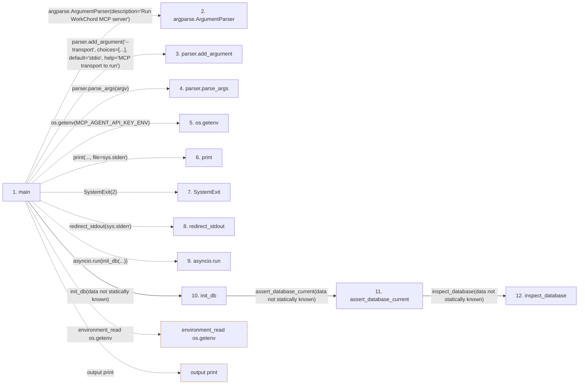

# mcp_server

**Entry point:** `main` (`process`)
**Source:** [mcp_server](../modules/mcp_server.md)
**Modules touched:** [app_database](../modules/app_database.md), [config](../modules/config.md), [database_config](../modules/database_config.md), [mcp_server](../modules/mcp_server.md), [upgrade_service](../modules/upgrade_service.md)

**Related modules:** [agent_model_catalog_service](../modules/agent_model_catalog_service.md), [agent_routing_service](../modules/agent_routing_service.md), [agent_service](../modules/agent_service.md), and 12 more

**Complete related modules:**

- [agent_model_catalog_service](../modules/agent_model_catalog_service.md)
- [agent_routing_service](../modules/agent_routing_service.md)
- [agent_service](../modules/agent_service.md)
- [agent_team_setup_service](../modules/agent_team_setup_service.md)
- [app_database](../modules/app_database.md)
- [authority](../modules/authority.md)
- [commands](../modules/commands.md)
- [config](../modules/config.md)
- [http_authority](../modules/http_authority.md)
- [identity_service](../modules/identity_service.md)
- [maintenance](../modules/maintenance.md)
- [models_agent](../modules/models_agent.md)
- [mutation_versions](../modules/mutation_versions.md)
- [task_service](../modules/task_service.md)
- [triage_service](../modules/triage_service.md)

## Call sequence

> Static overview in presentation order, not runtime execution order. Arrows retain captured callers; representative internal continuations and boundary examples precede repeated helper detail.

```mermaid
sequenceDiagram
    participant p0 as main
    participant p1 as init_db
    participant p2 as _run_standalone_transport
    participant p3 as assert_database_current
    participant p4 as inspect_database
    participant p5 as _inspect_database_connection
    participant p6 as _sync_engine
    participant p7 as database_configuration
    participant p8 as head_revision
    participant p9 as close_database
    participant p10 as UpgradeError
    participant p11 as _current_revision
    participant p12 as DatabaseStatus
    participant p13 as parse_database_configuration
    participant p14 as alembic_config
    participant p15 as get_settings
    participant p16 as argparse.ArgumentParser
    participant p17 as parser.add_argument
    participant p18 as parser.parse_args
    participant p19 as os.getenv
    participant p20 as print
    participant p21 as SystemExit
    participant p22 as redirect_stdout
    participant p23 as asyncio.run
    participant p24 as mcp.run_stdio_async
    participant p25 as mcp.run_streamable_http_async
    participant p26 as engine.dispose (backend/app/database.py:close_database)
    participant p27 as engine.connect
    participant p28 as engine.dispose (backend/app/services/upgr…ervice.py:inspect_database)
    p0->>p1: init_db
    p0->>p2: _run_standalone_transport
    p1->>p3: assert_database_current
    p3->>p4: inspect_database
    p4->>p5: _inspect_database_connection
    p4->>p6: _sync_engine
    p6->>p7: database_configuration
    p5->>p8: head_revision
    p2->>p9: close_database
    p3->>p10: UpgradeError
    p5->>p11: _current_revision
    p5->>p12: DatabaseStatus
    p7->>p13: parse_database_configuration
    p8->>p14: alembic_config
    p7->>p15: get_settings
    p0-->>p16: argparse.ArgumentParser(description='Run WorkChord MCP server')
    p0-->>p17: parser.add_argument('--transport', choices=[...], default='stdio', help='MCP transport to run')
    p0-->>p18: parser.parse_args(argv)
    p0-->>p19: os.getenv(MCP_AGENT_API_KEY_ENV)
    p0-->>p20: print(..., file=sys.stderr)
    p0-->>p21: SystemExit(2)
    p0-->>p22: redirect_stdout(sys.stderr)
    p0-->>p23: asyncio.run(init_db(...))
    p0-->>p23: asyncio.run(init_db(...))
    p0-->>p23: asyncio.run(_run_standalone_transport(...))
    p2-->>p24: mcp.run_stdio_async
    p2-->>p25: mcp.run_streamable_http_async
    p9-->>p26: engine.dispose (backend/app/database.py:close_database)
    p4-->>p27: engine.connect
    p4-->>p28: engine.dispose (backend/app/services/upgr…ervice.py:inspect_database)
```

<!-- Auto-generated from static call edges. Dashed arrows are external or unresolved calls. Reviewed runtime conditions and side effects belong in Behavior. -->

> Call sequence diagram shows 30 of 52 interactions; 22 omitted to keep the visualization within the 30-interaction and generated-diagram limits, with uncertain identities omitted rather than inferred.

> Captured boundary calls: external 8 of 20 (12 omitted); unresolved 7 of 14 (7 omitted). These counts cover the captured static trace.

Omitted captured detail, grouped by actual caller occurrence and target module:

| Caller | Parent step | Target module | Kind | Omitted interactions |
| --- | --- | --- | --- | --- |
| `backend/app/services/upgrade_service.py:_inspect_database_connection` | 13 | - | external | 4 |
| `backend/app/services/upgrade_service.py:_inspect_database_connection` | 13 | - | unresolved | 1 |
| `backend/app/services/upgrade_service.py:_current_revision` | 17 | - | external | 4 |
| `backend/app/services/upgrade_service.py:_current_revision` | 17 | - | unresolved | 4 |
| `backend/app/services/upgrade_service.py:head_revision` | 27 | - | external | 2 |
| `backend/app/services/upgrade_service.py:head_revision` | 27 | - | unresolved | 2 |
| `backend/app/services/upgrade_service.py:head_revision` | 27 | [backend/app/services/upgrade_service.py](../modules/upgrade_service.md) | internal | 1 |
| `backend/app/services/upgrade_service.py:_sync_engine` | 36 | - | external | 2 |
> Omission summary shows 8 of 10 groups; 2 further groups are not expanded here. Counts above include all omitted interactions.
> Detailed flow queries retain their own coverage and limits; omitted paths may execute at runtime.

> Trace truncated at the depth limit; deeper calls are omitted.

## Data flow

<!-- Auto-generated static analysis. Treat values and boundaries as best-effort hints, not runtime proof. -->

### Analysis coverage

**Effect analysis partially available.** Flow assembly and source effect analysis are separate; empty observations do not prove an empty handler body.

Source steps: 19; effect analysis evaluated: 16, partial: 0, unavailable: 3. Counts include steps omitted from the displayed trace.

Collector observations for 16 source steps with known totals: observed: 41, emitted: 41, omitted: 0. Unavailable totals are excluded.

- Callable record unavailable for one or more source steps; those steps have no represented callable body.
- Effect collector totals unavailable; observed counts cover captured records only.

| Step | Callable record | Effect analysis | Collector totals | Observed | Emitted | Omitted |
|---|---|---|---|---:|---:|---:|
| `main` | `available` | `evaluated` | `available` | `7` | `7` | `0` |
| `argparse.ArgumentParser` | `not_applicable` | `not_applicable` | `not_applicable` | — | — | — |
| `parser.add_argument` | `not_applicable` | `not_applicable` | `not_applicable` | — | — | — |
| `parser.parse_args` | `not_applicable` | `not_applicable` | `not_applicable` | — | — | — |
| `os.getenv` | `not_applicable` | `not_applicable` | `not_applicable` | — | — | — |
| `print` | `not_applicable` | `not_applicable` | `not_applicable` | — | — | — |
| `SystemExit` | `not_applicable` | `not_applicable` | `not_applicable` | — | — | — |
| `redirect_stdout` | `not_applicable` | `not_applicable` | `not_applicable` | — | — | — |
| `asyncio.run` | `not_applicable` | `not_applicable` | `not_applicable` | — | — | — |
| `init_db` | `available` | `evaluated` | `available` | `0` | `0` | `0` |
| `assert_database_current` | `available` | `evaluated` | `available` | `1` | `1` | `0` |
| `inspect_database` | `available` | `evaluated` | `available` | `3` | `3` | `0` |

### Step data

| Step | Inputs | Reads | Writes | Returns |
|---|---|---|---|---|
| `main` | `argv: Optional[list[str]]` | `MCP_AGENT_API_KEY_ENV`, `MCP_AGENT_API_KEY_ENV`, `sys`, `sys` | - | - |
| `argparse.ArgumentParser` | - | - | - | - |
| `parser.add_argument` | - | - | - | - |
| `parser.parse_args` | - | - | - | - |
| `os.getenv` | - | - | - | - |
| `print` | - | - | - | - |
| `SystemExit` | - | - | - | - |
| `redirect_stdout` | - | - | - | - |
| `asyncio.run` | - | - | - | - |
| `init_db` | - | - | - | - |
| `assert_database_current` | - | - | - | `none` |
| `inspect_database` | `connection: Connection \| None` | - | - | `_inspect_database_connection(...)`, `_inspect_database_connection(...)` |

### Call data

| From | To | Line | Call |
|---|---|---:|---|
| main | argparse.ArgumentParser | 2443 | `argparse.ArgumentParser(description='Run WorkChord MCP server')` |
| main | parser.add_argument | 2444 | `parser.add_argument('--transport', choices=[...], default='stdio', help='MCP transport to run')` |
| main | parser.parse_args | 2450 | `parser.parse_args(argv)` |
| main | os.getenv | 2452 | `os.getenv(MCP_AGENT_API_KEY_ENV)` |
| main | print | 2453 | `print(..., file=sys.stderr)` |
| main | SystemExit | 2454 | `SystemExit(2)` |
| main | redirect_stdout | 2458 | `redirect_stdout(sys.stderr)` |
| main | asyncio.run | 2459 | `asyncio.run(init_db(...))` |
| main | init_db | 2459 | `init_db(data not statically known)` |
| init_db | assert_database_current | 71 | `assert_database_current(data not statically known)` |
| assert_database_current | inspect_database | 384 | `inspect_database(data not statically known)` |

### Boundary effects

| Kind | Target | Step | Line |
|---|---|---|---:|
| environment_read | `os.getenv` | `main` | 2452 |
| output | `print` | `main` | 2453 |

### Static analysis gaps

| Kind | Step | Target | Line |
|---|---|---|---:|
| external_call | `main` | `argparse.ArgumentParser` | 2443 |
| unresolved_call | `main` | `parser.add_argument` | 2444 |
| unresolved_call | `main` | `parser.parse_args` | 2450 |
| external_call | `main` | `SystemExit` | 2454 |
| external_call | `main` | `redirect_stdout` | 2458 |
| external_call | `main` | `asyncio.run` | 2459 |
| step_limit | `main` | `first 12 steps` | 0 |
| truncated_flow | `main` | `depth limit` | 0 |

## Behavior

This flow starts at `main` and is classified as `process`. The generated call and data-flow sections are bounded static projections; runtime conditions and side effects require source-level confirmation.
