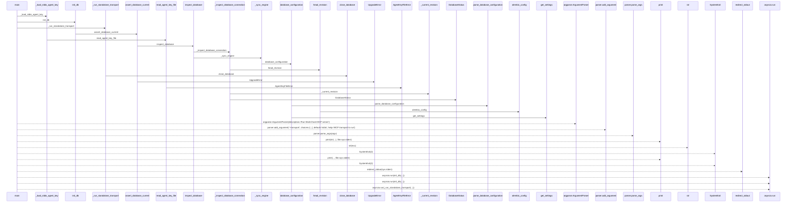
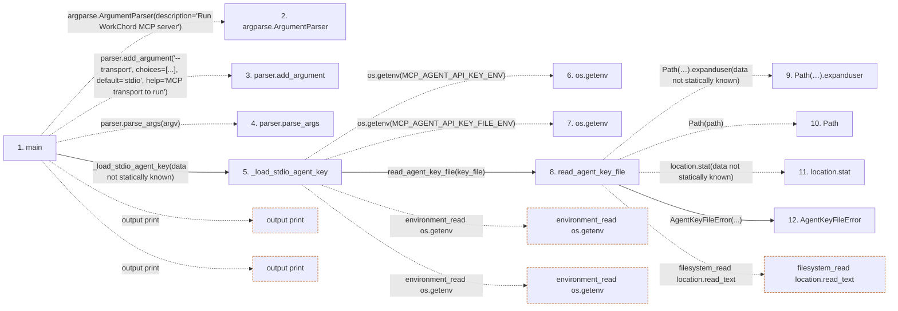

# mcp_server

**Entry point:** `main` (`process`)
**Source:** [mcp_server](../modules/mcp_server.md)
**Modules touched:** [agent_key_file](../modules/agent_key_file.md), [app_database](../modules/app_database.md), [config](../modules/config.md), [database_config](../modules/database_config.md), and 2 more

**Complete modules touched:**

- [agent_key_file](../modules/agent_key_file.md)
- [app_database](../modules/app_database.md)
- [config](../modules/config.md)
- [database_config](../modules/database_config.md)
- [mcp_server](../modules/mcp_server.md)
- [upgrade_service](../modules/upgrade_service.md)

**Related modules:** [agent_key_file](../modules/agent_key_file.md), [agent_model_catalog_service](../modules/agent_model_catalog_service.md), [agent_routing_service](../modules/agent_routing_service.md), and 17 more

**Complete related modules:**

- [agent_key_file](../modules/agent_key_file.md)
- [agent_model_catalog_service](../modules/agent_model_catalog_service.md)
- [agent_routing_service](../modules/agent_routing_service.md)
- [agent_service](../modules/agent_service.md)
- [agent_team_setup_service](../modules/agent_team_setup_service.md)
- [app_database](../modules/app_database.md)
- [authority](../modules/authority.md)
- [commands](../modules/commands.md)
- [config](../modules/config.md)
- [execution_reconciliation](../modules/execution_reconciliation.md)
- [http_authority](../modules/http_authority.md)
- [identity_service](../modules/identity_service.md)
- [maintenance](../modules/maintenance.md)
- [models_agent](../modules/models_agent.md)
- [mutation_versions](../modules/mutation_versions.md)
- [planning_window_reconciliation](../modules/planning_window_reconciliation.md)
- [retained_planning_output](../modules/retained_planning_output.md)
- [schemas_agent](../modules/schemas_agent.md)
- [task_service](../modules/task_service.md)
- [triage_service](../modules/triage_service.md)

## Call sequence

> Static overview in presentation order, not runtime execution order. Arrows retain captured callers; representative internal continuations and boundary examples precede repeated helper detail.

<!-- Auto-generated from static call edges. Dashed arrows are external or unresolved calls. Reviewed runtime conditions and side effects belong in Behavior. -->

> Call sequence diagram shows 30 of 73 interactions; 43 omitted to keep the visualization within the 30-interaction and generated-diagram limits, with uncertain identities omitted rather than inferred.

> Captured boundary calls: external 10 of 27 (17 omitted); unresolved 2 of 20 (18 omitted). These counts cover the captured static trace.

Omitted captured detail, grouped by actual caller occurrence and target module:

| Caller | Parent step | Target module | Kind | Omitted interactions |
| --- | --- | --- | --- | --- |
| `backend/app/mcp_server.py:_load_stdio_agent_key` | 5 | - | external | 2 |
| `backend/app/agent_key_file.py:read_agent_key_file` | 8 | - | unresolved | 6 |
| `backend/app/agent_key_file.py:read_agent_key_file` | 8 | - | external | 3 |
| `backend/app/agent_key_file.py:read_agent_key_file` | 8 | [backend/app/agent_key_file.py](../modules/agent_key_file.md) | internal | 5 |
| `backend/app/services/upgrade_service.py:_inspect_database_connection` | 34 | - | external | 4 |
| `backend/app/services/upgrade_service.py:_inspect_database_connection` | 34 | - | unresolved | 1 |
| `backend/app/services/upgrade_service.py:_current_revision` | 38 | - | external | 4 |
| `backend/app/services/upgrade_service.py:_current_revision` | 38 | - | unresolved | 4 |
> Omission summary shows 8 of 17 groups; 9 further groups are not expanded here. Counts above include all omitted interactions.
> Detailed flow queries retain their own coverage and limits; omitted paths may execute at runtime.

> Trace truncated at the depth limit; deeper calls are omitted.

## Data flow

<!-- Auto-generated static analysis. Treat values and boundaries as best-effort hints, not runtime proof. -->

### Analysis coverage

**Effect analysis partially available.** Flow assembly and source effect analysis are separate; empty observations do not prove an empty handler body.

Source steps: 27; effect analysis evaluated: 18, partial: 0, unavailable: 9. Counts include steps omitted from the displayed trace.

Collector observations for 18 source steps with known totals: observed: 55, emitted: 55, omitted: 0. Unavailable totals are excluded.

- Callable record unavailable for one or more source steps; those steps have no represented callable body.
- Effect collector totals unavailable; observed counts cover captured records only.

| Step | Callable record | Effect analysis | Collector totals | Observed | Emitted | Omitted |
|---|---|---|---|---:|---:|---:|
| `main` | `available` | `evaluated` | `available` | `9` | `9` | `0` |
| `argparse.ArgumentParser` | `not_applicable` | `not_applicable` | `not_applicable` | — | — | — |
| `parser.add_argument` | `not_applicable` | `not_applicable` | `not_applicable` | — | — | — |
| `parser.parse_args` | `not_applicable` | `not_applicable` | `not_applicable` | — | — | — |
| `_load_stdio_agent_key` | `available` | `evaluated` | `available` | `8` | `8` | `0` |
| `os.getenv` | `not_applicable` | `not_applicable` | `not_applicable` | — | — | — |
| `os.getenv` | `not_applicable` | `not_applicable` | `not_applicable` | — | — | — |
| `read_agent_key_file` | `available` | `evaluated` | `available` | `4` | `4` | `0` |
| `Path(…).expanduser` | `not_applicable` | `not_applicable` | `not_applicable` | — | — | — |
| `Path` | `not_applicable` | `not_applicable` | `not_applicable` | — | — | — |
| `location.stat` | `not_applicable` | `not_applicable` | `not_applicable` | — | — | — |
| `AgentKeyFileError` | `unavailable` | `unavailable` | `unavailable` | — | — | — |

### Step data

| Step | Inputs | Reads | Writes | Returns |
|---|---|---|---|---|
| `main` | `argv: Optional[list[str]]` | `AgentKeyFileError`, `sys`, `MCP_AGENT_API_KEY_ENV`, `MCP_AGENT_API_KEY_FILE_ENV`, `sys`, `sys` | - | - |
| `argparse.ArgumentParser` | - | - | - | - |
| `parser.add_argument` | - | - | - | - |
| `parser.parse_args` | - | - | - | - |
| `_load_stdio_agent_key` | - | `MCP_AGENT_API_KEY_ENV`, `MCP_AGENT_API_KEY_FILE_ENV` | `_stdio_file_agent_key` | `True`, `False`, `True` |
| `os.getenv` | - | - | - | - |
| `os.getenv` | - | - | - | - |
| `read_agent_key_file` | `path: str \| os.PathLike[str]` | `os` | - | `lines[...]` |
| `Path(…).expanduser` | - | - | - | - |
| `Path` | - | - | - | - |
| `location.stat` | - | - | - | - |
| `AgentKeyFileError` | - | - | - | - |

### Call data

| From | To | Line | Call |
|---|---|---:|---|
| main | argparse.ArgumentParser | 2542 | `argparse.ArgumentParser(description='Run WorkChord MCP server')` |
| main | parser.add_argument | 2543 | `parser.add_argument('--transport', choices=[...], default='stdio', help='MCP transport to run')` |
| main | parser.parse_args | 2549 | `parser.parse_args(argv)` |
| main | _load_stdio_agent_key | 2553 | `_load_stdio_agent_key(data not statically known)` |
| _load_stdio_agent_key | os.getenv | 215 | `os.getenv(MCP_AGENT_API_KEY_ENV)` |
| _load_stdio_agent_key | os.getenv | 217 | `os.getenv(MCP_AGENT_API_KEY_FILE_ENV)` |
| _load_stdio_agent_key | read_agent_key_file | 220 | `read_agent_key_file(key_file)` |
| read_agent_key_file | Path(…).expanduser | 28 | `Path(path).expanduser(data not statically known)` |
| read_agent_key_file | Path | 28 | `Path(path)` |
| read_agent_key_file | location.stat | 30 | `location.stat(data not statically known)` |
| read_agent_key_file | AgentKeyFileError | 32 | `AgentKeyFileError(...)` |

### Boundary effects

| Kind | Target | Step | Line |
|---|---|---|---:|
| output | `print` | `main` | 2555 |
| output | `print` | `main` | 2558 |
| environment_read | `os.getenv` | `_load_stdio_agent_key` | 215 |
| environment_read | `os.getenv` | `_load_stdio_agent_key` | 217 |
| filesystem_read | `location.read_text` | `read_agent_key_file` | 43 |

### Static analysis gaps

| Kind | Step | Target | Line |
|---|---|---|---:|
| external_call | `main` | `argparse.ArgumentParser` | 2542 |
| unresolved_call | `main` | `parser.add_argument` | 2543 |
| unresolved_call | `main` | `parser.parse_args` | 2549 |
| unresolved_call | `read_agent_key_file` | `Path(path).expanduser` | 28 |
| unresolved_call | `read_agent_key_file` | `location.stat` | 30 |
| step_limit | `main` | `first 12 steps` | 0 |
| truncated_flow | `main` | `depth limit` | 0 |

## Behavior

This flow starts at `main` and is classified as `process`. The generated call and data-flow sections are bounded static projections; runtime conditions and side effects require source-level confirmation.
