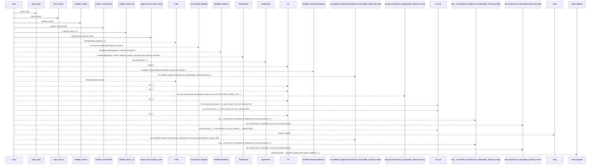
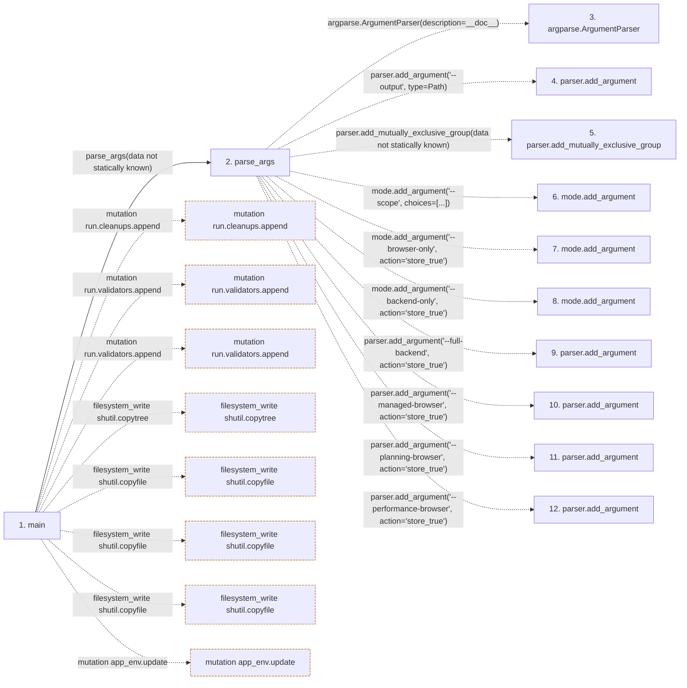

# run_disposable_checks

**Entry point:** `main` (`process`)
**Source:** [run_disposable_checks](../modules/run_disposable_checks.md)
**Modules touched:** [run_disposable_checks](../modules/run_disposable_checks.md)

## Call sequence

> Static overview in presentation order, not runtime execution order. Arrows retain captured callers; representative internal continuations and boundary examples precede repeated helper detail.

<!-- Auto-generated from static call edges. Dashed arrows are external or unresolved calls. Reviewed runtime conditions and side effects belong in Behavior. -->

> Call sequence diagram shows 30 of 107 interactions; 77 omitted to keep the visualization within the 30-interaction and generated-diagram limits, with uncertain identities omitted rather than inferred.

> Captured boundary calls: external 15 of 39 (24 omitted); unresolved 9 of 62 (53 omitted). These counts cover the captured static trace.

Omitted captured detail, grouped by actual caller occurrence and target module:

| Caller | Parent step | Target module | Kind | Omitted interactions |
| --- | --- | --- | --- | --- |
| `scripts/ci/run_disposable_checks.py:parse_args` | 2 | - | external | 2 |
| `scripts/ci/run_disposable_checks.py:parse_args` | 2 | - | unresolved | 19 |
| `scripts/ci/run_disposable_checks.py:bind_source` | 29 | - | unresolved | 5 |
| `scripts/ci/run_disposable_checks.py:bind_source` | 29 | - | external | 1 |
| `scripts/ci/run_disposable_checks.py:validate_results` | 39 | - | external | 6 |
| `scripts/ci/run_disposable_checks.py:validate_results` | 39 | - | unresolved | 11 |
| `scripts/ci/run_disposable_checks.py:runtime_environment` | 58 | - | external | 2 |
| `scripts/ci/run_disposable_checks.py:runtime_environment` | 58 | - | unresolved | 2 |
> Omission summary shows 8 of 13 groups; 5 further groups are not expanded here. Counts above include all omitted interactions.
> Detailed flow queries retain their own coverage and limits; omitted paths may execute at runtime.

## Data flow

<!-- Auto-generated static analysis. Treat values and boundaries as best-effort hints, not runtime proof. -->

### Analysis coverage

**Effect analysis partially available.** Flow assembly and source effect analysis are separate; empty observations do not prove an empty handler body.

Source steps: 7; effect analysis evaluated: 6, partial: 1, unavailable: 0. Counts include steps omitted from the displayed trace.

Collector observations for 7 source steps with known totals: observed: 54, emitted: 42, omitted: 12. Unavailable totals are excluded.

- Effect collector omitted observations before flow assembly; displayed effects are partial.

| Step | Callable record | Effect analysis | Collector totals | Observed | Emitted | Omitted |
|---|---|---|---|---:|---:|---:|
| `main` | `available` | `partial` | `available` | `33` | `21` | `12` |
| `parse_args` | `available` | `evaluated` | `available` | `3` | `3` | `0` |
| `argparse.ArgumentParser` | `not_applicable` | `not_applicable` | `not_applicable` | — | — | — |
| `parser.add_argument` | `not_applicable` | `not_applicable` | `not_applicable` | — | — | — |
| `parser.add_mutually_exclusive_group` | `not_applicable` | `not_applicable` | `not_applicable` | — | — | — |
| `mode.add_argument` | `not_applicable` | `not_applicable` | `not_applicable` | — | — | — |
| `mode.add_argument` | `not_applicable` | `not_applicable` | `not_applicable` | — | — | — |
| `mode.add_argument` | `not_applicable` | `not_applicable` | `not_applicable` | — | — | — |
| `parser.add_argument` | `not_applicable` | `not_applicable` | `not_applicable` | — | — | — |
| `parser.add_argument` | `not_applicable` | `not_applicable` | `not_applicable` | — | — | — |
| `parser.add_argument` | `not_applicable` | `not_applicable` | `not_applicable` | — | — | — |
| `parser.add_argument` | `not_applicable` | `not_applicable` | `not_applicable` | — | — | — |

### Step data

| Step | Inputs | Reads | Writes | Returns |
|---|---|---|---|---|
| `main` | - | `source_digest`, `PLAYWRIGHT_VERSION`, `ROOT`, `sys`, `sys`, `ROOT`, `ROOT`, `sys` | `run.data[...]`, `run.data[...]`, `env[...]`, `app_env[...]` | `run.exit_code` |
| `parse_args` | - | `Path`, `positive_seconds` | - | `(...)` |
| `argparse.ArgumentParser` | - | - | - | - |
| `parser.add_argument` | - | - | - | - |
| `parser.add_mutually_exclusive_group` | - | - | - | - |
| `mode.add_argument` | - | - | - | - |
| `mode.add_argument` | - | - | - | - |
| `mode.add_argument` | - | - | - | - |
| `parser.add_argument` | - | - | - | - |
| `parser.add_argument` | - | - | - | - |
| `parser.add_argument` | - | - | - | - |
| `parser.add_argument` | - | - | - | - |

### Call data

| From | To | Line | Call |
|---|---|---:|---|
| main | parse_args | 149 | `parse_args(data not statically known)` |
| parse_args | argparse.ArgumentParser | 114 | `argparse.ArgumentParser(description=__doc__)` |
| parse_args | parser.add_argument | 115 | `parser.add_argument('--output', type=Path)` |
| parse_args | parser.add_mutually_exclusive_group | 116 | `parser.add_mutually_exclusive_group(data not statically known)` |
| parse_args | mode.add_argument | 117 | `mode.add_argument('--scope', choices=[...])` |
| parse_args | mode.add_argument | 118 | `mode.add_argument('--browser-only', action='store_true')` |
| parse_args | mode.add_argument | 119 | `mode.add_argument('--backend-only', action='store_true')` |
| parse_args | parser.add_argument | 120 | `parser.add_argument('--full-backend', action='store_true')` |
| parse_args | parser.add_argument | 121 | `parser.add_argument('--managed-browser', action='store_true')` |
| parse_args | parser.add_argument | 122 | `parser.add_argument('--planning-browser', action='store_true')` |
| parse_args | parser.add_argument | 123 | `parser.add_argument('--performance-browser', action='store_true')` |

### Boundary effects

| Kind | Target | Step | Line |
|---|---|---|---:|
| mutation | `run.cleanups.append` | `main` | 160 |
| mutation | `run.validators.append` | `main` | 161 |
| mutation | `run.validators.append` | `main` | 188 |
| filesystem_write | `shutil.copytree` | `main` | 191 |
| filesystem_write | `shutil.copyfile` | `main` | 195 |
| filesystem_write | `shutil.copyfile` | `main` | 210 |
| filesystem_write | `shutil.copyfile` | `main` | 212 |
| mutation | `app_env.update` | `main` | 218 |

### Static analysis gaps

| Kind | Step | Target | Line |
|---|---|---|---:|
| external_call | `parse_args` | `argparse.ArgumentParser` | 114 |
| unresolved_call | `parse_args` | `parser.add_argument` | 115 |
| unresolved_call | `parse_args` | `parser.add_mutually_exclusive_group` | 116 |
| unresolved_call | `parse_args` | `mode.add_argument` | 117 |
| unresolved_call | `parse_args` | `mode.add_argument` | 118 |
| unresolved_call | `parse_args` | `mode.add_argument` | 119 |
| unresolved_call | `parse_args` | `parser.add_argument` | 120 |
| unresolved_call | `parse_args` | `parser.add_argument` | 121 |
| unresolved_call | `parse_args` | `parser.add_argument` | 122 |
| unresolved_call | `parse_args` | `parser.add_argument` | 123 |
| step_limit | `main` | `first 12 steps` | 0 |

## Behavior

The runner supplies its exact Python executable to the managed browser and copies the inbox dispatch helper beside the scenario. Node launches the worker through that absolute executable, retaining the backend dependency environment even when a different Python is on `PATH`. The helper requires the owned disposable database and invocation nonce before starting delivery.

The selected scope determines prerequisites, commands and required artifacts. SQLite runs without a PostgreSQL admin endpoint; PostgreSQL uses a validated loopback cluster; frontend owns its JUnit, lint and build outcomes; browser-only mode provisions the isolated application and Playwright scenario without repeating those suites. Existing combined command-line modes remain available.

The runner writes an initial receipt before commands, streams command logs with periodic heartbeats, records stage durations, and enforces command/run deadlines. Workflow setup time reduces the remaining budget so cleanup and uploads have reserved headroom. Missing evidence, nonzero commands, source changes and unsuccessful cleanup fail the run. Graceful cancellation is recorded; a hard-killed run remains incomplete. The browser invocation nonce and active-port ownership checks remain enforced.
