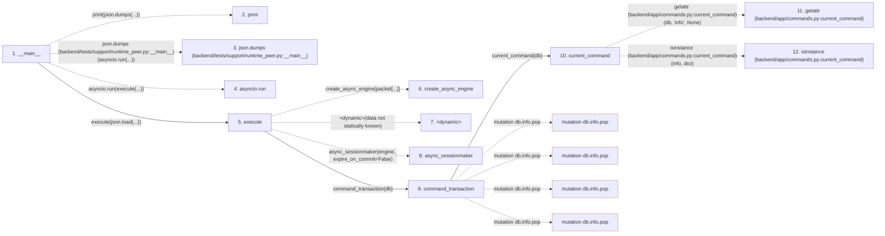

# runtime_peer

**Entry point:** `__main__` (`process`)
**Source:** [runtime_peer](../modules/runtime_peer.md)
**Modules touched:** [agent_routing_policy](../modules/agent_routing_policy.md), [agent_routing_rollout](../modules/agent_routing_rollout.md), [agent_service](../modules/agent_service.md), and 18 more

**Complete modules touched:**

- [agent_routing_policy](../modules/agent_routing_policy.md)
- [agent_routing_rollout](../modules/agent_routing_rollout.md)
- [agent_service](../modules/agent_service.md)
- [agent_team_setup_service](../modules/agent_team_setup_service.md)
- [agent_work_service](../modules/agent_work_service.md)
- [authority](../modules/authority.md)
- [commands](../modules/commands.md)
- [config](../modules/config.md)
- [delivery_dependency_service](../modules/delivery_dependency_service.md)
- [discussion_service](../modules/discussion_service.md)
- [identity_service](../modules/identity_service.md)
- [models_outbound_webhook](../modules/models_outbound_webhook.md)
- [mutation_versions](../modules/mutation_versions.md)
- [query_limits](../modules/query_limits.md)
- [runtime_peer](../modules/runtime_peer.md)
- [schemas_agent](../modules/schemas_agent.md)
- [services_work_metrics](../modules/services_work_metrics.md)
- [task_brief_service](../modules/task_brief_service.md)
- [task_service](../modules/task_service.md)
- [task_timeline_service](../modules/task_timeline_service.md)
- [time](../modules/time.md)

**Related modules:** [agent_service](../modules/agent_service.md), [agent_work_service](../modules/agent_work_service.md), [commands](../modules/commands.md), [schemas_agent](../modules/schemas_agent.md)

## Call sequence

> Static overview in presentation order, not runtime execution order. Arrows retain captured callers; representative internal continuations and boundary examples precede repeated helper detail.

```mermaid
sequenceDiagram
    participant p0 as __main__
    participant p1 as execute
    participant p2 as command_transaction
    participant p3 as AgentService.authenticate
    participant p4 as AgentWorkService.get_work
    participant p5 as AgentWorkService.get_task_context
    participant p6 as AgentWorkService._require_any_scope
    participant p7 as DeliveryDependencyService.reconcile
    participant p8 as commit_or_flush
    participant p9 as DiscussionService.enqueue
    participant p10 as AgentWorkService._current_recovery_codes
    participant p11 as AgentWorkService._work_item
    participant p12 as AgentWorkService._paginate_work_collections
    participant p13 as AgentWorkService._definition_blockers
    participant p14 as AgentWorkService._read_actor_queue_revision
    participant p15 as AgentWorkService.actor_response
    participant p16 as AgentService.get_task_timeline
    participant p17 as AgentWorkService._validate_assignment_actor
    participant p18 as actor_has_scope
    participant p19 as TaskTimelineService.page
    participant p20 as AgentWorkService._decode_page_cursor
    participant p21 as AgentWorkService._start_blockers
    participant p22 as DeliveryDependencyService.validate_cycles
    participant p23 as DiscussionService.recipient_authorized
    participant p24 as AgentWorkService.assignment_response
    participant p25 as AgentWorkService.run_response
    participant p26 as TaskService.reserve_task_version
    participant p27 as clear_execution_evidence
    participant p28 as DeliveryDependencyService.graph
    participant p29 as print
    participant p30 as <dynamic>
    p0->>p1: execute
    p1->>p2: command_transaction
    p1->>p3: AgentService.authenticate
    p1->>p4: AgentWorkService.get_work
    p1->>p5: AgentWorkService.get_task_context
    p4->>p6: AgentWorkService._require_any_scope
    p2->>p7: DeliveryDependencyService.reconcile
    p3->>p8: commit_or_flush
    p2->>p9: DiscussionService.enqueue
    p4->>p10: AgentWorkService._current_recovery_codes
    p4->>p11: AgentWorkService._work_item
    p4->>p12: AgentWorkService._paginate_work_collections
    p5->>p13: AgentWorkService._definition_blockers
    p4->>p14: AgentWorkService._read_actor_queue_revision
    p4->>p15: AgentWorkService.actor_response
    p5->>p16: AgentService.get_task_timeline
    p10->>p17: AgentWorkService._validate_assignment_actor
    p6->>p18: actor_has_scope
    p16->>p19: TaskTimelineService.page
    p12->>p20: AgentWorkService._decode_page_cursor
    p11->>p21: AgentWorkService._start_blockers
    p7->>p22: DeliveryDependencyService.validate_cycles
    p9->>p23: DiscussionService.recipient_authorized
    p11->>p24: AgentWorkService.assignment_response
    p11->>p25: AgentWorkService.run_response
    p7->>p26: TaskService.reserve_task_version
    p7->>p27: clear_execution_evidence
    p22->>p28: DeliveryDependencyService.graph
    p0-->>p29: print(json.dumps(...))
    p1-->>p30: <dynamic>
```

<!-- Auto-generated from static call edges. Dashed arrows are external or unresolved calls. Reviewed runtime conditions and side effects belong in Behavior. -->

> Call sequence diagram shows 30 of 741 interactions; 711 omitted to keep the visualization within the 30-interaction and generated-diagram limits, with uncertain identities omitted rather than inferred.

> Captured boundary calls: external 1 of 200 (199 omitted); unresolved 1 of 362 (361 omitted). These counts cover the captured static trace.

Omitted captured detail, grouped by actual caller occurrence and target module:

| Caller | Parent step | Target module | Kind | Omitted interactions |
| --- | --- | --- | --- | --- |
| `backend/tests/support/runtime_peer.py:__main__` | 1 | - | external | 3 |
| `backend/tests/support/runtime_peer.py:execute` | 5 | - | external | 9 |
| `backend/app/commands.py:command_transaction` | 9 | [backend/app/commands.py](../modules/commands.md) | internal | 2 |
| `backend/app/commands.py:current_command` | 10 | - | external | 2 |
| `backend/app/commands.py:current_command` | 10 | - | unresolved | 1 |
| `backend/app/commands.py:command_transaction` | 9 | - | external | 4 |
| `backend/app/commands.py:command_transaction` | 9 | - | unresolved | 12 |
| `backend/app/services/delivery_dependency_service.py:DeliveryDependencyService.reconcile` | 21 | - | unresolved | 23 |
> Omission summary shows 8 of 165 groups; 157 further groups are not expanded here. Counts above include all omitted interactions.
> Detailed flow queries retain their own coverage and limits; omitted paths may execute at runtime.

> Trace truncated at the depth limit; deeper calls are omitted.

## Data flow

<!-- Auto-generated static analysis. Treat values and boundaries as best-effort hints, not runtime proof. -->

### Analysis coverage

**Effect analysis partially available.** Flow assembly and source effect analysis are separate; empty observations do not prove an empty handler body.

Source steps: 180; effect analysis evaluated: 124, partial: 4, unavailable: 52. Counts include steps omitted from the displayed trace.

Collector observations for 128 source steps with known totals: observed: 704, emitted: 667, omitted: 37. Unavailable totals are excluded.

- Callable record unavailable for one or more source steps; those steps have no represented callable body.
- Effect collector omitted observations before flow assembly; displayed effects are partial.
- Effect collector totals unavailable; observed counts cover captured records only.

| Step | Callable record | Effect analysis | Collector totals | Observed | Emitted | Omitted |
|---|---|---|---|---:|---:|---:|
| `__main__` | `unavailable` | `unavailable` | `unavailable` | — | — | — |
| `print` | `not_applicable` | `not_applicable` | `not_applicable` | — | — | — |
| `json.dumps (backend/tests/support/runtime_peer.py:__main__)` | `not_applicable` | `not_applicable` | `not_applicable` | — | — | — |
| `asyncio.run` | `not_applicable` | `not_applicable` | `not_applicable` | — | — | — |
| `execute` | `available` | `evaluated` | `available` | `7` | `7` | `0` |
| `create_async_engine` | `not_applicable` | `not_applicable` | `not_applicable` | — | — | — |
| `<dynamic>` | `not_applicable` | `not_applicable` | `not_applicable` | — | — | — |
| `async_sessionmaker` | `not_applicable` | `not_applicable` | `not_applicable` | — | — | — |
| `command_transaction` | `available` | `evaluated` | `available` | `10` | `10` | `0` |
| `current_command` | `available` | `evaluated` | `available` | `2` | `2` | `0` |
| `getattr (backend/app/commands.py:current_command)` | `not_applicable` | `not_applicable` | `not_applicable` | — | — | — |
| `isinstance (backend/app/commands.py:current_command)` | `not_applicable` | `not_applicable` | `not_applicable` | — | — | — |

### Step data

| Step | Inputs | Reads | Writes | Returns |
|---|---|---|---|---|
| `__main__` | - | - | - | - |
| `print` | - | - | - | - |
| `json.dumps (backend/tests/support/runtime_peer.py:__main__)` | - | - | - | - |
| `asyncio.run` | - | - | - | - |
| `execute` | `packet` | `AgentWorkBegin`, `AgentWorkRenew`, `AgentWorkSubmit`, `AgentWorkTerminal` | - | `{...}`, `{...}` |
| `create_async_engine` | - | - | - | - |
| `<dynamic>` | - | - | - | - |
| `async_sessionmaker` | - | - | - | - |
| `command_transaction` | `db: AsyncSession`, `mode`, `commit` | - | `previous.failed`, `db.info[...]` | `none` |
| `current_command` | `db` | - | - | `...` |
| `getattr (backend/app/commands.py:current_command)` | - | - | - | - |
| `isinstance (backend/app/commands.py:current_command)` | - | - | - | - |

### Call data

| From | To | Line | Call |
|---|---|---:|---|
| __main__ | print | 63 | `print(json.dumps(...))` |
| __main__ | json.dumps (backend/tests/support/runtime_peer.py:__main__) | 63 | `json.dumps(asyncio.run(...))` |
| __main__ | asyncio.run | 63 | `asyncio.run(execute(...))` |
| __main__ | execute | 63 | `execute(json.load(...))` |
| execute | create_async_engine | 22 | `create_async_engine(packet[...])` |
| execute | <dynamic> | 28 | `<dynamic>(data not statically known)` |
| execute | async_sessionmaker | 28 | `async_sessionmaker(engine, expire_on_commit=False)` |
| execute | command_transaction | 29 | `command_transaction(db)` |
| command_transaction | current_command | 87 | `current_command(db)` |
| current_command | getattr (backend/app/commands.py:current_command) | 73 | `getattr(db, 'info', None)` |
| current_command | isinstance (backend/app/commands.py:current_command) | 74 | `isinstance(info, dict)` |

### Boundary effects

| Kind | Target | Step | Line |
|---|---|---|---:|
| mutation | `db.info.pop` | `command_transaction` | 107 |
| mutation | `db.info.pop` | `command_transaction` | 120 |
| mutation | `db.info.pop` | `command_transaction` | 121 |
| mutation | `db.info.pop` | `command_transaction` | 123 |

### Static analysis gaps

| Kind | Step | Target | Line |
|---|---|---|---:|
| external_call | `__main__` | `print` | 63 |
| external_call | `__main__` | `json.dumps` | 63 |
| external_call | `__main__` | `asyncio.run` | 63 |
| external_call | `execute` | `create_async_engine` | 22 |
| unresolved_call | `execute` | `<dynamic>` | 28 |
| external_call | `execute` | `async_sessionmaker` | 28 |
| external_call | `current_command` | `getattr` | 73 |
| external_call | `current_command` | `isinstance` | 74 |
| step_limit | `__main__` | `first 12 steps` | 0 |
| truncated_flow | `__main__` | `depth limit` | 0 |

## Behavior

This flow starts at `__main__` and is classified as `process`. The generated call and data-flow sections are bounded static projections; runtime conditions and side effects require source-level confirmation.
