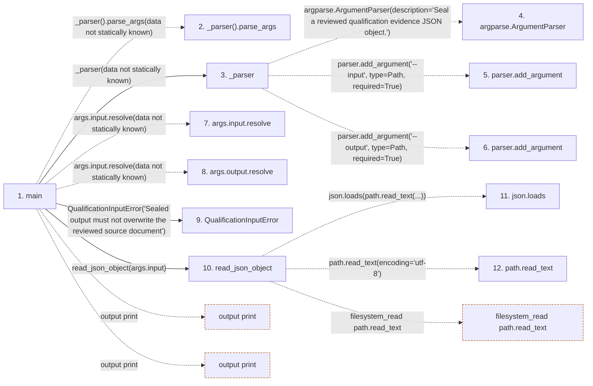

# seal

**Entry point:** `main` (`process`)
**Source:** [seal](../modules/seal.md)
**Modules touched:** [load_common](../modules/load_common.md), [seal](../modules/seal.md)

**Related modules:** [load_common](../modules/load_common.md)

## Call sequence

> Static overview in presentation order, not runtime execution order. Arrows retain captured callers; representative internal continuations and boundary examples precede repeated helper detail.

```mermaid
sequenceDiagram
    participant p0 as main
    participant p1 as read_json_object
    participant p2 as atomic_write_json
    participant p3 as _parser
    participant p4 as QualificationInputError
    participant p5 as seal_document
    participant p6 as verify_document
    participant p7 as sha256_bytes
    participant p8 as canonical_json_bytes
    participant p9 as print
    participant p10 as _parser().parse_args
    participant p11 as args.input.resolve
    participant p12 as args.output.resolve
    participant p13 as document.get (scripts/load/seal.py:main)
    participant p14 as argparse.ArgumentParser
    participant p15 as json.loads
    participant p16 as parser.add_argument
    participant p17 as path.read_text
    participant p18 as dict (scripts/load/common.py:atomic_write_json)
    participant p19 as path.parent.mkdir
    participant p20 as isinstance (scripts/load/common.py:read_json_object)
    participant p21 as path.with_name
    participant p22 as os.getpid
    participant p23 as json.dumps(…).encode (scripts/load/common.py:atomic_write_json)
    participant p24 as json.dumps (scripts/load/common.py:atomic_write_json)
    participant p25 as temporary.open
    participant p26 as os.chmod
    participant p27 as handle.write
    participant p28 as handle.flush
    p0->>p1: read_json_object
    p0->>p2: atomic_write_json
    p0->>p3: _parser
    p0->>p4: QualificationInputError
    p2->>p5: seal_document
    p1->>p6: verify_document
    p5->>p7: sha256_bytes
    p5->>p8: canonical_json_bytes
    p0-->>p9: print(...)
    p0-->>p10: _parser().parse_args
    p0-->>p11: args.input.resolve
    p0-->>p12: args.output.resolve
    p0-->>p13: document.get (scripts/load/seal.py:main)('kind', 'unspecified')
    p0-->>p9: print(..., file=sys.stderr)
    p3-->>p14: argparse.ArgumentParser(description='Seal a reviewed qualification evidence JSON object.')
    p1-->>p15: json.loads(path.read_text(...))
    p3-->>p16: parser.add_argument('--input', type=Path, required=True)
    p1-->>p17: path.read_text(encoding='utf-8')
    p2-->>p18: dict (scripts/load/common.py:atomic_write_json)(payload)
    p3-->>p16: parser.add_argument('--output', type=Path, required=True)
    p2-->>p19: path.parent.mkdir(parents=True, exist_ok=True)
    p1-->>p20: isinstance (scripts/load/common.py:read_json_object)(value, dict)
    p2-->>p21: path.with_name(...)
    p2-->>p22: os.getpid
    p2-->>p23: json.dumps(…).encode (scripts/load/common.py:atomic_write_json)('utf-8')
    p2-->>p24: json.dumps (scripts/load/common.py:atomic_write_json)(document, ensure_ascii=False, allow_nan=False, indent=2, sort_keys=True)
    p2-->>p25: temporary.open('xb')
    p2-->>p26: os.chmod(temporary, mode)
    p2-->>p27: handle.write(encoded)
    p2-->>p28: handle.flush
```

<!-- Auto-generated from static call edges. Dashed arrows are external or unresolved calls. Reviewed runtime conditions and side effects belong in Behavior. -->

> Call sequence diagram shows 30 of 56 interactions; 26 omitted to keep the visualization within the 30-interaction and generated-diagram limits, with uncertain identities omitted rather than inferred.

> Captured boundary calls: external 9 of 20 (11 omitted); unresolved 13 of 20 (7 omitted). These counts cover the captured static trace.

Omitted captured detail, grouped by actual caller occurrence and target module:

| Caller | Parent step | Target module | Kind | Omitted interactions |
| --- | --- | --- | --- | --- |
| `scripts/load/common.py:read_json_object` | 10 | [scripts/load/common.py](../modules/load_common.md) | internal | 2 |
| `scripts/load/common.py:verify_document` | 16 | - | unresolved | 2 |
| `scripts/load/common.py:verify_document` | 16 | - | external | 3 |
| `scripts/load/common.py:verify_document` | 16 | [scripts/load/common.py](../modules/load_common.md) | internal | 4 |
| `scripts/load/common.py:sha256_bytes` | 23 | - | unresolved | 1 |
| `scripts/load/common.py:sha256_bytes` | 23 | - | external | 1 |
| `scripts/load/common.py:canonical_json_bytes` | 26 | - | unresolved | 1 |
| `scripts/load/common.py:canonical_json_bytes` | 26 | - | external | 1 |
> Omission summary shows 8 of 13 groups; 5 further groups are not expanded here. Counts above include all omitted interactions.
> Detailed flow queries retain their own coverage and limits; omitted paths may execute at runtime.

## Data flow

<!-- Auto-generated static analysis. Treat values and boundaries as best-effort hints, not runtime proof. -->

### Analysis coverage

**Effect analysis partially available.** Flow assembly and source effect analysis are separate; empty observations do not prove an empty handler body.

Source steps: 17; effect analysis evaluated: 10, partial: 0, unavailable: 7. Counts include steps omitted from the displayed trace.

Collector observations for 10 source steps with known totals: observed: 42, emitted: 42, omitted: 0. Unavailable totals are excluded.

- Callable record unavailable for one or more source steps; those steps have no represented callable body.
- Effect collector totals unavailable; observed counts cover captured records only.

| Step | Callable record | Effect analysis | Collector totals | Observed | Emitted | Omitted |
|---|---|---|---|---:|---:|---:|
| `main` | `available` | `evaluated` | `available` | `8` | `8` | `0` |
| `_parser().parse_args` | `not_applicable` | `not_applicable` | `not_applicable` | — | — | — |
| `_parser` | `available` | `evaluated` | `available` | `3` | `3` | `0` |
| `argparse.ArgumentParser` | `not_applicable` | `not_applicable` | `not_applicable` | — | — | — |
| `parser.add_argument` | `not_applicable` | `not_applicable` | `not_applicable` | — | — | — |
| `parser.add_argument` | `not_applicable` | `not_applicable` | `not_applicable` | — | — | — |
| `args.input.resolve` | `not_applicable` | `not_applicable` | `not_applicable` | — | — | — |
| `args.output.resolve` | `not_applicable` | `not_applicable` | `not_applicable` | — | — | — |
| `QualificationInputError` | `unavailable` | `unavailable` | `unavailable` | — | — | — |
| `read_json_object` | `available` | `evaluated` | `available` | `5` | `5` | `0` |
| `json.loads` | `not_applicable` | `not_applicable` | `not_applicable` | — | — | — |
| `path.read_text` | `not_applicable` | `not_applicable` | `not_applicable` | — | — | — |

### Step data

| Step | Inputs | Reads | Writes | Returns |
|---|---|---|---|---|
| `main` | - | `DOCUMENT_CHECKSUM_FIELD`, `DOCUMENT_CHECKSUM_FIELD`, `QualificationInputError`, `sys` | - | `0`, `2` |
| `_parser().parse_args` | - | - | - | - |
| `_parser` | - | `Path`, `Path` | - | `parser` |
| `argparse.ArgumentParser` | - | - | - | - |
| `parser.add_argument` | - | - | - | - |
| `parser.add_argument` | - | - | - | - |
| `args.input.resolve` | - | - | - | - |
| `args.output.resolve` | - | - | - | - |
| `QualificationInputError` | - | - | - | - |
| `read_json_object` | `path: Path`, `sealed: bool` | `json` | - | `value` |
| `json.loads` | - | - | - | - |
| `path.read_text` | - | - | - | - |

### Call data

| From | To | Line | Call |
|---|---|---:|---|
| main | _parser().parse_args | 31 | `_parser().parse_args(data not statically known)` |
| main | _parser | 31 | `_parser(data not statically known)` |
| _parser | argparse.ArgumentParser | 22 | `argparse.ArgumentParser(description='Seal a reviewed qualification evidence JSON object.')` |
| _parser | parser.add_argument | 25 | `parser.add_argument('--input', type=Path, required=True)` |
| _parser | parser.add_argument | 26 | `parser.add_argument('--output', type=Path, required=True)` |
| main | args.input.resolve | 33 | `args.input.resolve(data not statically known)` |
| main | args.output.resolve | 33 | `args.input.resolve(data not statically known)` |
| main | QualificationInputError | 34 | `QualificationInputError('Sealed output must not overwrite the reviewed source document')` |
| main | read_json_object | 37 | `read_json_object(args.input)` |
| read_json_object | json.loads | 90 | `json.loads(path.read_text(...))` |
| read_json_object | path.read_text | 90 | `path.read_text(encoding='utf-8')` |

### Boundary effects

| Kind | Target | Step | Line |
|---|---|---|---:|
| output | `print` | `main` | 43 |
| output | `print` | `main` | 49 |
| filesystem_read | `path.read_text` | `read_json_object` | 90 |

### Static analysis gaps

| Kind | Step | Target | Line |
|---|---|---|---:|
| unresolved_call | `main` | `_parser().parse_args` | 31 |
| external_call | `_parser` | `argparse.ArgumentParser` | 22 |
| unresolved_call | `_parser` | `parser.add_argument` | 25 |
| unresolved_call | `_parser` | `parser.add_argument` | 26 |
| unresolved_call | `main` | `args.input.resolve` | 33 |
| unresolved_call | `main` | `args.output.resolve` | 33 |
| step_limit | `main` | `first 12 steps` | 0 |

## Behavior

This flow starts at `main` and is classified as `process`. The generated call and data-flow sections are bounded static projections; runtime conditions and side effects require source-level confirmation.
