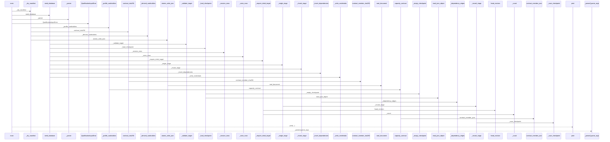
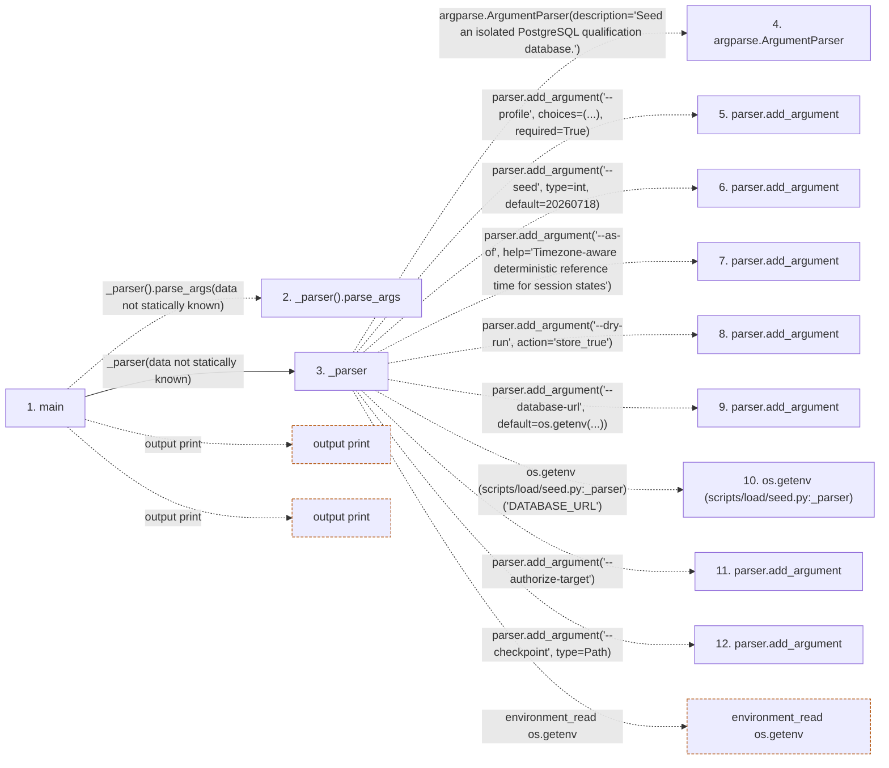

# seed

**Entry point:** `main` (`process`)
**Source:** [seed](../modules/seed.md)
**Modules touched:** [config](../modules/config.md), [database_config](../modules/database_config.md), [load_common](../modules/load_common.md), [loader](../modules/loader.md), and 2 more

**Complete modules touched:**

- [config](../modules/config.md)
- [database_config](../modules/database_config.md)
- [load_common](../modules/load_common.md)
- [loader](../modules/loader.md)
- [seed](../modules/seed.md)
- [upgrade_service](../modules/upgrade_service.md)

**Related modules:** [load_common](../modules/load_common.md), [upgrade_service](../modules/upgrade_service.md)

## Call sequence

> Static overview in presentation order, not runtime execution order. Arrows retain captured callers; representative internal continuations and boundary examples precede repeated helper detail.

<!-- Auto-generated from static call edges. Dashed arrows are external or unresolved calls. Reviewed runtime conditions and side effects belong in Behavior. -->

> Call sequence diagram shows 30 of 362 interactions; 332 omitted to keep the visualization within the 30-interaction and generated-diagram limits, with uncertain identities omitted rather than inferred.

> Captured boundary calls: external 1 of 112 (111 omitted); unresolved 1 of 121 (120 omitted). These counts cover the captured static trace.

Omitted captured detail, grouped by actual caller occurrence and target module:

| Caller | Parent step | Target module | Kind | Omitted interactions |
| --- | --- | --- | --- | --- |
| `scripts/load/seed.py:_parser` | 3 | - | external | 2 |
| `scripts/load/seed.py:_parser` | 3 | - | unresolved | 10 |
| `scripts/load/seed.py:_profile_cardinalities` | 18 | - | external | 2 |
| `scripts/load/common.py:contract_member_json` | 21 | - | unresolved | 1 |
| `scripts/load/common.py:contract_member_json` | 21 | [scripts/load/common.py](../modules/load_common.md) | internal | 3 |
| `scripts/load/common.py:contract_bundle` | 23 | [backend/app/autonomy/contracts/postgresql/loader.py](../modules/loader.md) | internal | 1 |
| `scripts/load/common.py:contract_bundle` | 23 | [scripts/load/common.py](../modules/load_common.md) | internal | 1 |
| `scripts/load/common.py:contract_member_json` | 21 | - | external | 1 |
> Omission summary shows 8 of 124 groups; 116 further groups are not expanded here. Counts above include all omitted interactions.
> Detailed flow queries retain their own coverage and limits; omitted paths may execute at runtime.

> Trace truncated at the depth limit; deeper calls are omitted.

## Data flow

<!-- Auto-generated static analysis. Treat values and boundaries as best-effort hints, not runtime proof. -->

### Analysis coverage

**Effect analysis partially available.** Flow assembly and source effect analysis are separate; empty observations do not prove an empty handler body.

Source steps: 130; effect analysis evaluated: 99, partial: 0, unavailable: 31. Counts include steps omitted from the displayed trace.

Collector observations for 99 source steps with known totals: observed: 418, emitted: 418, omitted: 0. Unavailable totals are excluded.

- Callable record unavailable for one or more source steps; those steps have no represented callable body.
- Effect collector totals unavailable; observed counts cover captured records only.

| Step | Callable record | Effect analysis | Collector totals | Observed | Emitted | Omitted |
|---|---|---|---|---:|---:|---:|
| `main` | `available` | `evaluated` | `available` | `6` | `6` | `0` |
| `_parser().parse_args` | `not_applicable` | `not_applicable` | `not_applicable` | — | — | — |
| `_parser` | `available` | `evaluated` | `available` | `5` | `5` | `0` |
| `argparse.ArgumentParser` | `not_applicable` | `not_applicable` | `not_applicable` | — | — | — |
| `parser.add_argument` | `not_applicable` | `not_applicable` | `not_applicable` | — | — | — |
| `parser.add_argument` | `not_applicable` | `not_applicable` | `not_applicable` | — | — | — |
| `parser.add_argument` | `not_applicable` | `not_applicable` | `not_applicable` | — | — | — |
| `parser.add_argument` | `not_applicable` | `not_applicable` | `not_applicable` | — | — | — |
| `parser.add_argument` | `not_applicable` | `not_applicable` | `not_applicable` | — | — | — |
| `os.getenv (scripts/load/seed.py:_parser)` | `not_applicable` | `not_applicable` | `not_applicable` | — | — | — |
| `parser.add_argument` | `not_applicable` | `not_applicable` | `not_applicable` | — | — | — |
| `parser.add_argument` | `not_applicable` | `not_applicable` | `not_applicable` | — | — | — |

### Step data

| Step | Inputs | Reads | Writes | Returns |
|---|---|---|---|---|
| `main` | - | `QualificationInputError`, `sys` | - | `0`, `2` |
| `_parser().parse_args` | - | - | - | - |
| `_parser` | - | `Path`, `Path`, `Path` | - | `parser` |
| `argparse.ArgumentParser` | - | - | - | - |
| `parser.add_argument` | - | - | - | - |
| `parser.add_argument` | - | - | - | - |
| `parser.add_argument` | - | - | - | - |
| `parser.add_argument` | - | - | - | - |
| `parser.add_argument` | - | - | - | - |
| `os.getenv (scripts/load/seed.py:_parser)` | - | - | - | - |
| `parser.add_argument` | - | - | - | - |
| `parser.add_argument` | - | - | - | - |

### Call data

| From | To | Line | Call |
|---|---|---:|---|
| main | _parser().parse_args | 1092 | `_parser().parse_args(data not statically known)` |
| main | _parser | 1092 | `_parser(data not statically known)` |
| _parser | argparse.ArgumentParser | 1072 | `argparse.ArgumentParser(description='Seed an isolated PostgreSQL qualification database.')` |
| _parser | parser.add_argument | 1075 | `parser.add_argument('--profile', choices=(...), required=True)` |
| _parser | parser.add_argument | 1076 | `parser.add_argument('--seed', type=int, default=20260718)` |
| _parser | parser.add_argument | 1077 | `parser.add_argument('--as-of', help='Timezone-aware deterministic reference time for session states')` |
| _parser | parser.add_argument | 1081 | `parser.add_argument('--dry-run', action='store_true')` |
| _parser | parser.add_argument | 1082 | `parser.add_argument('--database-url', default=os.getenv(...))` |
| _parser | os.getenv (scripts/load/seed.py:_parser) | 1082 | `os.getenv('DATABASE_URL')` |
| _parser | parser.add_argument | 1083 | `parser.add_argument('--authorize-target')` |
| _parser | parser.add_argument | 1084 | `parser.add_argument('--checkpoint', type=Path)` |

### Boundary effects

| Kind | Target | Step | Line |
|---|---|---|---:|
| output | `print` | `main` | 1115 |
| output | `print` | `main` | 1121 |
| environment_read | `os.getenv` | `_parser` | 1082 |

### Static analysis gaps

| Kind | Step | Target | Line |
|---|---|---|---:|
| unresolved_call | `main` | `_parser().parse_args` | 1092 |
| external_call | `_parser` | `argparse.ArgumentParser` | 1072 |
| unresolved_call | `_parser` | `parser.add_argument` | 1075 |
| unresolved_call | `_parser` | `parser.add_argument` | 1076 |
| unresolved_call | `_parser` | `parser.add_argument` | 1077 |
| unresolved_call | `_parser` | `parser.add_argument` | 1081 |
| unresolved_call | `_parser` | `parser.add_argument` | 1083 |
| unresolved_call | `_parser` | `parser.add_argument` | 1084 |
| step_limit | `main` | `first 12 steps` | 0 |
| truncated_flow | `main` | `depth limit` | 0 |

## Behavior

This flow starts at `main` and is classified as `process`. The generated call and data-flow sections are bounded static projections; runtime conditions and side effects require source-level confirmation.
