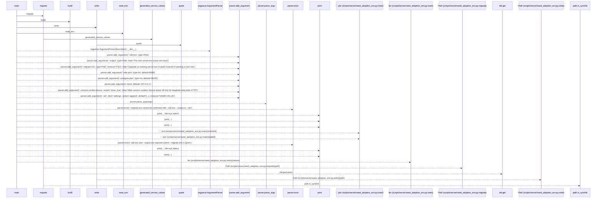
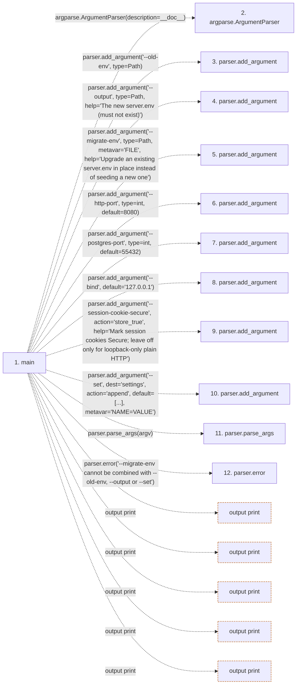

# seed_adoption_env

**Entry point:** `main` (`process`)
**Source:** [seed_adoption_env](../modules/seed_adoption_env.md)
**Modules touched:** [seed_adoption_env](../modules/seed_adoption_env.md)

## Call sequence

> Static overview in presentation order, not runtime execution order. Arrows retain captured callers; representative internal continuations and boundary examples precede repeated helper detail.

<!-- Auto-generated from static call edges. Dashed arrows are external or unresolved calls. Reviewed runtime conditions and side effects belong in Behavior. -->

> Call sequence diagram shows 30 of 92 interactions; 62 omitted to keep the visualization within the 30-interaction and generated-diagram limits, with uncertain identities omitted rather than inferred.

> Captured boundary calls: external 9 of 29 (20 omitted); unresolved 15 of 54 (39 omitted). These counts cover the captured static trace.

Omitted captured detail, grouped by actual caller occurrence and target module:

| Caller | Parent step | Target module | Kind | Omitted interactions |
| --- | --- | --- | --- | --- |
| `scripts/server/seed_adoption_env.py:migrate` | 13 | - | unresolved | 12 |
| `scripts/server/seed_adoption_env.py:migrate` | 13 | - | external | 6 |
| `scripts/server/seed_adoption_env.py:migrate` | 13 | [scripts/server/seed_adoption_env.py](../modules/seed_adoption_env.md) | internal | 2 |
| `scripts/server/seed_adoption_env.py:read_env` | 21 | - | unresolved | 6 |
| `scripts/server/seed_adoption_env.py:read_env` | 21 | - | external | 2 |
| `scripts/server/seed_adoption_env.py:generated_service_values` | 31 | - | unresolved | 5 |
| `scripts/server/seed_adoption_env.py:quote` | 40 | - | external | 2 |
| `scripts/server/seed_adoption_env.py:build` | 58 | - | external | 5 |
> Omission summary shows 8 of 12 groups; 4 further groups are not expanded here. Counts above include all omitted interactions.
> Detailed flow queries retain their own coverage and limits; omitted paths may execute at runtime.

## Data flow

<!-- Auto-generated static analysis. Treat values and boundaries as best-effort hints, not runtime proof. -->

### Analysis coverage

**Effect analysis evaluated.** Flow assembly and source effect analysis are separate; empty observations do not prove an empty handler body.

Source steps: 10; effect analysis evaluated: 10, partial: 0, unavailable: 0. Counts include steps omitted from the displayed trace.

Collector observations for 10 source steps with known totals: observed: 55, emitted: 55, omitted: 0. Unavailable totals are excluded.

### Step data

| Step | Inputs | Reads | Writes | Returns |
|---|---|---|---|---|
| `main` | `argv` | `Path`, `Path`, `Path`, `sys`, `sys` | - | `1`, `0`, `1`, `0` |
| `argparse.ArgumentParser` | - | - | - | - |
| `parser.add_argument` | - | - | - | - |
| `parser.add_argument` | - | - | - | - |
| `parser.add_argument` | - | - | - | - |
| `parser.add_argument` | - | - | - | - |
| `parser.add_argument` | - | - | - | - |
| `parser.add_argument` | - | - | - | - |
| `parser.add_argument` | - | - | - | - |
| `parser.add_argument` | - | - | - | - |
| `parser.parse_args` | - | - | - | - |
| `parser.error` | - | - | - | - |

### Call data

| From | To | Line | Call |
|---|---|---:|---|
| main | argparse.ArgumentParser | 131 | `argparse.ArgumentParser(description=__doc__)` |
| main | parser.add_argument | 132 | `parser.add_argument('--old-env', type=Path)` |
| main | parser.add_argument | 133 | `parser.add_argument('--output', type=Path, help='The new server.env (must not exist)')` |
| main | parser.add_argument | 134 | `parser.add_argument('--migrate-env', type=Path, metavar='FILE', help='Upgrade an existing server.env in place instead of seeding a new one')` |
| main | parser.add_argument | 136 | `parser.add_argument('--http-port', type=int, default=8080)` |
| main | parser.add_argument | 137 | `parser.add_argument('--postgres-port', type=int, default=55432)` |
| main | parser.add_argument | 138 | `parser.add_argument('--bind', default='127.0.0.1')` |
| main | parser.add_argument | 139 | `parser.add_argument('--session-cookie-secure', action='store_true', help='Mark session cookies Secure; leave off only for loopback-only plain HTTP')` |
| main | parser.add_argument | 141 | `parser.add_argument('--set', dest='settings', action='append', default=[...], metavar='NAME=VALUE')` |
| main | parser.parse_args | 142 | `parser.parse_args(argv)` |
| main | parser.error | 145 | `parser.error('--migrate-env cannot be combined with --old-env, --output or --set')` |

### Boundary effects

| Kind | Target | Step | Line |
|---|---|---|---:|
| output | `print` | `main` | 149 |
| output | `print` | `main` | 152 |
| output | `print` | `main` | 154 |
| output | `print` | `main` | 164 |
| output | `print` | `main` | 166 |

### Static analysis gaps

| Kind | Step | Target | Line |
|---|---|---|---:|
| external_call | `main` | `argparse.ArgumentParser` | 131 |
| unresolved_call | `main` | `parser.add_argument` | 132 |
| unresolved_call | `main` | `parser.add_argument` | 133 |
| unresolved_call | `main` | `parser.add_argument` | 134 |
| unresolved_call | `main` | `parser.add_argument` | 136 |
| unresolved_call | `main` | `parser.add_argument` | 137 |
| unresolved_call | `main` | `parser.add_argument` | 138 |
| unresolved_call | `main` | `parser.add_argument` | 139 |
| unresolved_call | `main` | `parser.add_argument` | 141 |
| unresolved_call | `main` | `parser.parse_args` | 142 |
| unresolved_call | `main` | `parser.error` | 145 |
| step_limit | `main` | `first 12 steps` | 0 |

## Behavior

Copies the durable secrets and a short list of operator settings from a running instance's environment file into a new private `server.env`, generates fresh values for identities the self-hosted layout adds, never prints a value and never overwrites an existing file.
