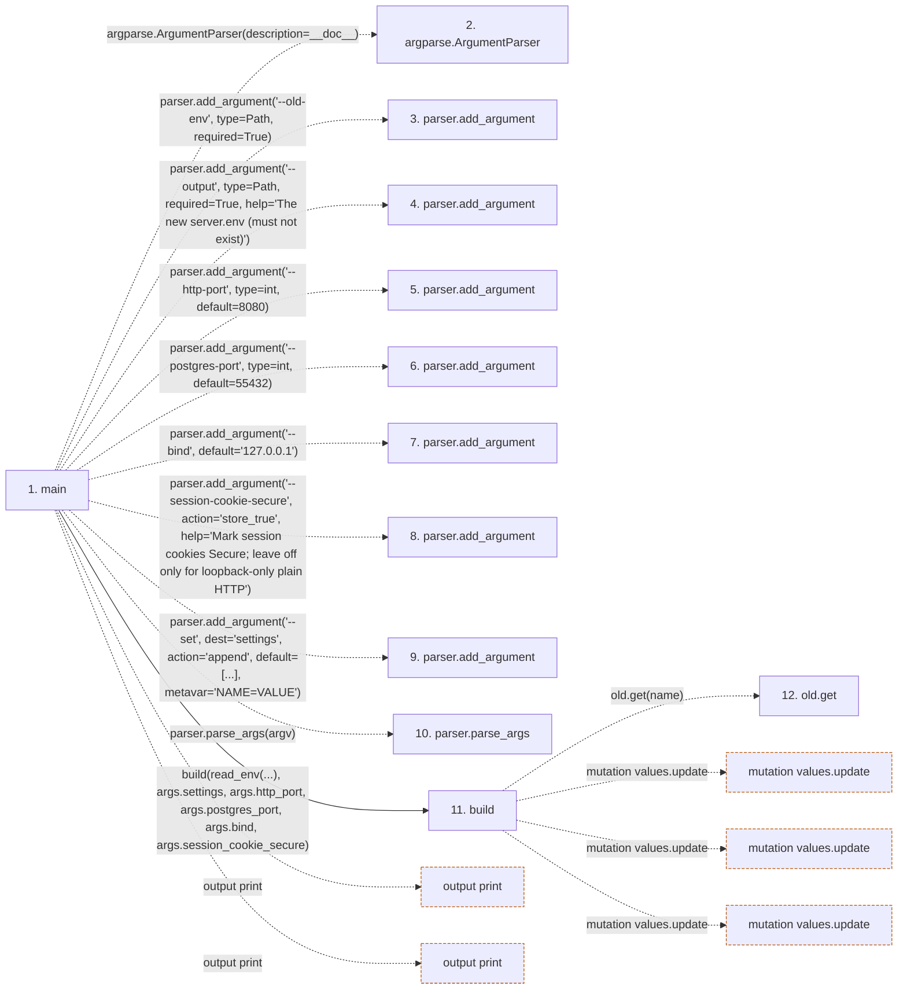

# seed_adoption_env

**Entry point:** `main` (`process`)
**Source:** [seed_adoption_env](../modules/seed_adoption_env.md)
**Modules touched:** [seed_adoption_env](../modules/seed_adoption_env.md)

## Call sequence

> Static overview in presentation order, not runtime execution order. Arrows retain captured callers; representative internal continuations and boundary examples precede repeated helper detail.

```mermaid
sequenceDiagram
    participant p0 as main
    participant p1 as write
    participant p2 as build
    participant p3 as read_env
    participant p4 as quote
    participant p5 as argparse.ArgumentParser
    participant p6 as parser.add_argument
    participant p7 as parser.parse_args
    participant p8 as print
    participant p9 as len (scripts/server/seed_adoption_env.py:main)
    participant p10 as old.get
    participant p11 as Path(…).read_text().splitlines
    participant p12 as Path (scripts/server/seed_adoption_env.py:write)
    participant p13 as ValueError (scripts/server/seed_adoption_env.py:build)
    participant p14 as Path(…).read_text
    participant p15 as path.exists
    participant p16 as ', '.join
    participant p17 as Path (scripts/server/seed_adoption_env.py:read_env)
    participant p18 as FileExistsError
    participant p19 as secrets.token_hex
    participant p20 as line.strip
    participant p21 as path.parent.mkdir
    participant p22 as values.update
    participant p23 as line.startswith
    p0->>p1: write
    p0->>p2: build
    p0->>p3: read_env
    p1->>p4: quote
    p0-->>p5: argparse.ArgumentParser(description=__doc__)
    p0-->>p6: parser.add_argument('--old-env', type=Path, required=True)
    p0-->>p6: parser.add_argument('--output', type=Path, required=True, help='The new server.env (must not exist)')
    p0-->>p6: parser.add_argument('--http-port', type=int, default=8080)
    p0-->>p6: parser.add_argument('--postgres-port', type=int, default=55432)
    p0-->>p6: parser.add_argument('--bind', default='127.0.0.1')
    p0-->>p6: parser.add_argument('--session-cookie-secure', action='store_true', help='Mark session cookies Secure leave off only for loopback-only plain HTTP')
    p0-->>p6: parser.add_argument('--set', dest='settings', action='append', default=[...], metavar='NAME=VALUE')
    p0-->>p7: parser.parse_args(argv)
    p0-->>p8: print(..., file=sys.stderr)
    p0-->>p8: print(...)
    p0-->>p9: len (scripts/server/seed_adoption_env.py:main)(values)
    p2-->>p10: old.get(name)
    p3-->>p11: Path(…).read_text().splitlines
    p1-->>p12: Path (scripts/server/seed_adoption_env.py:write)(path)
    p2-->>p13: ValueError (scripts/server/seed_adoption_env.py:build)(...)
    p3-->>p14: Path(…).read_text
    p1-->>p15: path.exists
    p2-->>p16: ', '.join(missing)
    p3-->>p17: Path (scripts/server/seed_adoption_env.py:read_env)(path)
    p1-->>p18: FileExistsError('Refusing to overwrite an existing environment file')
    p2-->>p19: secrets.token_hex(size)
    p3-->>p20: line.strip
    p1-->>p21: path.parent.mkdir(parents=True, exist_ok=True)
    p2-->>p22: values.update(...)
    p3-->>p23: line.startswith(' ')
```

<!-- Auto-generated from static call edges. Dashed arrows are external or unresolved calls. Reviewed runtime conditions and side effects belong in Behavior. -->

> Call sequence diagram shows 30 of 57 interactions; 27 omitted to keep the visualization within the 30-interaction and generated-diagram limits, with uncertain identities omitted rather than inferred.

> Captured boundary calls: external 9 of 19 (10 omitted); unresolved 17 of 34 (17 omitted). These counts cover the captured static trace.

Omitted captured detail, grouped by actual caller occurrence and target module:

| Caller | Parent step | Target module | Kind | Omitted interactions |
| --- | --- | --- | --- | --- |
| `scripts/server/seed_adoption_env.py:build` | 11 | - | unresolved | 13 |
| `scripts/server/seed_adoption_env.py:build` | 11 | - | external | 3 |
| `scripts/server/seed_adoption_env.py:read_env` | 33 | - | unresolved | 2 |
| `scripts/server/seed_adoption_env.py:read_env` | 33 | - | external | 1 |
| `scripts/server/seed_adoption_env.py:write` | 42 | - | external | 4 |
| `scripts/server/seed_adoption_env.py:write` | 42 | - | unresolved | 2 |
| `scripts/server/seed_adoption_env.py:quote` | 53 | - | external | 2 |
> Detailed flow queries retain their own coverage and limits; omitted paths may execute at runtime.

## Data flow

<!-- Auto-generated static analysis. Treat values and boundaries as best-effort hints, not runtime proof. -->

### Analysis coverage

**Effect analysis evaluated.** Flow assembly and source effect analysis are separate; empty observations do not prove an empty handler body.

Source steps: 5; effect analysis evaluated: 5, partial: 0, unavailable: 0. Counts include steps omitted from the displayed trace.

Collector observations for 5 source steps with known totals: observed: 32, emitted: 32, omitted: 0. Unavailable totals are excluded.

### Step data

| Step | Inputs | Reads | Writes | Returns |
|---|---|---|---|---|
| `main` | `argv` | `Path`, `Path`, `sys` | - | `1`, `0` |
| `argparse.ArgumentParser` | - | - | - | - |
| `parser.add_argument` | - | - | - | - |
| `parser.add_argument` | - | - | - | - |
| `parser.add_argument` | - | - | - | - |
| `parser.add_argument` | - | - | - | - |
| `parser.add_argument` | - | - | - | - |
| `parser.add_argument` | - | - | - | - |
| `parser.add_argument` | - | - | - | - |
| `parser.parse_args` | - | - | - | - |
| `build` | `old`, `settings`, `http_port`, `postgres_port`, `bind`, `session_cookie_secure` | `CARRIED_REQUIRED`, `CARRIED_REQUIRED`, `CARRIED_OPTIONAL`, `SETTABLE`, `SETTABLE` | `values[...]`, `values[...]` | `values` |
| `old.get` | - | - | - | - |

### Call data

| From | To | Line | Call |
|---|---|---:|---|
| main | argparse.ArgumentParser | 91 | `argparse.ArgumentParser(description=__doc__)` |
| main | parser.add_argument | 92 | `parser.add_argument('--old-env', type=Path, required=True)` |
| main | parser.add_argument | 93 | `parser.add_argument('--output', type=Path, required=True, help='The new server.env (must not exist)')` |
| main | parser.add_argument | 94 | `parser.add_argument('--http-port', type=int, default=8080)` |
| main | parser.add_argument | 95 | `parser.add_argument('--postgres-port', type=int, default=55432)` |
| main | parser.add_argument | 96 | `parser.add_argument('--bind', default='127.0.0.1')` |
| main | parser.add_argument | 97 | `parser.add_argument('--session-cookie-secure', action='store_true', help='Mark session cookies Secure; leave off only for loopback-only plain HTTP')` |
| main | parser.add_argument | 99 | `parser.add_argument('--set', dest='settings', action='append', default=[...], metavar='NAME=VALUE')` |
| main | parser.parse_args | 100 | `parser.parse_args(argv)` |
| main | build | 102 | `build(read_env(...), args.settings, args.http_port, args.postgres_port, args.bind, args.session_cookie_secure)` |
| build | old.get | 51 | `old.get(name)` |

### Boundary effects

| Kind | Target | Step | Line |
|---|---|---|---:|
| output | `print` | `main` | 106 |
| output | `print` | `main` | 108 |
| mutation | `values.update` | `build` | 56 |
| mutation | `values.update` | `build` | 57 |
| mutation | `values.update` | `build` | 64 |

### Static analysis gaps

| Kind | Step | Target | Line |
|---|---|---|---:|
| external_call | `main` | `argparse.ArgumentParser` | 91 |
| unresolved_call | `main` | `parser.add_argument` | 92 |
| unresolved_call | `main` | `parser.add_argument` | 93 |
| unresolved_call | `main` | `parser.add_argument` | 94 |
| unresolved_call | `main` | `parser.add_argument` | 95 |
| unresolved_call | `main` | `parser.add_argument` | 96 |
| unresolved_call | `main` | `parser.add_argument` | 97 |
| unresolved_call | `main` | `parser.add_argument` | 99 |
| unresolved_call | `main` | `parser.parse_args` | 100 |
| unresolved_call | `build` | `old.get` | 51 |
| step_limit | `main` | `first 12 steps` | 0 |

## Behavior

Copies the durable secrets and a short list of operator settings from a running instance's environment file into a new private `server.env`, generates fresh values for identities the self-hosted layout adds, never prints a value and never overwrites an existing file.
