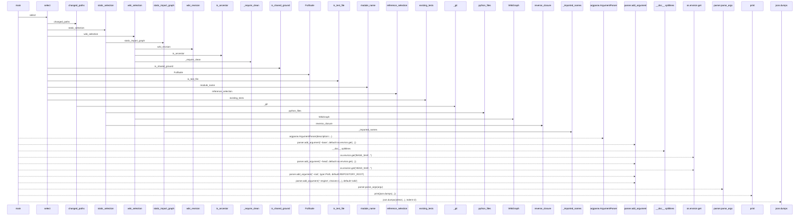
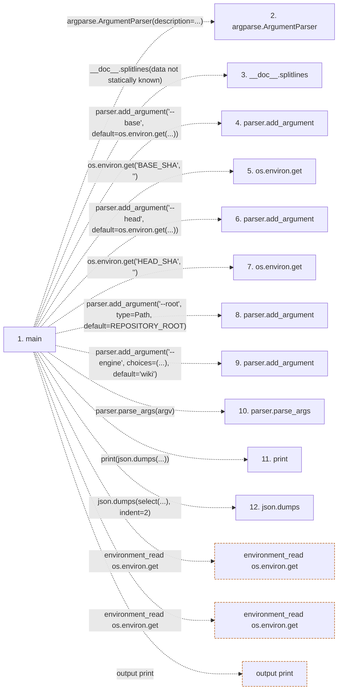

# select_backend_tests

**Entry point:** `main` (`process`)
**Source:** [select_backend_tests](../modules/select_backend_tests.md)
**Modules touched:** [select_backend_tests](../modules/select_backend_tests.md)

## Call sequence

> Static overview in presentation order, not runtime execution order. Arrows retain captured callers; representative internal continuations and boundary examples precede repeated helper detail.

<!-- Auto-generated from static call edges. Dashed arrows are external or unresolved calls. Reviewed runtime conditions and side effects belong in Behavior. -->

> Call sequence diagram shows 30 of 192 interactions; 162 omitted to keep the visualization within the 30-interaction and generated-diagram limits, with uncertain identities omitted rather than inferred.

> Captured boundary calls: external 6 of 62 (56 omitted); unresolved 5 of 88 (83 omitted). These counts cover the captured static trace.

Omitted captured detail, grouped by actual caller occurrence and target module:

| Caller | Parent step | Target module | Kind | Omitted interactions |
| --- | --- | --- | --- | --- |
| `scripts/ci/select_backend_tests.py:changed_paths` | 14 | [scripts/ci/select_backend_tests.py](../modules/select_backend_tests.md) | internal | 3 |
| `scripts/ci/select_backend_tests.py:_git` | 16 | - | external | 2 |
| `scripts/ci/select_backend_tests.py:changed_paths` | 14 | - | unresolved | 3 |
| `scripts/ci/select_backend_tests.py:select` | 13 | - | external | 19 |
| `scripts/ci/select_backend_tests.py:is_shared_ground` | 25 | - | external | 2 |
| `scripts/ci/select_backend_tests.py:is_shared_ground` | 25 | - | unresolved | 5 |
| `scripts/ci/select_backend_tests.py:select` | 13 | - | unresolved | 9 |
| `scripts/ci/select_backend_tests.py:is_test_file` | 37 | - | external | 1 |
> Omission summary shows 8 of 37 groups; 29 further groups are not expanded here. Counts above include all omitted interactions.
> Detailed flow queries retain their own coverage and limits; omitted paths may execute at runtime.

## Data flow

<!-- Auto-generated static analysis. Treat values and boundaries as best-effort hints, not runtime proof. -->

### Analysis coverage

**Effect analysis partially available.** Flow assembly and source effect analysis are separate; empty observations do not prove an empty handler body.

Source steps: 43; effect analysis evaluated: 27, partial: 0, unavailable: 16. Counts include steps omitted from the displayed trace.

Collector observations for 27 source steps with known totals: observed: 154, emitted: 154, omitted: 0. Unavailable totals are excluded.

- Callable record unavailable for one or more source steps; those steps have no represented callable body.
- Effect collector totals unavailable; observed counts cover captured records only.

| Step | Callable record | Effect analysis | Collector totals | Observed | Emitted | Omitted |
|---|---|---|---|---:|---:|---:|
| `main` | `available` | `evaluated` | `available` | `7` | `7` | `0` |
| `argparse.ArgumentParser` | `not_applicable` | `not_applicable` | `not_applicable` | — | — | — |
| `__doc__.splitlines` | `not_applicable` | `not_applicable` | `not_applicable` | — | — | — |
| `parser.add_argument` | `not_applicable` | `not_applicable` | `not_applicable` | — | — | — |
| `os.environ.get` | `not_applicable` | `not_applicable` | `not_applicable` | — | — | — |
| `parser.add_argument` | `not_applicable` | `not_applicable` | `not_applicable` | — | — | — |
| `os.environ.get` | `not_applicable` | `not_applicable` | `not_applicable` | — | — | — |
| `parser.add_argument` | `not_applicable` | `not_applicable` | `not_applicable` | — | — | — |
| `parser.add_argument` | `not_applicable` | `not_applicable` | `not_applicable` | — | — | — |
| `parser.parse_args` | `not_applicable` | `not_applicable` | `not_applicable` | — | — | — |
| `print` | `not_applicable` | `not_applicable` | `not_applicable` | — | — | — |
| `json.dumps` | `not_applicable` | `not_applicable` | `not_applicable` | — | — | — |

### Step data

| Step | Inputs | Reads | Writes | Returns |
|---|---|---|---|---|
| `main` | `argv: list[str] \| None` | `Path`, `REPOSITORY_ROOT` | - | `0` |
| `argparse.ArgumentParser` | - | - | - | - |
| `__doc__.splitlines` | - | - | - | - |
| `parser.add_argument` | - | - | - | - |
| `os.environ.get` | - | - | - | - |
| `parser.add_argument` | - | - | - | - |
| `os.environ.get` | - | - | - | - |
| `parser.add_argument` | - | - | - | - |
| `parser.add_argument` | - | - | - | - |
| `parser.parse_args` | - | - | - | - |
| `print` | - | - | - | - |
| `json.dumps` | - | - | - | - |

### Call data

| From | To | Line | Call |
|---|---|---:|---|
| main | argparse.ArgumentParser | 504 | `argparse.ArgumentParser(description=...)` |
| main | __doc__.splitlines | 504 | `__doc__.splitlines(data not statically known)` |
| main | parser.add_argument | 505 | `parser.add_argument('--base', default=os.environ.get(...))` |
| main | os.environ.get | 505 | `os.environ.get('BASE_SHA', '')` |
| main | parser.add_argument | 506 | `parser.add_argument('--head', default=os.environ.get(...))` |
| main | os.environ.get | 506 | `os.environ.get('HEAD_SHA', '')` |
| main | parser.add_argument | 507 | `parser.add_argument('--root', type=Path, default=REPOSITORY_ROOT)` |
| main | parser.add_argument | 508 | `parser.add_argument('--engine', choices=(...), default='wiki')` |
| main | parser.parse_args | 509 | `parser.parse_args(argv)` |
| main | print | 510 | `print(json.dumps(...))` |
| main | json.dumps | 510 | `json.dumps(select(...), indent=2)` |

### Boundary effects

| Kind | Target | Step | Line |
|---|---|---|---:|
| environment_read | `os.environ.get` | `main` | 505 |
| environment_read | `os.environ.get` | `main` | 506 |
| output | `print` | `main` | 510 |

### Static analysis gaps

| Kind | Step | Target | Line |
|---|---|---|---:|
| external_call | `main` | `argparse.ArgumentParser` | 504 |
| external_call | `main` | `__doc__.splitlines` | 504 |
| unresolved_call | `main` | `parser.add_argument` | 507 |
| unresolved_call | `main` | `parser.add_argument` | 508 |
| unresolved_call | `main` | `parser.parse_args` | 509 |
| step_limit | `main` | `first 12 steps` | 0 |

## Behavior

This flow starts at `main` and is classified as `process`. The generated call and data-flow sections are bounded static projections; runtime conditions and side effects require source-level confirmation.
