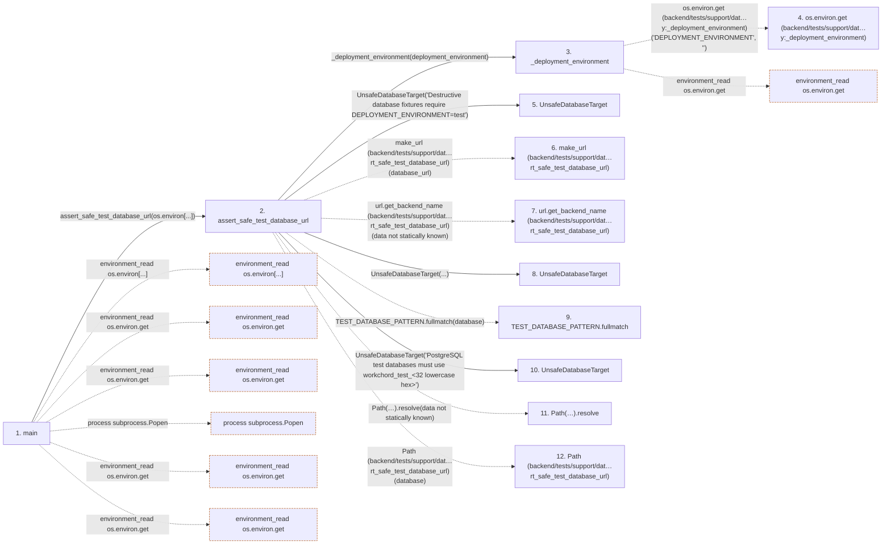

# serve_disposable_api

**Entry point:** `main` (`process`)
**Source:** [serve_disposable_api](../modules/serve_disposable_api.md)
**Modules touched:** [authority](../modules/authority.md), [calendar_service](../modules/calendar_service.md), [commands](../modules/commands.md), [config](../modules/config.md), and 20 more

**Complete modules touched:**

- [authority](../modules/authority.md)
- [calendar_service](../modules/calendar_service.md)
- [commands](../modules/commands.md)
- [config](../modules/config.md)
- [database_config](../modules/database_config.md)
- [github_status_automation_service](../modules/github_status_automation_service.md)
- [identity_service](../modules/identity_service.md)
- [label_service](../modules/label_service.md)
- [maintenance](../modules/maintenance.md)
- [models_calendar](../modules/models_calendar.md)
- [models_github](../modules/models_github.md)
- [models_identity](../modules/models_identity.md)
- [models_label](../modules/models_label.md)
- [models_saved_view](../modules/models_saved_view.md)
- [models_system_settings](../modules/models_system_settings.md)
- [models_template](../modules/models_template.md)
- [project_identity](../modules/project_identity.md)
- [saved_view_service](../modules/saved_view_service.md)
- [serve_disposable_api](../modules/serve_disposable_api.md)
- [support_database](../modules/support_database.md)
- [system_settings_service](../modules/system_settings_service.md)
- [template_service](../modules/template_service.md)
- [upgrade_service](../modules/upgrade_service.md)
- [url_policy](../modules/url_policy.md)

**Related modules:** [app_database](../modules/app_database.md), [app_main](../modules/app_main.md), [config](../modules/config.md), [delivery](../modules/delivery.md), and 5 more

**Complete related modules:**

- [app_database](../modules/app_database.md)
- [app_main](../modules/app_main.md)
- [config](../modules/config.md)
- [delivery](../modules/delivery.md)
- [models_identity](../modules/models_identity.md)
- [models_iteration](../modules/models_iteration.md)
- [models_task](../modules/models_task.md)
- [support_database](../modules/support_database.md)
- [upgrade_service](../modules/upgrade_service.md)

## Call sequence

> Static overview in presentation order, not runtime execution order. Arrows retain captured callers; representative internal continuations and boundary examples precede repeated helper detail.

```mermaid
sequenceDiagram
    participant p0 as main
    participant p1 as assert_safe_test_database_url
    participant p2 as run_alembic_upgrade
    participant p3 as migration_connection
    participant p4 as inspect_database
    participant p5 as _validate_managed_revision
    participant p6 as inspect_project_identity
    participant p7 as run_post_migration_repairs
    participant p8 as _backup_precondition
    participant p9 as _run_schema_upgrade
    participant p10 as database_configuration
    participant p11 as _inspect_database_connection
    participant p12 as require_background_writes_enabled
    participant p13 as _sync_engine
    participant p14 as initialize_control_plane
    participant p15 as commit_or_flush
    participant p16 as backup_sqlite_database
    participant p17 as CalendarService.get_or_create_default
    participant p18 as TemplateService.seed_default_templates
    participant p19 as LabelService.seed_default_labels
    participant p20 as SavedViewService.seed_default_views
    participant p21 as GitHubStatusAutomationService.seed_default_rules
    participant p22 as RuntimeSettingsService.migrate_legacy_email_settings
    participant p23 as parse_database_configuration
    participant p24 as require_identity_writes
    participant p25 as sqlite_database_path
    participant p26 as get_settings
    participant p27 as head_revision
    participant p28 as SavedViewService._normalized_system_definition
    participant p29 as SystemExit
    participant p30 as url.get_backend_name (scripts/ci/serve_disposable_api.py:main)
    p0->>p1: assert_safe_test_database_url
    p0->>p2: run_alembic_upgrade
    p2->>p3: migration_connection
    p2->>p4: inspect_database
    p2->>p5: _validate_managed_revision
    p2->>p6: inspect_project_identity
    p2->>p7: run_post_migration_repairs
    p2->>p8: _backup_precondition
    p2->>p9: _run_schema_upgrade
    p3->>p10: database_configuration
    p4->>p11: _inspect_database_connection
    p7->>p12: require_background_writes_enabled
    p3->>p13: _sync_engine
    p7->>p14: initialize_control_plane
    p7->>p15: commit_or_flush
    p8->>p16: backup_sqlite_database
    p7->>p17: CalendarService.get_or_create_default
    p7->>p18: TemplateService.seed_default_templates
    p7->>p19: LabelService.seed_default_labels
    p7->>p20: SavedViewService.seed_default_views
    p7->>p21: GitHubStatusAutomationService.seed_default_rules
    p7->>p22: RuntimeSettingsService.migrate_legacy_email_settings
    p10->>p23: parse_database_configuration
    p14->>p24: require_identity_writes
    p16->>p25: sqlite_database_path
    p10->>p26: get_settings
    p11->>p27: head_revision
    p20->>p28: SavedViewService._normalized_system_definition
    p0-->>p29: SystemExit('The browser harness requires its own temporary SQLite database')
    p0-->>p30: url.get_backend_name (scripts/ci/serve_disposable_api.py:main)
```

<!-- Auto-generated from static call edges. Dashed arrows are external or unresolved calls. Reviewed runtime conditions and side effects belong in Behavior. -->

> Call sequence diagram shows 30 of 583 interactions; 553 omitted to keep the visualization within the 30-interaction and generated-diagram limits, with uncertain identities omitted rather than inferred.

> Captured boundary calls: external 1 of 170 (169 omitted); unresolved 1 of 212 (211 omitted). These counts cover the captured static trace.

Omitted captured detail, grouped by actual caller occurrence and target module:

| Caller | Parent step | Target module | Kind | Omitted interactions |
| --- | --- | --- | --- | --- |
| `backend/tests/support/database.py:assert_safe_test_database_url` | 2 | [backend/tests/support/database.py](../modules/support_database.md) | internal | 7 |
| `backend/tests/support/database.py:_deployment_environment` | 3 | - | external | 1 |
| `backend/tests/support/database.py:assert_safe_test_database_url` | 2 | - | external | 4 |
| `backend/tests/support/database.py:assert_safe_test_database_url` | 2 | - | unresolved | 6 |
| `backend/app/database_config.py:parse_database_configuration` | 26 | - | external | 25 |
| `backend/app/database_config.py:parse_database_configuration` | 26 | [backend/app/database_config.py](../modules/database_config.md) | internal | 45 |
| `backend/app/database_config.py:_settings_value` | 29 | - | external | 1 |
| `backend/app/database_config.py:_settings_value` | 29 | [backend/app/database_config.py](../modules/database_config.md) | internal | 1 |
> Omission summary shows 8 of 137 groups; 129 further groups are not expanded here. Counts above include all omitted interactions.
> Detailed flow queries retain their own coverage and limits; omitted paths may execute at runtime.

> Trace truncated at the depth limit; deeper calls are omitted.

## Data flow

<!-- Auto-generated static analysis. Treat values and boundaries as best-effort hints, not runtime proof. -->

### Analysis coverage

**Effect analysis partially available.** Flow assembly and source effect analysis are separate; empty observations do not prove an empty handler body.

Source steps: 202; effect analysis evaluated: 110, partial: 1, unavailable: 91. Counts include steps omitted from the displayed trace.

Collector observations for 111 source steps with known totals: observed: 438, emitted: 432, omitted: 6. Unavailable totals are excluded.

- Callable record unavailable for one or more source steps; those steps have no represented callable body.
- Effect collector omitted observations before flow assembly; displayed effects are partial.
- Effect collector totals unavailable; observed counts cover captured records only.

| Step | Callable record | Effect analysis | Collector totals | Observed | Emitted | Omitted |
|---|---|---|---|---:|---:|---:|
| `main` | `available` | `evaluated` | `available` | `7` | `7` | `0` |
| `assert_safe_test_database_url` | `available` | `evaluated` | `available` | `9` | `9` | `0` |
| `_deployment_environment` | `available` | `evaluated` | `available` | `3` | `3` | `0` |
| `os.environ.get (backend/tests/support/dat…y:_deployment_environment)` | `not_applicable` | `not_applicable` | `not_applicable` | — | — | — |
| `UnsafeDatabaseTarget` | `unavailable` | `unavailable` | `unavailable` | — | — | — |
| `make_url (backend/tests/support/dat…rt_safe_test_database_url)` | `not_applicable` | `not_applicable` | `not_applicable` | — | — | — |
| `url.get_backend_name (backend/tests/support/dat…rt_safe_test_database_url)` | `not_applicable` | `not_applicable` | `not_applicable` | — | — | — |
| `UnsafeDatabaseTarget` | `unavailable` | `unavailable` | `unavailable` | — | — | — |
| `TEST_DATABASE_PATTERN.fullmatch` | `not_applicable` | `not_applicable` | `not_applicable` | — | — | — |
| `UnsafeDatabaseTarget` | `unavailable` | `unavailable` | `unavailable` | — | — | — |
| `Path(…).resolve` | `not_applicable` | `not_applicable` | `not_applicable` | — | — | — |
| `Path (backend/tests/support/dat…rt_safe_test_database_url)` | `not_applicable` | `not_applicable` | `not_applicable` | — | — | — |

### Step data

| Step | Inputs | Reads | Writes | Returns |
|---|---|---|---|---|
| `main` | - | `os` | - | - |
| `assert_safe_test_database_url` | `database_url: str \| URL`, `deployment_environment: str \| None`, `allowed_postgres_hosts: frozenset[str]`, `allowed_sqlite_root: Path \| None` | `TEST_DATABASE_PREFIX`, `TEST_DATABASE_PREFIX` | - | `url`, `url`, `url` |
| `_deployment_environment` | `explicit: str \| None` | - | - | `...` |
| `os.environ.get (backend/tests/support/dat…y:_deployment_environment)` | - | - | - | - |
| `UnsafeDatabaseTarget` | - | - | - | - |
| `make_url (backend/tests/support/dat…rt_safe_test_database_url)` | - | - | - | - |
| `url.get_backend_name (backend/tests/support/dat…rt_safe_test_database_url)` | - | - | - | - |
| `UnsafeDatabaseTarget` | - | - | - | - |
| `TEST_DATABASE_PATTERN.fullmatch` | - | - | - | - |
| `UnsafeDatabaseTarget` | - | - | - | - |
| `Path(…).resolve` | - | - | - | - |
| `Path (backend/tests/support/dat…rt_safe_test_database_url)` | - | - | - | - |

### Call data

| From | To | Line | Call |
|---|---|---:|---|
| main | assert_safe_test_database_url | 14 | `assert_safe_test_database_url(os.environ[...])` |
| assert_safe_test_database_url | _deployment_environment | 49 | `_deployment_environment(deployment_environment)` |
| _deployment_environment | os.environ.get (backend/tests/support/dat…y:_deployment_environment) | 32 | `os.environ.get('DEPLOYMENT_ENVIRONMENT', '')` |
| assert_safe_test_database_url | UnsafeDatabaseTarget | 50 | `UnsafeDatabaseTarget('Destructive database fixtures require DEPLOYMENT_ENVIRONMENT=test')` |
| assert_safe_test_database_url | make_url (backend/tests/support/dat…rt_safe_test_database_url) | 54 | `make_url(database_url)` |
| assert_safe_test_database_url | url.get_backend_name (backend/tests/support/dat…rt_safe_test_database_url) | 55 | `url.get_backend_name(data not statically known)` |
| assert_safe_test_database_url | UnsafeDatabaseTarget | 60 | `UnsafeDatabaseTarget(...)` |
| assert_safe_test_database_url | TEST_DATABASE_PATTERN.fullmatch | 63 | `TEST_DATABASE_PATTERN.fullmatch(database)` |
| assert_safe_test_database_url | UnsafeDatabaseTarget | 64 | `UnsafeDatabaseTarget('PostgreSQL test databases must use workchord_test_<32 lowercase hex>')` |
| assert_safe_test_database_url | Path(…).resolve | 72 | `Path(database).resolve(data not statically known)` |
| assert_safe_test_database_url | Path (backend/tests/support/dat…rt_safe_test_database_url) | 72 | `Path(database)` |

### Boundary effects

| Kind | Target | Step | Line |
|---|---|---|---:|
| environment_read | `os.environ[...]` | `main` | 14 |
| environment_read | `os.environ.get` | `main` | 69 |
| environment_read | `os.environ.get` | `main` | 121 |
| process | `subprocess.Popen` | `main` | 125 |
| environment_read | `os.environ.get` | `main` | 127 |
| environment_read | `os.environ.get` | `main` | 132 |
| environment_read | `os.environ.get` | `_deployment_environment` | 32 |

### Static analysis gaps

| Kind | Step | Target | Line |
|---|---|---|---:|
| external_call | `assert_safe_test_database_url` | `make_url` | 54 |
| unresolved_call | `assert_safe_test_database_url` | `url.get_backend_name` | 55 |
| unresolved_call | `assert_safe_test_database_url` | `TEST_DATABASE_PATTERN.fullmatch` | 63 |
| unresolved_call | `assert_safe_test_database_url` | `Path(database).resolve` | 72 |
| step_limit | `main` | `first 12 steps` | 0 |
| truncated_flow | `main` | `depth limit` | 0 |

## Behavior

The process validates the configured URL against the existing temporary-database safety fence before running migrations or seeding records. It permits only SQLite for this browser fixture. Managed fixture seeding adds canonical human ownership and explicit identity/profile/project links. When a nonce is configured, responses expose it and a single expiring override can simulate task-read failures. The real web lifespan then validates the schema and serves the application. Running the production app directly is a separate operation.
