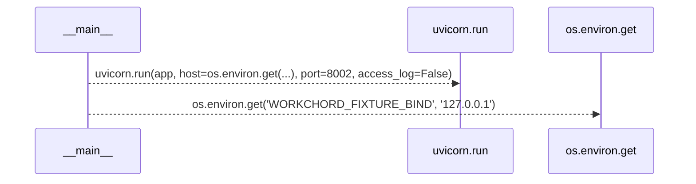
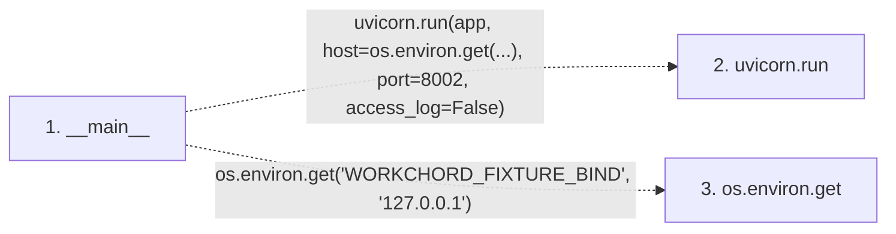

# serve_disposable_oidc

**Entry point:** `__main__` (`process`)
**Source:** [serve_disposable_oidc](../modules/serve_disposable_oidc.md)
**Modules touched:** [serve_disposable_oidc](../modules/serve_disposable_oidc.md)

**Related modules:** [support_database](../modules/support_database.md)

## Call sequence

> Static overview in presentation order, not runtime execution order. Arrows retain captured callers; representative internal continuations and boundary examples precede repeated helper detail.

<!-- Auto-generated from static call edges. Dashed arrows are external or unresolved calls. Reviewed runtime conditions and side effects belong in Behavior. -->

> Call sequence diagram shows 2 of 2 interactions; 0 omitted to keep the visualization within the 30-interaction and generated-diagram limits, with uncertain identities omitted rather than inferred.

> Captured boundary calls: external 2 of 2 (0 omitted); unresolved 0 of 0 (0 omitted). These counts cover the captured static trace.
> Detailed flow queries retain their own coverage and limits; omitted paths may execute at runtime.

## Data flow

<!-- Auto-generated static analysis. Treat values and boundaries as best-effort hints, not runtime proof. -->

### Analysis coverage

**Effect analysis unavailable.** Flow assembly and source effect analysis are separate; empty observations do not prove an empty handler body.

Source steps: 1; effect analysis evaluated: 0, partial: 0, unavailable: 1. Counts include steps omitted from the displayed trace.

- Callable record unavailable for one or more source steps; those steps have no represented callable body.
- Effect collector totals unavailable; observed counts cover captured records only.

| Step | Callable record | Effect analysis | Collector totals | Observed | Emitted | Omitted |
|---|---|---|---|---:|---:|---:|
| `__main__` | `unavailable` | `unavailable` | `unavailable` | — | — | — |
| `uvicorn.run` | `not_applicable` | `not_applicable` | `not_applicable` | — | — | — |
| `os.environ.get` | `not_applicable` | `not_applicable` | `not_applicable` | — | — | — |

### Step data

| Step | Inputs | Reads | Writes | Returns |
|---|---|---|---|---|
| `__main__` | - | - | - | - |
| `uvicorn.run` | - | - | - | - |
| `os.environ.get` | - | - | - | - |

### Call data

| From | To | Line | Call |
|---|---|---:|---|
| __main__ | uvicorn.run | 91 | `uvicorn.run(app, host=os.environ.get(...), port=8002, access_log=False)` |
| __main__ | os.environ.get | 91 | `os.environ.get('WORKCHORD_FIXTURE_BIND', '127.0.0.1')` |

### Boundary effects

*No boundary-effect observations were captured in this static trace.*

### Static analysis gaps

| Kind | Step | Target | Line |
|---|---|---|---:|
| external_call | `__main__` | `uvicorn.run` | 91 |
| external_call | `__main__` | `os.environ.get` | 91 |

## Behavior

This flow starts at `__main__` and is classified as `process`. The generated call and data-flow sections are bounded static projections; runtime conditions and side effects require source-level confirmation.
