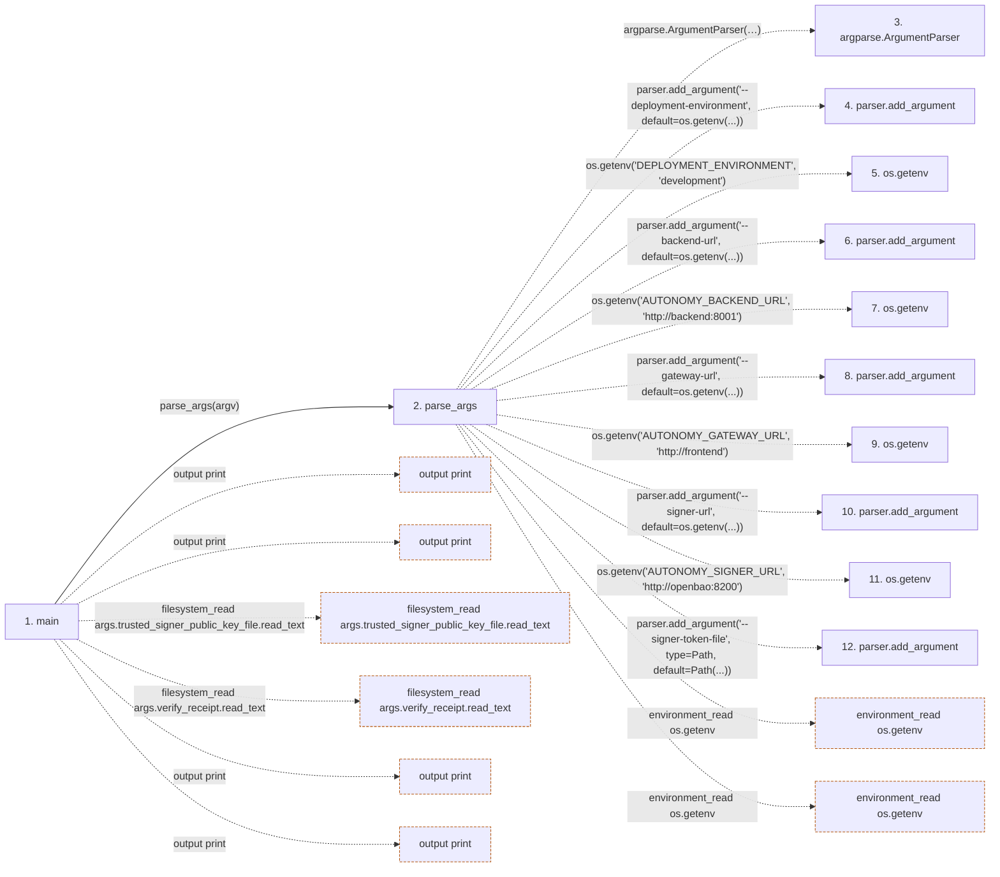

# server_acceptance

**Entry point:** `main` (`process`)
**Source:** [cli_server_acceptance](../modules/cli_server_acceptance.md)
**Modules touched:** [acceptance_artifacts](../modules/acceptance_artifacts.md), [autonomy_canonical](../modules/autonomy_canonical.md), [autonomy_server_acceptance](../modules/autonomy_server_acceptance.md), and 3 more

**Complete modules touched:**

- [acceptance_artifacts](../modules/acceptance_artifacts.md)
- [autonomy_canonical](../modules/autonomy_canonical.md)
- [autonomy_server_acceptance](../modules/autonomy_server_acceptance.md)
- [build_identity](../modules/build_identity.md)
- [cli_server_acceptance](../modules/cli_server_acceptance.md)
- [loader](../modules/loader.md)

**Related modules:** [acceptance_artifacts](../modules/acceptance_artifacts.md), [autonomy_server_acceptance](../modules/autonomy_server_acceptance.md), [build_identity](../modules/build_identity.md)

## Call sequence

> Static overview in presentation order, not runtime execution order. Arrows retain captured callers; representative internal continuations and boundary examples precede repeated helper detail.

```mermaid
sequenceDiagram
    participant p0 as main
    participant p1 as verify_exported_artifacts
    participant p2 as _required
    participant p3 as run_server_acceptance
    participant p4 as build_blocked_result
    participant p5 as parse_args
    participant p6 as load_backend_build_identity
    participant p7 as verify_receipt_trusted_signer
    participant p8 as verify_receipt_current_build
    participant p9 as ServerAcceptanceConfig
    participant p10 as ServerAcceptanceError
    participant p11 as _emit
    participant p12 as _render
    participant p13 as sha256_hex
    participant p14 as _probe_application
    participant p15 as load_postgresql_contract_bundle
    participant p16 as S3ObjectLockClient.probe_ready
    participant p17 as ValkeyCasClient.probe
    participant p18 as OpenBaoTransitClient.probe
    participant p19 as OpenBaoTransitClient.sign_and_verify
    participant p20 as _signed_report_payload
    participant p21 as S3ObjectLockClient.store_locked
    participant p22 as _receipt
    participant p23 as _pin
    participant p24 as OpenBaoTransitClient._request
    participant p25 as S3ObjectLockClient._request
    participant p26 as _public_urls
    participant p27 as canonical_json_bytes
    participant p28 as _valkey_command
    participant p29 as print (backend/app/cli/server_acceptance.py:main)
    participant p30 as args.trusted_signer_public_key_file.read_text
    p0->>p1: verify_exported_artifacts
    p0->>p2: _required
    p0->>p3: run_server_acceptance
    p0->>p4: build_blocked_result
    p0->>p5: parse_args
    p0->>p6: load_backend_build_identity
    p0->>p7: verify_receipt_trusted_signer
    p0->>p8: verify_receipt_current_build
    p0->>p9: ServerAcceptanceConfig
    p0->>p10: ServerAcceptanceError
    p0->>p11: _emit
    p0->>p12: _render
    p3->>p13: sha256_hex
    p3->>p14: _probe_application
    p3->>p15: load_postgresql_contract_bundle
    p3->>p16: S3ObjectLockClient.probe_ready
    p3->>p17: ValkeyCasClient.probe
    p3->>p18: OpenBaoTransitClient.probe
    p3->>p19: OpenBaoTransitClient.sign_and_verify
    p3->>p20: _signed_report_payload
    p3->>p21: S3ObjectLockClient.store_locked
    p1->>p22: _receipt
    p1->>p23: _pin
    p18->>p24: OpenBaoTransitClient._request
    p21->>p25: S3ObjectLockClient._request
    p22->>p26: _public_urls
    p13->>p27: canonical_json_bytes
    p17->>p28: _valkey_command
    p0-->>p29: print (backend/app/cli/server_acceptance.py:main)(json.dumps(...))
    p0-->>p30: args.trusted_signer_public_key_file.read_text(encoding='utf-8')
```

<!-- Auto-generated from static call edges. Dashed arrows are external or unresolved calls. Reviewed runtime conditions and side effects belong in Behavior. -->

> Call sequence diagram shows 30 of 630 interactions; 600 omitted to keep the visualization within the 30-interaction and generated-diagram limits, with uncertain identities omitted rather than inferred.

> Captured boundary calls: external 1 of 230 (229 omitted); unresolved 1 of 211 (210 omitted). These counts cover the captured static trace.

Omitted captured detail, grouped by actual caller occurrence and target module:

| Caller | Parent step | Target module | Kind | Omitted interactions |
| --- | --- | --- | --- | --- |
| `backend/app/cli/server_acceptance.py:parse_args` | 2 | - | external | 20 |
| `backend/app/cli/server_acceptance.py:parse_args` | 2 | - | unresolved | 20 |
| `backend/app/autonomy/acceptance_artifacts.py:verify_exported_artifacts` | 43 | - | unresolved | 16 |
| `backend/app/autonomy/acceptance_artifacts.py:verify_exported_artifacts` | 43 | - | external | 27 |
| `backend/app/autonomy/acceptance_artifacts.py:verify_exported_artifacts` | 43 | [backend/app/autonomy/acceptance_artifacts.py](../modules/acceptance_artifacts.md) | internal | 7 |
| `backend/app/autonomy/acceptance_artifacts.py:_json` | 49 | - | external | 1 |
| `backend/app/autonomy/acceptance_artifacts.py:_read` | 51 | - | external | 7 |
| `backend/app/autonomy/acceptance_artifacts.py:_read` | 51 | - | unresolved | 2 |
> Omission summary shows 8 of 102 groups; 94 further groups are not expanded here. Counts above include all omitted interactions.
> Detailed flow queries retain their own coverage and limits; omitted paths may execute at runtime.

## Data flow

<!-- Auto-generated static analysis. Treat values and boundaries as best-effort hints, not runtime proof. -->

### Analysis coverage

**Effect analysis partially available.** Flow assembly and source effect analysis are separate; empty observations do not prove an empty handler body.

Source steps: 190; effect analysis evaluated: 103, partial: 2, unavailable: 85. Counts include steps omitted from the displayed trace.

Collector observations for 105 source steps with known totals: observed: 513, emitted: 501, omitted: 12. Unavailable totals are excluded.

- Callable record unavailable for one or more source steps; those steps have no represented callable body.
- Effect collector omitted observations before flow assembly; displayed effects are partial.
- Effect collector totals unavailable; observed counts cover captured records only.

| Step | Callable record | Effect analysis | Collector totals | Observed | Emitted | Omitted |
|---|---|---|---|---:|---:|---:|
| `main` | `available` | `evaluated` | `available` | `16` | `16` | `0` |
| `parse_args` | `available` | `partial` | `available` | `22` | `15` | `7` |
| `argparse.ArgumentParser` | `not_applicable` | `not_applicable` | `not_applicable` | — | — | — |
| `parser.add_argument` | `not_applicable` | `not_applicable` | `not_applicable` | — | — | — |
| `os.getenv` | `not_applicable` | `not_applicable` | `not_applicable` | — | — | — |
| `parser.add_argument` | `not_applicable` | `not_applicable` | `not_applicable` | — | — | — |
| `os.getenv` | `not_applicable` | `not_applicable` | `not_applicable` | — | — | — |
| `parser.add_argument` | `not_applicable` | `not_applicable` | `not_applicable` | — | — | — |
| `os.getenv` | `not_applicable` | `not_applicable` | `not_applicable` | — | — | — |
| `parser.add_argument` | `not_applicable` | `not_applicable` | `not_applicable` | — | — | — |
| `os.getenv` | `not_applicable` | `not_applicable` | `not_applicable` | — | — | — |
| `parser.add_argument` | `not_applicable` | `not_applicable` | `not_applicable` | — | — | — |

### Step data

| Step | Inputs | Reads | Writes | Returns |
|---|---|---|---|---|
| `main` | `argv: list[str] \| None` | `ServerAcceptanceError` | - | `2`, `0`, `2`, `0`, `2`, `2`, `2`, `0` |
| `parse_args` | `argv: list[str] \| None` | `Path`, `Path`, `Path`, `Path`, `Path` | - | `parser.parse_args(...)` |
| `argparse.ArgumentParser` | - | - | - | - |
| `parser.add_argument` | - | - | - | - |
| `os.getenv` | - | - | - | - |
| `parser.add_argument` | - | - | - | - |
| `os.getenv` | - | - | - | - |
| `parser.add_argument` | - | - | - | - |
| `os.getenv` | - | - | - | - |
| `parser.add_argument` | - | - | - | - |
| `os.getenv` | - | - | - | - |
| `parser.add_argument` | - | - | - | - |

### Call data

| From | To | Line | Call |
|---|---|---:|---|
| main | parse_args | 173 | `parse_args(argv)` |
| parse_args | argparse.ArgumentParser | 24 | `argparse.ArgumentParser(description='Verify one exact self-hosted WorkChord checkout against its container-backed PostgreSQL, signer, locked evidence, and CAS services. A pass is never production autonomy evidence.')` |
| parse_args | parser.add_argument | 31 | `parser.add_argument('--deployment-environment', default=os.getenv(...))` |
| parse_args | os.getenv | 33 | `os.getenv('DEPLOYMENT_ENVIRONMENT', 'development')` |
| parse_args | parser.add_argument | 35 | `parser.add_argument('--backend-url', default=os.getenv(...))` |
| parse_args | os.getenv | 37 | `os.getenv('AUTONOMY_BACKEND_URL', 'http://backend:8001')` |
| parse_args | parser.add_argument | 39 | `parser.add_argument('--gateway-url', default=os.getenv(...))` |
| parse_args | os.getenv | 41 | `os.getenv('AUTONOMY_GATEWAY_URL', 'http://frontend')` |
| parse_args | parser.add_argument | 43 | `parser.add_argument('--signer-url', default=os.getenv(...))` |
| parse_args | os.getenv | 45 | `os.getenv('AUTONOMY_SIGNER_URL', 'http://openbao:8200')` |
| parse_args | parser.add_argument | 47 | `parser.add_argument('--signer-token-file', type=Path, default=Path(...))` |

### Boundary effects

| Kind | Target | Step | Line |
|---|---|---|---:|
| output | `print` | `main` | 180 |
| output | `print` | `main` | 182 |
| filesystem_read | `args.trusted_signer_public_key_file.read_text` | `main` | 187 |
| filesystem_read | `args.verify_receipt.read_text` | `main` | 190 |
| output | `print` | `main` | 198 |
| output | `print` | `main` | 209 |
| environment_read | `os.getenv` | `parse_args` | 33 |
| environment_read | `os.getenv` | `parse_args` | 37 |

### Static analysis gaps

| Kind | Step | Target | Line |
|---|---|---|---:|
| external_call | `parse_args` | `argparse.ArgumentParser` | 24 |
| unresolved_call | `parse_args` | `parser.add_argument` | 31 |
| unresolved_call | `parse_args` | `parser.add_argument` | 35 |
| unresolved_call | `parse_args` | `parser.add_argument` | 39 |
| external_call | `parse_args` | `os.getenv` | 41 |
| unresolved_call | `parse_args` | `parser.add_argument` | 43 |
| external_call | `parse_args` | `os.getenv` | 45 |
| unresolved_call | `parse_args` | `parser.add_argument` | 47 |
| step_limit | `main` | `first 12 steps` | 0 |

## Behavior

This flow starts at `main` and is classified as `process`. The generated call and data-flow sections are bounded static projections; runtime conditions and side effects require source-level confirmation.
