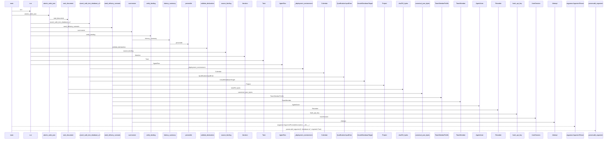
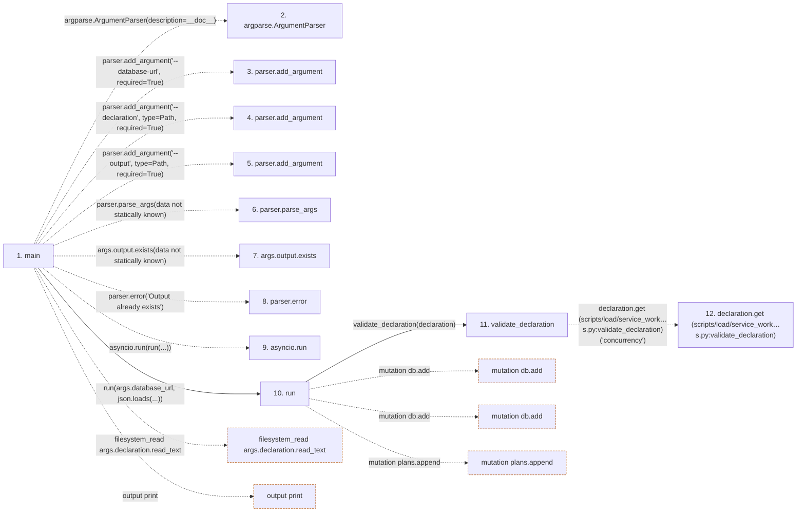

# service_worksets

**Entry point:** `main` (`process`)
**Source:** [service_worksets](../modules/service_worksets.md)
**Modules touched:** [agent_service](../modules/agent_service.md), [delivery](../modules/delivery.md), [load_common](../modules/load_common.md), [local_baseline](../modules/local_baseline.md), and 12 more

**Complete modules touched:**

- [agent_service](../modules/agent_service.md)
- [delivery](../modules/delivery.md)
- [load_common](../modules/load_common.md)
- [local_baseline](../modules/local_baseline.md)
- [models_agent](../modules/models_agent.md)
- [models_calendar](../modules/models_calendar.md)
- [models_iteration](../modules/models_iteration.md)
- [models_project](../modules/models_project.md)
- [models_task](../modules/models_task.md)
- [result](../modules/result.md)
- [run](../modules/run.md)
- [service_worksets](../modules/service_worksets.md)
- [source_binding](../modules/source_binding.md)
- [support_database](../modules/support_database.md)
- [team_member](../modules/team_member.md)
- [user_session](../modules/user_session.md)

**Related modules:** [app_database](../modules/app_database.md), [authority](../modules/authority.md), [capacity_service](../modules/capacity_service.md), [delivery](../modules/delivery.md), and 12 more

**Complete related modules:**

- [app_database](../modules/app_database.md)
- [authority](../modules/authority.md)
- [capacity_service](../modules/capacity_service.md)
- [delivery](../modules/delivery.md)
- [delivery_metrics_service](../modules/delivery_metrics_service.md)
- [load_common](../modules/load_common.md)
- [local_baseline](../modules/local_baseline.md)
- [models_agent](../modules/models_agent.md)
- [models_iteration](../modules/models_iteration.md)
- [models_task](../modules/models_task.md)
- [project_service](../modules/project_service.md)
- [query_limits](../modules/query_limits.md)
- [source_binding](../modules/source_binding.md)
- [support_database](../modules/support_database.md)
- [task_detail_service](../modules/task_detail_service.md)
- [task_service](../modules/task_service.md)

## Call sequence

> Static overview in presentation order, not runtime execution order. Arrows retain captured callers; representative internal continuations and boundary examples precede repeated helper detail.

<!-- Auto-generated from static call edges. Dashed arrows are external or unresolved calls. Reviewed runtime conditions and side effects belong in Behavior. -->

> Call sequence diagram shows 30 of 266 interactions; 236 omitted to keep the visualization within the 30-interaction and generated-diagram limits, with uncertain identities omitted rather than inferred.

> Captured boundary calls: external 1 of 105 (104 omitted); unresolved 1 of 108 (107 omitted). These counts cover the captured static trace.

Omitted captured detail, grouped by actual caller occurrence and target module:

| Caller | Parent step | Target module | Kind | Omitted interactions |
| --- | --- | --- | --- | --- |
| `scripts/load/service_worksets.py:main` | 1 | - | unresolved | 6 |
| `scripts/load/service_worksets.py:main` | 1 | - | external | 3 |
| `scripts/load/service_worksets.py:validate_declaration` | 11 | - | unresolved | 4 |
| `scripts/load/service_worksets.py:validate_declaration` | 11 | - | external | 2 |
| `scripts/load/source_binding.py:source_binding` | 18 | - | unresolved | 9 |
| `scripts/load/source_binding.py:source_binding` | 18 | - | external | 9 |
| `backend/tests/support/database.py:_deployment_environment` | 38 | - | external | 1 |
| `backend/tests/support/database.py:assert_safe_test_database_url` | 37 | - | external | 4 |
> Omission summary shows 8 of 38 groups; 30 further groups are not expanded here. Counts above include all omitted interactions.
> Detailed flow queries retain their own coverage and limits; omitted paths may execute at runtime.

## Data flow

<!-- Auto-generated static analysis. Treat values and boundaries as best-effort hints, not runtime proof. -->

### Analysis coverage

**Effect analysis partially available.** Flow assembly and source effect analysis are separate; empty observations do not prove an empty handler body.

Source steps: 54; effect analysis evaluated: 20, partial: 0, unavailable: 34. Counts include steps omitted from the displayed trace.

Collector observations for 20 source steps with known totals: observed: 85, emitted: 85, omitted: 0. Unavailable totals are excluded.

- Callable record unavailable for one or more source steps; those steps have no represented callable body.
- Effect collector totals unavailable; observed counts cover captured records only.

| Step | Callable record | Effect analysis | Collector totals | Observed | Emitted | Omitted |
|---|---|---|---|---:|---:|---:|
| `main` | `available` | `evaluated` | `available` | `5` | `5` | `0` |
| `argparse.ArgumentParser` | `not_applicable` | `not_applicable` | `not_applicable` | — | — | — |
| `parser.add_argument` | `not_applicable` | `not_applicable` | `not_applicable` | — | — | — |
| `parser.add_argument` | `not_applicable` | `not_applicable` | `not_applicable` | — | — | — |
| `parser.add_argument` | `not_applicable` | `not_applicable` | `not_applicable` | — | — | — |
| `parser.parse_args` | `not_applicable` | `not_applicable` | `not_applicable` | — | — | — |
| `args.output.exists` | `not_applicable` | `not_applicable` | `not_applicable` | — | — | — |
| `parser.error` | `not_applicable` | `not_applicable` | `not_applicable` | — | — | — |
| `asyncio.run` | `not_applicable` | `not_applicable` | `not_applicable` | — | — | — |
| `run` | `available` | `evaluated` | `available` | `16` | `16` | `0` |
| `validate_declaration` | `available` | `evaluated` | `available` | `1` | `1` | `0` |
| `declaration.get (scripts/load/service_work…s.py:validate_declaration)` | `not_applicable` | `not_applicable` | `not_applicable` | — | — | — |

### Step data

| Step | Inputs | Reads | Writes | Returns |
|---|---|---|---|---|
| `main` | - | `Path`, `Path` | - | `...` |
| `argparse.ArgumentParser` | - | - | - | - |
| `parser.add_argument` | - | - | - | - |
| `parser.add_argument` | - | - | - | - |
| `parser.add_argument` | - | - | - | - |
| `parser.parse_args` | - | - | - | - |
| `args.output.exists` | - | - | - | - |
| `parser.error` | - | - | - | - |
| `asyncio.run` | - | - | - | - |
| `run` | `url`, `declaration` | `Base`, `Task`, `Task`, `Task` | `task.title`, `result[...]`, `result[...]`, `result[...]`, `result[...]`, `result[...]` | `result` |
| `validate_declaration` | `declaration` | - | - | - |
| `declaration.get (scripts/load/service_work…s.py:validate_declaration)` | - | - | - | - |

### Call data

| From | To | Line | Call |
|---|---|---:|---|
| main | argparse.ArgumentParser | 122 | `argparse.ArgumentParser(description=__doc__)` |
| main | parser.add_argument | 123 | `parser.add_argument('--database-url', required=True)` |
| main | parser.add_argument | 123 | `parser.add_argument('--declaration', type=Path, required=True)` |
| main | parser.add_argument | 124 | `parser.add_argument('--output', type=Path, required=True)` |
| main | parser.parse_args | 124 | `parser.parse_args(data not statically known)` |
| main | args.output.exists | 125 | `args.output.exists(data not statically known)` |
| main | parser.error | 125 | `parser.error('Output already exists')` |
| main | asyncio.run | 126 | `asyncio.run(run(...))` |
| main | run | 126 | `run(args.database_url, json.loads(...))` |
| run | validate_declaration | 34 | `validate_declaration(declaration)` |
| validate_declaration | declaration.get (scripts/load/service_work…s.py:validate_declaration) | 27 | `declaration.get('concurrency')` |

### Boundary effects

| Kind | Target | Step | Line |
|---|---|---|---:|
| filesystem_read | `args.declaration.read_text` | `main` | 126 |
| output | `print` | `main` | 127 |
| mutation | `db.add` | `run` | 56 |
| mutation | `db.add` | `run` | 60 |
| mutation | `plans.append` | `run` | 95 |

### Static analysis gaps

| Kind | Step | Target | Line |
|---|---|---|---:|
| external_call | `main` | `argparse.ArgumentParser` | 122 |
| unresolved_call | `main` | `parser.add_argument` | 123 |
| unresolved_call | `main` | `parser.add_argument` | 124 |
| unresolved_call | `main` | `parser.parse_args` | 124 |
| unresolved_call | `main` | `args.output.exists` | 125 |
| unresolved_call | `main` | `parser.error` | 125 |
| unresolved_call | `validate_declaration` | `declaration.get` | 27 |
| step_limit | `main` | `first 12 steps` | 0 |

## Behavior

This flow starts at `main` and is classified as `process`. The generated call and data-flow sections are bounded static projections; runtime conditions and side effects require source-level confirmation.
