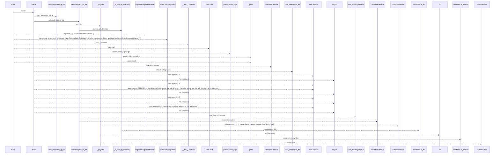
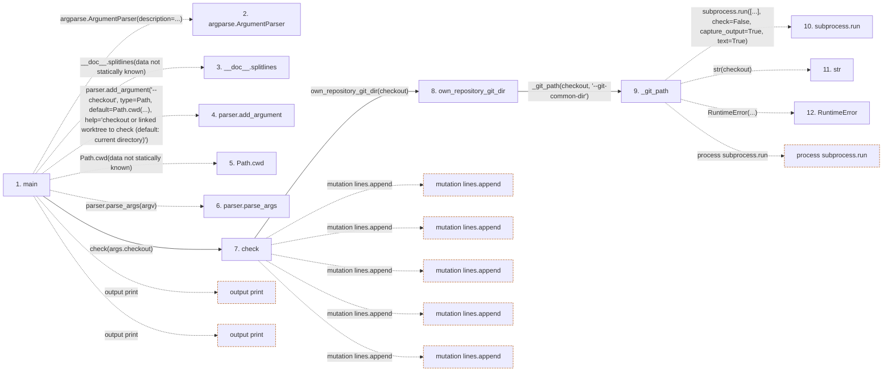

# wiki_lock_root_preflight

**Entry point:** `main` (`process`)
**Source:** [wiki_lock_root_preflight](../modules/wiki_lock_root_preflight.md)
**Modules touched:** [wiki_lock_root_preflight](../modules/wiki_lock_root_preflight.md)

## Call sequence

> Static overview in presentation order, not runtime execution order. Arrows retain captured callers; representative internal continuations and boundary examples precede repeated helper detail.

<!-- Auto-generated from static call edges. Dashed arrows are external or unresolved calls. Reviewed runtime conditions and side effects belong in Behavior. -->

> Call sequence diagram shows 30 of 34 interactions; 4 omitted to keep the visualization within the 30-interaction and generated-diagram limits, with uncertain identities omitted rather than inferred.

> Captured boundary calls: external 8 of 9 (1 omitted); unresolved 17 of 20 (3 omitted). These counts cover the captured static trace.

Omitted captured detail, grouped by actual caller occurrence and target module:

| Caller | Parent step | Target module | Kind | Omitted interactions |
| --- | --- | --- | --- | --- |
| `scripts/ci/wiki_lock_root_preflight.py:_git_path` | 9 | - | unresolved | 3 |
| `scripts/ci/wiki_lock_root_preflight.py:_git_path` | 9 | - | external | 1 |
> Detailed flow queries retain their own coverage and limits; omitted paths may execute at runtime.

## Data flow

<!-- Auto-generated static analysis. Treat values and boundaries as best-effort hints, not runtime proof. -->

### Analysis coverage

**Effect analysis evaluated.** Flow assembly and source effect analysis are separate; empty observations do not prove an empty handler body.

Source steps: 6; effect analysis evaluated: 6, partial: 0, unavailable: 0. Counts include steps omitted from the displayed trace.

Collector observations for 6 source steps with known totals: observed: 29, emitted: 29, omitted: 0. Unavailable totals are excluded.

### Step data

| Step | Inputs | Reads | Writes | Returns |
|---|---|---|---|---|
| `main` | `argv: list[str] \| None` | `Path`, `sys` | - | `1`, `...` |
| `argparse.ArgumentParser` | - | - | - | - |
| `__doc__.splitlines` | - | - | - | - |
| `parser.add_argument` | - | - | - | - |
| `Path.cwd` | - | - | - | - |
| `parser.parse_args` | - | - | - | - |
| `check` | `checkout: Path` | `WIKI_DIRECTORY` | - | `(...)`, `(...)`, `(...)`, `(...)` |
| `own_repository_git_dir` | `checkout: Path` | - | - | `_git_path(...)` |
| `_git_path` | `checkout: Path`, `args: str` | - | - | `...` |
| `subprocess.run` | - | - | - | - |
| `str` | - | - | - | - |
| `RuntimeError` | - | - | - | - |

### Call data

| From | To | Line | Call |
|---|---|---:|---|
| main | argparse.ArgumentParser | 92 | `argparse.ArgumentParser(description=...)` |
| main | __doc__.splitlines | 92 | `__doc__.splitlines(data not statically known)` |
| main | parser.add_argument | 93 | `parser.add_argument('--checkout', type=Path, default=Path.cwd(...), help='checkout or linked worktree to check (default: current directory)')` |
| main | Path.cwd | 96 | `Path.cwd(data not statically known)` |
| main | parser.parse_args | 99 | `parser.parse_args(argv)` |
| main | check | 101 | `check(args.checkout)` |
| check | own_repository_git_dir | 63 | `own_repository_git_dir(checkout)` |
| own_repository_git_dir | _git_path | 43 | `_git_path(checkout, '--git-common-dir')` |
| _git_path | subprocess.run | 26 | `subprocess.run([...], check=False, capture_output=True, text=True)` |
| _git_path | str | 27 | `str(checkout)` |
| _git_path | RuntimeError | 33 | `RuntimeError(...)` |

### Boundary effects

| Kind | Target | Step | Line |
|---|---|---|---:|
| output | `print` | `main` | 103 |
| output | `print` | `main` | 105 |
| mutation | `lines.append` | `check` | 70 |
| mutation | `lines.append` | `check` | 73 |
| mutation | `lines.append` | `check` | 75 |
| mutation | `lines.append` | `check` | 81 |
| mutation | `lines.append` | `check` | 87 |
| process | `subprocess.run` | `_git_path` | 26 |

### Static analysis gaps

| Kind | Step | Target | Line |
|---|---|---|---:|
| external_call | `main` | `argparse.ArgumentParser` | 92 |
| external_call | `main` | `__doc__.splitlines` | 92 |
| unresolved_call | `main` | `parser.add_argument` | 93 |
| external_call | `main` | `Path.cwd` | 96 |
| unresolved_call | `main` | `parser.parse_args` | 99 |
| external_call | `_git_path` | `RuntimeError` | 33 |
| step_limit | `main` | `first 12 steps` | 0 |

## Behavior

Reads Git metadata only and never opens a lock or runs the wiki writer. It resolves the nearest real directory named `.git` above the wiki directory, as the installed writer does, and compares it with the checkout's own repository directory. Exit 0 means the writer's locks stay inside this repository; exit 1 means they would not or cannot be determined, and the writer must then be run from an isolated clone.
