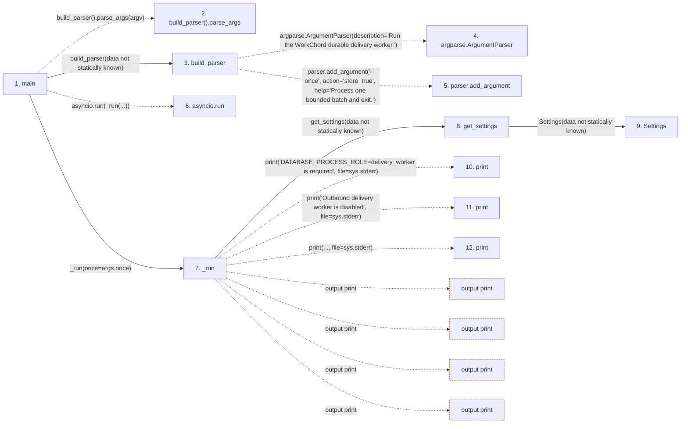

# worker

**Entry point:** `main` (`process`)
**Source:** [worker](../modules/worker.md)
**Modules touched:** [app_database](../modules/app_database.md), [commands](../modules/commands.md), [config](../modules/config.md), [database_runtime](../modules/database_runtime.md), and 6 more

**Complete modules touched:**

- [app_database](../modules/app_database.md)
- [commands](../modules/commands.md)
- [config](../modules/config.md)
- [database_runtime](../modules/database_runtime.md)
- [discussion_service](../modules/discussion_service.md)
- [maintenance](../modules/maintenance.md)
- [outbound_webhook_service](../modules/outbound_webhook_service.md)
- [time](../modules/time.md)
- [upgrade_service](../modules/upgrade_service.md)
- [worker](../modules/worker.md)

**Related modules:** [app_database](../modules/app_database.md), [config](../modules/config.md), [outbound_webhook_service](../modules/outbound_webhook_service.md)

## Call sequence

> Static overview in presentation order, not runtime execution order. Arrows retain captured callers; representative internal continuations and boundary examples precede repeated helper detail.

```mermaid
sequenceDiagram
    participant p0 as main
    participant p1 as _run
    participant p2 as build_parser
    participant p3 as get_settings
    participant p4 as init_db
    participant p5 as run_due_outbound_delivery_jobs
    participant p6 as outbound_delivery_worker_loop
    participant p7 as assert_database_current
    participant p8 as require_background_writes_enabled
    participant p9 as OutboundWebhookService.run_due_jobs
    participant p10 as inspect_database
    participant p11 as OutboundWebhookService.claim_due_deliveries
    participant p12 as OutboundWebhookService.process_claimed_delivery
    participant p13 as _inspect_database_connection
    participant p14 as _sync_engine
    participant p15 as OutboundWebhookService._claim_due_postgresql
    participant p16 as commit_or_flush
    participant p17 as OutboundWebhookService._attempt_delivery
    participant p18 as OutboundWebhookService._claim_delivery_id
    participant p19 as close_database
    participant p20 as Settings
    participant p21 as OutboundWebhookService
    participant p22 as UpgradeError
    participant p23 as MaintenanceModeError
    participant p24 as as_utc
    participant p25 as utc_now
    participant p26 as OutboundWebhookService._claim_conditions
    participant p27 as database_configuration
    participant p28 as run_database_retry
    participant p29 as asyncio.run
    participant p30 as build_parser().parse_args
    p0->>p1: _run
    p0->>p2: build_parser
    p1->>p3: get_settings
    p1->>p4: init_db
    p1->>p5: run_due_outbound_delivery_jobs
    p1->>p6: outbound_delivery_worker_loop
    p4->>p7: assert_database_current
    p5->>p8: require_background_writes_enabled
    p5->>p9: OutboundWebhookService.run_due_jobs
    p7->>p10: inspect_database
    p9->>p11: OutboundWebhookService.claim_due_deliveries
    p9->>p12: OutboundWebhookService.process_claimed_delivery
    p10->>p13: _inspect_database_connection
    p10->>p14: _sync_engine
    p11->>p15: OutboundWebhookService._claim_due_postgresql
    p12->>p16: commit_or_flush
    p12->>p17: OutboundWebhookService._attempt_delivery
    p11->>p18: OutboundWebhookService._claim_delivery_id
    p1->>p19: close_database
    p3->>p20: Settings
    p5->>p21: OutboundWebhookService
    p7->>p22: UpgradeError
    p8->>p23: MaintenanceModeError
    p11->>p24: as_utc
    p11->>p25: utc_now
    p11->>p26: OutboundWebhookService._claim_conditions
    p14->>p27: database_configuration
    p15->>p28: run_database_retry
    p0-->>p29: asyncio.run(_run(...))
    p0-->>p30: build_parser().parse_args(argv)
```

<!-- Auto-generated from static call edges. Dashed arrows are external or unresolved calls. Reviewed runtime conditions and side effects belong in Behavior. -->

> Call sequence diagram shows 30 of 131 interactions; 101 omitted to keep the visualization within the 30-interaction and generated-diagram limits, with uncertain identities omitted rather than inferred.

> Captured boundary calls: external 1 of 31 (30 omitted); unresolved 1 of 52 (51 omitted). These counts cover the captured static trace.

Omitted captured detail, grouped by actual caller occurrence and target module:

| Caller | Parent step | Target module | Kind | Omitted interactions |
| --- | --- | --- | --- | --- |
| `backend/app/cli/worker.py:build_parser` | 3 | - | external | 1 |
| `backend/app/cli/worker.py:build_parser` | 3 | - | unresolved | 1 |
| `backend/app/cli/worker.py:_run` | 7 | - | external | 6 |
| `backend/app/services/upgrade_service.py:_inspect_database_connection` | 16 | - | external | 4 |
| `backend/app/services/upgrade_service.py:_inspect_database_connection` | 16 | - | unresolved | 1 |
| `backend/app/services/upgrade_service.py:_inspect_database_connection` | 16 | [backend/app/services/upgrade_service.py](../modules/upgrade_service.md) | internal | 3 |
| `backend/app/services/upgrade_service.py:_sync_engine` | 25 | - | external | 2 |
| `backend/app/services/upgrade_service.py:inspect_database` | 15 | - | unresolved | 2 |
> Omission summary shows 8 of 39 groups; 31 further groups are not expanded here. Counts above include all omitted interactions.
> Detailed flow queries retain their own coverage and limits; omitted paths may execute at runtime.

> Trace truncated at the depth limit; deeper calls are omitted.

## Data flow

<!-- Auto-generated static analysis. Treat values and boundaries as best-effort hints, not runtime proof. -->

### Analysis coverage

**Effect analysis partially available.** Flow assembly and source effect analysis are separate; empty observations do not prove an empty handler body.

Source steps: 49; effect analysis evaluated: 41, partial: 1, unavailable: 7. Counts include steps omitted from the displayed trace.

Collector observations for 42 source steps with known totals: observed: 185, emitted: 173, omitted: 12. Unavailable totals are excluded.

- Callable record unavailable for one or more source steps; those steps have no represented callable body.
- Effect collector omitted observations before flow assembly; displayed effects are partial.
- Effect collector totals unavailable; observed counts cover captured records only.

| Step | Callable record | Effect analysis | Collector totals | Observed | Emitted | Omitted |
|---|---|---|---|---:|---:|---:|
| `main` | `available` | `evaluated` | `available` | `2` | `2` | `0` |
| `build_parser().parse_args` | `not_applicable` | `not_applicable` | `not_applicable` | — | — | — |
| `build_parser` | `available` | `evaluated` | `available` | `1` | `1` | `0` |
| `argparse.ArgumentParser` | `not_applicable` | `not_applicable` | `not_applicable` | — | — | — |
| `parser.add_argument` | `not_applicable` | `not_applicable` | `not_applicable` | — | — | — |
| `asyncio.run` | `not_applicable` | `not_applicable` | `not_applicable` | — | — | — |
| `_run` | `available` | `evaluated` | `available` | `14` | `14` | `0` |
| `get_settings` | `available` | `evaluated` | `available` | `1` | `1` | `0` |
| `Settings` | `unavailable` | `unavailable` | `unavailable` | — | — | — |
| `print` | `not_applicable` | `not_applicable` | `not_applicable` | — | — | — |
| `print` | `not_applicable` | `not_applicable` | `not_applicable` | — | — | — |
| `print` | `not_applicable` | `not_applicable` | `not_applicable` | — | — | — |

### Step data

| Step | Inputs | Reads | Writes | Returns |
|---|---|---|---|---|
| `main` | `argv: Optional[list[str]]` | - | - | `asyncio.run(...)` |
| `build_parser().parse_args` | - | - | - | - |
| `build_parser` | - | - | - | `parser` |
| `argparse.ArgumentParser` | - | - | - | - |
| `parser.add_argument` | - | - | - | - |
| `asyncio.run` | - | - | - | - |
| `_run` | `once: bool` | `sys`, `sys`, `sys`, `signal` | - | `2`, `2`, `0`, `0`, `0` |
| `get_settings` | - | - | - | `Settings(...)` |
| `Settings` | - | - | - | - |
| `print` | - | - | - | - |
| `print` | - | - | - | - |
| `print` | - | - | - | - |

### Call data

| From | To | Line | Call |
|---|---|---:|---|
| main | build_parser().parse_args | 76 | `build_parser().parse_args(argv)` |
| main | build_parser | 76 | `build_parser(data not statically known)` |
| build_parser | argparse.ArgumentParser | 20 | `argparse.ArgumentParser(description='Run the WorkChord durable delivery worker.')` |
| build_parser | parser.add_argument | 23 | `parser.add_argument('--once', action='store_true', help='Process one bounded batch and exit.')` |
| main | asyncio.run | 77 | `asyncio.run(_run(...))` |
| main | _run | 77 | `_run(once=args.once)` |
| _run | get_settings | 32 | `get_settings(data not statically known)` |
| get_settings | Settings | 481 | `Settings(data not statically known)` |
| _run | print | 34 | `print('DATABASE_PROCESS_ROLE=delivery_worker is required', file=sys.stderr)` |
| _run | print | 40 | `print('Outbound delivery worker is disabled', file=sys.stderr)` |
| _run | print | 43 | `print(..., file=sys.stderr)` |

### Boundary effects

| Kind | Target | Step | Line |
|---|---|---|---:|
| output | `print` | `_run` | 34 |
| output | `print` | `_run` | 40 |
| output | `print` | `_run` | 43 |
| output | `print` | `_run` | 55 |

### Static analysis gaps

| Kind | Step | Target | Line |
|---|---|---|---:|
| unresolved_call | `main` | `build_parser().parse_args` | 76 |
| external_call | `build_parser` | `argparse.ArgumentParser` | 20 |
| unresolved_call | `build_parser` | `parser.add_argument` | 23 |
| external_call | `main` | `asyncio.run` | 77 |
| step_limit | `main` | `first 12 steps` | 0 |
| truncated_flow | `main` | `depth limit` | 0 |

## Behavior

This flow starts at `main` and is classified as `process`. The generated call and data-flow sections are bounded static projections; runtime conditions and side effects require source-level confirmation.
