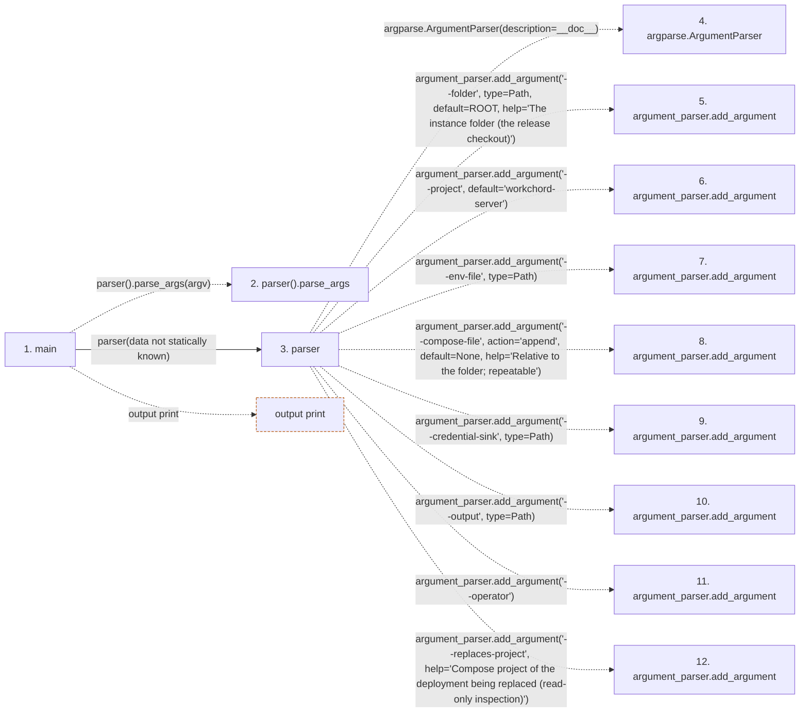

# write_deployment_record

**Entry point:** `main` (`process`)
**Source:** [write_deployment_record](../modules/write_deployment_record.md)
**Modules touched:** [write_deployment_record](../modules/write_deployment_record.md)

## Call sequence

> Static overview in presentation order, not runtime execution order. Arrows retain captured callers; representative internal continuations and boundary examples precede repeated helper detail.

```mermaid
sequenceDiagram
    participant p0 as main
    participant p1 as build_record
    participant p2 as parser
    participant p3 as write_record
    participant p4 as project_volumes
    participant p5 as compose_images
    participant p6 as source_identity
    participant p7 as replaced_deployment
    participant p8 as project_images
    participant p9 as container_service
    participant p10 as image_identity
    participant p11 as database_volumes
    participant p12 as release_version
    participant p13 as parse_json_lines
    participant p14 as git
    participant p15 as docker
    participant p16 as Path (scripts/server/write_deployment_record.py:main)
    participant p17 as parser().parse_args
    participant p18 as args.folder.resolve
    participant p19 as print
    participant p20 as argparse.ArgumentParser
    participant p21 as Path(…).resolve
    participant p22 as Path (scripts/server/write_depl…nt_record.py:write_record)
    participant p23 as argument_parser.add_argument
    participant p24 as Path (scripts/server/write_depl…nt_record.py:build_record)
    participant p25 as destination.parent.mkdir
    participant p26 as str (scripts/server/write_depl…nt_record.py:build_record)
    participant p27 as destination.is_file (scripts/server/write_depl…nt_record.py:write_record)
    p0->>p1: build_record
    p0->>p2: parser
    p0->>p3: write_record
    p1->>p4: project_volumes
    p1->>p5: compose_images
    p1->>p6: source_identity
    p1->>p7: replaced_deployment
    p7->>p8: project_images
    p5->>p9: container_service
    p5->>p10: image_identity
    p1->>p11: database_volumes
    p1->>p12: release_version
    p5->>p13: parse_json_lines
    p6->>p14: git
    p4->>p15: docker
    p0-->>p16: Path (scripts/server/write_deployment_record.py:main)(destination)
    p0-->>p17: parser().parse_args(argv)
    p0-->>p18: args.folder.resolve
    p0-->>p19: print(...)
    p2-->>p20: argparse.ArgumentParser(description=__doc__)
    p1-->>p21: Path(…).resolve
    p3-->>p22: Path (scripts/server/write_depl…nt_record.py:write_record)(destination)
    p2-->>p23: argument_parser.add_argument('--folder', type=Path, default=ROOT, help='The instance folder (the release checkout)')
    p1-->>p24: Path (scripts/server/write_depl…nt_record.py:build_record)(args.folder)
    p3-->>p25: destination.parent.mkdir(parents=True, exist_ok=True)
    p2-->>p23: argument_parser.add_argument('--project', default='workchord-server')
    p1-->>p26: str (scripts/server/write_depl…nt_record.py:build_record)(...)
    p3-->>p27: destination.is_file (scripts/server/write_depl…nt_record.py:write_record)
    p2-->>p23: argument_parser.add_argument('--env-file', type=Path)
    p1-->>p26: str (scripts/server/write_depl…nt_record.py:build_record)(Path(...))
```

<!-- Auto-generated from static call edges. Dashed arrows are external or unresolved calls. Reviewed runtime conditions and side effects belong in Behavior. -->

> Call sequence diagram shows 30 of 128 interactions; 98 omitted to keep the visualization within the 30-interaction and generated-diagram limits, with uncertain identities omitted rather than inferred.

> Captured boundary calls: external 7 of 40 (33 omitted); unresolved 8 of 64 (56 omitted). These counts cover the captured static trace.

Omitted captured detail, grouped by actual caller occurrence and target module:

| Caller | Parent step | Target module | Kind | Omitted interactions |
| --- | --- | --- | --- | --- |
| `scripts/server/write_deployment_record.py:parser` | 3 | - | unresolved | 8 |
| `scripts/server/write_deployment_record.py:build_record` | 18 | - | external | 9 |
| `scripts/server/write_deployment_record.py:database_volumes` | 24 | - | unresolved | 1 |
| `scripts/server/write_deployment_record.py:project_volumes` | 26 | - | unresolved | 1 |
| `scripts/server/write_deployment_record.py:docker` | 28 | - | unresolved | 1 |
| `scripts/server/write_deployment_record.py:docker` | 28 | - | external | 1 |
| `scripts/server/write_deployment_record.py:project_volumes` | 26 | - | external | 1 |
| `scripts/server/write_deployment_record.py:parse_json_lines` | 33 | - | unresolved | 4 |
> Omission summary shows 8 of 33 groups; 25 further groups are not expanded here. Counts above include all omitted interactions.
> Detailed flow queries retain their own coverage and limits; omitted paths may execute at runtime.

## Data flow

<!-- Auto-generated static analysis. Treat values and boundaries as best-effort hints, not runtime proof. -->

### Analysis coverage

**Effect analysis evaluated.** Flow assembly and source effect analysis are separate; empty observations do not prove an empty handler body.

Source steps: 25; effect analysis evaluated: 25, partial: 0, unavailable: 0. Counts include steps omitted from the displayed trace.

Collector observations for 25 source steps with known totals: observed: 83, emitted: 83, omitted: 0. Unavailable totals are excluded.

### Step data

| Step | Inputs | Reads | Writes | Returns |
|---|---|---|---|---|
| `main` | `argv` | `RECORD_NAME` | `args.env_file`, `args.compose_file`, `args.credential_sink` | - |
| `parser().parse_args` | - | - | - | - |
| `parser` | - | `Path`, `ROOT`, `Path`, `Path`, `Path`, `Path` | - | `argument_parser` |
| `argparse.ArgumentParser` | - | - | - | - |
| `argument_parser.add_argument` | - | - | - | - |
| `argument_parser.add_argument` | - | - | - | - |
| `argument_parser.add_argument` | - | - | - | - |
| `argument_parser.add_argument` | - | - | - | - |
| `argument_parser.add_argument` | - | - | - | - |
| `argument_parser.add_argument` | - | - | - | - |
| `argument_parser.add_argument` | - | - | - | - |
| `argument_parser.add_argument` | - | - | - | - |

### Call data

| From | To | Line | Call |
|---|---|---:|---|
| main | parser().parse_args | 192 | `parser().parse_args(argv)` |
| main | parser | 192 | `parser(data not statically known)` |
| parser | argparse.ArgumentParser | 176 | `argparse.ArgumentParser(description=__doc__)` |
| parser | argument_parser.add_argument | 177 | `argument_parser.add_argument('--folder', type=Path, default=ROOT, help='The instance folder (the release checkout)')` |
| parser | argument_parser.add_argument | 178 | `argument_parser.add_argument('--project', default='workchord-server')` |
| parser | argument_parser.add_argument | 179 | `argument_parser.add_argument('--env-file', type=Path)` |
| parser | argument_parser.add_argument | 180 | `argument_parser.add_argument('--compose-file', action='append', default=None, help='Relative to the folder; repeatable')` |
| parser | argument_parser.add_argument | 181 | `argument_parser.add_argument('--credential-sink', type=Path)` |
| parser | argument_parser.add_argument | 182 | `argument_parser.add_argument('--output', type=Path)` |
| parser | argument_parser.add_argument | 183 | `argument_parser.add_argument('--operator')` |
| parser | argument_parser.add_argument | 184 | `argument_parser.add_argument('--replaces-project', help='Compose project of the deployment being replaced (read-only inspection)')` |

### Boundary effects

| Kind | Target | Step | Line |
|---|---|---|---:|
| output | `print` | `main` | 202 |

### Static analysis gaps

| Kind | Step | Target | Line |
|---|---|---|---:|
| unresolved_call | `main` | `parser().parse_args` | 192 |
| external_call | `parser` | `argparse.ArgumentParser` | 176 |
| unresolved_call | `parser` | `argument_parser.add_argument` | 177 |
| unresolved_call | `parser` | `argument_parser.add_argument` | 178 |
| unresolved_call | `parser` | `argument_parser.add_argument` | 179 |
| unresolved_call | `parser` | `argument_parser.add_argument` | 180 |
| unresolved_call | `parser` | `argument_parser.add_argument` | 181 |
| unresolved_call | `parser` | `argument_parser.add_argument` | 182 |
| unresolved_call | `parser` | `argument_parser.add_argument` | 183 |
| unresolved_call | `parser` | `argument_parser.add_argument` | 184 |
| step_limit | `main` | `first 12 steps` | 0 |

## Behavior

Writes the deployment record of a self-hosted instance atomically: the exact image identities of every service, source revision, release version, Compose project, folder, database volumes, time, operator and the deployment it replaces. An existing record is archived first, and the record holds paths and identities but no secrets.
