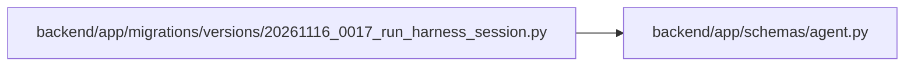

# 20261116_0017_run_harness_session Module

**Path:** `backend/app/migrations/versions/20261116_0017_run_harness_session.py`

## Description

Keep a run's declared harness session in columns a reader can search.

## Imports

| Source | Symbols |
|--------|---------|
| `alembic` | `op` |
| `app.schemas.agent` | `check_harness_identity` |
| `json` | `json` |
| `sqlalchemy` | `sa` |

## Local dependency map

<!-- Auto-generated local dependency summary. Do not edit by hand. -->

### Internal neighbors

| Direction | Module |
|---|---|
| Outbound | [schemas_agent](../modules/schemas_agent.md) |

### External packages

| Language | Used packages | Undeclared packages |
|---|---:|---:|
| python | 2 | 0 |

## Functions

| Function | Signature | Decorators | Description |
|----------|-----------|------------|-------------|
| `_declared` | `(metadata)` | — | — |
| `upgrade` | `()` | — | — |
| `downgrade` | `()` | — | — |
